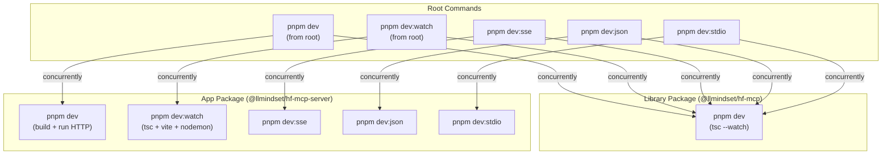
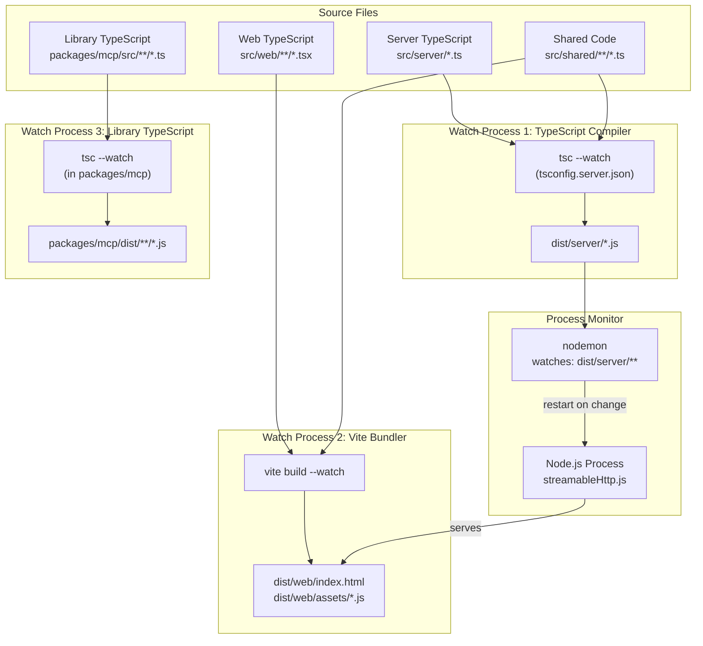
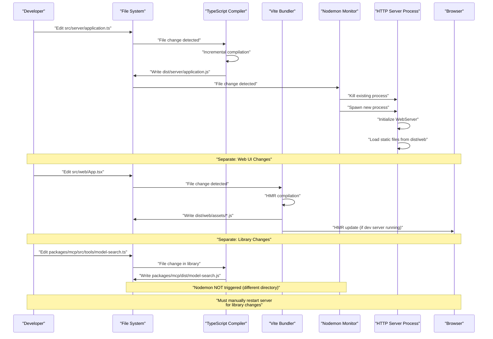
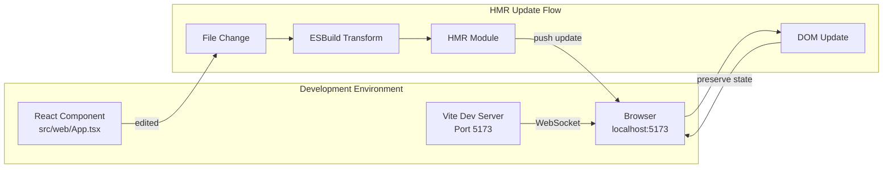
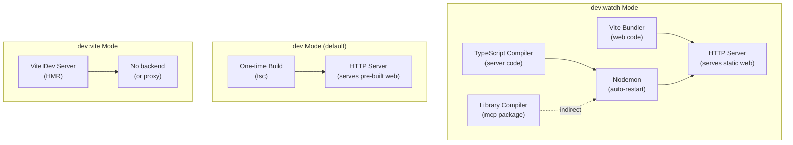

<!-- source: DeepWiki mcp.deepwiki.com · repo huggingface/hf-mcp-server · page 9.2 Development Workflow · fetched 2026-10-26 -->

# Development Workflow

<details>
<summary>Relevant source files</summary>

The following files were used as context for generating this wiki page:

- [package.json](package.json)
- [packages/app/package.json](packages/app/package.json)
- [packages/mcp/package.json](packages/mcp/package.json)
- [pnpm-lock.yaml](pnpm-lock.yaml)

</details>


This document describes the development workflow for the HF MCP Server codebase, including hot reload setup, concurrent watch modes, development scripts, and debugging patterns. For information about the build system and production compilation, see [Build System](#9.1). For testing infrastructure, see [Testing](#9.3).

## Overview

The HF MCP Server uses a monorepo structure with two packages that require different compilation strategies. The development workflow is designed to support rapid iteration through:

- **TypeScript watch mode** for server-side code compilation
- **Vite HMR** (Hot Module Replacement) for web UI development
- **Nodemon** for automatic server restarts
- **Concurrent execution** of multiple watch processes
- **Transport-specific dev modes** for testing different client connection types

---

## Development Scripts Reference

The project provides multiple development entry points through npm scripts defined across three `package.json` files. The scripts are organized hierarchically from root to package-specific commands.

### Root-Level Development Scripts

The root [package.json:7-12]() defines monorepo-wide development commands:

| Script | Purpose | Packages Involved |
|--------|---------|-------------------|
| `pnpm dev` | Default development mode (HTTP transport) | `@llmindset/hf-mcp`, `@llmindset/hf-mcp-server` |
| `pnpm dev:sse` | SSE transport development | Both packages |
| `pnpm dev:json` | Stateless JSON transport development | Both packages |
| `pnpm dev:watch` | Full hot-reload watch mode | Both packages |
| `pnpm dev:stdio` | STDIO transport development | Both packages |

Each root script executes corresponding scripts in both packages concurrently using the `concurrently` utility.

### Application Package Scripts

The [packages/app/package.json:40-46]() defines application-specific development commands:

| Script | Command | Description |
|--------|---------|-------------|
| `dev` | `build:server && node dist/server/streamableHttp.js` | Build then run HTTP server |
| `dev:vite` | `vite dev` | Run Vite dev server only (port 5173) |
| `dev:widget` | `vite dev` | Run widget dev server |
| `dev:stdio` | `build:server && node dist/server/stdio.js` | Build then run STDIO transport |
| `dev:sse` | `build:server && node dist/server/sse.js` | Build then run SSE transport |
| `dev:json` | `build:server && node dist/server/streamableHttp.js --json` | Build then run stateless JSON mode |
| `dev:watch` | `concurrently "tsc -p tsconfig.server.json --watch" "vite build --watch" "nodemon dist/server/streamableHttp.js --json"` | Full hot-reload mode |

### Library Package Scripts

The [packages/mcp/package.json:28]() defines the library development command:

| Script | Command | Description |
|--------|---------|-------------|
| `dev` | `tsc --watch` | TypeScript watch mode for library compilation |

**Development Script Hierarchy**



Sources: [package.json:7-12](), [packages/app/package.json:40-46](), [packages/mcp/package.json:28]()

---

## Watch Mode Architecture

Watch mode enables continuous development by automatically recompiling and restarting components when source files change. The system uses three concurrent watch processes that operate independently.

### Concurrent Watch Processes

The `dev:watch` script ([packages/app/package.json:46]()) runs three processes simultaneously using `concurrently`:

1. **TypeScript Watch**: `tsc -p tsconfig.server.json --watch`
2. **Vite Watch**: `vite build --watch`
3. **Nodemon**: `nodemon dist/server/streamableHttp.js --json`

**Watch Mode Process Architecture**



### File Change Detection Flow

When a developer modifies source files, the following sequence occurs:



Sources: [packages/app/package.json:46](), [package.json:11]()

---

## Hot Reload Mechanisms

The development environment provides two distinct hot reload mechanisms for different parts of the codebase.

### Server-Side Hot Reload (Nodemon)

Server-side code uses **Nodemon** for automatic process restarts. Nodemon watches the `dist/server` directory and restarts the Node.js process when changes are detected.

**Nodemon Configuration** (inferred from [packages/app/package.json:46]()):

- **Watched directory**: `dist/server/**` (implicit)
- **Entry point**: `dist/server/streamableHttp.js`
- **Restart delay**: Default (usually 1 second)
- **Ignored patterns**: None specified (watches all changes)

**Restart Behavior**:

1. TypeScript compiler writes to `dist/server/*.js`
2. Nodemon detects file change
3. Current server process receives `SIGTERM`
4. New process spawns with fresh module imports
5. WebServer reinitializes (port binding, transport setup)

**Limitations**:

- Full process restart required (no in-place module replacement)
- Active client connections are dropped
- Server state is lost (sessions, metrics)
- Restart time typically 1-3 seconds

### Client-Side Hot Reload (Vite HMR)

Web UI code uses **Vite's Hot Module Replacement** for instant updates without page refresh.

**Vite Dev Server Configuration**:

- **Dev server**: `vite dev` ([packages/app/package.json:41]())
- **Port**: 5173 (default)
- **HMR protocol**: WebSocket
- **Build target**: Modern browsers (ESM)

**HMR Process**:



**React Fast Refresh**:

Vite uses the `@vitejs/plugin-react-swc` plugin ([packages/app/package.json:95]()) which enables React Fast Refresh. This preserves component state during hot updates.

**HMR-Safe Components**:

- Components must be default exports or named exports
- No class components (use function components)
- Hooks must follow React rules
- State preservation works for local component state

Sources: [packages/app/package.json:41](), [packages/app/package.json:95]()

---

## Development Workflow Patterns

### Standard Development Workflow

The typical development workflow for working on both server and web code:

**Step 1: Start Watch Mode**

```bash
# From repository root
pnpm dev:watch
```

This starts three concurrent processes:
- TypeScript compiler watching `packages/mcp/src` and `packages/app/src/server`
- Vite bundler watching `packages/app/src/web`
- Nodemon monitoring `packages/app/dist/server`

**Step 2: Access Development Server**

- **Web UI**: http://localhost:3000
- **API endpoints**: http://localhost:3000/api/*
- **MCP endpoint**: http://localhost:3000/mcp

**Step 3: Make Changes**

- Edit server code → automatic restart via Nodemon
- Edit web code → instant HMR update (if using Vite dev server)
- Edit library code → automatic recompilation, manual server restart required

### Transport-Specific Development

Different MCP clients use different transport mechanisms. Test specific transports during development:

**HTTP Transport Development** ([packages/app/package.json:40]()):

```bash
pnpm dev  # Uses StreamableHTTP transport
```

Access via: `http://localhost:3000/mcp`

**SSE Transport Development** ([packages/app/package.json:44]()):

```bash
pnpm dev:sse
```

Endpoints:
- GET `/sse` - Establish SSE connection
- POST `/message` - Send messages

**STDIO Transport Development** ([packages/app/package.json:43]()):

```bash
pnpm dev:stdio
```

Uses stdin/stdout, suitable for Claude Code integration testing.

**Stateless JSON Mode** ([packages/app/package.json:45]()):

```bash
pnpm dev:json
```

Uses `StatelessHTTPTransport` with no persistent sessions.

### Vite-Only Development

For rapid web UI development without running the full MCP server:

```bash
cd packages/app
pnpm dev:vite
```

This runs only the Vite dev server on port 5173. Use this when:
- Working exclusively on UI components
- Testing visual changes
- Need fastest HMR performance

**Limitation**: API endpoints won't work (mock them or proxy to running server).

**Development Mode Comparison**



Sources: [packages/app/package.json:40-46]()

---

## Environment Configuration

Development mode respects environment variables for configuration. Set these before running dev scripts:

**Development Environment Variables**:

| Variable | Purpose | Default (dev) |
|----------|---------|---------------|
| `NODE_ENV` | Runtime environment | `development` |
| `PORT` | HTTP server port | `3000` |
| `HF_TOKEN` | Hugging Face API token | (from client or env) |
| `USER_CONFIG_API` | External settings API URL | (none) |
| `LOG_LEVEL` | Pino logging level | `info` |

**Setting Variables**:

```bash
# Cross-platform approach using cross-env
pnpm dev  # NODE_ENV=development set automatically

# Custom port
PORT=8080 pnpm dev

# With HF token for testing auth-required endpoints
HF_TOKEN=hf_xxxxx pnpm dev
```

The [packages/app/package.json:40]() scripts use `cross-env` to ensure consistent behavior across platforms (Windows, macOS, Linux).

Sources: [packages/app/package.json:40-48]()

---

## Debugging Setup

### Node.js Debugging

Debug the server process using Node.js built-in inspector:

**Step 1: Modify the dev script** (temporary change):

```bash
# In packages/app
node --inspect dist/server/streamableHttp.js
```

**Step 2: Attach debugger**:

- **VS Code**: Use "Attach to Node Process" configuration
- **Chrome DevTools**: Navigate to `chrome://inspect`
- **Command line**: Use `node inspect`

**Breakpoint Locations**:

- `src/server/application.ts` - Server initialization
- `src/server/transports/*.ts` - Request handling
- `packages/mcp/src/tools/**/*.ts` - Tool implementations

### TypeScript Source Maps

Both TypeScript compilations ([packages/app/package.json:35](), [packages/mcp/package.json:26]()) generate source maps by default. This enables:

- Debugging TypeScript source instead of compiled JavaScript
- Accurate stack traces pointing to `.ts` files
- Breakpoints in original source files

Source maps are written adjacent to compiled files:
- `dist/server/**/*.js.map`
- `packages/mcp/dist/**/*.js.map`

### Browser Debugging

Debug the web UI using browser DevTools:

**React DevTools**:

Install React DevTools browser extension for:
- Component tree inspection
- Props and state examination
- Performance profiling

**Vite Dev Tools**:

Vite provides source maps automatically in dev mode. View original TypeScript/TSX source in browser DevTools Sources panel.

Sources: [packages/app/package.json:35](), [packages/mcp/package.json:26]()

---

## Build vs. Development Mode

Understanding the differences between build and development modes:

**Development Mode Characteristics**:

- Source maps enabled
- No minification
- Fast incremental compilation
- `NODE_ENV=development`
- Verbose logging
- Hot reload enabled
- Development dependencies available

**Production Build Characteristics** (see [Build System](#9.1) for details):

- No source maps (or separate files)
- Code minification
- `NODE_ENV=production`
- Optimized bundle sizes
- No hot reload
- Only production dependencies

**Key Files**:

| Aspect | Development | Production |
|--------|-------------|------------|
| TypeScript config | `tsconfig.server.json` | `tsconfig.server.json` |
| Vite config | `vite.config.ts` (dev mode) | `vite.config.ts` (build mode) |
| Output location | `dist/` (watched) | `dist/` (final) |
| Server startup | Via nodemon | Via `node` directly |

Sources: [packages/app/package.json:34-50]()

---

## Common Development Tasks

### Adding a New Tool

**Step 1**: Create tool implementation in `packages/mcp/src/tools/`

**Step 2**: Export from `packages/mcp/src/index.ts`

**Step 3**: Register in `packages/app/src/server/createServerFactory.ts`

**Step 4**: Watch compilation automatically picks up changes:
- Library: `tsc --watch` compiles new tool
- Server: Nodemon restarts to register tool

### Modifying Web UI

**Step 1**: Edit React components in `packages/app/src/web/`

**Step 2**: Changes automatically apply via HMR (if using `dev:vite`)

**Step 3**: Test in browser at http://localhost:5173 (Vite) or http://localhost:3000 (built)

### Testing Transport Changes

**Step 1**: Modify transport implementation in `packages/app/src/server/transports/`

**Step 2**: TypeScript watch recompiles

**Step 3**: Nodemon restarts server

**Step 4**: Test with appropriate client:
- STDIO: Claude Code CLI
- HTTP/SSE: Browser-based clients
- Test in isolation: `pnpm dev:stdio` or `pnpm dev:sse`

### Dependency Updates

**Step 1**: Update dependencies in appropriate `package.json`

**Step 2**: Run `pnpm install` from root

**Step 3**: Restart dev processes:

```bash
# Kill existing processes (Ctrl+C)
pnpm dev:watch
```

TypeScript and Vite will recompile with new dependencies.

Sources: [packages/app/package.json:58-110](), [packages/mcp/package.json:34-52]()

---

## Troubleshooting Development Issues

### Common Issues and Solutions

**Issue: Port Already in Use**

```
Error: listen EADDRINUSE: address already in use :::3000
```

**Solution**:
- Kill existing process: `lsof -ti:3000 | xargs kill -9` (Unix) or `taskkill /F /IM node.exe` (Windows)
- Change port: `PORT=3001 pnpm dev`

**Issue: TypeScript Compilation Errors**

**Solution**:
- Check [packages/app/package.json:54](): `pnpm typecheck` to see all errors
- Ensure `packages/mcp` is compiled: `cd packages/mcp && pnpm build`
- Clean and rebuild: `pnpm clean && pnpm build`

**Issue: Web UI Not Updating**

**Solution**:
- If using `dev` (not `dev:vite`): Vite runs in build mode, need full rebuild
- Switch to `pnpm dev:vite` for HMR
- Hard refresh browser: Ctrl+Shift+R
- Check console for HMR errors

**Issue: Nodemon Not Restarting**

**Solution**:
- Verify TypeScript is compiling: Check console output
- Ensure file changes in `dist/server/` directory
- Check nodemon is running: Look for "watching for file changes" message
- Manual restart: Kill and run `pnpm dev:watch` again

**Issue: Library Changes Not Reflecting**

**Solution**:
- Library watch only recompiles, doesn't restart server
- After library changes, restart server manually
- Or use full `pnpm dev:watch` from root which restarts on any change

Sources: [packages/app/package.json:34-56]()

---

