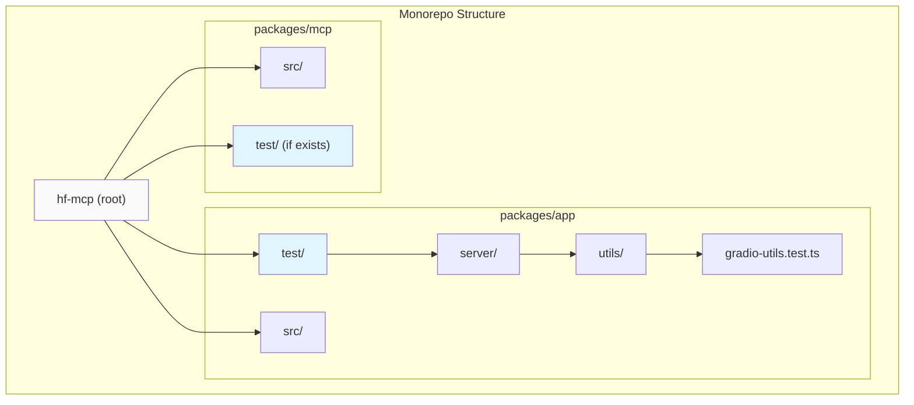
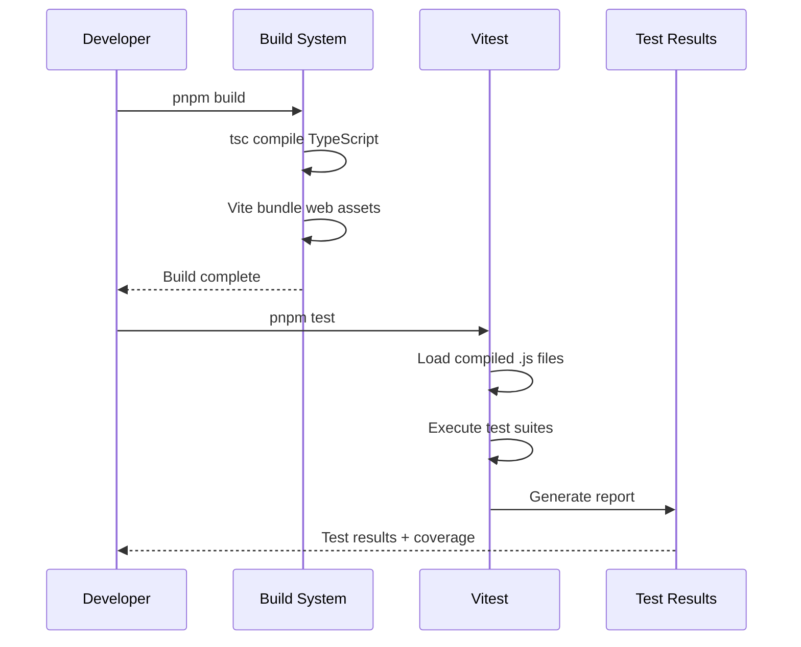
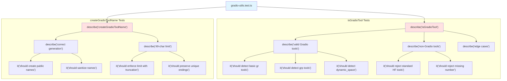
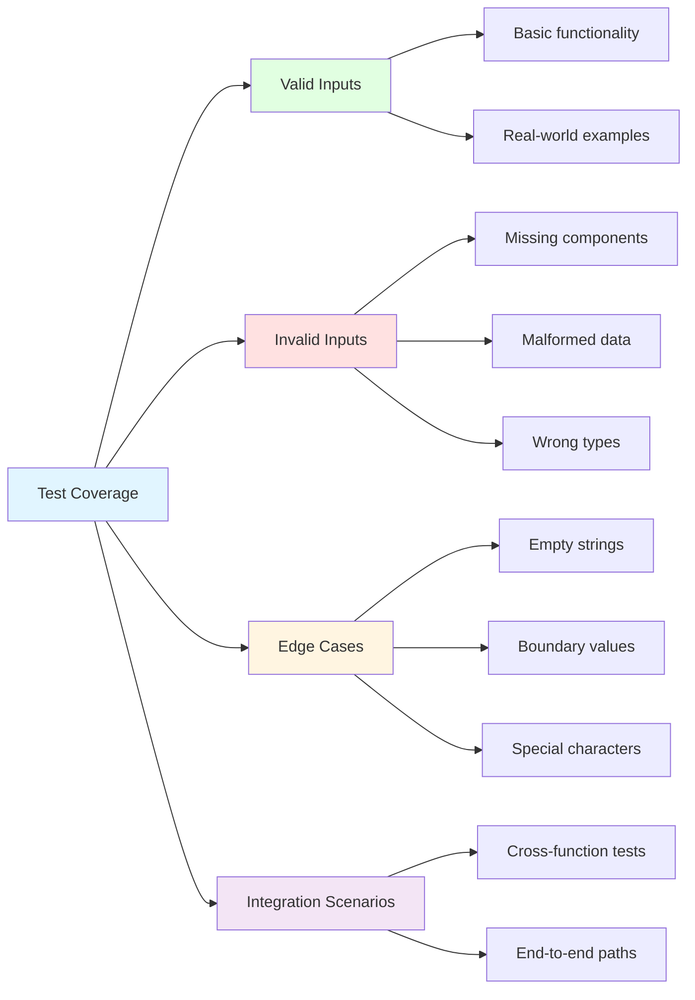
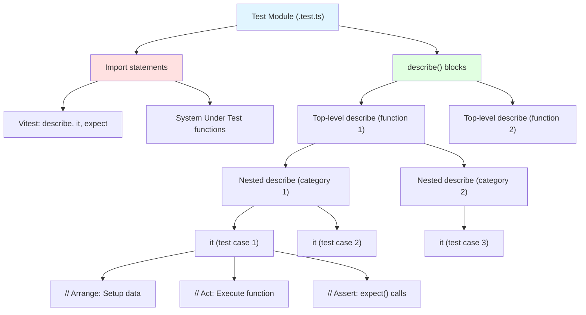
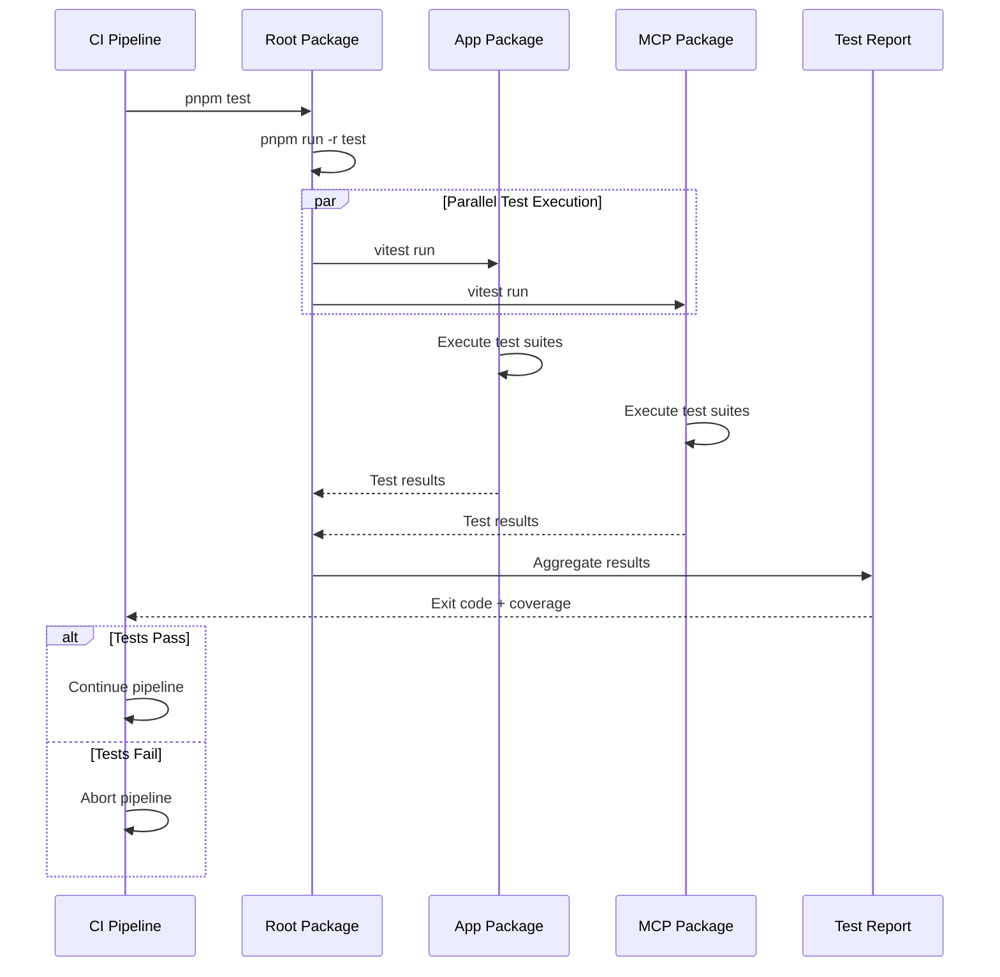

<!-- source: DeepWiki mcp.deepwiki.com · repo huggingface/hf-mcp-server · page 9.3 Testing · fetched 2026-10-26 -->

# Testing

<details>
<summary>Relevant source files</summary>

The following files were used as context for generating this wiki page:

- [package.json](package.json)
- [packages/app/package.json](packages/app/package.json)
- [packages/app/src/server/transport/base-transport.ts](packages/app/src/server/transport/base-transport.ts)
- [packages/app/src/server/transport/stateless-http-transport.ts](packages/app/src/server/transport/stateless-http-transport.ts)
- [packages/app/src/server/utils/gradio-utils.ts](packages/app/src/server/utils/gradio-utils.ts)
- [packages/app/test/server/utils/gradio-utils.test.ts](packages/app/test/server/utils/gradio-utils.test.ts)
- [packages/mcp/package.json](packages/mcp/package.json)
- [pnpm-lock.yaml](pnpm-lock.yaml)

</details>


This page documents the test infrastructure and testing practices for the Hugging Face MCP Server. It covers the test framework setup, how to run tests, test organization patterns, and examples of test implementation.

For information about the build system that compiles code before testing, see [Build System](#9.1). For development workflows including hot reload and watch modes, see [Development Workflow](#9.2).

---

## Test Infrastructure

The project uses **Vitest** as its testing framework across both packages in the monorepo. Vitest provides fast unit testing with native TypeScript support and ESM compatibility.

### Framework Configuration

Both `packages/app` and `packages/mcp` include Vitest as a dev dependency and define test scripts in their respective `package.json` files:

| Package | Test Command | Configuration |
|---------|-------------|---------------|
| Root | `pnpm run -r test` | Runs tests recursively across all packages |
| `packages/app` | `vitest run` | Executes app package tests |
| `packages/mcp` | `vitest run` | Executes mcp library tests |

The test command `vitest run` executes tests in non-watch mode, suitable for CI/CD pipelines and pre-commit checks.

**Sources:** [package.json:15](), [packages/app/package.json:51](), [packages/mcp/package.json:27]()

---

## Test Organization

### Directory Structure

Tests are organized in a parallel structure to the source code, following the convention of placing test files in a `test/` directory within each package:



**Test Directory Mirroring Source Structure**

The test directory structure mirrors the source directory organization. For example, tests for [packages/app/src/server/utils/gradio-utils.ts]() are located at [packages/app/test/server/utils/gradio-utils.test.ts]().

**Sources:** [packages/app/test/server/utils/gradio-utils.test.ts:1-450]()

---

## Running Tests

### Command Reference

| Command | Purpose | Scope |
|---------|---------|-------|
| `pnpm test` | Run all tests across packages | Monorepo |
| `pnpm run --filter=@llmindset/hf-mcp-server test` | Run app package tests | `packages/app` |
| `pnpm run --filter=@llmindset/hf-mcp test` | Run mcp package tests | `packages/mcp` |
| `vitest` | Run tests in watch mode | Current package |
| `vitest run` | Run tests once (CI mode) | Current package |

### Pre-Test Build Requirements

Tests execute against compiled TypeScript code. The build pipeline must complete successfully before running tests:



**Test Execution Flow**

1. TypeScript compilation via `tsc` produces JavaScript output in `dist/` directories
2. Vitest loads compiled code from `dist/` or directly via TypeScript loader
3. Test files import from compiled or source depending on configuration
4. Vitest executes test suites and reports results

**Sources:** [package.json:15-23](), [packages/app/package.json:34-36](), [packages/mcp/package.json:26]()

---

## Test Patterns and Structure

### Test File Organization

Test files follow a consistent structure using Vitest's `describe` and `it` functions for organizing test cases into logical groups.

#### Example Test Structure

The [gradio-utils.test.ts]() file demonstrates the standard test organization pattern:



**Three-Level Hierarchy:**
1. **Top Level**: `describe` blocks for each function being tested
2. **Second Level**: `describe` blocks for test categories (valid inputs, invalid inputs, edge cases)
3. **Third Level**: `it` blocks for individual test cases with specific assertions

**Sources:** [packages/app/test/server/utils/gradio-utils.test.ts:8-266]()

---

### Test Case Implementation

Tests use Vitest's `expect` API for assertions. The test file shows several common patterns:

#### Pattern 1: Basic Assertions

Testing boolean return values with straightforward expectations:

```typescript
it('should detect basic gr tools', () => {
    expect(isGradioTool('gr1_tool')).toBe(true);
    expect(isGradioTool('gr2_another_tool')).toBe(true);
    expect(isGradioTool('gr999_test')).toBe(true);
});
```

**Sources:** [packages/app/test/server/utils/gradio-utils.test.ts:10-14]()

#### Pattern 2: Object Equality Testing

Testing functions that return structured data using deep equality:

```typescript
it('should parse single space ID', () => {
    const result = parseGradioSpaceIds('microsoft/Florence-2-large');
    expect(result).toEqual([{ name: 'microsoft/Florence-2-large' }]);
});
```

**Sources:** [packages/app/test/server/utils/gradio-utils.test.ts:270-273]()

#### Pattern 3: Property Validation

Testing specific properties or characteristics of returned values:

```typescript
it('should enforce 49-character limit with middle truncation', () => {
    const longName = 'very_long_tool_name_that_exceeds_forty_nine_characters_total_and_more';
    const result1 = createGradioToolName(longName, 0, false);
    expect(result1.length).toBe(49);
    expect(result1).toBe('gr1_very_long_tool_name__haracters_total_and_more');
});
```

**Sources:** [packages/app/test/server/utils/gradio-utils.test.ts:145-150]()

---

### Test Coverage Categories

The test suite demonstrates comprehensive coverage across multiple dimensions:



**Coverage Dimensions:**

| Dimension | Example from Tests | Purpose |
|-----------|-------------------|---------|
| **Valid Inputs** | Testing `gr1_tool`, `grp2_tool` patterns | Verify correct behavior on expected inputs |
| **Invalid Inputs** | Testing `hf_doc_search`, missing underscores | Ensure proper rejection of non-conforming data |
| **Edge Cases** | Empty strings, boundary lengths, special characters | Test robustness at limits |
| **Integration** | Tools generated by `createGradioToolName` tested with `isGradioTool` | Verify compatibility between functions |

**Sources:** [packages/app/test/server/utils/gradio-utils.test.ts:8-449]()

---

## Test Execution Details

### Import Resolution

Test files import from the compiled source using relative paths with `.js` extensions (TypeScript convention for ESM):

```typescript
import {
    isGradioTool,
    createGradioToolName,
    parseGradioSpaceIds,
} from '../../../src/server/utils/gradio-utils.js';
```

The `.js` extension is required even though the source is TypeScript because the compiled output produces `.js` files.

**Sources:** [packages/app/test/server/utils/gradio-utils.test.ts:2-6]()

---

### Test Module Structure



**Mapping Test Structure to Code Entities:**

- **Test File**: [packages/app/test/server/utils/gradio-utils.test.ts]()
- **System Under Test**: [packages/app/src/server/utils/gradio-utils.ts]()
- **Test Framework**: `vitest` (imported via `describe`, `it`, `expect`)
- **Functions Tested**: `isGradioTool`, `createGradioToolName`, `parseGradioSpaceIds`

**Sources:** [packages/app/test/server/utils/gradio-utils.test.ts:1-7]()

---

## Test-Driven Validation

### Regression Prevention

Tests document and prevent known bugs from reoccurring. The test suite includes specific cases derived from bug reports:

```typescript
it('should handle real-world example from bug report', () => {
    // This was the actual failing case: microsoft/Florence-2-large
    const result = parseGradioSpaceIds('microsoft/Florence-2-large');
    expect(result).toEqual([{ name: 'microsoft/Florence-2-large' }]);
    // Verify we're NOT converting the slash to a dash here
    expect(result[0].name).not.toContain('-Florence-');
    expect(result[0].name).toContain('/Florence-');
});
```

This test explicitly documents:
- The original bug scenario (slash being converted to dash)
- The expected correct behavior (preserving the slash)
- Validation that prevents regression (explicit checks for both conditions)

**Sources:** [packages/app/test/server/utils/gradio-utils.test.ts:306-313]()

---

### Cross-Function Integration Tests

Tests verify that outputs from one function are valid inputs to another, ensuring API compatibility:

```typescript
it('should detect tool names generated by createGradioToolName', () => {
    // Generate examples using the actual tool creation logic
    const publicTool1 = createGradioToolName('flux1_schnell', 0, false);
    const publicTool2 = createGradioToolName('EasyGhibli', 1, false);
    const privateTool = createGradioToolName('private-model', 2, true);
    
    expect(isGradioTool(publicTool1)).toBe(true);
    expect(isGradioTool(publicTool2)).toBe(true);
    expect(isGradioTool(privateTool)).toBe(true);
});
```

This validates the integration between `createGradioToolName` (tool name generator) and `isGradioTool` (tool name detector).

**Sources:** [packages/app/test/server/utils/gradio-utils.test.ts:32-42]()

---

## Test Execution Environment

### CI/CD Integration

The test command structure supports continuous integration workflows:



**Test Execution Characteristics:**

- **Parallel Execution**: Tests in `packages/app` and `packages/mcp` run independently
- **Fast Feedback**: Vitest's speed enables rapid test-driven development
- **Exit Codes**: Non-zero exit code on test failure enables CI gating
- **Deterministic**: Tests run in consistent order without side effects

**Sources:** [package.json:15](), [packages/app/package.json:51](), [packages/mcp/package.json:27]()

---

## Writing New Tests

### Test File Creation

When adding tests for a new module, follow these conventions:

1. **Location**: Create test file in `test/` directory mirroring source structure
2. **Naming**: Use `.test.ts` suffix (e.g., `new-module.test.ts` for `new-module.ts`)
3. **Imports**: Import test functions from Vitest and module under test
4. **Organization**: Use nested `describe` blocks for logical grouping

### Example Template

```typescript
import { describe, it, expect } from 'vitest';
import { functionToTest } from '../../../src/path/to/module.js';

describe('functionToTest', () => {
    describe('valid inputs', () => {
        it('should handle basic case', () => {
            const result = functionToTest('input');
            expect(result).toBe('expected');
        });
    });
    
    describe('invalid inputs', () => {
        it('should reject null', () => {
            expect(() => functionToTest(null)).toThrow();
        });
    });
    
    describe('edge cases', () => {
        it('should handle empty input', () => {
            const result = functionToTest('');
            expect(result).toBe('default');
        });
    });
});
```

---

## Coverage and Quality Metrics

While specific coverage tools are not explicitly configured in the package.json files, Vitest supports coverage reporting through the `@vitest/coverage-*` packages. Coverage can be added by:

1. Installing a coverage provider (e.g., `@vitest/coverage-v8`)
2. Running `vitest run --coverage`
3. Viewing HTML coverage reports in the generated `coverage/` directory

### Target Coverage Areas

Priority areas for test coverage based on system architecture:

| Component | Test Priority | Rationale |
|-----------|--------------|-----------|
| **Utility Functions** | High | Pure functions, easy to test, high reuse |
| **Transport Layer** | High | Critical for client communication |
| **Tool Implementations** | Medium | Complex integration, may need mocking |
| **Server Factory** | Medium | Central orchestration point |
| **UI Components** | Low | Visual testing complexity |

**Sources:** [packages/app/package.json:109](), [packages/mcp/package.json:51]()

---

