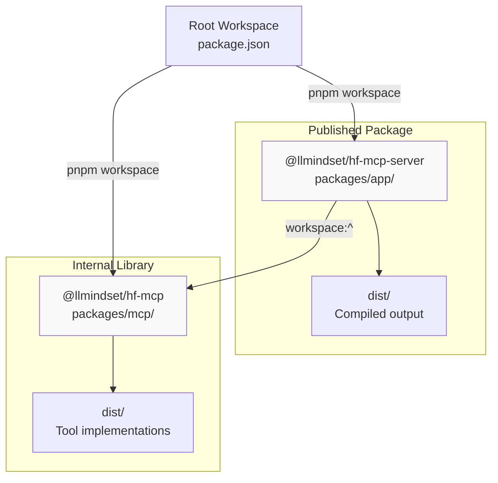
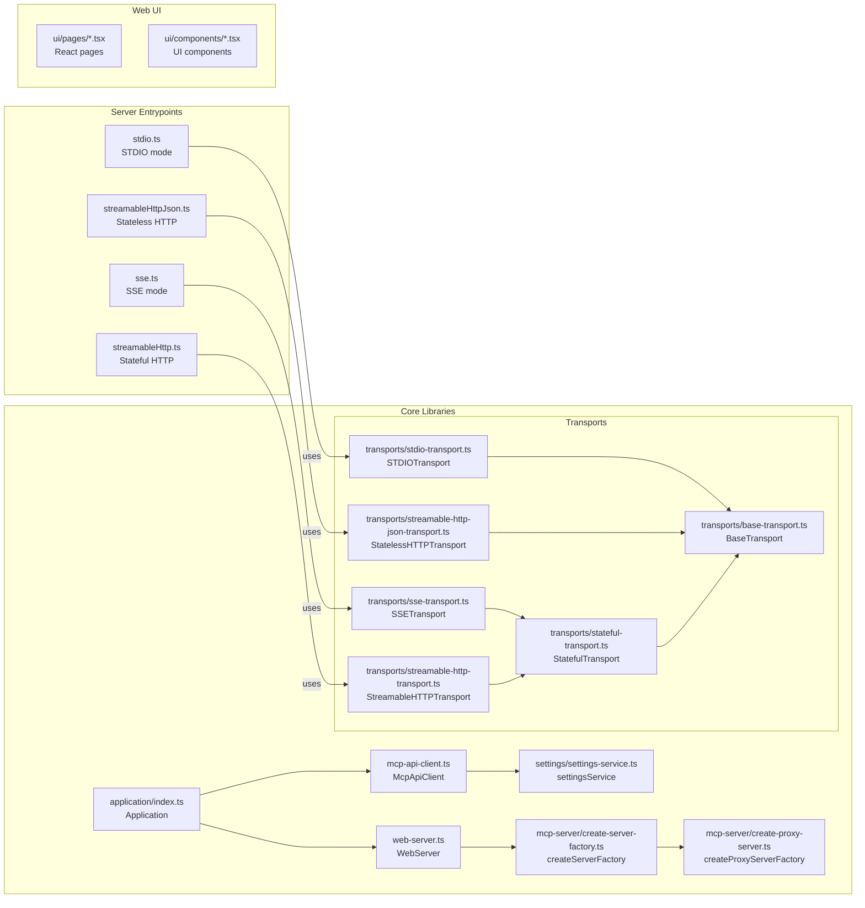
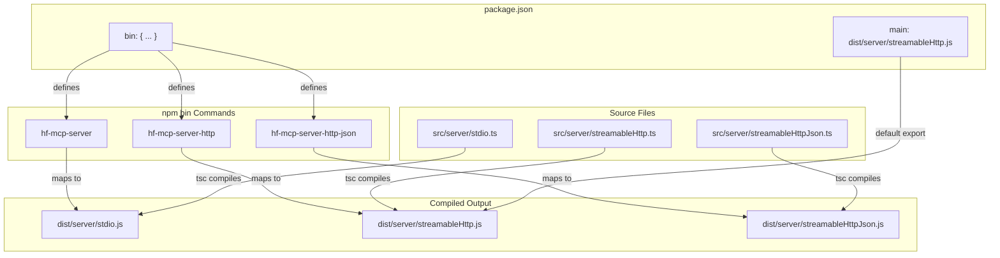
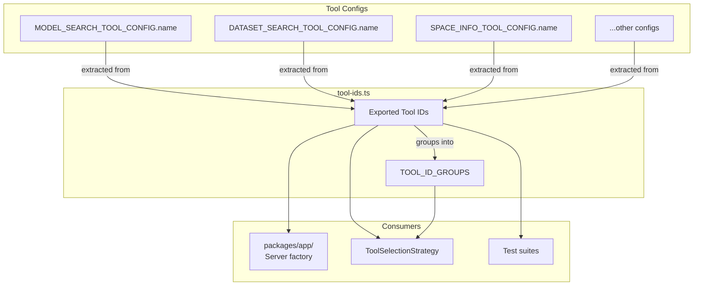
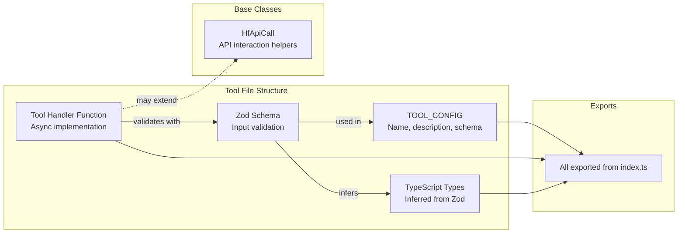
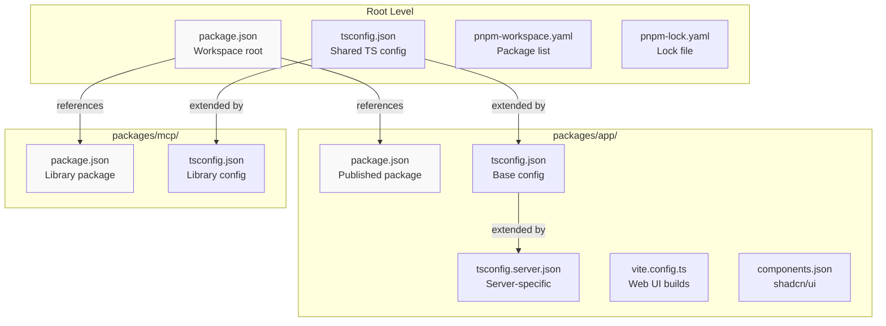

<!-- source: DeepWiki mcp.deepwiki.com · repo huggingface/hf-mcp-server · page 9.4 Project Structure · fetched 2026-10-26 -->

# Project Structure

<details>
<summary>Relevant source files</summary>

The following files were used as context for generating this wiki page:

- [package.json](package.json)
- [packages/app/package.json](packages/app/package.json)
- [packages/mcp/package.json](packages/mcp/package.json)
- [packages/mcp/src/index.ts](packages/mcp/src/index.ts)
- [packages/mcp/src/tool-ids.ts](packages/mcp/src/tool-ids.ts)
- [pnpm-lock.yaml](pnpm-lock.yaml)

</details>


This page provides a detailed walkthrough of the directory structure, file organization conventions, and key file locations in the HF MCP Server codebase. It serves as a map for developers navigating the repository structure.

For information about the build system and compilation process, see [Build System](#9.1). For development workflow and hot reload setup, see [Development Workflow](#9.2).

---

## Monorepo Organization

The project uses a **pnpm workspace-based monorepo** with two primary packages:

| Package | Location | Purpose | Published |
|---------|----------|---------|-----------|
| `@llmindset/hf-mcp` | `packages/mcp/` | Library layer with tool implementations | No |
| `@llmindset/hf-mcp-server` | `packages/app/` | Application layer with server and web UI | Yes (npm) |

**Root-Level Files**

```
├── package.json              # Workspace root with dev scripts
├── pnpm-workspace.yaml       # Workspace configuration
├── pnpm-lock.yaml           # Dependency lock file
├── tsconfig.json            # Shared TypeScript config
└── .eslintrc.json           # Shared linting rules
```

The root `package.json` provides workspace-level scripts that orchestrate both packages:

[package.json:7-24]()

**Sources:** [package.json:1-38](), [pnpm-lock.yaml:1-100]()

---

## Monorepo Dependency Graph



The application package (`@llmindset/hf-mcp-server`) depends on the library package (`@llmindset/hf-mcp`) using pnpm's workspace protocol, ensuring the local version is always used during development.

**Sources:** [packages/app/package.json:59](), [pnpm-lock.yaml:42-49]()

---

## packages/app/ Structure

The `packages/app/` directory contains the **application layer** — everything needed to run MCP servers and the web dashboard.

### Directory Layout

```
packages/app/
├── package.json                      # Main package metadata and scripts
├── tsconfig.json                     # TypeScript config (server code)
├── tsconfig.server.json             # Server-specific TS config
├── vite.config.ts                   # Vite config (web UI builds)
├── components.json                  # shadcn/ui config
│
├── src/                             # Source code
│   ├── server/                      # Server entrypoints
│   │   ├── stdio.ts                # STDIO transport entrypoint
│   │   ├── sse.ts                  # SSE transport entrypoint
│   │   ├── streamableHttp.ts       # HTTP transport entrypoint
│   │   └── streamableHttpJson.ts   # Stateless HTTP entrypoint
│   │
│   ├── lib/                         # Server-side libraries
│   │   ├── application/            # Application orchestrator
│   │   ├── transports/             # Transport implementations
│   │   ├── auth/                   # Authentication utilities
│   │   ├── gradio/                 # Gradio integration
│   │   ├── settings/               # Settings service
│   │   └── mcp-server/             # MCP server factory
│   │
│   ├── api/                         # Web API routes
│   │   ├── transport.ts            # Transport metrics endpoint
│   │   ├── sessions.ts             # Session management endpoint
│   │   └── settings.ts             # Settings CRUD endpoint
│   │
│   └── ui/                          # React web UI
│       ├── pages/                  # UI pages
│       ├── components/             # Reusable components
│       └── hooks/                  # Custom React hooks
│
├── dist/                            # Build output
│   ├── server/                     # Compiled server code
│   │   ├── stdio.js               # STDIO entrypoint
│   │   ├── streamableHttp.js      # HTTP entrypoint
│   │   └── ...                    # Other compiled server files
│   │
│   ├── ui/                         # Bundled web UI
│   │   ├── index.html             # Dashboard HTML
│   │   └── assets/                # JS/CSS bundles
│   │
│   └── singlefiles/                # Standalone HTML files
│       ├── gradio-widget.html     # Gradio widget for OpenAI
│       └── mcp-welcome.html       # Welcome page
│
└── scripts/                        # Build utilities
    └── html-to-ts.js              # Convert HTML to TS string
```

**Sources:** [packages/app/package.json:1-111]()

---

## packages/app/ File Path Mappings

This diagram maps logical components to their actual file locations:



**Key Directories Explained:**

- **`src/server/`** — Contains the four main entrypoints ([stdio.ts](), [sse.ts](), [streamableHttp.ts](), [streamableHttpJson.ts]()), each instantiating a different transport implementation
- **`src/lib/transports/`** — Transport layer implementations with inheritance hierarchy
- **`src/lib/mcp-server/`** — Server factory logic and Gradio proxy factory
- **`src/lib/settings/`** — User settings persistence (internal or external API)
- **`src/lib/gradio/`** — Gradio discovery, schema parsing, and tool handler creation
- **`src/ui/`** — Complete React web dashboard with pages and components

**Sources:** [packages/app/package.json:6-11]()

---

## packages/app/ Build Configuration

The package uses **dual build systems**:

| Build Target | Tool | Config | Output |
|--------------|------|--------|--------|
| Server code | TypeScript | `tsconfig.server.json` | `dist/server/` |
| Web UI | Vite | `vite.config.ts` | `dist/ui/` |
| Single-file HTML | Vite + plugin | `vite.config.ts` | `dist/singlefiles/` |

**Build Scripts:**

[packages/app/package.json:34-39]()

The `build` script chains together:
1. `build:web` — Vite bundles the React UI into `dist/ui/`
2. `build:singlefiles` — Vite creates standalone HTML files for Gradio widgets
3. `build:server` — TypeScript compiles server code to `dist/server/`

**Published Files:**

[packages/app/package.json:12-15]()

Only `dist/` and `components.json` are included in the npm package, keeping the published size minimal.

**Sources:** [packages/app/package.json:34-56]()

---

## packages/app/ Entrypoint Mapping



Users can invoke the server via:
- **`npx hf-mcp-server`** — Runs STDIO transport
- **`npx hf-mcp-server-http`** — Runs stateful HTTP transport
- **`npx hf-mcp-server-http-json`** — Runs stateless HTTP transport
- **`import "@llmindset/hf-mcp-server"`** — Imports stateful HTTP transport (main entry)

**Sources:** [packages/app/package.json:6-11]()

---

## packages/mcp/ Structure

The `packages/mcp/` directory contains the **library layer** — all tool implementations and shared utilities.

### Directory Layout

```
packages/mcp/
├── package.json                 # Library package metadata
├── tsconfig.json               # TypeScript config
│
├── src/                        # Source code
│   ├── index.ts               # Main export file
│   ├── tool-ids.ts            # Canonical tool ID registry
│   │
│   ├── hf-api-call.ts         # Base class for HF API tools
│   ├── error-messages.ts      # Error handling utilities
│   ├── utilities.ts           # Shared utilities
│   ├── readme-utils.ts        # README processing
│   │
│   ├── model-search.ts        # Model search tool
│   ├── model-detail.ts        # Model detail tool
│   ├── dataset-search.ts      # Dataset search tool
│   ├── dataset-detail.ts      # Dataset detail tool
│   ├── paper-search.ts        # Paper search tool
│   ├── space-search.ts        # Space semantic search
│   ├── hub-inspect.ts         # Hub repo details tool
│   │
│   ├── duplicate-space.ts     # Space duplication tool
│   ├── space-info.ts          # Space info tool
│   ├── space-files.ts         # Space files tool
│   ├── use-space.ts           # Dynamic space invocation
│   │
│   ├── user-summary.ts        # User summary prompt
│   ├── paper-summary.ts       # Paper summary prompt
│   │
│   ├── docs-search/           # Documentation tools
│   │   ├── docs-semantic-search.ts
│   │   └── doc-fetch.ts
│   │
│   ├── gradio-files.ts        # Gradio utilities
│   │
│   ├── jobs/                  # Jobs-related tools
│   │   └── jobs-tool.ts
│   │
│   ├── space/                 # Dynamic space tools
│   │   └── space-tool.ts
│   │
│   └── types/                 # Shared TypeScript types
│       └── tool-result.ts
│
└── dist/                      # Compiled JavaScript + declarations
    ├── index.js
    ├── index.d.ts
    ├── tool-ids.js
    ├── tool-ids.d.ts
    └── ...                    # All other compiled files
```

**Sources:** [packages/mcp/package.json:1-53](), [packages/mcp/src/index.ts:1-30]()

---

## packages/mcp/ Export Structure

The library uses a **flat export pattern** — all modules are re-exported from `index.ts`:

[packages/mcp/src/index.ts:1-30]()

**Package Exports:**

[packages/mcp/package.json:7-24]()

The package provides **subpath exports** for selective imports:
- `@llmindset/hf-mcp` — Full library (all tools)
- `@llmindset/hf-mcp/semantic` — Just semantic search
- `@llmindset/hf-mcp/model` — Just model search
- `@llmindset/hf-mcp/paper` — Just paper search

**Sources:** [packages/mcp/package.json:7-24](), [packages/mcp/src/index.ts:1-30]()

---

## Tool ID Registry

The `tool-ids.ts` file serves as the **canonical source of truth** for all tool identifiers:



**Key Exports:**

[packages/mcp/src/tool-ids.ts:28-48]()

**Grouped Tool IDs for Bouquets:**

[packages/mcp/src/tool-ids.ts:68-96]()

This structure enables the **bouquet system** where clients can request predefined sets of tools by referencing a group key (e.g., `"search"`, `"spaces"`, `"hf_api"`).

**Sources:** [packages/mcp/src/tool-ids.ts:1-105]()

---

## Tool Implementation Pattern

All built-in tools follow a consistent pattern:



**Example from model-search.ts:**

```typescript
// 1. Zod schema for validation
const modelSearchArgsSchema = z.object({
  query: z.string(),
  limit: z.number().optional(),
  // ...
});

// 2. Config object (single source of truth)
export const MODEL_SEARCH_TOOL_CONFIG = {
  name: "model_search",
  description: "Search for models on Hugging Face",
  schema: zodToJsonSchema(modelSearchArgsSchema),
};

// 3. Handler function
export async function handleModelSearch(
  args: z.infer<typeof modelSearchArgsSchema>
): Promise<ToolResult> {
  // Implementation
}
```

This pattern ensures:
- **Type safety** — TypeScript types inferred from Zod schemas
- **Runtime validation** — All inputs validated before execution
- **Single source of truth** — Config object contains canonical tool metadata
- **Consistent structure** — All tools follow the same pattern

**Sources:** [packages/mcp/src/index.ts:2-24](), [packages/mcp/src/tool-ids.ts:6-26]()

---

## File Naming Conventions

The project follows consistent naming patterns:

| Pattern | Example | Purpose |
|---------|---------|---------|
| `*-search.ts` | `model-search.ts` | Search/query tools |
| `*-detail.ts` | `dataset-detail.ts` | Detail/info retrieval tools |
| `*-info.ts` | `space-info.ts` | Info/metadata tools |
| `*-summary.ts` | `user-summary.ts` | Prompt templates |
| `*-tool.ts` | `jobs-tool.ts` | Generic tool suffix |
| `*-utils.ts` | `readme-utils.ts` | Utility modules |
| `*-transport.ts` | `stdio-transport.ts` | Transport implementations |
| `*-service.ts` | `settings-service.ts` | Service classes |

**Directory Naming:**
- **Kebab-case** for directories: `docs-search/`, `mcp-server/`
- **Singular nouns** for single-concept directories: `auth/`, `gradio/`
- **Plural nouns** for collections: `transports/`, `jobs/`

**Sources:** [packages/mcp/src/index.ts:1-30]()

---

## Configuration Files



**TypeScript Configuration Hierarchy:**

1. **Root `tsconfig.json`** — Shared compiler options (target, module, strict mode)
2. **`packages/app/tsconfig.json`** — Extends root, adds React JSX support
3. **`packages/app/tsconfig.server.json`** — Extends app config, server-only includes
4. **`packages/mcp/tsconfig.json`** — Extends root, library-specific settings

**Build Configuration:**

- **`vite.config.ts`** — Configures Vite for web UI builds, React plugin, HTML generation
- **`components.json`** — shadcn/ui configuration for component generation

**Sources:** [package.json:1-38](), [packages/app/package.json:1-111](), [packages/mcp/package.json:1-53]()

---

## Build Output Structure

After running `pnpm build`, the directory structure becomes:

```
packages/app/dist/
├── server/                    # Compiled server code (CommonJS)
│   ├── stdio.js              # Entrypoint scripts
│   ├── streamableHttp.js
│   ├── streamableHttpJson.js
│   ├── sse.js
│   │
│   ├── lib/                  # Library modules
│   │   ├── application/
│   │   ├── transports/
│   │   ├── mcp-server/
│   │   └── ...
│   │
│   └── [all source files mirrored]
│
├── ui/                        # Bundled web UI (static site)
│   ├── index.html            # Entry HTML
│   └── assets/               # Hashed JS/CSS bundles
│       ├── index-abc123.js
│       └── index-xyz789.css
│
└── singlefiles/               # Standalone HTML files
    ├── gradio-widget.html    # Single-file Gradio widget
    └── mcp-welcome.html      # Welcome page

packages/mcp/dist/
├── index.js                   # Main export
├── index.d.ts                # Type declarations
├── tool-ids.js               # Tool ID registry
├── tool-ids.d.ts
├── model-search.js           # Individual tool modules
├── model-search.d.ts
└── [all source files compiled]
```

**Distribution Strategy:**

- **Server code** — Not tree-shakeable; entire `dist/server/` included
- **Web UI** — Optimized bundle with code splitting
- **Library** — Each tool is a separate module for selective imports
- **Type definitions** — `.d.ts` files alongside every `.js` file

**Sources:** [packages/app/package.json:34-56](), [packages/mcp/package.json:25-32]()

---

## Import Path Conventions

**Within packages/app/:**

```typescript
// Relative imports for intra-package references
import { Application } from '../lib/application/index.js';
import { WebServer } from '../lib/web-server.js';
import { STDIOTransport } from '../lib/transports/stdio-transport.js';

// Library imports use package name
import { MODEL_SEARCH_TOOL_ID } from '@llmindset/hf-mcp';
```

**Within packages/mcp/:**

```typescript
// Always use relative imports with .js extension
import { HfApiCall } from './hf-api-call.js';
import { MODEL_SEARCH_TOOL_CONFIG } from './model-search.js';
```

**From external consumers:**

```typescript
// Import from published package
import { MODEL_SEARCH_TOOL_ID } from '@llmindset/hf-mcp';
import { createServerFactory } from '@llmindset/hf-mcp-server';

// Or use subpath exports
import { handleModelSearch } from '@llmindset/hf-mcp/model';
```

All imports use **`.js` extensions** even in TypeScript source files, following Node.js ESM conventions.

**Sources:** [packages/mcp/src/index.ts:1-30](), [packages/mcp/package.json:7-24]()

---

## Key File Locations Reference

This table provides quick lookup for commonly-referenced files:

| Component | File Path |
|-----------|-----------|
| **Entrypoints** | |
| STDIO server | `packages/app/src/server/stdio.ts` |
| HTTP server | `packages/app/src/server/streamableHttp.ts` |
| **Application Core** | |
| Application orchestrator | `packages/app/src/lib/application/index.ts` |
| Web server | `packages/app/src/lib/web-server.ts` |
| MCP server factory | `packages/app/src/lib/mcp-server/create-server-factory.ts` |
| **Transports** | |
| Base transport | `packages/app/src/lib/transports/base-transport.ts` |
| STDIO transport | `packages/app/src/lib/transports/stdio-transport.ts` |
| SSE transport | `packages/app/src/lib/transports/sse-transport.ts` |
| **Settings & State** | |
| Settings service | `packages/app/src/lib/settings/settings-service.ts` |
| MCP API client | `packages/app/src/lib/mcp-api-client.ts` |
| Tool selection strategy | `packages/app/src/lib/mcp-server/tool-selection-strategy.ts` |
| **Gradio Integration** | |
| Gradio connector | `packages/app/src/lib/gradio/gradio-endpoint-connector.ts` |
| Gradio utilities | `packages/app/src/lib/gradio/gradio-utils.ts` |
| **Library Tools** | |
| Tool ID registry | `packages/mcp/src/tool-ids.ts` |
| Library main export | `packages/mcp/src/index.ts` |
| HF API base class | `packages/mcp/src/hf-api-call.ts` |
| Model search | `packages/mcp/src/model-search.ts` |
| Dataset detail | `packages/mcp/src/dataset-detail.ts` |
| Doc search | `packages/mcp/src/docs-search/docs-semantic-search.ts` |

**Sources:** [packages/app/package.json:1-111](), [packages/mcp/src/index.ts:1-30](), [packages/mcp/src/tool-ids.ts:1-105]()