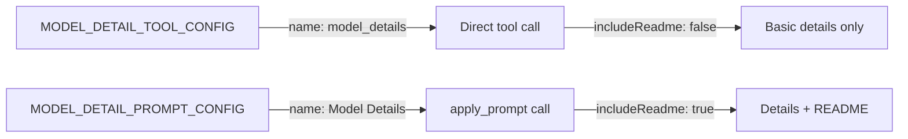
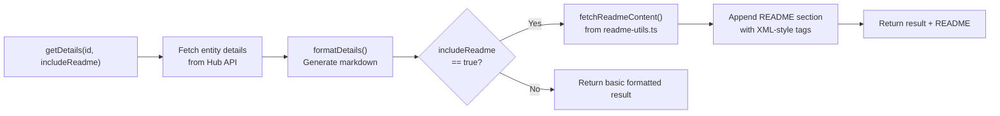
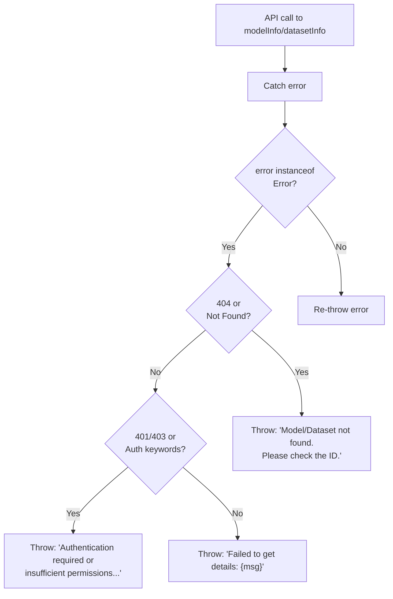
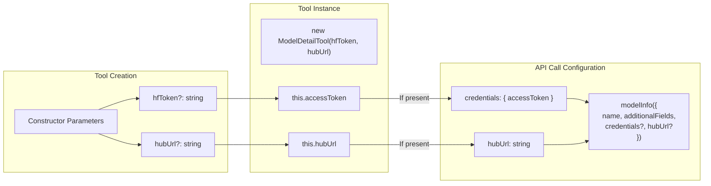

<!-- source: DeepWiki mcp.deepwiki.com · repo huggingface/hf-mcp-server · extra page Detail Tools · fetched 2026-10-26 -->

# Detail Tools

<details>
<summary>Relevant source files</summary>

The following files were used as context for generating this wiki page:

- [packages/e2e-python/prompts.py](packages/e2e-python/prompts.py)
- [packages/mcp/src/dataset-detail.ts](packages/mcp/src/dataset-detail.ts)
- [packages/mcp/src/model-detail.ts](packages/mcp/src/model-detail.ts)

</details>


This document describes the detail tools in the HF MCP Server that retrieve comprehensive information about specific entities on the Hugging Face Hub. These tools provide in-depth metadata, statistics, and technical specifications for models and datasets.

For information about searching across entities, see [Search Tools](#4.2.1). For information about managing and discovering Spaces, see [Space Management Tools](#4.2.3).

## Overview

The detail tools provide rich, structured information about individual Hugging Face Hub entities. The system currently includes two primary detail tools:

| Tool Name | Entity Type | Primary Class | Configuration |
|-----------|-------------|---------------|---------------|
| `model_details` | Models | `ModelDetailTool` | `MODEL_DETAIL_TOOL_CONFIG` |
| `dataset_details` | Datasets | `DatasetDetailTool` | `DATASET_DETAIL_TOOL_CONFIG` |

These tools integrate with the `@huggingface/hub` library to fetch comprehensive metadata and format it as structured markdown responses. Both tools support optional README content inclusion and provide both tool and prompt configurations for different use cases.

**Sources:** [packages/mcp/src/model-detail.ts:9-26](), [packages/mcp/src/dataset-detail.ts:8-20]()

## Tool Configuration Pattern

Each detail tool follows a consistent configuration pattern with Zod schema validation and MCP annotations:

```typescript
// Model Details Tool Configuration
{
  name: 'model_details',
  description: 'Get detailed information about a model from the Hugging Face Hub...',
  schema: z.object({
    model_id: z.string().min(1).describe('The Model ID in author/model format')
  }),
  annotations: {
    title: 'Model Details',
    destructiveHint: false,
    readOnlyHint: true,
    openWorldHint: false
  }
}
```

### Prompt Configurations

Both tools also provide prompt configurations that include README content by default. These are registered as MCP prompts and can be invoked using the `apply_prompt` method:



**Sources:** [packages/mcp/src/model-detail.ts:9-40](), [packages/mcp/src/dataset-detail.ts:8-34](), [packages/e2e-python/prompts.py:20-21]()

## Data Extraction Architecture

### ModelDetailTool Architecture

The `ModelDetailTool` class implements a layered data extraction approach that safely handles optional fields from the Hugging Face API:

```mermaid
graph TB
    subgraph "API Layer"
        modelInfo["modelInfo() from @huggingface/hub"]
        additionalFields["additionalFields array:<br/>author, downloadsAllTime, library_name,<br/>tags, config, transformersInfo,<br/>safetensors, cardData, spaces,<br/>inferenceProviderMapping"]
    end
    
    subgraph "ModelDetailTool Class"
        constructor["constructor(hfToken?, hubUrl?)"]
        getDetails["getDetails(modelId, includeReadme)"]
    end
    
    subgraph "Data Structures"
        ModelBasicInfo["ModelBasicInfo<br/>Required: id, name, downloads,<br/>likes, private, gated, updatedAt"]
        ModelExtendedInfo["ModelExtendedInfo<br/>Optional: author, library_name,<br/>pipeline_tag, downloadsAllTime, tags"]
        ModelTechnicalDetails["ModelTechnicalDetails<br/>Optional: modelType, vocabSize,<br/>parameters, modelClass"]
        ModelMetadata["ModelMetadata<br/>Optional: language, license,<br/>datasets, fineTunedFrom"]
        InferenceProvider["InferenceProvider[]<br/>provider, status, providerId, task"]
    end
    
    subgraph "Output"
        ModelInformation["ModelInformation interface<br/>Combines all data layers"]
        formatModelDetails["formatModelDetails()<br/>Markdown formatter"]
        ToolResult["ToolResult<br/>formatted, totalResults, resultsShared"]
    end
    
    constructor --> getDetails
    getDetails --> modelInfo
    modelInfo --> additionalFields
    additionalFields --> ModelBasicInfo
    additionalFields --> ModelExtendedInfo
    additionalFields --> ModelTechnicalDetails
    additionalFields --> ModelMetadata
    additionalFields --> InferenceProvider
    
    ModelBasicInfo --> ModelInformation
    ModelExtendedInfo --> ModelInformation
    ModelTechnicalDetails --> ModelInformation
    ModelMetadata --> ModelInformation
    InferenceProvider --> ModelInformation
    
    ModelInformation --> formatModelDetails
    formatModelDetails --> ToolResult
```

The class extracts data through carefully validated type assertions:

**Technical Details Extraction:**
```typescript
// Safe extraction from config
if (modelData.config && typeof modelData.config === 'object') {
  const config = modelData.config as Record<string, unknown>;
  if ('model_type' in config && typeof config.model_type === 'string') {
    technical.modelType = config.model_type;
  }
  // vocab_size, etc.
}
```

**Inference Provider Extraction:**
```typescript
const inferenceProviders = (modelData.inferenceProviderMapping ?? [])
  .map((entry) => ({
    provider: entry.provider,
    status: entry.status,
    providerId: entry.providerId,
    task: entry.task,
  }))
  .filter((el) => !!el);
```

**Sources:** [packages/mcp/src/model-detail.ts:106-301](), [packages/mcp/src/model-detail.ts:44-101]()

### DatasetDetailTool Architecture

The `DatasetDetailTool` follows a similar pattern but focuses on dataset-specific metadata:

```mermaid
graph TB
    subgraph "API Layer"
        datasetInfo["datasetInfo() from @huggingface/hub"]
        additionalFields["additionalFields array:<br/>author, downloadsAllTime,<br/>tags, description, cardData"]
    end
    
    subgraph "DatasetDetailTool Class"
        constructor["constructor(hfToken?, hubUrl?)"]
        getDetails["getDetails(datasetId, includeReadme)"]
    end
    
    subgraph "Data Structures"
        DatasetBasicInfo["DatasetBasicInfo<br/>Required: id, name, downloads,<br/>likes, private, gated, updatedAt"]
        DatasetExtendedInfo["DatasetExtendedInfo<br/>Optional: author, downloadsAllTime,<br/>tags, description"]
        DatasetMetadata["DatasetMetadata<br/>Optional: language, license,<br/>task_categories, size_categories,<br/>dataset_info"]
    end
    
    subgraph "Output"
        DatasetInformation["DatasetInformation interface<br/>Combines all data layers"]
        formatDatasetDetails["formatDatasetDetails()<br/>Markdown formatter"]
        ToolResult["ToolResult<br/>formatted, totalResults, resultsShared"]
    end
    
    constructor --> getDetails
    getDetails --> datasetInfo
    datasetInfo --> additionalFields
    additionalFields --> DatasetBasicInfo
    additionalFields --> DatasetExtendedInfo
    additionalFields --> DatasetMetadata
    
    DatasetBasicInfo --> DatasetInformation
    DatasetExtendedInfo --> DatasetInformation
    DatasetMetadata --> DatasetInformation
    
    DatasetInformation --> formatDatasetDetails
    formatDatasetDetails --> ToolResult
```

**Sources:** [packages/mcp/src/dataset-detail.ts:77-206](), [packages/mcp/src/dataset-detail.ts:38-72]()

## Output Format Structure

### Model Details Output

The `formatModelDetails` function generates structured markdown with the following sections:

| Section | Condition | Content |
|---------|-----------|---------|
| Title | Always | Model name as H1 |
| Overview | Always | Author, task, library, downloads, likes, updated date, status |
| Technical Details | If available | Model class, parameters, architecture, vocab size |
| Tags | If available | Comma-separated tags in code blocks |
| Metadata | If available | Language, license, datasets, fine-tuned from |
| Demo Spaces | If available | Up to 12 spaces with links (limited by `SPACES_TO_INCLUDE`) |
| Inference Providers | If available | Provider names with status, playground link |
| Link | Always | Direct link to model on hf.co |

**Example Output Structure:**
```markdown
# author/model-name

## Overview
- **Author:** author-name
- **Task:** text-generation
- **Library:** transformers
- **Downloads:** 1,234,567 | **Likes:** 42
- **Updated:** Jan 15, 2024
- **Status:** 🔒 Gated

## Technical Details
- **Model Class:** AutoModelForCausalLM
- **Parameters:** 7,000,000,000
- **Architecture:** llama
- **Vocab Size:** 32,000

## Inference Providers
- **serverless** (ready)
Try this model in the playground...

**Link:** [https://hf.co/author/model-name]
```

**Sources:** [packages/mcp/src/model-detail.ts:304-462]()

### Dataset Details Output

The `formatDatasetDetails` function generates a similar structure tailored to datasets:

| Section | Condition | Content |
|---------|-----------|---------|
| Title | Always | Dataset name as H1 |
| Description | If available | Full description text |
| Overview | Always | Author, downloads, likes, updated date, status |
| Tags | If available | Comma-separated tags |
| Metadata | If available | Language, license, task categories, size categories |
| Link | Always | Direct link to dataset on hf.co |

**Sources:** [packages/mcp/src/dataset-detail.ts:209-310]()

## README Integration

Both tools support including README content from the repository's model card or dataset card. This is controlled by the `includeReadme` parameter:



The README content is wrapped in XML-style tags for clear delineation:

```markdown
## README
<modelcard-readme>
[README content converted from HTML to Markdown]
</modelcard-readme>
```

or

```markdown
## README
<datasetcard-readme>
[README content converted from HTML to Markdown]
</datasetcard-readme>
```

**Sources:** [packages/mcp/src/model-detail.ts:261-268](), [packages/mcp/src/dataset-detail.ts:165-172]()

## Error Handling

Both tools implement comprehensive error handling with user-friendly messages:



**Error Detection Patterns:**

| Error Type | Detection Logic | User Message |
|------------|-----------------|--------------|
| Not Found | `HubApiError.statusCode === 404` OR message contains "404", "Not Found", "Repository not found" | `Model/Dataset '{id}' not found. Please check the ID.` |
| Unauthorized | `statusCode === 401/403` OR message contains "401", "403", "username", "password", "access token" | `Authentication required or insufficient permissions to access '{id}'.` |
| Generic | Any other error | `Failed to get model/dataset details: {message}` |

**Sources:** [packages/mcp/src/model-detail.ts:271-300](), [packages/mcp/src/dataset-detail.ts:176-205]()

## Tool Instantiation and Invocation

The detail tools are instantiated with optional authentication and custom hub URL:



**Invocation Flow:**

1. MCP client calls tool with entity ID parameter
2. Tool extracts `model_id` or `dataset_id` from request
3. `getDetails()` method called with ID and optional `includeReadme` flag
4. API call made with configured authentication
5. Response data extracted into typed interfaces
6. Markdown formatted via `formatModelDetails()` or `formatDatasetDetails()`
7. `ToolResult` returned with `formatted` string, `totalResults: 1`, `resultsShared: 1`

**Sources:** [packages/mcp/src/model-detail.ts:106-118](), [packages/mcp/src/dataset-detail.ts:77-89]()

## Usage Examples

### Tool Invocation

Direct tool calls request basic details without README:

```python
# Direct tool call - basic details only
await agent.call_tool("model_details", {"model_id": "microsoft/DialoGPT-large"})
await agent.call_tool("dataset_details", {"dataset_id": "squad"})
```

### Prompt Application

Prompt invocation includes README content automatically:

```python
# Prompt application - includes README
await agent.apply_prompt("Model Details", {"model_id": "openai/gpt-oss-120b"})
await agent.apply_prompt("Dataset Details", {"dataset_id": "Anthropic/hh-rlhf"})
```

**Sources:** [packages/e2e-python/prompts.py:20-21]()

## Field Extraction Details

### Model-Specific Fields

The `ModelDetailTool` extracts specialized fields not available for datasets:

| Field Path | Interface | Extraction Method | Example Value |
|------------|-----------|-------------------|---------------|
| `config.model_type` | `ModelTechnicalDetails.modelType` | Type check and cast | `"llama"` |
| `config.vocab_size` | `ModelTechnicalDetails.vocabSize` | Type check and cast | `32000` |
| `safetensors.total` | `ModelTechnicalDetails.parameters` | Direct numeric access | `7000000000` |
| `transformersInfo.auto_model` | `ModelTechnicalDetails.modelClass` | Direct string access | `"AutoModelForCausalLM"` |
| `inferenceProviderMapping` | `inferenceProviders[]` | Array mapping | `[{provider: "serverless", status: "ready"}]` |
| `spaces` | `spaces[]` | Array mapping with ID parsing | `[{id: "user/space", name: "space"}]` |

### Dataset-Specific Fields

The `DatasetDetailTool` extracts fields relevant to datasets:

| Field Path | Interface | Extraction Method | Example Value |
|------------|-----------|-------------------|---------------|
| `description` | `DatasetExtendedInfo.description` | Direct string access | `"A reading comprehension dataset..."` |
| `cardData.task_categories` | `DatasetMetadata.task_categories` | Cast to string or array | `["question-answering"]` |
| `cardData.size_categories` | `DatasetMetadata.size_categories` | Cast to string or array | `["10K<n<100K"]` |
| `cardData.dataset_info` | `DatasetMetadata.dataset_info` | Cast to Record | `{features: [...], splits: [...]}` |

**Sources:** [packages/mcp/src/model-detail.ts:184-258](), [packages/mcp/src/dataset-detail.ts:130-159]()

## Integration with Tool Selection

Detail tools are included in multiple bouquets:

- **`hf_api` bouquet:** Both `model_details` and `dataset_details`
- **`search` bouquet:** Both tools (paired with search capabilities)
- **`all` bouquet:** All tools including detail tools

When selected via the Tool Selection Strategy (see [Tool Selection Strategy](#5.2)), these tools become available for invocation by MCP clients. The README inclusion behavior differs between tool and prompt invocations, allowing clients to choose between compact responses and comprehensive documentation.

**Sources:** Based on tool configuration and bouquet system described in architecture diagrams

---

