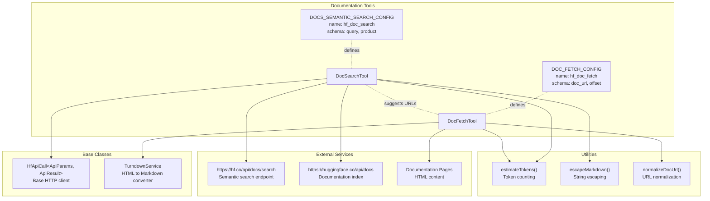
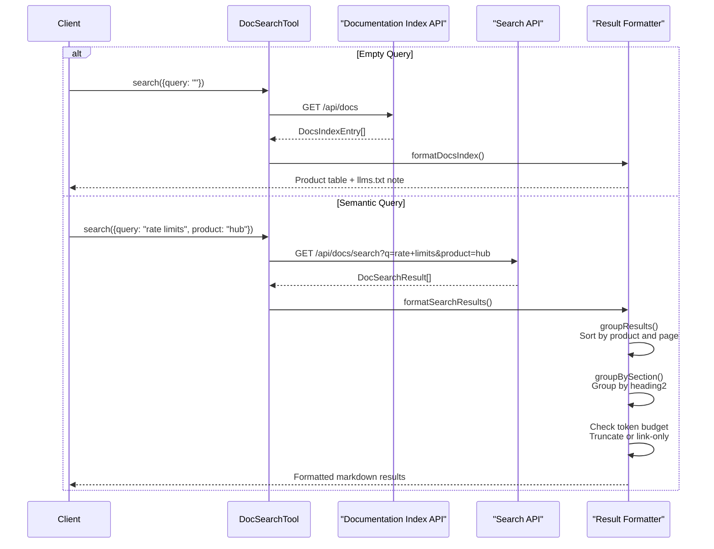
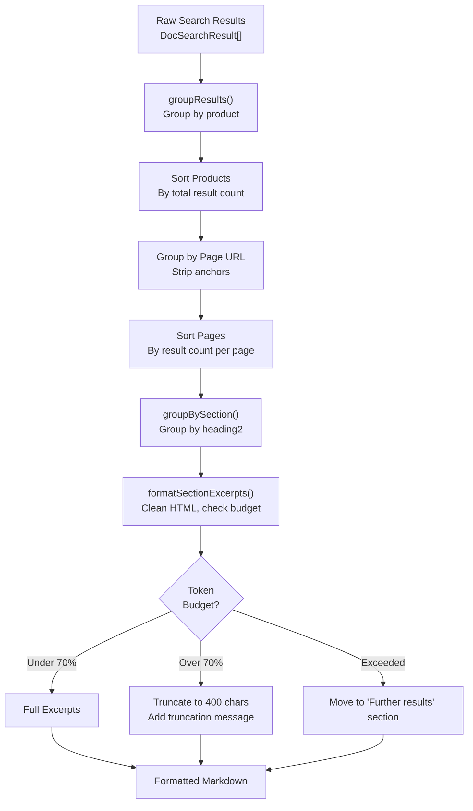
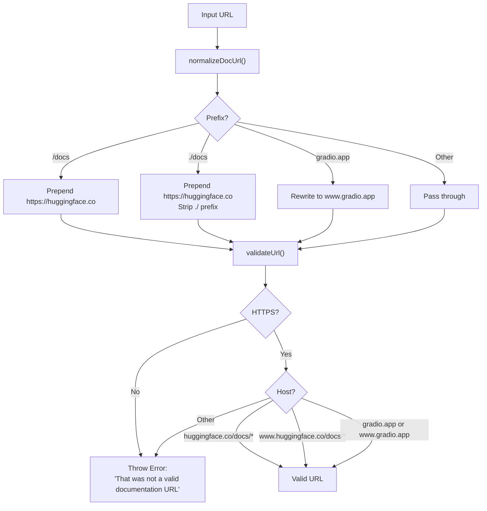
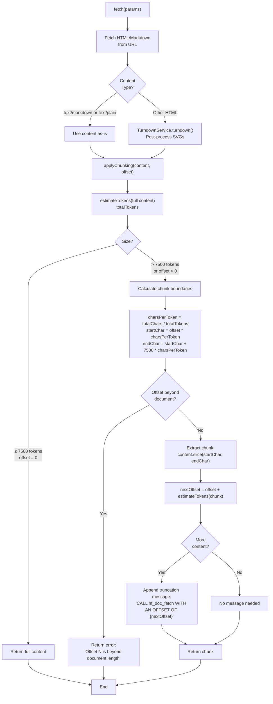
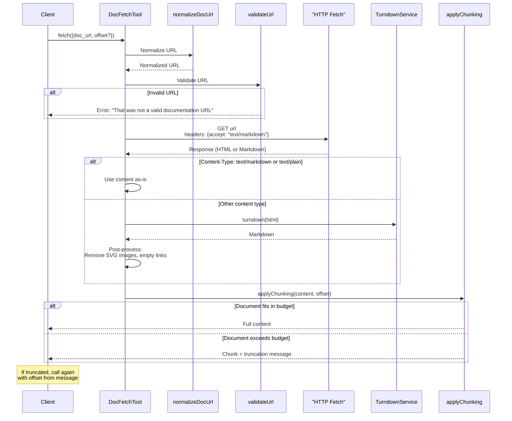

<!-- source: DeepWiki mcp.deepwiki.com · repo huggingface/hf-mcp-server · extra page Documentation Tools · fetched 2026-10-26 -->

# Documentation Tools

<details>
<summary>Relevant source files</summary>

The following files were used as context for generating this wiki page:

- [packages/app/src/shared/constants.ts](packages/app/src/shared/constants.ts)
- [packages/mcp/src/docs-search/doc-fetch.test.ts](packages/mcp/src/docs-search/doc-fetch.test.ts)
- [packages/mcp/src/docs-search/doc-fetch.ts](packages/mcp/src/docs-search/doc-fetch.ts)
- [packages/mcp/src/docs-search/docs-semantic-search.test.ts](packages/mcp/src/docs-search/docs-semantic-search.test.ts)
- [packages/mcp/src/docs-search/docs-semantic-search.ts](packages/mcp/src/docs-search/docs-semantic-search.ts)

</details>


This page describes the two built-in documentation tools that enable AI clients to discover and retrieve content from Hugging Face and Gradio documentation. These tools provide semantic search capabilities and HTML-to-Markdown conversion for documentation consumption.

For information about other tool categories, see [Search Tools](#4.2.1), [Detail Tools](#4.2.2), and [Space Management Tools](#4.2.3). For the overall tool system architecture, see [Tool System Overview](#4.1).

---

## Overview

The documentation tools consist of two complementary MCP tools:

1. **`hf_doc_search`** - Semantic search over Hugging Face documentation libraries
2. **`hf_doc_fetch`** - Fetch and convert documentation pages to Markdown

These tools work together in a discovery-then-retrieval pattern. The search tool identifies relevant documentation pages, and the fetch tool retrieves their full content with clean Markdown formatting.

### Supported Documentation Sources

Both tools support:
- Hugging Face documentation (`huggingface.co/docs/*`)
- Gradio documentation (`gradio.app` and `www.gradio.app`)

Sources: [packages/mcp/src/docs-search/doc-fetch.ts:1-243](), [packages/mcp/src/docs-search/docs-semantic-search.ts:1-379]()

---

## Tool Architecture



**Tool Discovery and Retrieval Flow**

The tools implement a two-phase workflow where search results include URLs that can be passed to the fetch tool.

Sources: [packages/mcp/src/docs-search/doc-fetch.ts:5-23](), [packages/mcp/src/docs-search/docs-semantic-search.ts:10-45]()

---

## Documentation Search Tool

The `DocSearchTool` class implements the `hf_doc_search` tool, providing semantic search over Hugging Face and Gradio documentation libraries.

### Configuration

| Property | Type | Description |
|----------|------|-------------|
| `name` | string | `hf_doc_search` |
| `query` | string | Search query (0-200 chars). Empty string returns documentation index |
| `product` | string (optional) | Filter by product name (e.g. "transformers", "hub") |
| Token budget | number | Default: 12,500 tokens |

The tool schema enforces a minimum query length of 3 characters for searches, but allows empty queries for discovering the documentation structure.

Sources: [packages/mcp/src/docs-search/docs-semantic-search.ts:10-45](), [packages/mcp/src/docs-search/docs-semantic-search.ts:69-71]()

### Search Behavior



**Empty Query Response**

When the query is empty, the tool returns a table of available documentation products:

```markdown
### Hugging Face Documentation Products
| Product | Category | Documentation |
| --- | --- | --- |
| `transformers` | Machine Learning | https://huggingface.co/docs/transformers |
| `datasets` | Machine Learning | https://huggingface.co/docs/datasets |
...
```

This response includes a note about `llms.txt` endpoints for each documentation root.

Sources: [packages/mcp/src/docs-search/docs-semantic-search.ts:94-127](), [packages/mcp/src/docs-search/docs-semantic-search.ts:162-190]()

### Result Grouping and Formatting

The tool implements a sophisticated multi-level grouping system:



**Grouping Rules**

1. Results group by `product` field (e.g., "hub", "transformers")
2. Within products, group by base URL (anchors stripped: `#section` removed)
3. Within pages, group by `heading2` field (section within page)
4. Products and pages sort by descending result count

Sources: [packages/mcp/src/docs-search/docs-semantic-search.ts:132-157](), [packages/mcp/src/docs-search/docs-semantic-search.ts:195-210](), [packages/mcp/src/docs-search/docs-semantic-search.ts:265-378]()

### Result Structure

The formatted output follows this structure:

```
# Documentation Library Search Results for "{query}" (filtered by product: {product})

Found {count} results

## Results for Product: {product} ({count} results)

### Results from [{page_title}]({url}) ({count} results)

#### Excerpts from the "{section}" section

{cleaned_text}

#### Excerpt from the "{section}" section

{cleaned_text}

## Further results were found in:
- [Page Title](url) (count results) *(product)*

---

Use the "hf_doc_fetch" tool to fetch a document from the library.
```

The tool includes a footer directing users to `hf_doc_fetch` for retrieving full documents.

Sources: [packages/mcp/src/docs-search/docs-semantic-search.ts:265-378]()

### Token Budget Management

The `DocSearchTool` implements three-tier budget management:

| State | Token Usage | Behavior |
|-------|-------------|----------|
| Under 70% budget | < 8,750 tokens | Full excerpts with HTML stripped |
| 70-100% budget | 8,750-12,500 tokens | Truncate excerpts to 400 chars, add message once |
| Over budget | > 12,500 tokens | Move remaining products/pages to "Further results" links section |

The truncation message references `hf_doc_fetch`:

```
*[Content truncated - use hf_doc_fetch for full text or narrow search terms]*
```

Token estimation uses the `estimateTokens()` utility function, which calculates approximately 3.3 characters per token.

Sources: [packages/mcp/src/docs-search/docs-semantic-search.ts:69-88](), [packages/mcp/src/docs-search/docs-semantic-search.ts:215-260](), [packages/mcp/src/docs-search/docs-semantic-search.ts:296-376]()

### Text Cleaning

The tool cleans search result excerpts before display:

1. Remove HTML tags: `<div>`, ``, etc. → stripped via regex
2. Collapse multiple newlines: `\n\n\n` → `\n`
3. Trim whitespace
4. Escape markdown special characters in headings and product names

Sources: [packages/mcp/src/docs-search/docs-semantic-search.ts:237-252]()

---

## Documentation Fetch Tool

The `DocFetchTool` class implements the `hf_doc_fetch` tool, which retrieves documentation pages and converts them to clean Markdown.

### Configuration

| Property | Type | Description |
|----------|------|-------------|
| `name` | string | `hf_doc_fetch` |
| `doc_url` | string | Documentation URL (max 200 chars) |
| `offset` | number (optional) | Token offset for chunked documents (min 0) |

Sources: [packages/mcp/src/docs-search/doc-fetch.ts:5-23]()

### URL Validation and Normalization



**Normalization Examples**

| Input | Output |
|-------|--------|
| `/docs/diffusers/index` | `https://huggingface.co/docs/diffusers/index` |
| `./docs/diffusers/index` | `https://huggingface.co/docs/diffusers/index` |
| `https://gradio.app/guides/x` | `https://www.gradio.app/guides/x` |
| `https://huggingface.co/docs/transformers` | (unchanged) |

The `gradio.app` to `www.gradio.app` normalization is necessary for correct page resolution.

Sources: [packages/mcp/src/docs-search/doc-fetch.ts:119-139](), [packages/mcp/src/docs-search/doc-fetch.ts:219-243]()

### HTML to Markdown Conversion

The tool uses `TurndownService` with extensive customization to produce clean Markdown output.

#### Conversion Configuration

```typescript
// Configuration applied in constructor
headingStyle: 'atx'        // Use ### style headings
codeBlockStyle: 'fenced'   // Use ``` code blocks
```

#### Content Filtering Rules

The `DocFetchTool` constructor configures removal rules for noisy elements:

| Rule | Elements Removed | Rationale |
|------|------------------|-----------|
| Structural | `<head>`, `<script>`, `<style>`, `<noscript>` | Non-content elements |
| Navigation | `<header>`, `<nav>`, `<footer>`, `<aside>` | UI chrome, not documentation |
| Interactive | `<form>`, `<button>`, `<iframe>` | Non-textual elements |
| SVG images | `<svg>`, ``, data URIs | Visual elements, noisy in text |
| Heading anchors | `<a href="#...">` with icons/encoded SVGs | Navigation artifacts |

Sources: [packages/mcp/src/docs-search/doc-fetch.ts:30-116]()

#### Post-Processing

After Turndown conversion, the tool applies regex cleanup:

```typescript
// Strip remaining SVG markdown images
.replace(/!\[[^\]]*\]\(\s*(?:data:image\/svg\+xml[^)]*|[^)]*\.svg(?:\?[^)]*)?)\s*\)/gi, '')

// Remove empty links: [](...) 
.replace(/\[\s*\]\(\s*[^)]*\s*\)/g, '')

// Remove links with encoded SVG payloads
.replace(/\[[^\]]*(?:data:image\/svg\+xml|%3csvg|svg%2bxml)[^\]]*\]\([^)]*\)/gi, '')
```

This ensures clean text even if DOM filters miss edge cases.

Sources: [packages/mcp/src/docs-search/doc-fetch.ts:156-169]()

### Document Chunking System

Large documents automatically chunk to stay within token limits.



**Chunking Parameters**

| Parameter | Value | Notes |
|-----------|-------|-------|
| Max tokens per chunk | 7,500 | Configured in `applyChunking()` |
| Offset unit | Tokens | Not characters |
| Truncation message | `=== DOCUMENT TRUNCATED. CALL hf_doc_fetch WITH AN OFFSET OF {nextOffset} FOR THE NEXT CHUNK ===` | Added if more content exists |

**Token-to-Character Mapping**

The chunking system estimates character positions from token offsets:

```typescript
const charsPerToken = totalChars / totalTokens;
const startChar = Math.floor(offset * charsPerToken);
const maxCharsPerChunk = Math.floor(7500 * charsPerToken);
const endChar = Math.min(startChar + maxCharsPerChunk, totalChars);
```

This approach avoids re-tokenizing the entire document for each chunk request.

Sources: [packages/mcp/src/docs-search/doc-fetch.ts:144-176](), [packages/mcp/src/docs-search/doc-fetch.ts:178-216]()

### Fetch Workflow



Sources: [packages/mcp/src/docs-search/doc-fetch.ts:144-176]()

---

## Integration and Usage Patterns

### Discovery-Retrieval Pattern

The typical workflow combines both tools:

1. **Discover**: Use `hf_doc_search` with semantic query
2. **Select**: Identify relevant page URLs from results
3. **Retrieve**: Use `hf_doc_fetch` with selected URL
4. **Continue**: If truncated, use offset for next chunk

### Example: Multi-Chunk Retrieval

```
1. hf_doc_search({query: "rate limits"})
   → Returns: URL https://huggingface.co/docs/hub/rate-limits

2. hf_doc_fetch({doc_url: "https://huggingface.co/docs/hub/rate-limits"})
   → Returns: First 7500 tokens + "CALL hf_doc_fetch WITH AN OFFSET OF 7234"

3. hf_doc_fetch({doc_url: "https://huggingface.co/docs/hub/rate-limits", offset: 7234})
   → Returns: Next chunk or full remainder
```

### Cross-Tool References

The tools reference each other in their output:

- `hf_doc_search` truncation message: `*[Content truncated - use hf_doc_fetch for full text...]*`
- `hf_doc_search` footer: `Use the "hf_doc_fetch" tool to fetch a document from the library.`
- `hf_doc_fetch` truncation message: `=== DOCUMENT TRUNCATED. CALL hf_doc_fetch WITH AN OFFSET OF...`

These references are implemented using the exported `DOC_FETCH_CONFIG.name` constant to ensure consistency.

Sources: [packages/mcp/src/docs-search/docs-semantic-search.ts:4](), [packages/mcp/src/docs-search/docs-semantic-search.ts:246](), [packages/mcp/src/docs-search/docs-semantic-search.ts:372](), [packages/mcp/src/docs-search/doc-fetch.ts:212]()

### Tool Registration

Both tools are registered in the MCP server with their respective configurations:

- Tool config objects: `DOCS_SEMANTIC_SEARCH_CONFIG`, `DOC_FETCH_CONFIG`
- Tool classes: `DocSearchTool`, `DocFetchTool`
- Base class: `DocSearchTool extends HfApiCall`

The search tool inherits from `HfApiCall` for consistent API interaction patterns, while the fetch tool directly implements HTTP fetching with Turndown conversion.

Sources: [packages/mcp/src/docs-search/docs-semantic-search.ts:10-45](), [packages/mcp/src/docs-search/docs-semantic-search.ts:77-88](), [packages/mcp/src/docs-search/doc-fetch.ts:5-23](), [packages/mcp/src/docs-search/doc-fetch.ts:27-116]()

---

