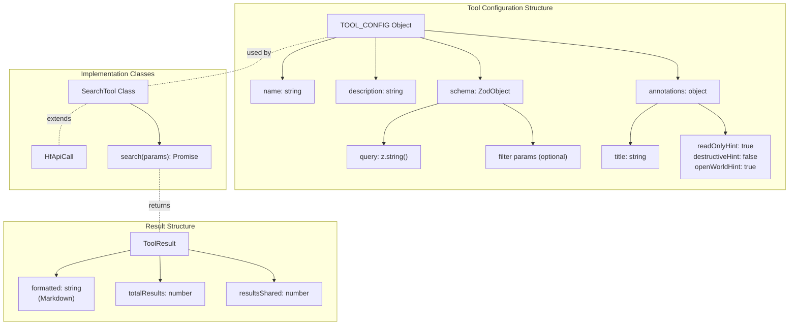
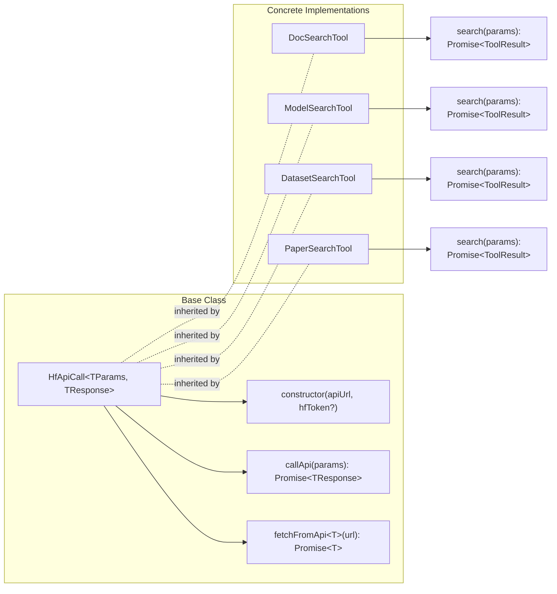
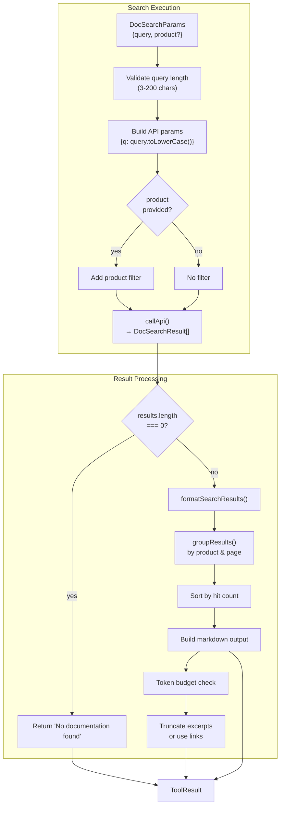
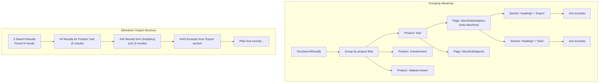
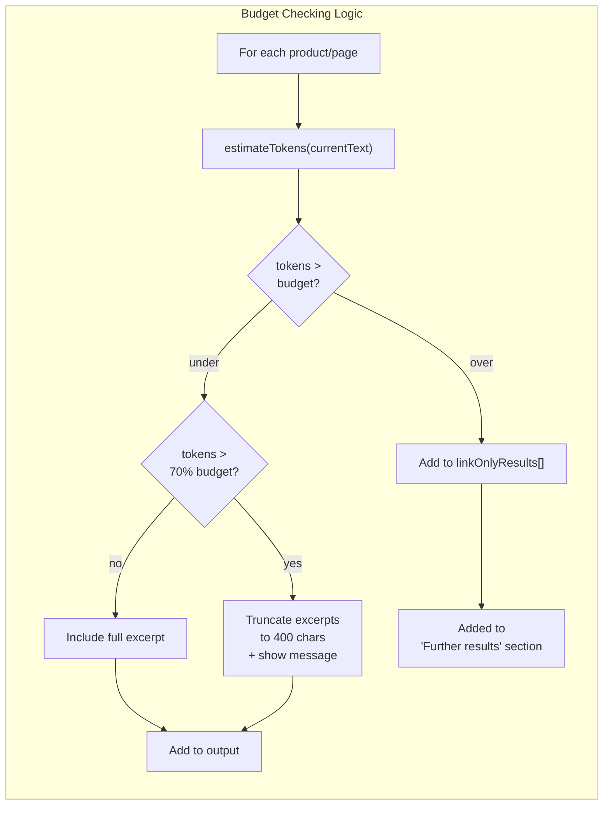
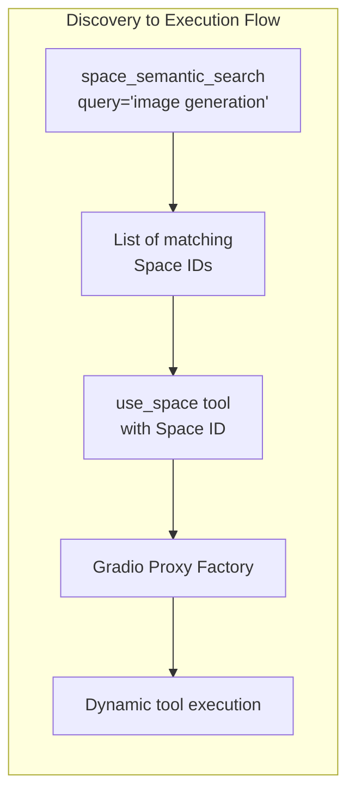
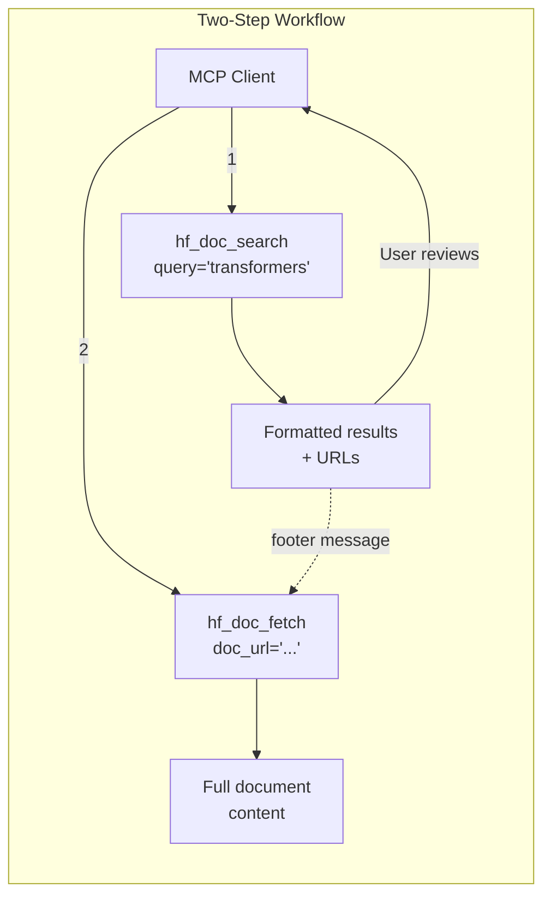

<!-- source: DeepWiki mcp.deepwiki.com · repo huggingface/hf-mcp-server · extra page Search Tools · fetched 2026-10-26 -->

# Search Tools

<details>
<summary>Relevant source files</summary>

The following files were used as context for generating this wiki page:

- [packages/app/src/shared/constants.ts](packages/app/src/shared/constants.ts)
- [packages/e2e-python/prompts.py](packages/e2e-python/prompts.py)
- [packages/mcp/src/dataset-detail.ts](packages/mcp/src/dataset-detail.ts)
- [packages/mcp/src/docs-search/doc-fetch.test.ts](packages/mcp/src/docs-search/doc-fetch.test.ts)
- [packages/mcp/src/docs-search/doc-fetch.ts](packages/mcp/src/docs-search/doc-fetch.ts)
- [packages/mcp/src/docs-search/docs-semantic-search.test.ts](packages/mcp/src/docs-search/docs-semantic-search.test.ts)
- [packages/mcp/src/docs-search/docs-semantic-search.ts](packages/mcp/src/docs-search/docs-semantic-search.ts)
- [packages/mcp/src/model-detail.ts](packages/mcp/src/model-detail.ts)

</details>


## Purpose and Scope

This page documents the five search tools that enable discovery of resources on the Hugging Face Hub and within the documentation library. These tools provide semantic search capabilities for models, datasets, papers, spaces, and documentation.

For tools that retrieve detailed information about specific entities, see [Detail Tools](#4.2.2). For space-specific operations beyond search, see [Space Management Tools](#4.2.3). For documentation retrieval after search, see [Documentation Tools](#4.2.4).

**Sources:** [packages/mcp/src/docs-search/docs-semantic-search.ts:1-380]()

## Available Search Tools

| Tool Name | Purpose | Primary Use Case |
|-----------|---------|------------------|
| `model_search` | Search for models on Hugging Face Hub | Finding models by keywords, tags, or capabilities |
| `dataset_search` | Search for datasets on Hugging Face Hub | Discovering datasets by task, domain, or features |
| `paper_search` | Search for papers on Hugging Face Hub | Finding research papers and associated artifacts |
| `space_semantic_search` | Semantic search for Spaces | Discovering Gradio/Streamlit applications |
| `hf_doc_search` | Search Hugging Face documentation | Finding documentation pages and code examples |

**Sources:** [packages/mcp/src/docs-search/docs-semantic-search.ts:10-45]()

## Search Tool Architecture

### Tool Configuration Pattern

All search tools follow a consistent configuration pattern using Zod schemas for input validation and MCP tool annotations.



**Diagram: Search Tool Configuration and Implementation Pattern**

**Sources:** [packages/mcp/src/docs-search/docs-semantic-search.ts:10-45](), [packages/mcp/src/types/tool-result.ts]()

### HfApiCall Base Class

Search tools that interact with the Hugging Face API extend the `HfApiCall` base class, which provides common functionality for HTTP requests, error handling, and authentication.



**Diagram: HfApiCall Base Class Inheritance Hierarchy**

**Sources:** [packages/mcp/src/docs-search/docs-semantic-search.ts:77-88](), [packages/mcp/src/hf-api-call.ts]()

## Documentation Search Tool (hf_doc_search)

### Tool Configuration

The `hf_doc_search` tool provides semantic search over the Hugging Face documentation library with support for product filtering and empty-query discovery.

```typescript
// Tool identifier and schema
name: 'hf_doc_search'

// Input parameters
query: string (0-200 chars)  // Empty query returns docs index
product?: string             // Optional filter (e.g., 'hub', 'transformers')

// Annotations
readOnlyHint: true           // Read-only operation
openWorldHint: true          // Can discover new information
```

**Sources:** [packages/mcp/src/docs-search/docs-semantic-search.ts:10-45]()

### Empty Query Behavior

When invoked with an empty query string, `hf_doc_search` returns the documentation index, providing a structured overview of available products and navigation guidance.

```mermaid
sequenceDiagram
    participant Client
    participant DocSearchTool
    participant DocsAPI["HF Docs API<br/>/api/docs"]
    
    Client->>DocSearchTool: "search({ query: '' })"
    DocSearchTool->>DocSearchTool: "query.trim().length === 0"
    DocSearchTool->>DocsAPI: "fetchFromApi(DOCS_INDEX_URL)"
    DocsAPI-->>DocSearchTool: "DocsIndexEntry[]"
    DocSearchTool->>DocSearchTool: "formatDocsIndex()"
    DocSearchTool-->>Client: "Markdown table of products"
    
    Note over Client,DocSearchTool: Returns structure, categories,<br/>and llms.txt endpoints
```

**Diagram: Empty Query Discovery Flow**

The response includes a markdown table with columns for Product ID, Category, and Documentation URL, plus information about `llms.txt` endpoints for each documentation root.

**Sources:** [packages/mcp/src/docs-search/docs-semantic-search.ts:94-100](), [packages/mcp/src/docs-search/docs-semantic-search.ts:162-190]()

### Semantic Search Flow

For non-empty queries, the tool performs semantic search against the documentation API and formats results with grouping and token budget management.



**Diagram: Semantic Search Processing Pipeline**

**Sources:** [packages/mcp/src/docs-search/docs-semantic-search.ts:94-127](), [packages/mcp/src/docs-search/docs-semantic-search.ts:265-379]()

### Result Grouping and Formatting

Search results are grouped hierarchically by product, then by source page URL (with anchors stripped), then by section heading.



**Diagram: Result Grouping and Output Structure**

**Sources:** [packages/mcp/src/docs-search/docs-semantic-search.ts:132-157](), [packages/mcp/src/docs-search/docs-semantic-search.ts:194-210]()

### Token Budget Management

The tool implements a token budget system (default 12,500 tokens) to prevent overwhelming responses. When approaching the budget, the tool switches strategies:

| Phase | Token Usage | Behavior |
|-------|-------------|----------|
| Early results | < 70% of budget | Full excerpts included |
| Approaching limit | > 70% of budget | Excerpts truncated to 400 chars with message |
| Over budget | > 100% of budget | Pages converted to link-only references |



**Diagram: Token Budget Management Strategy**

**Sources:** [packages/mcp/src/docs-search/docs-semantic-search.ts:69-72](), [packages/mcp/src/docs-search/docs-semantic-search.ts:296-370](), [packages/mcp/src/docs-search/docs-semantic-search.ts:242-248]()

### Integration with Doc Fetch Tool

Search results include a footer message directing users to the `hf_doc_fetch` tool for retrieving full document content. The constant `DOC_FETCH_CONFIG.name` is referenced to maintain consistency.

```typescript
// Footer added to all search results
lines.push(`Use the "${DOC_FETCH_CONFIG.name}" tool to fetch a document from the library.`);
```

This integration pattern enables a two-step workflow: discover relevant documentation with `hf_doc_search`, then retrieve full content with `hf_doc_fetch`.

**Sources:** [packages/mcp/src/docs-search/docs-semantic-search.ts:4](), [packages/mcp/src/docs-search/docs-semantic-search.ts:372]()

## Model, Dataset, and Paper Search Tools

While the implementation files for `model_search`, `dataset_search`, and `paper_search` are not included in the provided sources, these tools follow similar patterns to the documentation search tool:

### Common Characteristics

- Extend `HfApiCall` base class for API interactions
- Accept query strings and optional filter parameters
- Return `ToolResult` with formatted markdown
- Support sorting and filtering by various attributes
- Integrate with corresponding detail tools (see [Detail Tools](#4.2.2))

### Typical Parameters

| Tool | Key Parameters | Example Filters |
|------|---------------|-----------------|
| `model_search` | query, sort, direction, limit | task, language, library, tags |
| `dataset_search` | query, sort, direction, limit | task_categories, languages, size_categories |
| `paper_search` | query, sort, limit | published date, topics |

**Sources:** Inferred from [packages/mcp/src/model-detail.ts](), [packages/mcp/src/dataset-detail.ts]()

## Space Semantic Search

The `space_semantic_search` tool enables discovery of Gradio and Streamlit applications hosted on Hugging Face Spaces using semantic queries.

### Integration with Gradio System

Space search results can be used in conjunction with the Gradio integration system (see [Gradio Integration](#6)) to dynamically load and invoke Space tools.



**Diagram: Space Search to Execution Pipeline**

**Sources:** Referenced in tool selection system documentation

## Search Results Structure

All search tools return a consistent `ToolResult` structure with three key fields:

```typescript
interface ToolResult {
  formatted: string;      // Markdown-formatted results for display
  totalResults: number;   // Total number of results found
  resultsShared: number;  // Number of results included in formatted output
}
```

The distinction between `totalResults` and `resultsShared` allows tools to report when results have been truncated or limited for token budget reasons.

**Sources:** [packages/mcp/src/types/tool-result.ts](), [packages/mcp/src/docs-search/docs-semantic-search.ts:374-378]()

## Search-Fetch Integration Pattern

The documentation search tool demonstrates a key integration pattern where search tools reference complementary fetch/detail tools:



**Diagram: Search-to-Fetch Workflow Pattern**

This pattern is also utilized by the tool selection strategy through the `SEARCH_ENABLES_FETCH` feature flag (see [Tool Selection Strategy](#5.2)), which automatically enables `hf_doc_fetch` when `hf_doc_search` is selected in a bouquet.

**Sources:** [packages/mcp/src/docs-search/docs-semantic-search.ts:372](), [packages/mcp/src/docs-search/doc-fetch.ts:5-23]()

## Test Coverage

The documentation search tool includes comprehensive test coverage demonstrating expected behaviors:

### Key Test Scenarios

- URL validation for HF and Gradio documentation
- Empty query returns documentation index
- Product filtering in search requests
- Result grouping by product and page
- Token budget enforcement with truncation
- Link-only mode for over-budget results
- Markdown escaping for special characters
- HTML tag removal from excerpts
- Proper sorting by result count

**Sources:** [packages/mcp/src/docs-search/docs-semantic-search.test.ts:1-429]()

## Usage Example

From the end-to-end test suite:

```python
# Discover documentation structure
await agent.anon("***CALL_TOOL hf_doc_search {\"query\": \"\"}")

# Search for specific topic
await agent.anon("***CALL_TOOL hf_doc_search {\"query\": \"rate limits\", \"product\": \"hub\"}")

# Fetch full document after search
await agent.anon("***CALL_TOOL hf_doc_fetch {\"doc_url\": \"https://huggingface.co/docs/hub/...\"}")
```

**Sources:** [packages/e2e-python/prompts.py:1-30]() (pattern inferred)

---

