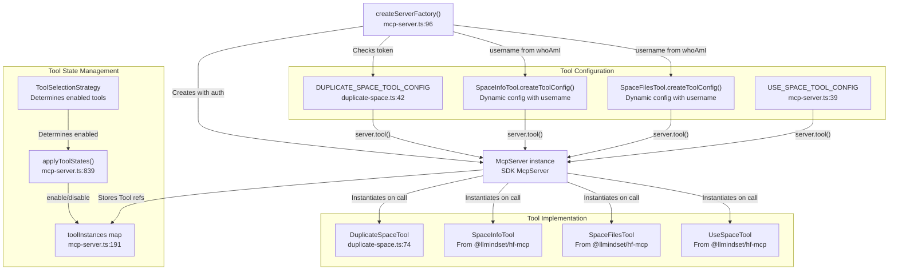
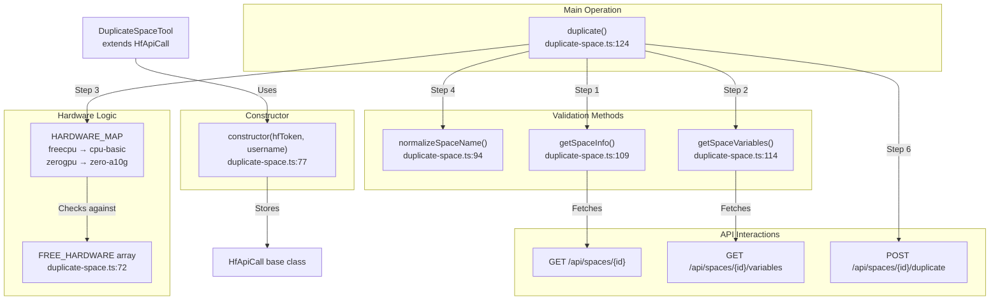
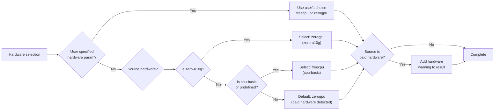
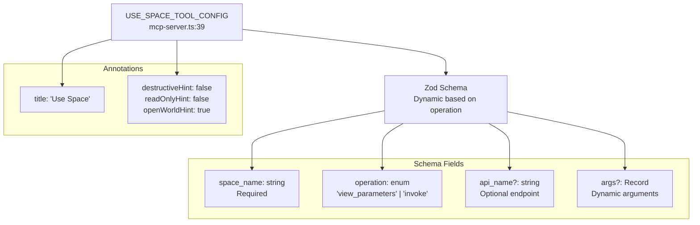
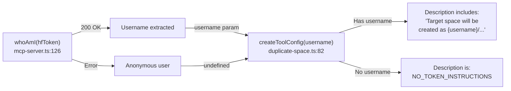

<!-- source: DeepWiki mcp.deepwiki.com · repo huggingface/hf-mcp-server · extra page Space Management Tools · fetched 2026-10-26 -->

# Space Management Tools

<details>
<summary>Relevant source files</summary>

The following files were used as context for generating this wiki page:

- [.dockerignore](.dockerignore)
- [Dockerfile](Dockerfile)
- [README.md](README.md)
- [packages/app/src/server/mcp-server.ts](packages/app/src/server/mcp-server.ts)
- [packages/app/src/shared/settings.ts](packages/app/src/shared/settings.ts)
- [packages/app/src/web/App.tsx](packages/app/src/web/App.tsx)
- [packages/app/vite.config.ts](packages/app/vite.config.ts)
- [packages/mcp/src/duplicate-space.ts](packages/mcp/src/duplicate-space.ts)
- [packages/mcp/src/error-messages.ts](packages/mcp/src/error-messages.ts)
- [start.sh](start.sh)

</details>


## Purpose and Scope

This document describes the space management tools provided by the HF MCP Server. These tools enable AI clients to interact with Hugging Face Spaces - both static operations (duplicating, inspecting, listing files) and dynamic invocation of Gradio applications. This page covers four built-in tools: `duplicate_space`, `space_info`, `space_files`, and `use_space`.

For information about searching for spaces, see [Search Tools](#4.2.1). For dynamic Gradio tool discovery and proxied execution, see [Gradio Integration](#6).

---

## Overview

Space management tools allow clients to:

1. **Duplicate existing spaces** to the authenticated user's account
2. **Inspect space metadata** including runtime configuration and hardware
3. **List files** in static spaces with download URLs
4. **Dynamically invoke Gradio spaces** without pre-registration

All space management tools except `duplicate_space` and `space_files` work for both authenticated and anonymous users. The `duplicate_space` tool requires authentication since it creates resources in the user's account. The `space_files` tool requires authentication to access the space's file tree.

Sources: [packages/app/src/server/mcp-server.ts:602-670](), [packages/mcp/src/duplicate-space.ts:1-264]()

---

## Tool Registration Architecture

### Registration Flow



**Diagram: Space Tool Registration and State Management**

The space management tools follow the standard MCP tool registration pattern. The `duplicate_space`, `space_info`, and `space_files` tools generate their descriptions dynamically based on whether the user is authenticated. If a valid `hfToken` is present and `whoAmI` succeeds, the tool configurations include the username in their descriptions.

Sources: [packages/app/src/server/mcp-server.ts:96-220](), [packages/app/src/server/mcp-server.ts:602-670](), [packages/mcp/src/duplicate-space.ts:82-92]()

---

## duplicate_space Tool

### Purpose

The `duplicate_space` tool creates a copy of an existing Hugging Face Space in the authenticated user's account. This is useful for:

- Forking community spaces for customization
- Creating private versions of public spaces
- Testing modified configurations
- Migrating spaces between hardware tiers

### Configuration and Schema

The tool is defined by `DUPLICATE_SPACE_TOOL_CONFIG` with the following schema:

| Parameter | Type | Required | Description |
|-----------|------|----------|-------------|
| `sourceSpaceId` | string | Yes | Space ID to copy (e.g., 'username/space-name') |
| `newSpaceId` | string | No | Name for new space (defaults to source space name) |
| `hardware` | enum | No | Either "freecpu" or "zerogpu" (auto-detects from source) |
| `private` | boolean | No | Visibility (defaults to true) |

The tool schema is defined at [packages/mcp/src/duplicate-space.ts:42-64]() and includes annotations:

```typescript
annotations: {
  title: 'Duplicate Hugging Face Space',
  destructiveHint: false,
  readOnlyHint: false,
  openWorldHint: true,
}
```

The `openWorldHint: true` indicates the tool creates new resources, alerting clients that this is a write operation.

Sources: [packages/mcp/src/duplicate-space.ts:42-64]()

### Implementation: DuplicateSpaceTool Class



**Diagram: DuplicateSpaceTool Implementation Flow**

The `DuplicateSpaceTool` class at [packages/mcp/src/duplicate-space.ts:74-259]() extends `HfApiCall` to inherit authentication and error handling. The duplication process follows these steps:

1. **Fetch source space info** via `getSpaceInfo()` to access runtime configuration
2. **Retrieve space variables** via `getSpaceVariables()` to copy environment settings
3. **Determine hardware tier** using `HARDWARE_MAP` and source space configuration
4. **Normalize target space ID** to ensure proper namespace (`username/space-name`)
5. **Check for warnings** regarding paid hardware or gated models
6. **Execute duplication** via POST to `/api/spaces/{id}/duplicate`

Sources: [packages/mcp/src/duplicate-space.ts:74-236]()

### Hardware Selection Logic



**Diagram: Hardware Tier Selection Algorithm**

The hardware selection logic at [packages/mcp/src/duplicate-space.ts:156-192]() handles three cases:

1. **User-specified hardware**: Direct mapping via `HARDWARE_MAP` constant
2. **Auto-detection from source**: Preserves `zero-a10g` or `cpu-basic`
3. **Paid hardware fallback**: Defaults to `zerogpu` with warning

The `FREE_HARDWARE` array at [packages/mcp/src/duplicate-space.ts:72]() defines which hardware tiers are in the free tier. If the source uses paid hardware, a warning is included in the result instructing the user to upgrade if needed.

Sources: [packages/mcp/src/duplicate-space.ts:156-192](), [packages/mcp/src/duplicate-space.ts:66-72]()

### Response Format

The tool returns a `DuplicateSpaceResult` object that is formatted by `formatDuplicateResult()` at [packages/mcp/src/duplicate-space.ts:261-263](). The formatted response includes:

- **URL**: Direct link to the new space
- **Configuration summary**: Hardware tier and visibility
- **Variable count**: Number of environment variables copied
- **Setup instructions**: Step-by-step guide to configure the space
- **Warnings**: Hardware compatibility or gated model notices

Example response structure:
```
✅ 🤗 Space successfully duplicated! 

🔗 Your new space: https://huggingface.co/spaces/username/space-name

⚙️ To configure your space:
1. Go to https://huggingface.co/spaces/username/space-name
2. Click on 'Settings' in the top right
3. Configure any additional settings as needed

Hardware: zerogpu | Visibility: Private

⚠️ Warnings:
- Note: The source space uses 'a10g-large' which is paid hardware...
```

Sources: [packages/mcp/src/duplicate-space.ts:218-258](), [packages/mcp/src/duplicate-space.ts:261-263]()

### Error Handling

The tool uses the `explain()` function from [packages/mcp/src/error-messages.ts:48-57]() to enhance error messages. Common error scenarios:

| Status | Explanation |
|--------|-------------|
| 400 | Invalid request - check token permissions or space quota |
| 401 | Authentication failed - invalid token |
| 403 | Permission denied - check token scopes |
| 404 | Source space does not exist |
| 409 | Space with target name already exists |
| 429 | Rate limit exceeded |

The `FRIENDLY_ERROR_EXPLANATIONS` at [packages/mcp/src/error-messages.ts:10-21]() provides user-friendly messages for each status code.

Sources: [packages/mcp/src/error-messages.ts:10-57](), [packages/mcp/src/duplicate-space.ts:129-235]()

---

## space_info Tool

### Purpose

The `space_info` tool retrieves comprehensive metadata about a Hugging Face Space, including runtime configuration, hardware allocation, and operational status. This tool is read-only and works for both authenticated and anonymous users.

### Configuration

The tool configuration is generated dynamically by `SpaceInfoTool.createToolConfig()` based on authentication status. When authenticated, the description includes the username to clarify which account's spaces can be managed.

Tool registration occurs at [packages/app/src/server/mcp-server.ts:617-630]() with these annotations:

```typescript
annotations: {
  title: 'Space Info',
  readOnlyHint: true,
  openWorldHint: false,
}
```

Sources: [packages/app/src/server/mcp-server.ts:617-630]()

### Implementation

The `SpaceInfoTool` class is imported from `@llmindset/hf-mcp` package. The tool:

1. Accepts a `space_id` parameter (e.g., `username/space-name`)
2. Calls the Hugging Face API to retrieve space metadata
3. Formats the result using `formatSpaceInfoResult()` helper
4. Returns structured information about the space

The tool handler at [packages/app/src/server/mcp-server.ts:624-628]() instantiates `SpaceInfoTool` with the user's token and username, then delegates to the formatting function.

Sources: [packages/app/src/server/mcp-server.ts:617-630]()

---

## space_files Tool

### Purpose

The `space_files` tool lists all files in a static Hugging Face Space with their download URLs. This is useful for:

- Inspecting space contents before duplication
- Downloading specific assets from a space
- Understanding space structure and dependencies
- Programmatic access to space artifacts

### Configuration and Schema

The tool schema requires:

| Parameter | Type | Required | Description |
|-----------|------|----------|-------------|
| `space_id` | string | Yes | Space ID to inspect (e.g., 'username/space-name') |

Like `space_info`, this tool's configuration is generated dynamically by `SpaceFilesTool.createToolConfig()` and includes authentication-aware descriptions.

Tool annotations:
```typescript
annotations: {
  title: 'Space Files',
  readOnlyHint: true,
  openWorldHint: false,
}
```

Sources: [packages/app/src/server/mcp-server.ts:632-645]()

### Implementation

The tool is registered at [packages/app/src/server/mcp-server.ts:632-645]() and follows this flow:

1. Instantiate `SpaceFilesTool` with token and username
2. Call `listFiles()` method with the space ID parameter
3. Return formatted list of files with download URLs

The `SpaceFilesTool` class handles API interaction and response formatting internally.

Sources: [packages/app/src/server/mcp-server.ts:632-645]()

---

## use_space Tool (Dynamic Invocation)

### Purpose

The `use_space` tool is a special dynamic tool that allows invocation of Gradio spaces without pre-registration. Unlike the proxied Gradio tools (e.g., `gr1_tool`, `gr2_tool`) which are discovered and registered at server startup, `use_space` enables on-demand invocation of any Gradio space.

This tool supports two operations:
1. **view_parameters**: Inspect the tool schema for a Gradio space
2. **invoke**: Execute a Gradio endpoint with provided arguments

For comprehensive Gradio integration architecture, see [Gradio Integration](#6).

Sources: [packages/app/src/server/mcp-server.ts:647-815]()

### Configuration and Schema



**Diagram: use_space Tool Configuration Structure**

The tool is registered at [packages/app/src/server/mcp-server.ts:647-815]() with `DYNAMIC_SPACE_TOOL_CONFIG` (also referenced as `USE_SPACE_TOOL_CONFIG`). The schema allows both parameter inspection and invocation operations.

Sources: [packages/app/src/server/mcp-server.ts:38-40](), [packages/app/src/server/mcp-server.ts:647-670]()

### Operation Flow

```mermaid
sequenceDiagram
    participant Client
    participant Handler["use_space handler<br/>mcp-server.ts:704"]
    participant SpaceTool["SpaceTool instance<br/>From @llmindset/hf-mcp"]
    participant GradioCheck["gradio header check<br/>mcp-server.ts:706"]
    participant PostProcess["applyResultPostProcessing<br/>gradio-tool-caller.ts"]
    participant Logger["logGradioEvent"]
    
    Client->>Handler: tools/call use_space
    Handler->>GradioCheck: Check if gradio=none
    
    alt gradio=none and operation=invoke
        GradioCheck-->>Client: Error: invoke disabled
    else gradio allowed
        Handler->>SpaceTool: execute(params)
        
        alt operation=view_parameters
            SpaceTool-->>Handler: ToolResult (formatted schema)
            Handler->>Logger: logSearchQuery (view operation)
            Handler-->>Client: Text response
        else operation=invoke
            SpaceTool-->>Handler: InvokeResult (raw MCP content)
            Handler->>PostProcess: Strip images if needed
            PostProcess->>PostProcess: Apply OpenAI transforms
            PostProcess-->>Handler: Processed content
            Handler->>Logger: logGradioEvent (with metrics)
            Handler-->>Client: Content array with images/text
        end
    end
```

**Diagram: use_space Execution Flow**

The tool handler at [packages/app/src/server/mcp-server.ts:704-814]() implements a sophisticated flow:

1. **Check gradio header**: If `gradio=none`, reject invoke operations
2. **Execute via SpaceTool**: Delegate to `@llmindset/hf-mcp` implementation
3. **Branch on result type**:
   - `InvokeResult`: Raw MCP content from Gradio (needs post-processing)
   - `ToolResult`: Formatted text (for view_parameters)
4. **Post-process invoke results**: Apply image filtering and OpenAI transforms
5. **Log metrics**: Track invocation performance and success

Sources: [packages/app/src/server/mcp-server.ts:704-814]()

### Post-Processing Pipeline

The invoke operation applies `applyResultPostProcessing()` from [packages/app/src/server/utils/gradio-tool-caller.ts]() with these options:

```typescript
const postProcessOptions: GradioToolCallOptions = {
  stripImageContent: noImageContentHeaderEnabled || 
                     toolSelection.enabledToolIds.includes('NO_GRADIO_IMAGE_CONTENT'),
  toolName: DYNAMIC_SPACE_TOOL_CONFIG.name,
  outwardFacingName: DYNAMIC_SPACE_TOOL_CONFIG.name,
  sessionInfo,
  spaceName: params.space_name,
};
```

This unified post-processing at [packages/app/src/server/mcp-server.ts:731-745]() handles:

- **Image filtering**: Removes image content if `x-mcp-no-image-content: true` header or `NO_GRADIO_IMAGE_CONTENT` flag is set
- **OpenAI transformations**: Converts MCP content format to OpenAI-compatible structured content (for skybridge clients)
- **Warning prepending**: Adds any warnings from the invocation to the response

Sources: [packages/app/src/server/mcp-server.ts:731-759](), [packages/app/src/server/utils/gradio-tool-caller.ts:76]()

### Gradio Header Control

The tool respects the `gradio` header value for access control:

| Header Value | Behavior |
|--------------|----------|
| Not set | Invoke allowed |
| Space IDs | Invoke allowed |
| `none` | **Invoke blocked**, view_parameters still allowed |

The check at [packages/app/src/server/mcp-server.ts:706-716]() prevents invocation when `gradio=none` is set:

```typescript
if (params.operation === 'invoke' && gradio === 'none') {
  return {
    content: [{ type: 'text', text: errorMessage }],
    isError: true,
  };
}
```

This allows users to disable Gradio invocations while still enabling parameter inspection.

Sources: [packages/app/src/server/mcp-server.ts:706-716](), [packages/app/src/server/utils/auth-utils.ts:1-50]()

### Metrics and Logging

The tool uses different logging approaches based on operation:

**For invoke operations** (line [packages/app/src/server/mcp-server.ts:762-773]()):
- Logs via `logGradioEvent()` with timing metrics
- Tracks duration, authentication status, client info
- Records response size and success/failure
- Marks as `isDynamic: true` to distinguish from proxied tools

**For view_parameters operations** (line [packages/app/src/server/mcp-server.ts:785-791]()):
- Logs via `logSearchQuery()` for consistency with other inspection tools
- Records operation type and parameter details

Sources: [packages/app/src/server/mcp-server.ts:762-791](), [packages/app/src/server/utils/query-logger.ts:69](), [packages/app/src/server/utils/gradio-tool-caller.ts:1-200]()

### Error Handling

The tool has two error handling paths:

1. **Operation-level errors** (try-catch at [packages/app/src/server/mcp-server.ts:797-813]()):
   - Logs Gradio event for invoke failures
   - Includes error details in metrics
   - Re-throws for MCP protocol error handling

2. **Validation errors** (inline at [packages/app/src/server/mcp-server.ts:706-716]()):
   - Returns error content with `isError: true`
   - Provides user-facing guidance

Sources: [packages/app/src/server/mcp-server.ts:706-813]()

---

## UI Configuration

### Web Dashboard Integration

The space management tools appear in the web dashboard's "Spaces" tab. The configuration is defined at [packages/app/src/web/App.tsx:289-311]():

```typescript
const spaceTools = {
  duplicate_space: {
    id: DUPLICATE_SPACE_TOOL_ID,
    label: DUPLICATE_SPACE_TOOL_CONFIG.annotations.title,
    description: DUPLICATE_SPACE_TOOL_CONFIG.description,
    settings: { enabled: settings?.builtInTools?.includes(DUPLICATE_SPACE_TOOL_ID) ?? true },
  },
  space_files: {
    id: SPACE_FILES_TOOL_ID,
    label: SPACE_FILES_TOOL_CONFIG.annotations.title,
    description: SPACE_FILES_TOOL_CONFIG.description,
    settings: { enabled: settings?.builtInTools?.includes(SPACE_FILES_TOOL_ID) ?? true },
  },
  no_gradio_images: {
    id: GRADIO_IMAGE_FILTER_FLAG,
    label: 'Disable Gradio Images (flag)',
    description: 'Strips image responses from Gradio spaces...',
    settings: { enabled: gradioImageFilterEnabled },
  },
};
```

Users can toggle these tools on/off, triggering API calls to update settings and sending `toolStateChange` events to all connected MCP server instances.

Sources: [packages/app/src/web/App.tsx:289-367]()

### Tool Selection and Bouquets

Space management tools are included in specific bouquet presets:

| Bouquet | Includes |
|---------|----------|
| `spaces` | `duplicate_space`, `space_info`, `space_files`, `use_space`, `space_semantic_search` |
| `hf_api` | `duplicate_space`, `space_info`, `space_files` |
| `all` | All space tools |

The bouquet system is documented in [Tool Selection System](#5).

Sources: [packages/app/src/server/utils/tool-selection-strategy.ts:1-300]()

---

## Authentication Requirements

### Tool-by-Tool Requirements

| Tool | Requires Auth | Reason |
|------|---------------|--------|
| `duplicate_space` | ✅ Yes | Creates resources in user's account |
| `space_info` | ❌ No | Read-only inspection |
| `space_files` | ✅ Yes | Accesses file tree (may include private info) |
| `use_space` | ❌ No* | *May be required by individual Gradio spaces |

The `duplicate_space` tool checks for authentication at initialization ([packages/mcp/src/duplicate-space.ts:127]()) and returns a clear error message if no token is present:

```typescript
if (!this.username) throw new Error(NO_TOKEN_INSTRUCTIONS);
```

The `NO_TOKEN_INSTRUCTIONS` constant provides user-facing guidance on setting up authentication.

Sources: [packages/mcp/src/duplicate-space.ts:77-127](), [packages/mcp/src/utilities.ts:1-50]()

### Dynamic Description Updates

The tool descriptions adapt based on authentication:



**Diagram: Dynamic Tool Description Generation**

This pattern appears in all username-aware space tools (`duplicate_space`, `space_info`, `space_files`) at their respective `createToolConfig()` methods.

Sources: [packages/app/src/server/mcp-server.ts:124-133](), [packages/mcp/src/duplicate-space.ts:82-92]()

---

## Relationship to Gradio Integration

The space management tools complement but differ from the Gradio integration system:

| Aspect | Space Management Tools | Gradio Integration |
|--------|----------------------|-------------------|
| Registration | Static, always available | Dynamic, discovered at runtime |
| Purpose | Manage space lifecycle | Invoke Gradio endpoints |
| Examples | `duplicate_space`, `space_info` | `gr1_flux_schnell`, `gr2_tool` |
| Authentication | Per-tool requirements | Inherited from space |
| Configuration | Via tool selection | Via `x-mcp-gradio` header or user settings |

The `use_space` tool bridges these systems by providing dynamic invocation without requiring pre-registration. For detailed Gradio tool discovery and proxying, see [Gradio Integration](#6).

Sources: [packages/app/src/server/mcp-server.ts:602-815]()

---

