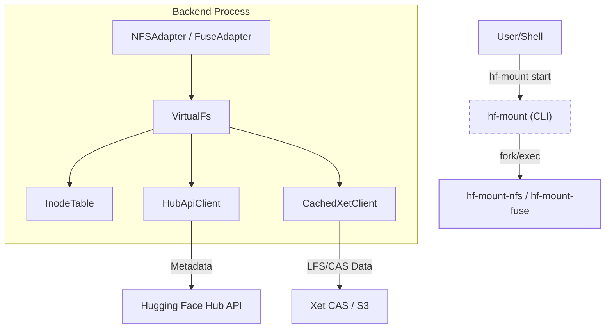

<!-- source: DeepWiki mcp.deepwiki.com · repo huggingface/hf-mount · page 1 Overview · fetched 2026-10-26 -->

# Overview

Relevant source files

The following files were used as context for generating this wiki page:

- [Cargo.toml](Cargo.toml)
- [README.md](README.md)

`hf-mount` is a high-performance virtual filesystem that allows users to mount Hugging Face [Storage Buckets](https://huggingface.co/docs/hub/storage-buckets) and [Repositories](https://huggingface.co) as local directories. It enables "lazy-loading" of data, meaning files are only fetched from the remote server when a process actually reads them, eliminating the need for full repository clones or manual downloads [README.md:5-25]().

The project is designed for read-heavy Machine Learning workloads, such as training or inference, where datasets and models may be significantly larger than available local disk space [README.md:82-87]().

## Key Capabilities

*   **Lazy Fetching:** Only the bytes requested by the application are downloaded, using range requests via the Xet CAS (Content Addressable Storage) layer [README.md:25]().
*   **Dual Protocol Support:** Provides both **NFS** (stateless, no root required) and **FUSE** (tighter kernel integration) backends [README.md:27-29]().
*   **Write Support:** Supports read-write operations on Hugging Face Buckets with two distinct modes: a synchronous streaming mode for simple appends and an advanced staging mode for random-access writes [README.md:117-122]().
*   **Agent-Friendly:** Exposes remote data through standard POSIX interfaces, allowing tools like `ls`, `grep`, and `find` to work directly on Hub content [README.md:31]().

For installation instructions and basic CLI usage, see [Getting Started (#1.1)]().

## System Architecture

The `hf-mount` ecosystem consists of a management CLI and specialized backend binaries that implement the filesystem logic.

### Component Relationship

The following diagram illustrates how the user-facing CLI interacts with the daemonized backends and how those backends communicate with Hugging Face infrastructure.

**System Entity Map**

**Sources:** [src/bin/hf-mount.rs:1-59](), [src/bin/hf-mount-nfs.rs:1-50](), [src/bin/hf-mount-fuse.rs:1-50]()

### Core Abstractions

1.  **CLI Wrapper (`hf-mount`):** A frontend binary that manages the lifecycle of mount points, including starting, stopping, and tracking PIDs/logs [README.md:131-138]().
2.  **Protocol Adapters:**
    *   `NFSAdapter`: Implements the `nfsserve` trait to expose the filesystem over the NFSv3 protocol [Cargo.toml:26-39]().
    *   `FuseAdapter`: Implements the `fuser` trait for direct kernel integration [Cargo.toml:23-38]().
3.  **VirtualFs:** The central engine that translates POSIX-like operations (getattr, lookup, read, write) into remote API calls. It maintains an `InodeTable` to track file metadata and directory structures.
4.  **Xet CAS Layer:** Handles the heavy lifting of data movement, using the `xet-client` to reconstruct files from content-addressable chunks [Cargo.toml:12-16]().

For a deep dive into the internal data flow and write modes, see [Architecture Overview (#1.2)]().

## Technical Stack

The project is written in Rust and leverages several key technologies:

| Component | Entity / Library | Purpose |
| :--- | :--- | :--- |
| **Concurrency** | `tokio` | Async runtime for I/O and polling [Cargo.toml:30]() |
| **NFS Backend** | `nfsserve` | User-space NFSv3 server implementation [Cargo.toml:26]() |
| **FUSE Backend** | `fuser` | Rust bindings for FUSE [Cargo.toml:23]() |
| **Data Transport** | `xet-client` | Deduplicated data transfer and caching [Cargo.toml:13]() |
| **API Client** | `reqwest` | Communication with the Hugging Face Hub [Cargo.toml:27]() |

## Project Structure

The codebase is organized into a main library and multiple binary targets:

*   `src/lib.rs`: Contains the core `VirtualFs` logic and trait definitions.
*   `src/bin/hf-mount.rs`: The management CLI [src/bin/hf-mount.rs:1-59]().
*   `src/bin/hf-mount-nfs.rs`: The NFS-specific daemon [src/bin/hf-mount-nfs.rs:1-50]().
*   `src/bin/hf-mount-fuse.rs`: The FUSE-specific daemon [src/bin/hf-mount-fuse.rs:1-50]().
*   `src/vfs/`: Directory and file metadata management.
*   `src/hub/`: Implementation of the Hub API and Xet CAS interfaces.

For details on the core filesystem implementation, see [Core Filesystem Layer (#2)]().

---

