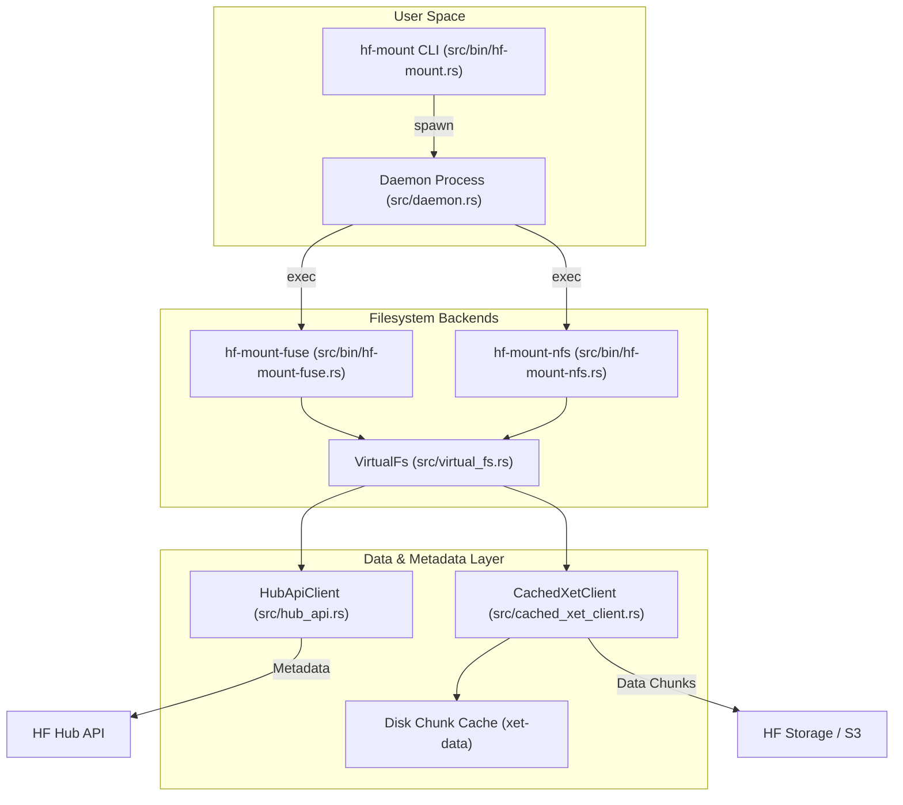
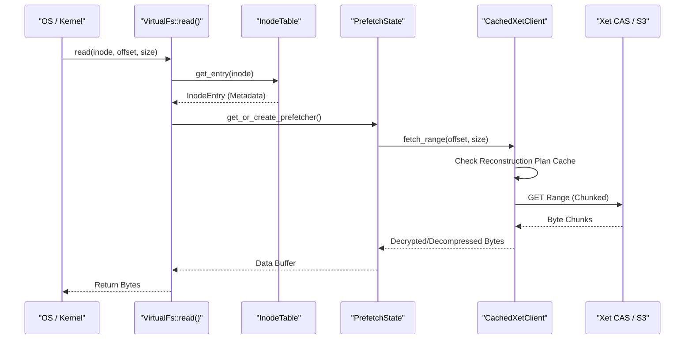

<!-- source: DeepWiki mcp.deepwiki.com · repo huggingface/hf-mount · page 1.2 Architecture Overview · fetched 2026-10-26 -->

# Architecture Overview

Relevant source files

The following files were used as context for generating this wiki page:

- [Cargo.lock](Cargo.lock)
- [Cargo.toml](Cargo.toml)
- [README.md](README.md)
- [src/setup.rs](src/setup.rs)

The `hf-mount` system is a multi-layered filesystem bridge that exposes Hugging Face Hub repositories and Storage Buckets as local POSIX-compliant filesystems. It is designed for lazy-loading data, meaning file contents are only fetched from the remote server when a process performs a read operation.

## Layered Architecture

The system operates through a hierarchy of components, moving from user-facing CLI tools down to the low-level Hugging Face API and Content Addressable Storage (CAS).

### System Component Diagram
The following diagram illustrates the data flow and component relationships from the CLI to the remote backend.

"Architecture Component Flow"

Sources: [src/bin/hf-mount.rs:1-60](), [src/daemon.rs:1-50](), [src/virtual_fs.rs:1-100](), [src/hub_api.rs:1-50](), [src/cached_xet_client.rs:1-40]()

## Mount Types: Repo vs. Bucket

The system supports two primary sources of data, handled via the `Source` enum in `src/setup.rs` [src/setup.rs:17-35]().

| Feature | Repo Mount (`Source::Repo`) | Bucket Mount (`Source::Bucket`) |
| :--- | :--- | :--- |
| **Primary Use** | Models, Datasets, Git-based repos | S3-like object storage for checkpoints/logs |
| **Mutability** | Read-Only (by default) | Read-Write (default) |
| **Versioning** | Git Revisions (branch/tag/commit) | Flat/Prefix-based (no Git) |
| **Metadata Source** | Hub Tree API | Bucket List API |
| **Data Path** | Xet CAS / LFS | Direct S3 / Xet CAS |

Sources: [src/setup.rs:17-54](), [src/hub_api.rs:115-150](), [README.md:98-130]()

## Filesystem Backends

`hf-mount` provides two protocol implementations to expose the `VirtualFs` to the Operating System.

1.  **FUSE (Filesystem in Userspace)**: Implemented in `FuseAdapter` using the `fuser` crate. It provides tighter kernel integration and supports features like `FOPEN_DIRECT_IO` [src/setup.rs:110-115](). It requires `libfuse` and often root privileges.
2.  **NFS (Network File System)**: Implemented via `NFSAdapter` using the `nfsserve` crate. It runs a local NFSv3 server and mounts it via the OS's native NFS client. This is the recommended backend as it requires no kernel extensions or root privileges [README.md:28-29]().

Sources: [src/bin/hf-mount-fuse.rs:1-50](), [src/bin/hf-mount-nfs.rs:1-50](), [Cargo.toml:36-40]()

## Write Modes

When mounting a Bucket, the system supports two distinct write strategies configured via `MountOptions` [src/setup.rs:91-94]().

### 1. Streaming Mode (Default)
Optimized for append-only workloads like logging.
*   **Implementation**: Uses `StreamingChannel` in `VirtualFs`.
*   **Behavior**: Data is buffered in memory and uploaded synchronously to the Hub when the file handle is closed.
*   **Constraint**: Does not support random access or seeking.

### 2. Advanced Mode (`--advanced-writes`)
Optimized for random I/O and large file modifications.
*   **Implementation**: Uses a local `StagingDir` [src/xet.rs:253-260]() to store temporary files.
*   **Behavior**: Writes are applied to local staging files. A background `FlushManager` debounces these changes and asynchronously uploads them to the Hub based on `flush_debounce_ms` [src/setup.rs:133-141]().
*   **Constraint**: Requires local disk space for the staging area.

Sources: [src/setup.rs:91-94](), [src/setup.rs:133-141](), [src/virtual_fs.rs:750-800](), [src/xet.rs:253-300]()

## Lazy-Loading Data Flow

The core of the performance model is the lazy-loading mechanism. Metadata is fetched and cached, but file bytes are only retrieved upon request.

"Read Path Sequence"

### Key Components in Data Flow:
*   **`InodeTable`**: Manages the mapping between POSIX inodes and Hub paths. It uses a TTL-based revalidation mechanism (`metadata_ttl_ms`) to ensure local metadata isn't too stale [src/setup.rs:117-123]().
*   **`PrefetchState`**: Tracks sequential read patterns to adaptively pre-fetch data into the local cache, reducing latency for large file reads.
*   **`CachedXetClient`**: Interfaces with the Xet-core library to handle deduplication and chunking. It maintains a cache of "reconstruction plans" to quickly locate which remote chunks correspond to specific file ranges [src/cached_xet_client.rs:15-30]().

Sources: [src/virtual_fs.rs:400-500](), [src/cached_xet_client.rs:10-60](), [src/setup.rs:117-128]()

---

