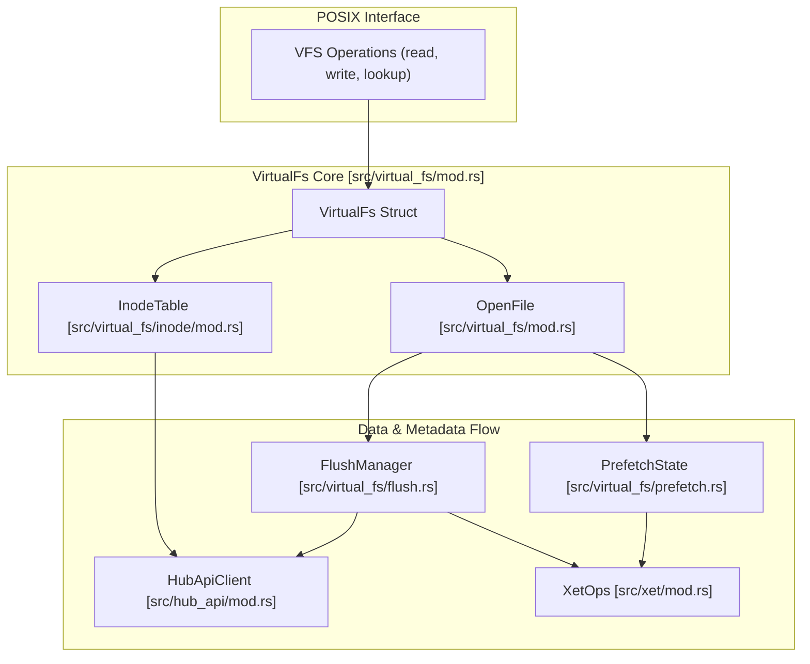

<!-- source: DeepWiki mcp.deepwiki.com · repo huggingface/hf-mount · page 2 Core Filesystem Layer · fetched 2026-10-26 -->

# Core Filesystem Layer

Relevant source files

The following files were used as context for generating this wiki page:

- [src/virtual_fs/mod.rs](src/virtual_fs/mod.rs)

The Core Filesystem Layer is centered around the `VirtualFs` struct, which acts as the primary bridge between POSIX filesystem operations (requested by FUSE or NFS backends) and the remote Hugging Face Hub API and Xet Content Addressable Storage (CAS). It manages the translation of file paths to inodes, handles metadata caching, and orchestrates the complex data flow for reading and writing remote assets.

### VirtualFs Abstraction

`VirtualFs` implements the core logic for a virtualized filesystem. It maintains an internal mapping of the remote repository or bucket structure into a local hierarchy of inodes. It is designed to be protocol-agnostic, allowing both `FuseAdapter` and `NFSAdapter` to invoke its methods for standard operations like `lookup`, `read`, `write`, and `readdir`.

#### Key Components of VirtualFs

| Component | Role | Code Entity |
| :--- | :--- | :--- |
| **Inode Table** | Tracks metadata and relationships for all known files and directories. | `inode_table` [src/virtual_fs/mod.rs:82-82]() |
| **Open File Table** | Maps numeric file handles to active local file descriptors or remote streams. | `open_files` [src/virtual_fs/mod.rs:84-84]() |
| **Staging Directory** | Local scratch space used for "Advanced Writes" before syncing to the Hub. | `staging_dir` [src/virtual_fs/mod.rs:79-79]() |
| **Flush Manager** | Manages the background pipeline for uploading dirty files and processing deletes. | `flush_manager` [src/virtual_fs/mod.rs:97-97]() |
| **Negative Cache** | Prevents redundant API calls for paths that are known to not exist. | `negative_cache` [src/virtual_fs/mod.rs:89-89]() |

**Sources:** [src/virtual_fs/mod.rs:75-115](), [src/virtual_fs/mod.rs:119-176]()

### System Architecture and Code Mapping

The following diagram illustrates how high-level filesystem concepts map to specific implementation entities within the `VirtualFs` layer.

**VirtualFs Entity Mapping**

**Sources:** [src/virtual_fs/mod.rs:75-115](), [src/virtual_fs/mod.rs:15-21]()

### Concurrency and Locking Discipline

To prevent deadlocks while handling asynchronous I/O, `VirtualFs` follows a strict locking hierarchy. Most locks are held only briefly to extract state before dropping them to perform async operations.

1.  **Staging Locks**: Per-inode `tokio::sync::Mutex` to prevent concurrent races during file preparation. [src/virtual_fs/mod.rs:91-91]()
2.  **Inode Table**: `RwLock` for metadata access and hierarchy traversal. [src/virtual_fs/mod.rs:82-82]()
3.  **Open Files**: `RwLock` for tracking active file handles. [src/virtual_fs/mod.rs:84-84]()
4.  **Negative Cache**: `RwLock` for path existence checks. [src/virtual_fs/mod.rs:89-89]()

**Sources:** [src/virtual_fs/mod.rs:62-74]()

---

## Subsystems and Child Pages

The functionality of the Core Filesystem Layer is divided into several specialized subsystems:

### [VirtualFs: Inode Table and Metadata](#2.1)
The `InodeTable` is the heart of the filesystem. It manages `InodeEntry` objects which can represent directories, regular files, or symlinks (`InodeKind`). This subsystem handles the TTL-based revalidation of metadata against the Hub API and manages the "dirty-generation" mechanism to ensure consistency during concurrent writes and remote updates.
*   **Key Entities**: `InodeTable`, `InodeEntry`, `InodeKind`.
*   **Details**: See [VirtualFs: Inode Table and Metadata](#2.1).

### [Read Path and Prefetching](#2.2)
Remote files are read lazily. The `PrefetchState` manages an adaptive windowing strategy that decides whether to stream data sequentially or perform range-based downloads. It interacts with the `CachedXetClient` to reconstruct file content from the Xet CAS.
*   **Key Entities**: `PrefetchState`, `FetchStrategy`, `FetchPlan`.
*   **Details**: See [Read Path and Prefetching](#2.2).

### [Write Path: Streaming and Advanced Modes](#2.3)
`hf-mount` supports two distinct write models. **Streaming Mode** is optimized for sequential, append-only uploads (e.g., logging or large model exports). **Advanced Writes** use a local `StagingDir` to allow random access and small writes, which are then debounced and batched by the `FlushManager`.
*   **Key Entities**: `StreamingChannel`, `StagingDir`, `FlushManager`.
*   **Details**: See [Write Path: Streaming and Advanced Modes](#2.3).

### [Background Polling and Cache Invalidation](#2.4)
To stay in sync with remote changes made by other clients, a background task (`poll_remote_changes`) periodically fetches the remote tree state. It diffs this state against the local `InodeTable` and uses an `Invalidator` callback to signal the OS kernel to drop stale page caches.
*   **Key Entities**: `poll_remote_changes`, `Invalidator`, `metadata_ttl`.
*   **Details**: See [Background Polling and Cache Invalidation](#2.4).

**Sources:** [src/virtual_fs/mod.rs:15-21](), [src/virtual_fs/mod.rs:129-164]()

---

