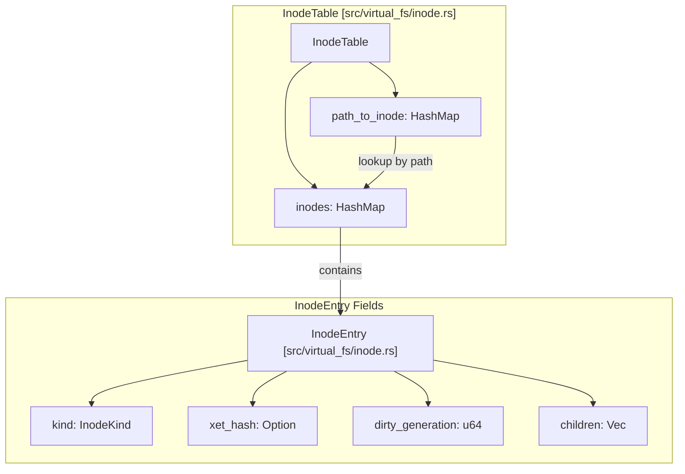
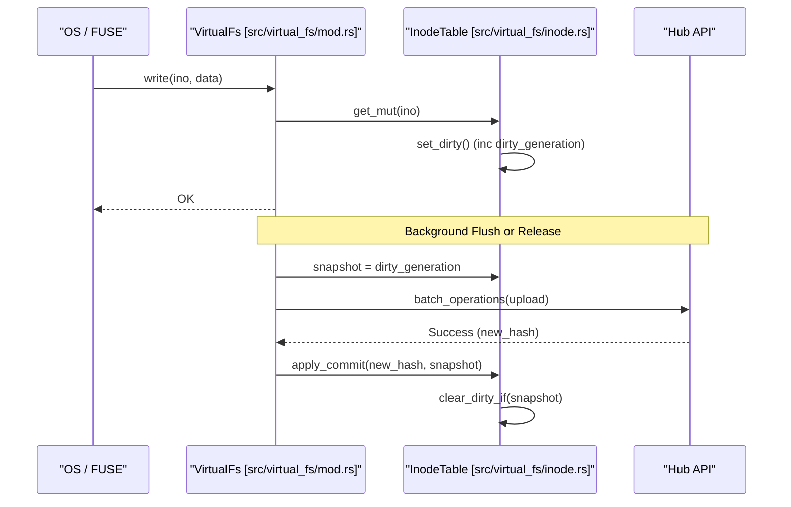

<!-- source: DeepWiki mcp.deepwiki.com · repo huggingface/hf-mount · page 2.1 VirtualFs: Inode Table and Metadata · fetched 2026-10-26 -->

# VirtualFs: Inode Table and Metadata

Relevant source files

The following files were used as context for generating this wiki page:

- [src/virtual_fs/inode.rs](src/virtual_fs/inode.rs)
- [src/virtual_fs/mod.rs](src/virtual_fs/mod.rs)
- [src/virtual_fs/prefetch.rs](src/virtual_fs/prefetch.rs)
- [src/virtual_fs/tests.rs](src/virtual_fs/tests.rs)
- [tests/pjdfstest.rs](tests/pjdfstest.rs)

The `VirtualFs` layer provides a POSIX-compliant filesystem abstraction that bridges local OS requests to the Hugging Face Hub and Xet CAS. At the heart of this layer is the **Inode Table**, which manages the lifecycle, metadata, and consistency of filesystem entities.

### Inode Data Structures

The filesystem represents every file, directory, and symlink as an `InodeEntry`. These entries are indexed within an `InodeTable` to allow O(1) lookups by inode number or path.

| Entity | Description |
| :--- | :--- |
| `InodeKind` | Enum defining the type: `File`, `Directory`, or `Symlink` [src/virtual_fs/inode.rs:17-21](). |
| `InodeEntry` | The primary metadata container. Stores POSIX attributes (size, mtime, mode, uid/gid) alongside Hub-specific metadata like `xet_hash` and `etag` [src/virtual_fs/inode.rs:31-61](). |
| `DirChild` | A lightweight edge representation in the directory tree, mapping a name to an inode number [src/virtual_fs/inode.rs:25-28](). |
| `InodeTable` | A thread-safe container (protected by `RwLock`) holding the mapping of `u64` IDs to `InodeEntry` and a reverse `path_to_inode` map [src/virtual_fs/inode.rs:100-104](). |

#### Inode Metadata and Identity
The system uses a 64-bit counter to generate unique inode numbers, starting from `ROOT_INODE` (1) [src/virtual_fs/inode.rs:5-117]().

**Inode Table Mapping**

Sources: [src/virtual_fs/inode.rs:17-61](), [src/virtual_fs/inode.rs:100-104]()

---

### Inode Lifecycle and Lookup

When a user accesses a path, `VirtualFs` performs a lookup. If the inode is not in the `InodeTable`, it is fetched from the Hub API and cached.

1.  **Local Cache Check**: The `InodeTable` is searched by path [src/virtual_fs/inode.rs:158-160]().
2.  **Negative Cache**: If a path was recently confirmed as non-existent, the request is rejected immediately to avoid Hub API spam [src/virtual_fs/mod.rs:29-31]().
3.  **Remote Fetch**: If missing, `HubOps::head` or `HubOps::list_tree` is called to populate the entry [src/virtual_fs/mod.rs:1138-1150]().
4.  **Creation**: New inodes are inserted via `InodeTable::insert`, which increments the `next_inode` counter [src/virtual_fs/inode.rs:178-218]().

#### Metadata Revalidation (TTL)
To balance performance with consistency, `VirtualFs` implements a TTL-based revalidation mechanism:
*   **`metadata_ttl`**: Configurable duration (defaulting to kernel attribute timeout) during which cached metadata is trusted [src/virtual_fs/mod.rs:104-106]().
*   **`last_revalidated`**: A timestamp on the `InodeEntry` [src/virtual_fs/inode.rs:60]().
*   **Lookup Logic**: If `serve_lookup_from_cache` is enabled and the TTL hasn't expired, the cached entry is returned without a network call [src/virtual_fs/mod.rs:109-110]().

---

### Concurrency: Dirty Generation Mechanism

To handle concurrent writes and background polling without data loss, `hf-mount` uses a "Dirty Generation" counter rather than simple boolean flags.

*   **`dirty_generation`**: Every mutation (write, truncate) increments this counter [src/virtual_fs/inode.rs:69-72]().
*   **Atomic Snapshots**: When a flush starts, the current generation is snapshotted.
*   **Conditional Clear**: Upon successful upload, `clear_dirty_if(snapshot)` is called. If a concurrent writer incremented the generation during the upload, the inode remains dirty, ensuring the new data is eventually flushed [src/virtual_fs/inode.rs:77-84]().

**Write and Commit Flow**

Sources: [src/virtual_fs/inode.rs:63-98](), [src/virtual_fs/mod.rs:718-735](), [src/virtual_fs/tests.rs:81-106]()

---

### Negative Lookup Cache

The `negative_cache` prevents repeated "File Not Found" (ENOENT) errors from triggering expensive Hub API calls.

*   **Capacity**: Limited to 10,000 entries by default [src/virtual_fs/mod.rs:29]().
*   **TTL**: Entries expire after 30 seconds [src/virtual_fs/mod.rs:31]().
*   **Invalidation**: When a file is created or when `poll_remote_changes` detects a new remote file, the corresponding path is purged from the negative cache to make it visible [src/virtual_fs/mod.rs:155-161]().

### OS Junk Filtering

The `VirtualFs` can be configured via `filter_os_files` to ignore metadata-only files generated by operating systems (e.g., `.DS_Store`, `Thumbs.db`).
*   **Implementation**: `is_os_junk(name)` checks against a hardcoded list of patterns [src/virtual_fs/mod.rs:38-43]().
*   **Effect**: If enabled, `mknod` or `create` calls for these files return successfully to the OS but do not create an inode or sync to the Hub [src/virtual_fs/mod.rs:111-112]().

Sources:
*   `src/virtual_fs/mod.rs`: Constants [23-31](), Junk filtering [38-43](), VfsConfig [48-60](), Initialization [125-175]().
*   `src/virtual_fs/inode.rs`: InodeEntry definition [31-61](), Dirty generation logic [63-98](), InodeTable implementation [100-218]().
*   `src/virtual_fs/tests.rs`: Streaming write tests [81-106]().

---

