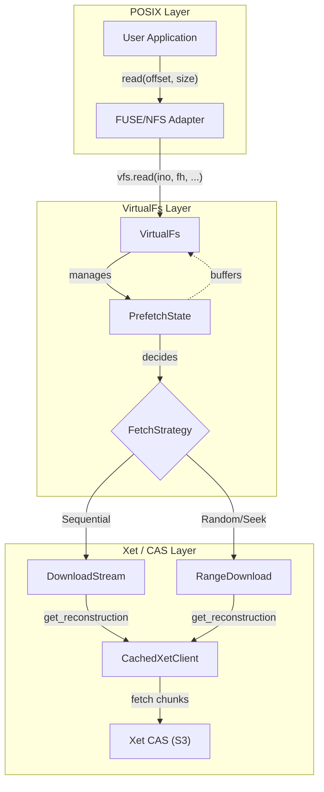
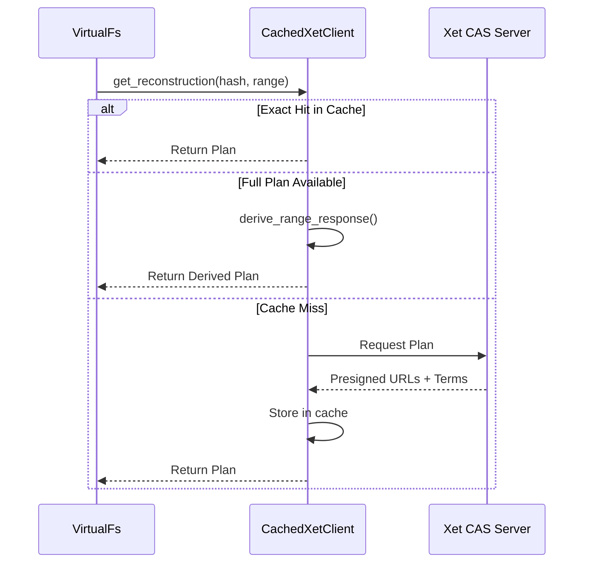

<!-- source: DeepWiki mcp.deepwiki.com · repo huggingface/hf-mount · page 2.2 Read Path and Prefetching · fetched 2026-10-26 -->

# Read Path and Prefetching

<details>
<summary>Relevant source files</summary>

The following files were used as context for generating this wiki page:

- [src/cached_xet_client.rs](src/cached_xet_client.rs)
- [src/virtual_fs/mod.rs](src/virtual_fs/mod.rs)
- [src/virtual_fs/prefetch.rs](src/virtual_fs/prefetch.rs)
- [src/virtual_fs/tests.rs](src/virtual_fs/tests.rs)

</details>


This page describes the implementation of remote file reads in `hf-mount`. It covers the lifecycle of a read request from the virtual filesystem layer down to the Xet Content Addressable Storage (CAS), including adaptive prefetching logic and the reconstruction plan cache.

## Overview of the Read Path

When a user process issues a `read(2)` system call, the request enters `VirtualFs` via the FUSE or NFS adapter. `hf-mount` translates these POSIX offsets into requests for data chunks from the Hugging Face Hub's Xet-based storage. To minimize latency over high-bandwidth, high-latency network connections, the system employs an adaptive prefetching strategy.

### Data Flow

1.  **Request Reception**: `VirtualFs::read` receives an inode, offset, and size.
2.  **Handle Lookup**: The `file_handle` is used to retrieve an `OpenFile` entry from the `open_files` map [src/virtual_fs/mod.rs:84-84]().
3.  **Buffer Check**: The `PrefetchState` associated with the file handle is checked for cached data.
4.  **Strategy Selection**: If data is missing, `PrefetchState::prepare_fetch` determines whether to use a sequential stream or a targeted range download [src/virtual_fs/prefetch.rs:106-106]().
5.  **Plan Reconstruction**: The `CachedXetClient` retrieves or derives a "reconstruction plan" (mapping file offsets to Xet Object (Xorb) hashes) [src/cached_xet_client.rs:45-55]().
6.  **Data Fetch**: Data is pulled from the CAS, optionally populating the local `xorb` disk cache.

**Read Path Architecture**


Sources: [src/virtual_fs/mod.rs:75-115](), [src/virtual_fs/prefetch.rs:39-46](), [src/cached_xet_client.rs:138-143]()

---

## Prefetching and Adaptive Window Sizing

The `PrefetchState` struct [src/virtual_fs/prefetch.rs:66-85]() manages the forward-read buffer for a specific file handle. It classifies access patterns to balance between high throughput for sequential reads and low overhead for random access.

### Tuning Constants

The prefetching behavior is governed by several internal constants [src/virtual_fs/prefetch.rs:11-22]():

| Constant | Value | Description |
| :--- | :--- | :--- |
| `INITIAL_WINDOW` | 8 MiB | Starting prefetch size for a new sequential stream. |
| `MAX_WINDOW` | 128 MiB | Upper bound for the prefetch window (reached via "slow-start"). |
| `SEEK_WINDOW` | 1 MiB | Size of the backward-seek buffer kept in memory. |
| `FORWARD_SKIP` | 16 MiB | Max gap to "drain" from a stream before resetting it. |

### Fetch Strategies

The `FetchStrategy` enum [src/virtual_fs/prefetch.rs:39-46]() defines how data is retrieved:

*   **`StartStream` / `ContinueStream`**: Used for sequential access. It utilizes an unbounded stream that prefetches up to `window_size` ahead of the current read offset. This mode enables the `xorb` disk cache to amortize the cost of downloading large compressed objects.
*   **`RangeDownload`**: Used for random access or seeks beyond `FORWARD_SKIP`. It fetches only the exact byte range requested. This strategy bypasses the `xorb` disk cache to avoid downloading 64MB objects for small, isolated reads (e.g., reading metadata from the end of a Parquet or ZIP file).

### Adaptive Logic

The system implements a "slow-start" mechanism similar to TCP. If a read is contiguous with the previous buffer end, the `window_size` is doubled, up to `MAX_WINDOW` [src/virtual_fs/prefetch.rs:119-123](). If a "far seek" occurs, the window is reset to `INITIAL_WINDOW` to avoid wasting bandwidth [src/virtual_fs/prefetch.rs:131-132]().

Sources: [src/virtual_fs/prefetch.rs:8-22](), [src/virtual_fs/prefetch.rs:106-161]()

---

## CachedXetClient and Reconstruction Plans

To read a file from the Xet CAS, the client must first obtain a **Reconstruction Plan**. This plan describes which Xorbs (and which byte ranges within them) compose the target file.

### Reconstruction Plan Cache

`CachedXetClient` [src/cached_xet_client.rs:45-55]() maintains an in-memory cache of these plans to avoid repeated Hub API calls.

*   **Cache Key**: A tuple of `(MerkleHash, Option<FileRange>)` [src/cached_xet_client.rs:19-19]().
*   **TTL**: Entries are cached for 59 minutes [src/cached_xet_client.rs:24-24](), just under the 1-hour expiry of the presigned S3 URLs contained within the plan.
*   **Single-Flight Coalescing**: If multiple threads request the same reconstruction plan simultaneously, the `inflight` map [src/cached_xet_client.rs:53-53]() ensures only one network request is made. Other threads wait on a broadcast channel [src/cached_xet_client.rs:149-149]().

### Plan Derivation

A key optimization in `CachedXetClient` is the ability to derive range-specific plans from a cached full-file plan.

The `derive_range_response` function [src/cached_xet_client.rs:97-97]() walks the terms of a full-file plan and filters for those overlapping the requested `FileRange`. This allows a random read to proceed immediately if the full file's metadata has already been fetched, without requiring a new round-trip to the CAS server.

**Reconstruction Plan Logic**


Sources: [src/cached_xet_client.rs:97-135](), [src/cached_xet_client.rs:138-200]()

---

## Implementation Details: PrefetchState

The `PrefetchState` uses a `VecDeque<Bytes>` to store downloaded chunks [src/virtual_fs/prefetch.rs:70-70](). This structure allows for:
1.  **Zero-copy Reads**: Using `Bytes::slice()` to return data to the caller without copying.
2.  **Efficient Draining**: Removing consumed data from the front of the queue without reallocating the entire buffer.

### Sequential Read Buffer Management

When `VirtualFs` performs a read, it calls `PrefetchState::get_reach` to check if the requested offset and size are already buffered. If not, it uses the `FetchPlan` to trigger a download.

```rust
// Simplified logic from src/virtual_fs/prefetch.rs
pub(crate) fn prepare_fetch(&mut self, offset: u64, size: u32) -> FetchPlan {
    // 1. Drain consumed data to the seek window
    // 2. Determine if the access is sequential
    // 3. Adjust window_size (double if sequential, reset if seek)
    // 4. Return FetchStrategy and fetch_size
}
```

If the `forward_only` flag (associated with `DIRECT_IO`) is set, the buffer is aggressively drained after every read to minimize memory footprint [src/virtual_fs/prefetch.rs:83-84]().

Sources: [src/virtual_fs/prefetch.rs:66-102](), [src/virtual_fs/prefetch.rs:106-161]()

---

