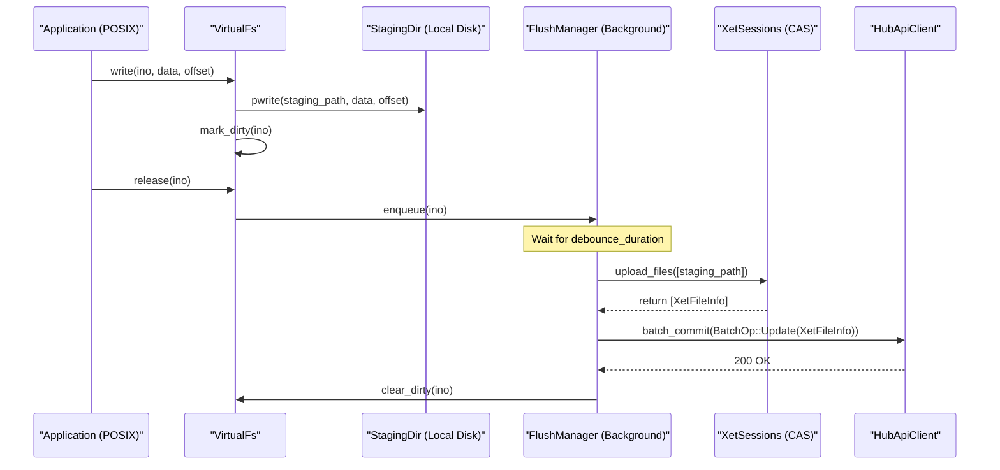
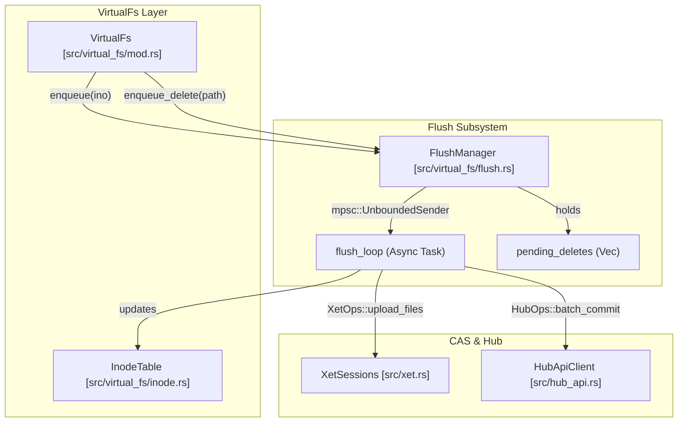

<!-- source: DeepWiki mcp.deepwiki.com · repo huggingface/hf-mount · page 2.3 Write Path: Streaming and Advanced Modes · fetched 2026-10-26 -->

# Write Path: Streaming and Advanced Modes

Relevant source files

The following files were used as context for generating this wiki page:

- [src/virtual_fs/flush.rs](src/virtual_fs/flush.rs)
- [src/virtual_fs/mod.rs](src/virtual_fs/mod.rs)
- [src/xet.rs](src/xet.rs)
- [tests/common/bench.rs](tests/common/bench.rs)
- [tests/common/fs_tests.rs](tests/common/fs_tests.rs)

The `hf-mount` write path is divided into two distinct operational modes: **Streaming** (default) and **Advanced Writes**. These modes cater to different workloads, ranging from simple sequential logging or model exports to complex, random-access data manipulation.

### Overview of Write Modes

| Feature | Streaming Mode (Default) | Advanced Writes (`--advanced-writes`) |
|:---|:---|:---|
| **Access Pattern** | Append-only, sequential | Random access, read-modify-write |
| **Concurrency** | Single-writer per file | Multi-writer, debounced flushing |
| **Storage** | Memory buffers (via `xet-core`) | Local disk staging area |
| **Upload Trigger** | Synchronous on `close()` | Asynchronous debounced background task |
| **Atomicity** | File-level (all or nothing) | Batch-level (multiple files/deletes) |

---

### 1. Streaming Mode

Streaming mode is designed for high-throughput, sequential writes. It bypasses local disk staging by piping data directly into the `xet-core` deduplication and CAS (Content Addressable Storage) pipeline.

#### StreamingChannel and StreamingWriter
When a file is opened for writing in streaming mode, `VirtualFs` creates a `StreamingChannel` [src/virtual_fs/mod.rs:1134-1140](). This channel wraps a `StreamingWriterOps` implementation (typically `StreamingWriter` in `src/xet.rs`) [src/xet.rs:37-42]().

1.  **Write Operation**: Data passed to `write()` is forwarded to the `SingleFileCleaner` in `xet-core` [src/xet.rs:110-116](). This component calculates hashes and prepares chunks for CAS upload in memory.
2.  **Close Operation**: When the file handle is released, `StreamingChannel::commit` is called. This performs a **synchronous** finalize of the CAS session and a Hub API commit [src/virtual_fs/mod.rs:1164-1175]().
3.  **Limitations**: If a user attempts to seek or perform a random-access write, the operation returns `ENOTSUP` or `ESPIPE` because the underlying `StreamingWriter` only supports incremental `add_data` calls.

**Sources:** [src/virtual_fs/mod.rs:1134-1175](), [src/xet.rs:37-42](), [src/xet.rs:102-116]()

---

### 2. Advanced Writes

Advanced mode enables full POSIX compatibility for writes, including random seeks, overwrites, and `truncate()`. It achieves this by using a local `StagingDir` as a scratchpad before committing changes to the Hugging Face Hub.

#### StagingDir and Session Isolation
The `StagingDir` manages a local directory (usually under `~/.cache/huggingface/hf-mount/.../staging`) where dirty files are stored [src/xet.rs:182-192](). 
*   **Path Generation**: Staging paths are obfuscated using a `session_key` to prevent collisions between different mount instances [src/xet.rs:191-197]().
*   **File Preparation**: When a remote file is opened for writing, `VirtualFs` downloads the remote content to the staging area first, allowing the application to perform read-modify-write operations locally [src/xet.rs:118-125]().

#### Data Flow: Local-to-Remote Pipeline
The following diagram illustrates the transition of data from a POSIX `write()` call to the Hub API using the `FlushManager`.

**Diagram: Advanced Write Data Flow**

**Sources:** [src/virtual_fs/flush.rs:23-68](), [src/virtual_fs/mod.rs:1191-1210](), [src/xet.rs:182-205]()

---

### 3. FlushManager and the Flush Loop

The `FlushManager` is the orchestrator for asynchronous durability in advanced mode. It prevents the "stutter" associated with synchronous network I/O during file closes by debouncing updates.

#### Debouncing and Batching
The `flush_loop` task waits for `FlushSignal` events [src/virtual_fs/flush.rs:14-19]().
*   **Debounce**: After receiving a signal, the loop waits for a `flush_debounce` period (default ~1s) to see if more writes arrive for the same or other files [src/virtual_fs/flush.rs:164-180]().
*   **Max Batch Window**: To prevent starvation, the loop forces a flush if the `max_batch_window` is reached [src/virtual_fs/flush.rs:179-185]().

#### Remote Delete Queue
The `FlushManager` also handles `pending_deletes`. When a file is renamed or removed, the local inode is updated immediately, but the Hub API call is deferred and batched with other updates in `flush_pending_deletes` [src/virtual_fs/flush.rs:86-95](), [src/virtual_fs/flush.rs:193-194]().

**Diagram: Entity Mapping for Flush Subsystem**

**Sources:** [src/virtual_fs/flush.rs:23-68](), [src/virtual_fs/flush.rs:157-194](), [src/virtual_fs/mod.rs:75-115]()

---

### 4. Implementation Details

#### Key Functions
*   **`VirtualFs::write`**: Determines if the file is a `StreamingChannel` or a local staging file. If staging, it performs a standard file system write to the local disk [src/virtual_fs/mod.rs:1000-1050]().
*   **`FlushManager::enqueue`**: Sends a signal to the background loop to mark an inode as needing a remote sync [src/virtual_fs/flush.rs:71-77]().
*   **`XetSessions::upload_files`**: Takes a list of local paths, processes them through the `xet-core` deduplication engine, and returns `XetFileInfo` objects containing the Merkle hashes required by the Hub [src/xet.rs:127-147]().

#### Error Handling
If a background flush fails (e.g., network timeout or unauthorized), the error is captured in `FlushManager::errors` [src/virtual_fs/flush.rs:26](). The next time the application performs a metadata operation or another write on that inode, the VFS checks for these deferred errors and returns them to the user [src/virtual_fs/flush.rs:79-81]().

**Sources:** [src/virtual_fs/mod.rs:1000-1050](), [src/virtual_fs/flush.rs:26-81](), [src/xet.rs:127-147]()

---

