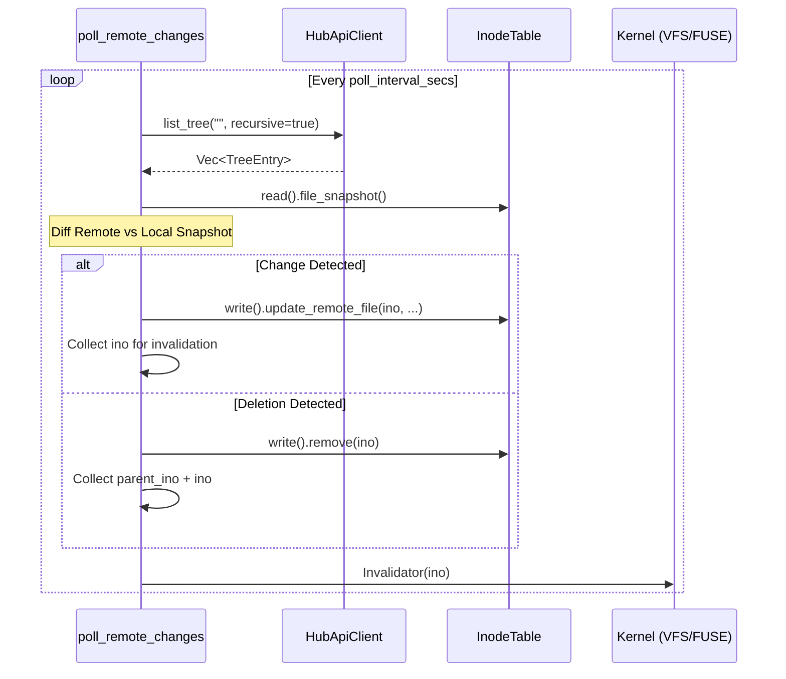
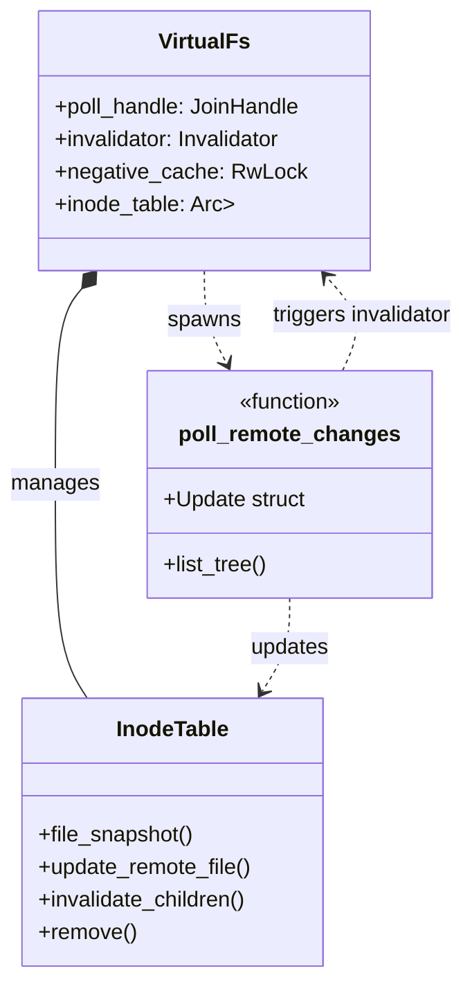

<!-- source: DeepWiki mcp.deepwiki.com · repo huggingface/hf-mount · page 2.4 Background Polling and Cache Invalidation · fetched 2026-10-26 -->

# Background Polling and Cache Invalidation

Relevant source files

The following files were used as context for generating this wiki page:

- [src/virtual_fs/mod.rs](src/virtual_fs/mod.rs)
- [src/virtual_fs/poll.rs](src/virtual_fs/poll.rs)

The `hf-mount` filesystem maintains consistency with the Hugging Face Hub by periodically polling for remote changes. This mechanism ensures that updates made by other clients or through the Hub web interface are eventually reflected in the local mount point without requiring a remount. The system utilizes a background task to diff the remote state against the local `InodeTable` and triggers kernel-level cache invalidations to purge stale data.

## Polling Lifecycle and Implementation

The polling logic is encapsulated in the `poll_remote_changes` function, which runs as a long-lived asynchronous task spawned during `VirtualFs` initialization [src/virtual_fs/mod.rs:148-164]().

### The Polling Loop
The task operates on a fixed interval defined by `VfsConfig.poll_interval_secs` [src/virtual_fs/mod.rs:53](). If this interval is set to zero, polling is disabled [src/virtual_fs/mod.rs:148]().

1.  **Remote Fetch**: The loop begins by calling `hub_client.list_tree("", true)` to get a full recursive listing of the remote repository or bucket [src/virtual_fs/poll.rs:24]().
2.  **Snapshotting**: It takes a read-only snapshot of the local `InodeTable` to minimize lock contention during the diffing phase [src/virtual_fs/poll.rs:39]().
3.  **Diffing**: The system compares the remote entries against the local snapshot.
4.  **Application**: Mutations (updates, deletions, and new files) are applied to the `InodeTable` under a write lock [src/virtual_fs/poll.rs:96]().
5.  **Invalidation**: The kernel is notified to drop cached attributes and pages for affected inodes [src/virtual_fs/poll.rs:172-178]().

### Polling Data Flow
The following diagram illustrates how the background task interacts with the Hub API and local state.

**Figure 1: Remote Change Detection Flow**

Sources: [src/virtual_fs/poll.rs:14-178](), [src/virtual_fs/mod.rs:148-164]()

## Change Detection Logic

The system uses specific metadata fields to determine if a file has changed on the remote.

| Feature | Logic | Source |
| :--- | :--- | :--- |
| **Xet Hash** | Preferred for Xet-enabled repos. Compares `xet_hash`. | [src/virtual_fs/poll.rs:63-64]() |
| **ETag / OID** | Used for standard files. Compares `oid`. | [src/virtual_fs/poll.rs:66]() |
| **Size** | Secondary check. If size differs, file is marked changed. | [src/virtual_fs/poll.rs:69]() |
| **Dirty Protection** | Locally modified files (marked `is_dirty`) are **skipped** during polling. | [src/virtual_fs/poll.rs:53-56]() |

### Dirty-File Protection
To prevent remote changes from overwriting uncommitted local work, the poller checks the `is_dirty` flag on every inode [src/virtual_fs/poll.rs:54](). If a file is dirty, the local version takes precedence until the `FlushManager` successfully uploads the changes to the Hub.

## Kernel Cache Invalidation

Because modern operating systems heavily cache file attributes and data pages, simply updating the internal `InodeTable` is insufficient. `hf-mount` uses an `Invalidator` callback to bridge the gap between the userspace daemon and the kernel.

### The Invalidator Callback
The `Invalidator` is a boxed closure `Fn(u64)` stored in `VirtualFs` [src/virtual_fs/mod.rs:33](). It is typically provided by the backend (e.g., `FuseAdapter`) after the filesystem is mounted.

*   **For Files**: The poller triggers invalidation for the specific file inode. This forces the kernel to discard page cache entries and re-fetch attributes (like size and mtime) on the next access [src/virtual_fs/poll.rs:172-174]().
*   **For Deletions**: The poller invalidates both the deleted file's inode and its parent directory's inode [src/virtual_fs/poll.rs:112-115](). This ensures the directory entry (dentry) is removed from the kernel's name cache.
*   **For New Files**: The poller identifies the parent directory of the new remote file and invalidates that directory's inode [src/virtual_fs/poll.rs:131-143]().

### Negative Cache Invalidation
The `VirtualFs` maintains a `negative_cache` to prevent repeated Hub API calls for files that do not exist [src/virtual_fs/mod.rs:89](). When polling detects new files on the remote, it must clear relevant entries from this cache:
1.  The poller identifies the parent path of the new file [src/virtual_fs/poll.rs:125-130]().
2.  It removes all entries in the `negative_cache` that reside under that parent path [src/virtual_fs/poll.rs:163-169]().

## Code Entity Mapping

The following diagram maps the logical polling components to their specific implementation structures in the `virtual_fs` module.

**Figure 2: Polling Component Mapping**

Sources: [src/virtual_fs/mod.rs:75-115](), [src/virtual_fs/poll.rs:14-178](), [src/virtual_fs/inode/mod.rs:252-270]()

## Summary of Invalidation Scenarios

| Event | Inode(s) Invalidated | Cache Effect |
| :--- | :--- | :--- |
| **File Updated** | `file_ino` | Kernel drops page cache; attributes re-fetched. |
| **File Deleted** | `file_ino`, `parent_ino` | Dentry removed; file disappears from directory listing. |
| **New File Created** | `parent_ino` | Kernel re-reads directory; `negative_cache` cleared for path. |
| **Directory Changed** | `dir_ino` | `inode_table.invalidate_children()` called; `readdir` re-fetches. |

Sources: [src/virtual_fs/poll.rs:98-178]()

---

