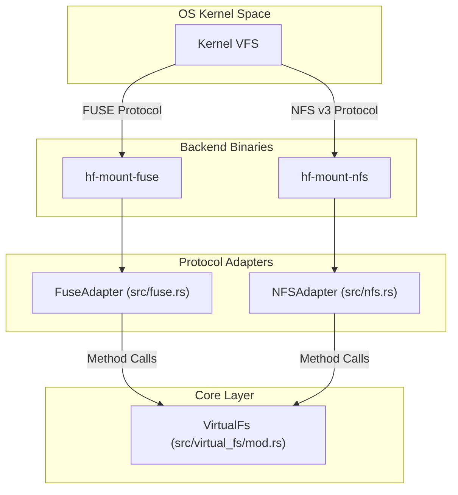
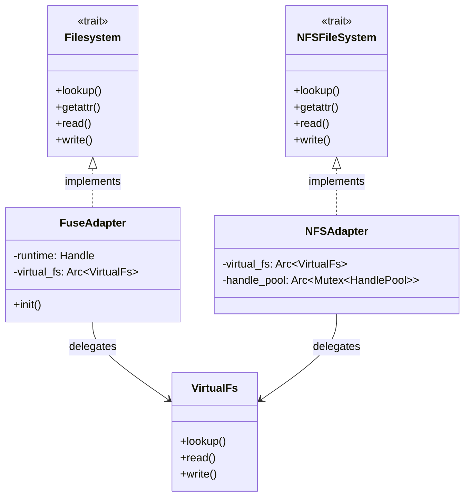

<!-- source: DeepWiki mcp.deepwiki.com · repo huggingface/hf-mount · page 3 Filesystem Backends · fetched 2026-10-26 -->

# Filesystem Backends

Relevant source files

The following files were used as context for generating this wiki page:

- [src/bin/hf-mount-fuse.rs](src/bin/hf-mount-fuse.rs)
- [src/bin/hf-mount-nfs.rs](src/bin/hf-mount-nfs.rs)
- [src/fuse.rs](src/fuse.rs)
- [src/nfs.rs](src/nfs.rs)

The `hf-mount` codebase provides two distinct protocol backends to expose the `VirtualFs` abstraction to the operating system: **FUSE** (Filesystem in Userspace) and **NFS** (Network File System). These backends act as adapters, translating OS-specific filesystem requests into operations understood by the core virtual filesystem layer.

### Backend Selection
The choice of backend is typically determined by the environment and performance requirements:
- **FUSE**: The default for Linux and macOS. It offers deeper integration with kernel features like `DIRECT_IO` and atomic truncation.
- **NFS**: Primarily used for environments where FUSE is restricted (e.g., certain container runtimes) or where a stateless protocol is preferred.

### System Architecture: Backend Adapters
The following diagram illustrates how the specialized backend binaries (`hf-mount-fuse` and `hf-mount-nfs`) wrap the `VirtualFs` core.

**Backend to VFS Mapping**

**Sources:** [src/bin/hf-mount-fuse.rs:6-25](), [src/bin/hf-mount-nfs.rs:5-21](), [src/fuse.rs:20-30](), [src/nfs.rs:21-34]()

---

## FUSE Backend

The FUSE backend is implemented via the `FuseAdapter` struct [src/fuse.rs:20-30](), which implements the `fuser::Filesystem` trait. It serves as an async-to-sync bridge, using a `tokio::runtime::Handle` to execute the asynchronous `VirtualFs` methods within the synchronous FUSE callback context [src/fuse.rs:153-157]().

### Key Responsibilities
- **Kernel Negotiation**: Configures kernel parameters such as `max_background` requests and `max_readahead` during the `init` phase [src/fuse.rs:99-148]().
- **Capability Support**: Enables advanced features like `FUSE_DIRECT_IO_ALLOW_MMAP` to support memory-mapped files (e.g., for `safetensors`) even when bypassing the kernel page cache [src/fuse.rs:112-117]().
- **Attribute Mapping**: Converts internal `VirtualFsAttr` metadata into the `FileAttr` format required by the `fuser` library [src/fuse.rs:60-83]().

For detailed implementation details on signal handling and kernel flags, see [FUSE Backend](#3.1).

**Sources:** [src/fuse.rs:20-49](), [src/fuse.rs:98-148](), [src/fuse.rs:151-157]()

---

## NFS Backend

The NFS backend uses the `NFSAdapter` [src/nfs.rs:21-25]() to expose the repository as an NFS v3 export. Unlike FUSE, which is a stateful local protocol, NFS v3 is stateless. To bridge this, the backend maintains a `HandlePool` [src/nfs.rs:23]().

### Key Responsibilities
- **Handle Management**: Since NFS v3 does not have explicit `open` or `release` calls for every I/O operation, the `NFSAdapter` uses an LRU cache (`HandlePool`) to keep `VirtualFs` file handles open for active I/O [src/nfs.rs:46-81]().
- **Stateless-to-Stateful Bridge**: Automatically opens handles on `read` or `write` requests and flushes/releases them when they are evicted from the pool [src/nfs.rs:37-43]().
- **Mount Orchestration**: Handles platform-specific mount commands (e.g., `mount_nfs` on macOS or `mount.nfs` on Linux) to attach the local NFS server to the desired mount point.

For details on the LRU eviction logic and write durability, see [NFS Backend](#3.2).

**Sources:** [src/nfs.rs:21-34](), [src/nfs.rs:46-56](), [src/nfs.rs:149-168]()

---

## Interaction Overview

The backends are initialized by their respective entry points using a shared `setup` utility [src/setup.rs]().

| Feature | FUSE (`FuseAdapter`) | NFS (`NFSAdapter`) |
| :--- | :--- | :--- |
| **Library** | `fuser` | `nfsserve` |
| **Async Handling** | `runtime.block_on()` | `async_trait` implementation |
| **Metadata TTL** | Kernel-enforced | Adapter-enforced |
| **File Handles** | Managed by Kernel | Managed by `HandlePool` LRU |
| **Direct I/O** | Supported via `FOPEN_DIRECT_IO` | Implicit (NFS-dependent) |

**Code Entity Mapping**

**Sources:** [src/fuse.rs:20-30](), [src/fuse.rs:98-100](), [src/nfs.rs:21-25](), [src/nfs.rs:119-120]()

---

