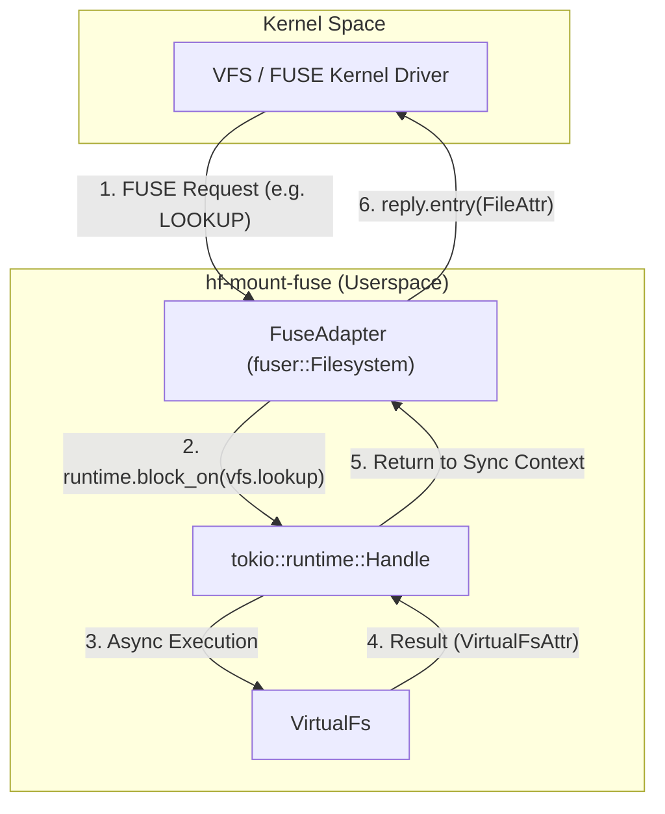
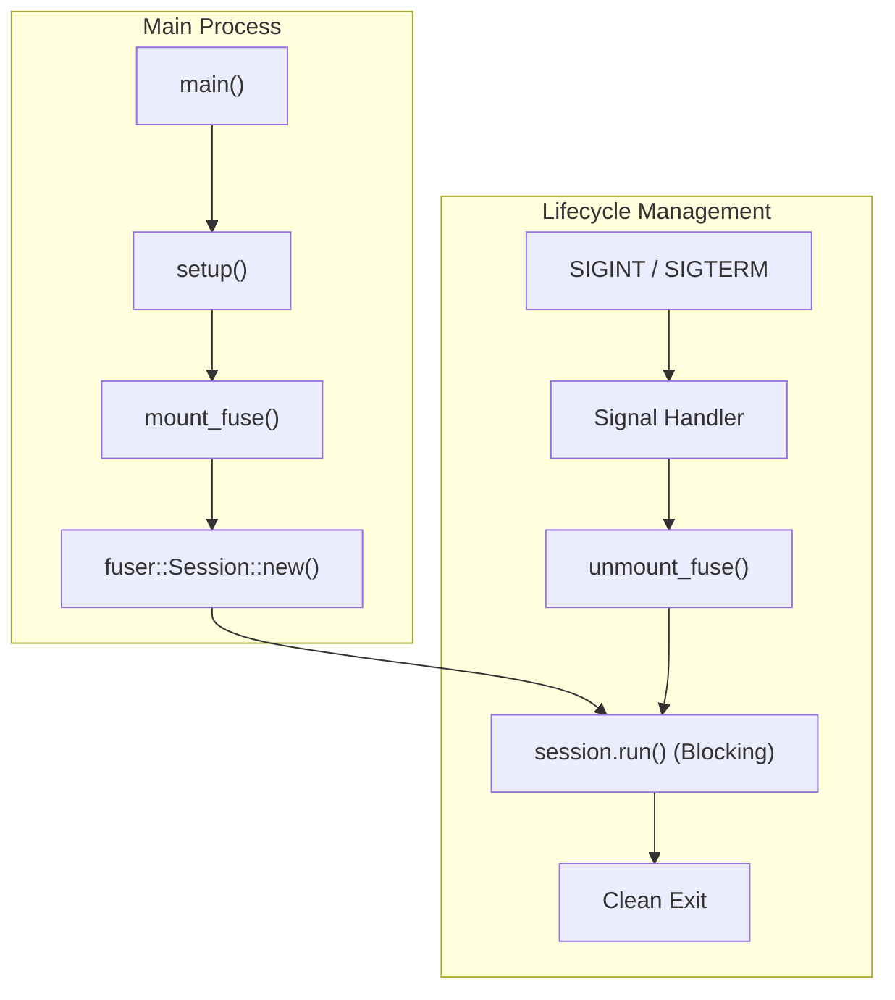

<!-- source: DeepWiki mcp.deepwiki.com · repo huggingface/hf-mount · page 3.1 FUSE Backend · fetched 2026-10-26 -->

# FUSE Backend

Relevant source files

The following files were used as context for generating this wiki page:

- [.vscode/settings.json](.vscode/settings.json)
- [src/bin/hf-mount-fuse.rs](src/bin/hf-mount-fuse.rs)
- [src/bin/hf-mount-nfs.rs](src/bin/hf-mount-nfs.rs)
- [src/fuse.rs](src/fuse.rs)

The FUSE (Filesystem in Userspace) backend provides a high-performance, POSIX-compliant interface to the `VirtualFs` layer. It leverages the `fuser` crate to communicate with the Linux/macOS kernel FUSE driver. This backend is responsible for translating synchronous kernel requests into asynchronous operations, negotiating advanced kernel capabilities, and managing the mount lifecycle including signal-driven unmounting.

## FuseAdapter and Trait Implementation

The core of the FUSE backend is the `FuseAdapter` struct [src/fuse.rs:20-30](). It implements the `fuser::Filesystem` trait, acting as a bridge between the kernel's low-level FUSE protocol and the internal `VirtualFs` abstraction.

Because the `fuser` trait methods are synchronous but `VirtualFs` operations are `async` (relying on `tokio` for network I/O), the `FuseAdapter` uses a `tokio::runtime::Handle` to execute futures via `block_on` [src/fuse.rs:153-157]().

### Data Flow: Kernel to VirtualFs

The following diagram illustrates the path of a filesystem request from the OS kernel through the FUSE adapter into the asynchronous virtual filesystem.

**FUSE Request Lifecycle**

Sources: [src/fuse.rs:151-157](), [src/fuse.rs:170-184]()

## Kernel Capability Negotiation

During the `init` phase, `FuseAdapter` configures the kernel FUSE driver to optimize for network-backed storage and specific container environments.

| Capability | Purpose | Implementation Detail |
| :--- | :--- | :--- |
| `FUSE_ATOMIC_O_TRUNC` | Allows `open()` with `O_TRUNC` to succeed atomically. | Required for simple streaming writes [src/fuse.rs:120-135](). |
| `FUSE_DIRECT_IO_ALLOW_MMAP` | Enables `mmap()` support when `direct_io` is enabled. | Critical for `safetensors` on Linux 6.6+ [src/fuse.rs:112-117](). |
| `FUSE_ALLOW_IDMAP` | Supports UID/GID remapping in user namespaces. | Essential for rootless containers/Kubernetes [src/fuse.rs:140-145](). |
| `max_background` | Increases concurrent kernel requests. | Set to 64 to avoid bottlenecks during high I/O [src/fuse.rs:103](). |

Sources: [src/fuse.rs:98-148]()

## Implementation Details

### Attribute Conversion
The backend converts internal `VirtualFsAttr` metadata into the `fuser::FileAttr` format required by the kernel [src/fuse.rs:60-83](). It uses a constant `GENERATION` of 0 because `hf-mount` does not currently recycle inode numbers [src/fuse.rs:17-18]().

### Directory Pagination
In `readdir`, the adapter uses the `offset` provided by the kernel to support pagination of large directories [src/fuse.rs:169-184](). This ensures that even if a directory contains thousands of entries, the kernel can fetch them in chunks without overwhelming the `ReplyDirectory` buffer.

### Write Modes and Flags
The `FuseAdapter` respects several configuration flags that alter its behavior:
*   **Direct I/O**: If `direct_io` is enabled, the `FOPEN_DIRECT_IO` flag is passed to the kernel during `open` and `create` calls [src/fuse.rs:51-57](). This bypasses the kernel page cache, which is preferred when `VirtualFs` manages its own `PrefetchState`.
*   **Advanced Writes**: If disabled, the backend enforces strict checks on `FUSE_ATOMIC_O_TRUNC` support to ensure streaming writes don't result in corrupted files [src/fuse.rs:122-129]().

Sources: [src/fuse.rs:20-30](), [src/fuse.rs:51-57](), [src/fuse.rs:120-135]()

## Mount Lifecycle and Signal Handling

The entry point for the FUSE backend is the `hf-mount-fuse` binary. It initializes the environment using `setup()` and enters the `mount_fuse` loop.

**Mount and Signal Flow**

Sources: [src/bin/hf-mount-fuse.rs:6-25](), [src/fuse.rs:324-365]()

### Unmount Utilities
The backend includes a robust unmount utility, `unmount_fuse`, which attempts to unmount the filesystem using the standard `umount` (or `diskutil` on macOS) command [src/fuse.rs:367-393](). This is called both during graceful shutdown and as a cleanup measure if initialization fails.

The `DaemonGuard` [src/bin/hf-mount-fuse.rs:8]() ensures that the PID file and logs are managed correctly while the FUSE session is active in the background.

Sources: [src/bin/hf-mount-fuse.rs:1-25](), [src/fuse.rs:367-393]()

---

