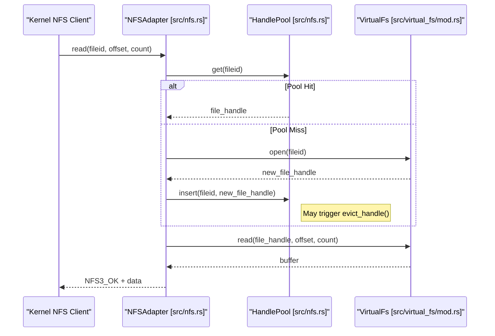
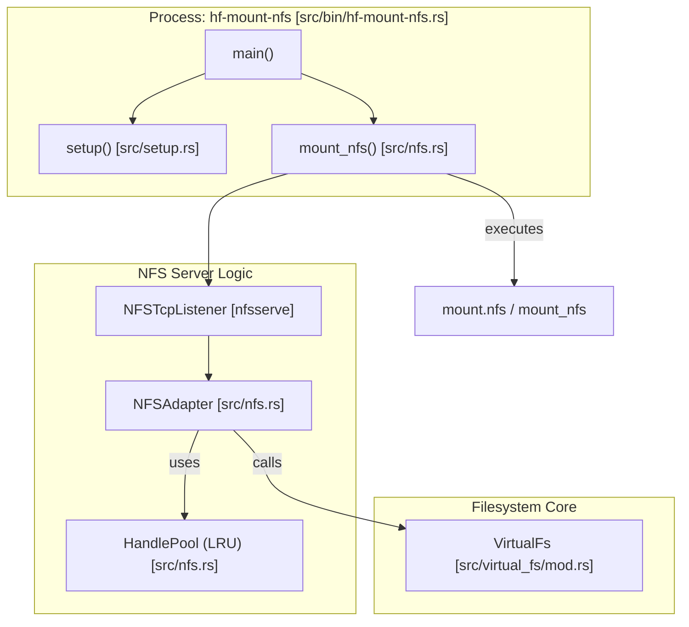

<!-- source: DeepWiki mcp.deepwiki.com · repo huggingface/hf-mount · page 3.2 NFS Backend · fetched 2026-10-26 -->

# NFS Backend

Relevant source files

The following files were used as context for generating this wiki page:

- [src/bin/hf-mount-fuse.rs](src/bin/hf-mount-fuse.rs)
- [src/bin/hf-mount-nfs.rs](src/bin/hf-mount-nfs.rs)
- [src/nfs.rs](src/nfs.rs)

The NFS backend provides a high-performance, cross-platform alternative to FUSE by exposing the `VirtualFs` via the NFS v3 protocol over a local TCP loopback. This approach is particularly useful on platforms where FUSE support is restricted or where kernel-level NFS optimizations (like aggressive client-side caching) are desired. It utilizes the `nfsserve` library to implement the server-side logic and bridges the stateless nature of NFS to the stateful requirements of the `VirtualFs`.

### Implementation Overview

The core of the NFS backend is the `NFSAdapter`, which implements the `NFSFileSystem` trait from the `nfsserve` crate [src/nfs.rs:21-25](). It acts as a translation layer between NFS procedure calls (e.g., `LOOKUP`, `READ`, `WRITE`) and `VirtualFs` operations.

#### Handle Management and the HandlePool
NFS v3 is inherently stateless, identifying files by `fileid3` (Inodes). However, `VirtualFs` requires stateful file handles for operations like `read` and `write`. The `HandlePool` is an LRU (Least Recently Used) cache that manages this mapping [src/nfs.rs:31](), [src/nfs.rs:364-370]().

*   **LRU Eviction**: The pool has a fixed capacity (defaulting to 1000 handles) [src/nfs.rs:372](). When the capacity is reached, the least recently used handle is evicted.
*   **Flush on Eviction**: Before a handle is closed, the adapter calls `evict_handle`, which triggers `virtual_fs.flush` to ensure all dirty data is committed to the Hub/CAS before the handle is released [src/nfs.rs:37-43]().
*   **Concurrent Access**: The `get_or_open_handle` method handles cases where multiple NFS threads might request the same file simultaneously, ensuring only one `VirtualFs` handle is opened and cached [src/nfs.rs:46-81]().

#### Data Flow: NFS to VirtualFs
The following diagram illustrates how a standard NFS `READ` request is resolved through the adapter and the handle pool.

**NFS Read Operation Flow**

Sources: [src/nfs.rs:149-168](), [src/nfs.rs:46-81]()

### Platform-Specific Mounting

The `mount_nfs` function handles the lifecycle of the NFS server and the OS-level mount command [src/nfs.rs:223-331](). It binds to a random port on `127.0.0.1` and executes platform-specific commands to attach the local NFS server to the filesystem tree.

| Platform | Command Used | Key Arguments |
| :--- | :--- | :--- |
| **Linux** | `mount.nfs` | `port`, `mountport`, `nolock`, `tcp`, `nfsvers=3`, `actimeo` [src/nfs.rs:265-275]() |
| **macOS** | `mount_nfs` | `port`, `mountport`, `nolock`, `tcp`, `nfsvers=3`, `locallocks` [src/nfs.rs:277-287]() |

The `metadata_ttl_ms` configuration is passed to the mount command via `actimeo` (Linux) or `nocto` settings to control how aggressively the kernel caches file attributes [src/nfs.rs:260-262]().

### Write Durability and `schedule_flush`

NFS supports both synchronous and asynchronous writes. To optimize performance while maintaining durability, the `NFSAdapter` utilizes the `VirtualFs` flushing mechanism:

1.  **Write**: Data is written to the `VirtualFs` via the handle retrieved from the `HandlePool` [src/nfs.rs:200-210]().
2.  **Commit**: When the NFS client sends a `COMMIT` request, the adapter calls `virtual_fs.flush` to ensure data is persisted [src/nfs.rs:212-220]().
3.  **Background Flush**: For asynchronous writes, the `VirtualFs` may manage its own background flushing, but the `NFSAdapter` ensures that any handle evicted from the `HandlePool` is explicitly flushed first [src/nfs.rs:37-39]().

### Shutdown and Unmount Detection

The NFS backend must handle graceful shutdowns to avoid "stale mount" errors in the host OS.

*   **Unmount Detection**: A background task polls the mount point or monitors the server status. If the user manually unmounts the directory, the `NFSTcpListener` loop terminates [src/nfs.rs:320-331]().
*   **DaemonGuard**: The `DaemonGuard` is notified once the mount is ready by checking for the existence of the mount point in the system's mount table [src/nfs.rs:303-315]().
*   **Cleanup**: On exit, the `NFSAdapter` ensures all remaining handles in the `HandlePool` are flushed and released [src/nfs.rs:40-42]().

**NFS System Component Mapping**

Sources: [src/bin/hf-mount-nfs.rs:5-21](), [src/nfs.rs:21-34](), [src/nfs.rs:223-235]()

### Key Functions and Methods

| Entity | Description |
| :--- | :--- |
| `NFSAdapter::new` | Initializes the adapter with a `VirtualFs` instance and an empty `HandlePool` [src/nfs.rs:28-34](). |
| `get_or_open_handle` | Retrieves an existing handle or opens a new one, managing LRU eviction and concurrency [src/nfs.rs:46-81](). |
| `vfs_attr_to_nfs` | Converts internal `VirtualFsAttr` metadata into the `fattr3` format required by the NFS protocol [src/nfs.rs:408-435](). |
| `errno_to_nfs` | Maps standard libc error codes to `nfsstat3` error codes for protocol compliance [src/nfs.rs:444-465](). |
| `mount_nfs` | The entry point for starting the TCP server and executing the OS mount command [src/nfs.rs:223-250](). |

Sources: [src/nfs.rs:21-465](), [src/bin/hf-mount-nfs.rs:1-22]()

---

