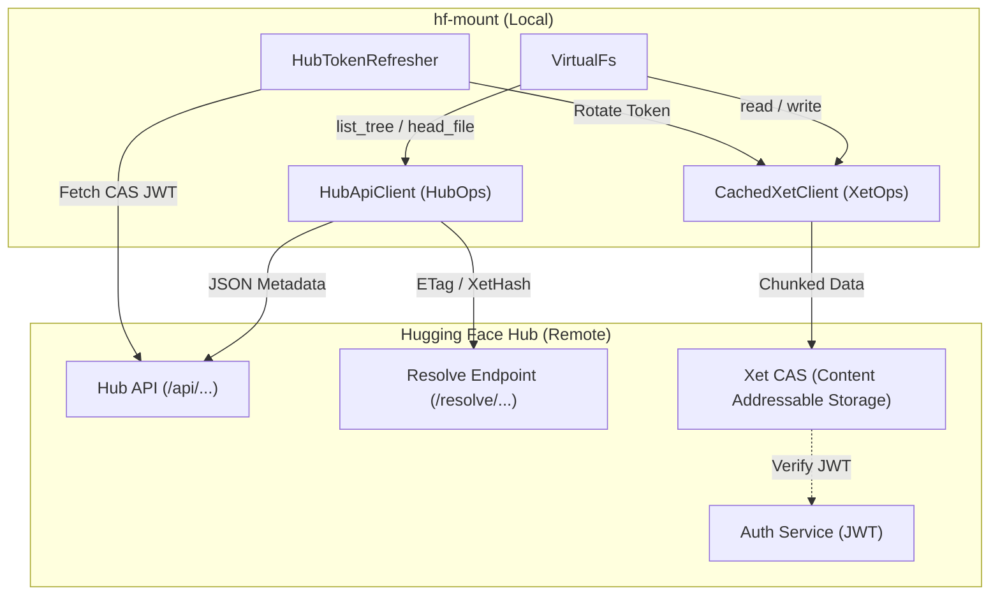
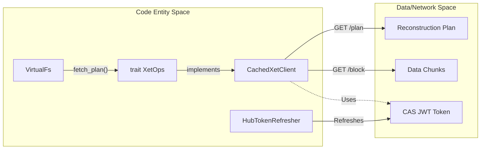

<!-- source: DeepWiki mcp.deepwiki.com · repo huggingface/hf-mount · page 4 Hub API and Authentication · fetched 2026-10-26 -->

# Hub API and Authentication

Relevant source files

The following files were used as context for generating this wiki page:

- [src/hub_api.rs](src/hub_api.rs)
- [src/setup.rs](src/setup.rs)

The Hugging Face Hub serves as the remote source of truth for both metadata and file content in `hf-mount`. Communication is split into two distinct layers: the **Hub API** (for directory structures, file attributes, and commit operations) and the **Xet CAS Layer** (for high-performance, chunk-deduplicated data transfer).

This page provides a high-level overview of how `hf-mount` authenticates with these services and manages the data flow between the local filesystem and the remote Hub.

### System Architecture: API and Data Flow

The following diagram illustrates how the `HubApiClient` and `Xet CAS` components interact with the Hugging Face infrastructure.

**Hub Communication Overview**

Sources: [src/hub_api.rs:18-26](), [src/hub_api.rs:194-214](), [src/setup.rs:161-171]()

---

## HubApiClient and HubOps Trait

The `HubApiClient` is the primary interface for metadata operations. It implements the `HubOps` trait, which abstracts operations like listing directory trees, fetching file headers (HEAD requests), and committing batches of changes.

- **Source Polymorphism**: Supports both `Bucket` (S3-like storage) and `Repo` (Git-based Models, Datasets, and Spaces) through the `SourceKind` enum [src/hub_api.rs:84-93]().
- **Path Scoping**: Supports a `path_prefix` which allows mounting a specific subfolder of a repository as the filesystem root [src/hub_api.rs:211-213]().
- **Metadata Translation**: Converts Hub-specific structures like `RepoTreeEntry` into a unified `TreeEntry` format used by the `VirtualFs` [src/hub_api.rs:126-156]().

For details on tree listing, pagination, and ETag-based validation, see **[HubApiClient and HubOps Trait](#4.1)**.

Sources: [src/hub_api.rs:13-26](), [src/hub_api.rs:194-214]()

---

## Authentication and Token Management

`hf-mount` employs a two-tier authentication model to handle long-lived user credentials and short-lived storage access tokens.

| Credential Type | Purpose | Lifecycle |
|:---|:---|:---|
| **HF Token** | Primary user identity for Hub API calls. | Static (env/CLI) or File-based (30s refresh). |
| **CAS JWT** | Scoped access to Xet Content Addressable Storage. | Short-lived; automatically refreshed by `HubTokenRefresher`. |

### Token Rotation and CSI Support
To support environments like Kubernetes (CSI Driver), `hf-mount` can monitor a `token_file`. If the file on disk is updated, the client re-reads it automatically every 30 seconds [src/hub_api.rs:191-192](). This allows for seamless credential rotation without unmounting the filesystem.

For details on the refresh logic and JWT acquisition, see **[Authentication and Token Management](#4.2)**.

Sources: [src/hub_api.rs:191-206](), [src/setup.rs:58-69]()

---

## Xet CAS Layer

While metadata travels via the Hub API, actual file content is managed by the Xet CAS (Content Addressable Storage) layer. This layer provides high-performance data transfer using Merkle-tree-based deduplication.

**Entity Mapping: CAS Interaction**

Sources: [src/hub_api.rs:504-510](), [src/setup.rs:9-14]()

Key features of the Xet layer in `hf-mount` include:
- **Deduplication**: Only unique data chunks are uploaded or downloaded.
- **Reconstruction Plans**: Metadata that describes how chunks assemble into a file. These are cached locally in the `CachedXetClient` to reduce latency [src/setup.rs:11-14]().
- **Streaming vs. Staging**: Supports both direct streaming writes and random-access writes via a local `StagingDir` [src/setup.rs:91-94]().

For details on session isolation and the xorb disk cache bypass, see **[Xet CAS Layer](#4.3)**.

Sources: [src/setup.rs:75-78](), [src/setup.rs:100-108]()

---

