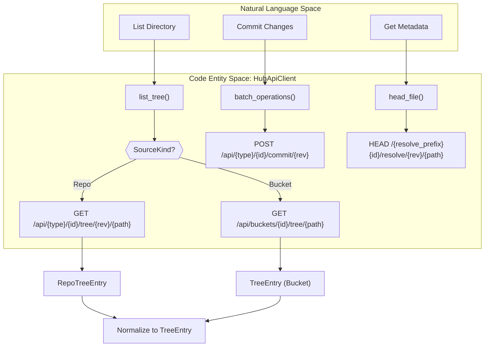
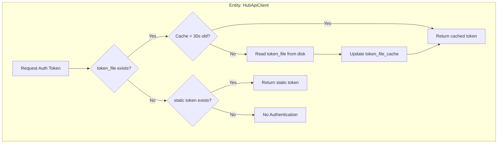

<!-- source: DeepWiki mcp.deepwiki.com · repo huggingface/hf-mount · page 4.1 HubApiClient and HubOps Trait · fetched 2026-10-26 -->

# HubApiClient and HubOps Trait

Relevant source files

The following files were used as context for generating this wiki page:

- [src/hub_api.rs](src/hub_api.rs)

The `HubApiClient` serves as the primary interface for interacting with the Hugging Face Hub. It abstracts the complexities of the Hub's REST API, providing a unified set of operations for both standard Git-based repositories and S3-backed buckets. This abstraction is formalized through the `HubOps` trait, which allows the filesystem layer (`VirtualFs`) and the background flush manager to perform metadata lookups, tree listings, and atomic batch updates without concern for the underlying storage type.

## HubOps Trait Interface

The `HubOps` trait defines the contract for all Hub-related operations. By using this trait, the codebase facilitates easier testing through mocks and ensures that the `VirtualFs` remains decoupled from the specific HTTP implementation.

| Method | Description |
| :--- | :--- |
| `list_tree` | Recursively or non-recursively lists entries in a directory. |
| `head_file` | Fetches metadata (ETag, size, Xet hash) for a specific path. |
| `batch_operations` | Submits a list of file additions or deletions as an atomic commit. |
| `download_file_http` | Downloads a file directly via HTTP (used for small files or non-Xet content). |
| `source` | Returns the `SourceKind` (Bucket vs Repo) of the current mount. |

Sources: [src/hub_api.rs:13-26]()

## Data Model and Source Types

The client distinguishes between two primary source types through the `SourceKind` enum. This distinction dictates which API endpoints are hit and how metadata is parsed.

### SourceKind and RepoType
A `SourceKind` can either be a `Bucket` (identified by a `bucket_id`) or a `Repo` (identified by `repo_id`, `repo_type`, and `revision`) [src/hub_api.rs:81-93](). 

The `RepoType` determines the URL structure used for API calls:
*   **Model**: API prefix `models`, resolve prefix `""` [src/hub_api.rs:31-57]().
*   **Dataset**: API prefix `datasets`, resolve prefix `datasets/` [src/hub_api.rs:31-57]().
*   **Space**: API prefix `spaces`, resolve prefix `spaces/` [src/hub_api.rs:31-57]().

### TreeEntry and BatchOp
Metadata returned from the Hub is normalized into a `TreeEntry` struct, which includes the file path, size, and critical identifiers like the `xet_hash` (for deduplicated content) and `oid` (Git blob OID, used as an ETag) [src/hub_api.rs:126-138]().

For writes, the `BatchOp` enum represents atomic changes:
*   `AddFile`: Includes path, `xet_hash`, and `mtime` [src/hub_api.rs:114-120]().
*   `DeleteFile`: Includes the target path [src/hub_api.rs:122]().

Sources: [src/hub_api.rs:30-57](), [src/hub_api.rs:81-106](), [src/hub_api.rs:110-138]()

## HubApiClient Implementation

The `HubApiClient` manages the HTTP lifecycle using `reqwest`. It maintains two distinct clients: a standard `client` for most requests and a `head_client` specifically configured *not* to follow redirects [src/hub_api.rs:195-198](). This is necessary because `HEAD` requests to the Hub's `resolve` endpoint often redirect to S3/Cloudfront; the client needs the headers from the Hub (containing `X-Repo-Commit`, etc.) rather than the headers from the final download target.

### Scoped Path Management (`path_prefix`)
The client supports mounting a subfolder of a repository or bucket via the `path_prefix` field [src/hub_api.rs:213-214](). 
1.  **Outgoing**: When calling the Hub API, the `path_prefix` is prepended to the requested path.
2.  **Incoming**: When receiving `TreeEntry` results, the `path_prefix` is stripped so that the `VirtualFs` only sees paths relative to the mount point.

### Token Caching and Refresh
To support environments like Kubernetes (CSI drivers) where tokens are rotated on disk, `HubApiClient` implements a two-tier token strategy:
*   **Static Token**: A token provided at initialization [src/hub_api.rs:200]().
*   **Token File**: A path to a file (e.g., a mounted Secret) [src/hub_api.rs:204]().
*   **Caching**: If a `token_file` is used, the client caches the content for 30 seconds (`TOKEN_FILE_REFRESH`) to avoid excessive I/O on every API call [src/hub_api.rs:192](), [src/hub_api.rs:206]().

Sources: [src/hub_api.rs:194-214](), [src/hub_api.rs:434-463]()

## Technical Diagrams

### Hub API Interaction Flow
This diagram illustrates how `HubApiClient` translates high-level `HubOps` calls into specific Hub API routes based on the `SourceKind`.

Sources: [src/hub_api.rs:18-26](), [src/hub_api.rs:84-93](), [src/hub_api.rs:141-156](), [src/hub_api.rs:555-580]()

### Token Resolution Logic
This diagram shows the priority and caching logic used to retrieve the Hugging Face authentication token for requests.

Sources: [src/hub_api.rs:191-206](), [src/hub_api.rs:434-463]()

## Key Operations

### Tree Listing and Pagination
When `list_tree` is called, the client handles the differences between Repository and Bucket APIs. For Repositories, it fetches the `RepoTreeEntry` which contains Git-specific metadata (like LFS info) and converts it to the common `TreeEntry` format [src/hub_api.rs:555-600]().

### ETag-based Conditional Downloads
The `head_file` operation is used to validate local cache freshness. It retrieves the `etag` and `xet_hash` from the Hub's response headers [src/hub_api.rs:173-179](). This allows the `VirtualFs` to perform conditional requests or skip downloads if the local `Inode` metadata matches the remote state.

### Batch Operations
The `batch_operations` method enables atomic multi-file updates. It takes a slice of `BatchOp` and sends them to the Hub's commit endpoint. This is used by the `FlushManager` to ensure that when multiple files are written or deleted, they appear in the Hub as a single consistent commit [src/hub_api.rs:112-123](), [src/hub_api.rs:650-680]().

Sources: [src/hub_api.rs:112-123](), [src/hub_api.rs:173-179](), [src/hub_api.rs:555-600](), [src/hub_api.rs:650-680]()

---

