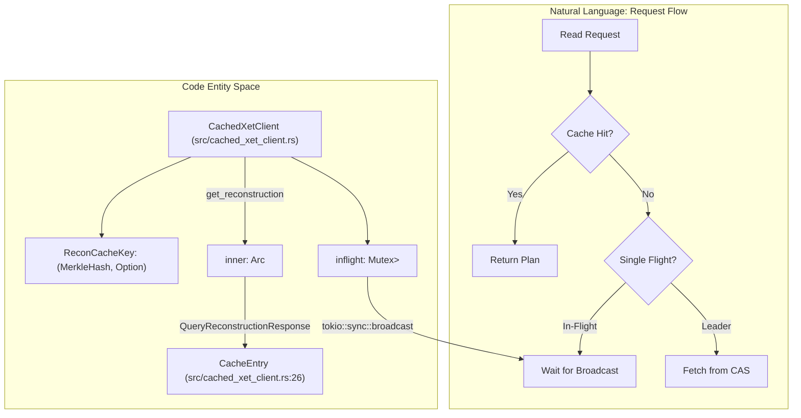
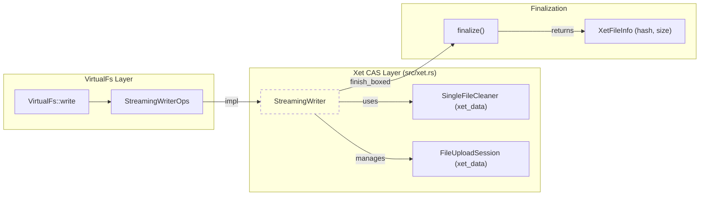

<!-- source: DeepWiki mcp.deepwiki.com · repo huggingface/hf-mount · page 4.3 Xet CAS Layer · fetched 2026-10-26 -->

# Xet CAS Layer

Relevant source files

The following files were used as context for generating this wiki page:

- [src/cached_xet_client.rs](src/cached_xet_client.rs)
- [src/xet.rs](src/xet.rs)

The Xet Content Addressable Storage (CAS) layer provides the underlying data transport and deduplication logic for `hf-mount`. It abstracts the complexity of the Xet protocol—including Merkle-tree based file reconstruction, block-level deduplication, and compressed "xorb" storage—into a set of high-level traits used by the filesystem layer.

## Overview of XetOps

The `XetOps` trait is the primary interface between the `VirtualFs` and the Xet backend. it provides methods for streaming writes, full-file downloads, and range-based streaming.

| Method | Purpose | Implementation Detail |
| :--- | :--- | :--- |
| `create_streaming_writer` | Starts an append-only upload session. | Returns a `StreamingWriter` wrapping a `FileUploadSession` [src/xet.rs:102-116](). |
| `download_to_file` | Downloads a full file to a local path. | Used for staging files in "advanced" write mode [src/xet.rs:118-125](). |
| `upload_files` | Batch uploads multiple files from disk. | Finalizes a `FileUploadSession` after processing paths [src/xet.rs:127-147](). |
| `download_stream_boxed` | Creates a byte-range stream. | Bridges to `FileReconstructor` or `FileDownloadSession` [src/xet.rs:149-157](). |
| `warm_reconstruction_cache` | Pre-fetches a file's reconstruction plan. | Triggers a background fetch in `CachedXetClient` [src/xet.rs:159-163](). |

Sources: [src/xet.rs:20-33](), [src/xet.rs:101-164]()

## XetSessions and Data Flow

`XetSessions` is the concrete implementation of `XetOps`. It manages the lifecycle of `FileDownloadSession` and `FileUploadSession` objects from the `xet-core` library.

### Streaming and Reconstruction
When a read request arrives, `XetSessions::download_stream` determines the optimal fetching strategy based on whether a byte range is specified:

1.  **Unbounded Streams (`end == None`)**: Uses `session.download_stream_from_offset`. This path utilizes the standard `xet-core` chunk cache, which is ideal for sequential reads [src/xet.rs:78-82]().
2.  **Bounded Ranges (`end == Some`)**: Uses `FileReconstructor` to build a stream for a specific `FileRange`. Crucially, this path bypasses the `xorb` disk cache to avoid "cache pollution" where a small random read might otherwise trigger a ~64MB xorb download [src/xet.rs:83-96]().

### StagingDir Session Isolation
For "advanced" write modes (random access or read-modify-write), `hf-mount` uses a `StagingDir`. To prevent collisions between different mount instances or concurrent sessions, it generates a unique `session_key` for the staging path [src/xet.rs:182-192]().

Sources: [src/xet.rs:54-98](), [src/xet.rs:182-192]()

## CachedXetClient

The `CachedXetClient` sits between the CAS sessions and the remote server. It optimizes the retrieval of **Reconstruction Plans**—the manifests that describe which chunks (and which xorbs) compose a specific file.

### Reconstruction Plan Coalescing
The client implements a "single-flight" mechanism using `tokio::sync::broadcast` channels. If multiple threads request the same reconstruction plan simultaneously, only the first thread performs the network request (`Lead` action); others wait (`Wait` action) and consume the result from the cache once the leader finishes [src/cached_xet_client.rs:146-152]().

### Plan Derivation Logic
To minimize network overhead, `CachedXetClient` can derive a range-specific plan from a cached full-file plan.

*   **Logic**: It iterates through the `terms` of the full plan, tracking cumulative offsets, and filters for those overlapping the requested `FileRange` [src/cached_xet_client.rs:97-121]().
*   **Over-fetch Management**: Because `XorbReconstructionTerm` only provides `unpacked_length` for the whole term, the derived plan may include up to one extra chunk (~128KB) at the boundaries. This is considered negligible for large model weights [src/cached_xet_client.rs:80-96]().

### Cache Lifecycle
*   **Capacity**: Limited to 4096 entries [src/cached_xet_client.rs:21]().
*   **TTL**: Set to 59 minutes [src/cached_xet_client.rs:24](). This is specifically tuned to be shorter than the 1-hour expiry of the S3 presigned URLs contained within the plans, preventing "Stale URL" errors [src/cached_xet_client.rs:22-24]().

### Entity Mapping: Reconstruction Cache
The following diagram shows how `CachedXetClient` coordinates between the `Client` trait and internal cache structures.

Sources: [src/cached_xet_client.rs:18-24](), [src/cached_xet_client.rs:45-70](), [src/cached_xet_client.rs:143-152]()

## Writing to CAS

The CAS layer supports two distinct writing abstractions via `StreamingWriterOps`.

### StreamingWriter
The `StreamingWriter` is used for append-only uploads. It encapsulates a `SingleFileCleaner` which handles the chunking and hashing of data as it is written [src/xet.rs:205-212]().

1.  **`write()`**: Passes data to the `cleaner`. It tracks `bytes_written` locally [src/xet.rs:224-228]().
2.  **`finish_boxed()`**: Closes the cleaner, finalizes the `FileUploadSession`, and returns a `XetFileInfo` containing the final Merkle hash of the uploaded content [src/xet.rs:230-241]().

### Write Path Entity Mapping
This diagram maps the high-level write operations to the internal `xet-core` session objects.

Sources: [src/xet.rs:37-42](), [src/xet.rs:102-116](), [src/xet.rs:205-242]()

## Performance Optimizations

### Xorb Cache Bypass
For random reads (typical in `safetensors` header lookups), `hf-mount` explicitly bypasses the `xorb` disk cache. By using `FileReconstructor` directly with a `FileRange`, the system avoids the latency and disk I/O of downloading an entire 64MB xorb when only a few kilobytes are needed [src/xet.rs:87-94]().

### Single-Flight Coalescing
The `inflight` map in `CachedXetClient` ensures that even under heavy parallel load (e.g., a distributed training job starting on many nodes simultaneously), the CAS server is not overwhelmed by redundant requests for the same file manifest [src/cached_xet_client.rs:51-53]().

Sources: [src/xet.rs:87-94](), [src/cached_xet_client.rs:51-53]()

---

