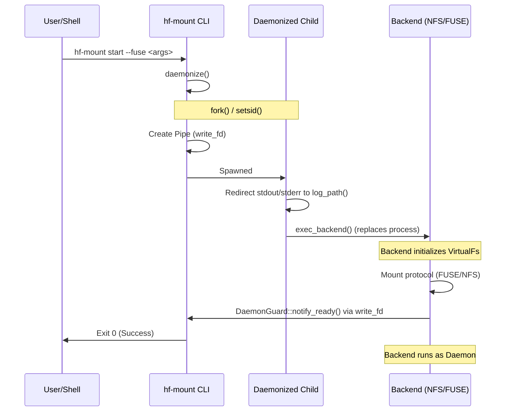
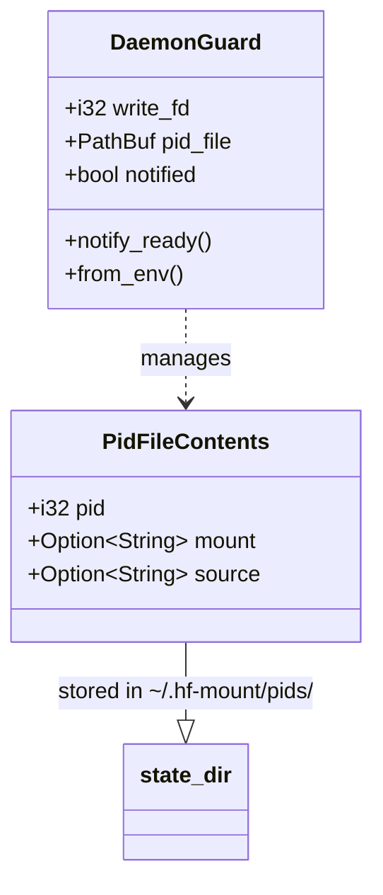

<!-- source: DeepWiki mcp.deepwiki.com · repo huggingface/hf-mount · page 5 Daemon and Process Management · fetched 2026-10-26 -->

# Daemon and Process Management

Relevant source files

The following files were used as context for generating this wiki page:

- [src/bin/hf-mount.rs](src/bin/hf-mount.rs)
- [src/daemon.rs](src/daemon.rs)

This page describes the lifecycle of `hf-mount` processes, the daemonization mechanism used to run mounts in the background, and the tools provided for process discovery and termination.

## Overview

The `hf-mount` system employs a wrapper-based execution model where a primary CLI (`hf-mount`) manages the lifecycle of specialized backend binaries (`hf-mount-nfs` or `hf-mount-fuse`). When a user starts a mount, the wrapper handles the transition from a foreground terminal process to a background daemon, ensuring the filesystem is fully initialized before returning control to the user.

For details on how these processes are configured during startup, see [Mount Setup and Configuration](#5.1).

## Lifecycle and Daemonization

The `hf-mount` CLI implements a manual `fork`/`exec` flow to achieve daemonization without external process managers. This flow ensures that logs are redirected and the process is detached from the controlling terminal.

### The Fork/Exec Sequence

1.  **CLI Entry**: The user runs `hf-mount start` [src/bin/hf-mount.rs:15-23]().
2.  **Daemonization**: The `daemonize()` function handles the initial fork, `setsid` call, and redirection of `stdout`/`stderr` to a log file [src/bin/hf-mount.rs:92-98]().
3.  **Ready Notification**: A pipe is established between the parent and child. The parent waits on this pipe while the child proceeds to initialization [src/daemon.rs:119-146]().
4.  **Backend Exec**: The child process identifies the appropriate backend binary and calls `exec_backend`, which replaces the current process image using `execvp` [src/bin/hf-mount.rs:104-106]().
5.  **Signal Readiness**: Once the backend (NFS or FUSE) has successfully mounted the filesystem, it uses the `DaemonGuard` to write to the pipe, signaling the original parent process to exit with success [src/daemon.rs:137-146]().

### Process Transition Diagram

The following diagram illustrates the transition from the wrapper CLI to the long-running backend daemon.

"Process Transition and Exec Flow"

Sources: [src/bin/hf-mount.rs:55-107](), [src/bin/hf-mount.rs:113-130](), [src/daemon.rs:119-164]()

## DaemonGuard and PID Management

The `DaemonGuard` is an RAII (Resource Acquisition Is Initialization) struct that manages the liveness state of a daemon.

*   **PID File Schema**: PID files are stored in `~/.hf-mount/pids/` [src/daemon.rs:5-10](). The filename is a percent-encoded version of the canonical mount point path [src/daemon.rs:61-64]().
*   **PID File Contents**: The file contains three lines: the PID, the canonical mount path, and a source label (e.g., "bucket my-bucket") [src/daemon.rs:107-115]().
*   **RAII Cleanup**: When the backend process terminates (gracefully or via crash), the `DaemonGuard` drop implementation attempts to remove the PID file [src/daemon.rs:166-175]().

### Daemon State Management

"Daemon Metadata and File Entities"

Sources: [src/daemon.rs:119-123](), [src/daemon.rs:100-104](), [src/daemon.rs:5-10]()

## Discovery and Shutdown

`hf-mount` provides built-in mechanisms to discover running daemons and shut them down cleanly.

### Discovery (`list_daemons`)
The `list_daemons()` function scans the `~/.hf-mount/pids/` directory [src/daemon.rs:61-64](). For each PID file found, it verifies:
1.  **Liveness**: The process is still running [src/daemon.rs:95-97]().
2.  **Identity**: On Linux, it checks `/proc/<pid>/exe` to ensure the process is actually an `hf-mount` binary [src/daemon.rs:78-84]().

### Graceful Shutdown (`stop_daemon`)
Stopping a daemon is primarily achieved by unmounting the filesystem, which triggers the backend's internal shutdown logic.

*   **Unmount Strategies**: The system attempts several platform-specific commands. On macOS, it tries `umount` and `diskutil` [src/daemon.rs:190-193](). On Linux, it attempts `umount`, `sudo umount`, and `fusermount3 -u -z` (lazy unmount) [src/daemon.rs:194-203]().
*   **Wait for Exit**: After the unmount command is issued, `stop_daemon` polls the PID to ensure the process has exited before returning [src/daemon.rs:207]().

| Feature | Linux Strategy | macOS Strategy |
| :--- | :--- | :--- |
| **Identity Check** | `/proc/<pid>/exe` verification | Process liveness only |
| **Unmount** | `fusermount3`, `umount`, `sudo` | `diskutil unmount`, `umount` |
| **PID Path** | `~/.hf-mount/pids/%2Fmnt.pid` | `~/.hf-mount/pids/%2Fmnt.pid` |

Sources: [src/daemon.rs:71-87](), [src/daemon.rs:188-204](), [src/bin/hf-mount.rs:44-54]()

## Log Management

Logs are automatically managed by the daemonization process.
*   **Location**: Logs are stored in `~/.hf-mount/logs/` [src/daemon.rs:66-69]().
*   **Naming**: Like PID files, log files use the percent-encoded canonical mount point to ensure uniqueness [src/daemon.rs:67-68]().
*   **Redirection**: During `daemonize()`, the child process redirects its standard output and error streams to these files, ensuring that backend logs (including FUSE/NFS debug output) are captured even when detached from the terminal [src/bin/hf-mount.rs:92-98]().

Sources: [src/daemon.rs:66-69](), [src/daemon.rs:52-59]()

---

