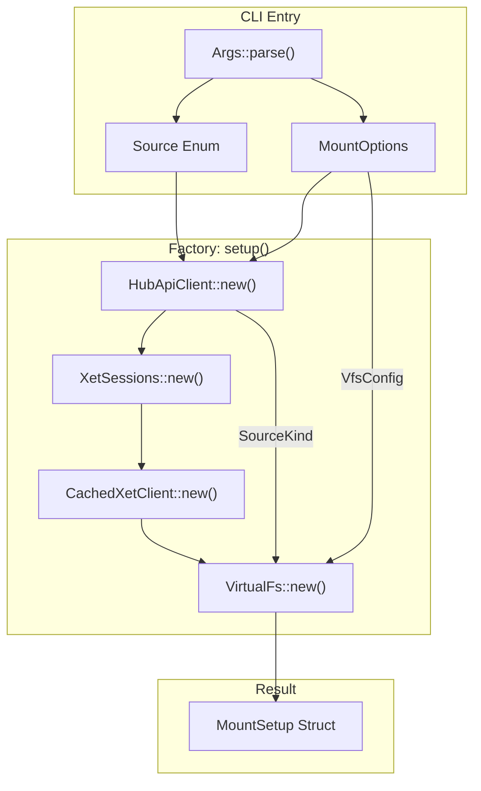
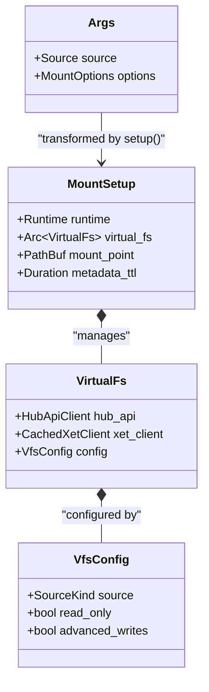

<!-- source: DeepWiki mcp.deepwiki.com · repo huggingface/hf-mount · page 5.1 Mount Setup and Configuration · fetched 2026-10-26 -->

# Mount Setup and Configuration

Relevant source files

The following files were used as context for generating this wiki page:

- [src/setup.rs](src/setup.rs)

This page describes the initialization sequence of `hf-mount`, covering the transition from CLI arguments to a fully operational `VirtualFs`. It details the configuration schemas, the factory logic in `setup()`, and the environment tuning for the underlying `xet-core` libraries.

## Overview of the Initialization Sequence

The setup process follows a strict linear progression to ensure that authentication is valid, caches are initialized, and the virtual filesystem tree is rooted correctly before the FUSE or NFS server starts.

### Initialization Flow
The following diagram illustrates the data flow from the `Args` parser to the `MountSetup` container.

**Mount Initialization Sequence**

**Sources:** [src/setup.rs:152-171](), [src/setup.rs:198-268]()

## Configuration Schemas

### Source Enum
The `Source` enum defines what is being mounted. It handles the parsing of Hugging Face identifiers into internal types.

| Variant | Fields | Purpose |
| :--- | :--- | :--- |
| `Bucket` | `bucket_id`, `mount_point` | Mounts an S3-backed HF Bucket (Read-Write). |
| `Repo` | `repo_id`, `mount_point`, `revision` | Mounts a Model/Dataset/Space repo (Read-Only). |

**Sources:** [src/setup.rs:17-35]()

### MountOptions CLI Schema
The `MountOptions` struct defines the global configuration for the filesystem behavior, performance tuning, and cache limits.

| Option | Code Reference | Default | Description |
| :--- | :--- | :--- | :--- |
| `hf_token` | `hf_token` | `None` | API token (or `HF_TOKEN` env). |
| `token_file` | `token_file` | `None` | Path to a file for dynamic token refresh. |
| `cache_dir` | `cache_dir` | `/tmp/hf-mount-cache` | Local disk storage for chunks and staging. |
| `advanced_writes`| `advanced_writes` | `false` | Enables staging files for random-access writes. |
| `metadata_ttl_ms`| `metadata_ttl_ms` | `10,000` | Kernel attribute cache duration. |
| `poll_interval` | `poll_interval_secs`| `30` | Frequency of remote change detection. |

**Sources:** [src/setup.rs:58-147]()

## The `setup()` Factory Function

The `setup()` function is the primary entry point for constructing the filesystem environment. It performs the following critical tasks:

1.  **Path Resolution**: Splits the provided `repo_id` or `bucket_id` into a `SourceKind` and an optional `path_prefix` (e.g., mounting a specific subdirectory) using `split_path_prefix` [[src/hub_api.rs:136-152]()] and `parse_repo_id` [[src/hub_api.rs:114-134]()].
2.  **Authentication**: Initializes a `HubTokenRefresher` which manages the 30-second TTL refresh cycle for JWTs used by the Xet CAS backend [[src/setup.rs:218-223]()].
3.  **Client Stack**:
    *   Constructs `HubApiClient` for metadata operations [[src/setup.rs:224-229]()].
    *   Constructs `CachedXetClient` for data operations, wrapping the `xet-core` remote client [[src/setup.rs:242-244]()].
4.  **VirtualFs Creation**: Consolidates these components into a `VirtualFs` instance wrapped in an `Arc` for multi-threaded access [[src/setup.rs:260-267]()].

**Sources:** [src/setup.rs:198-268]()

## xet-core Environment Tuning

`hf-mount` relies on `xet-core` (via `xet-data`) for content-addressed storage (CAS) operations. These are tuned via environment variables in `init_tracing()` to ensure optimal performance for filesystem workloads.

| Variable | Value | Purpose |
| :--- | :--- | :--- |
| `XET_DISABLE_VERSION_CHECK` | `1` | Prevents startup delays from version pings. |
| `XET_LOG_LEVEL` | `error` | Suppresses verbose internal Xet logging. |
| `XET_CONCURRENCY` | `128` | Max concurrent network requests for chunking. |
| `XET_BLOCK_SIZE` | `16777216` | Sets 16MB block size for deduplication. |

**Sources:** [src/setup.rs:189-196]()

## Data Structure Mapping

The following diagram bridges the CLI argument space to the internal structs that govern the filesystem lifecycle.

**CLI to Internal Entity Mapping**

**Sources:** [src/setup.rs:152-171](), [src/virtual_fs.rs:65-81]()

## Initialization Sequence Implementation

The initialization is split into two phases to support daemonization:
1.  **`init_tracing(daemon: bool)`**: Sets up logging and environment variables. This must be called before any threads are spawned to allow for safe `fork()` calls in daemon mode [[src/setup.rs:177-196]()].
2.  **`setup(args: Args)`**: Spawns the `tokio` runtime and builds the VFS stack [[src/setup.rs:198-268]()].

### The `MountSetup` Result
The `MountSetup` struct is the final artifact of the configuration phase. It contains the initialized `tokio::runtime::Runtime` and the `Arc<VirtualFs>`, which are then passed to the specific backend (FUSE or NFS) to begin serving requests [[src/setup.rs:161-171]()].

**Sources:** [src/setup.rs:161-171](), [src/setup.rs:177-196]()

---

