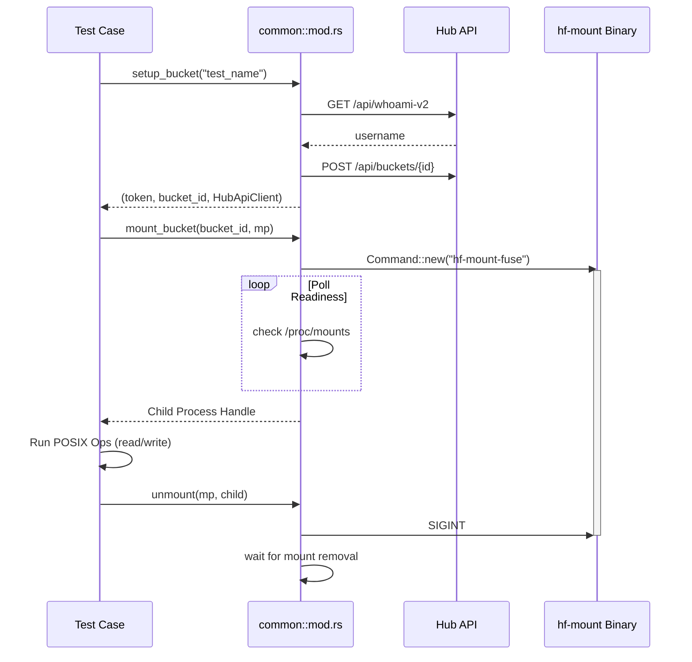
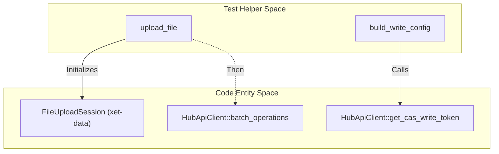

<!-- source: DeepWiki mcp.deepwiki.com · repo huggingface/hf-mount · page 6.1 Integration Test Framework · fetched 2026-10-26 -->

# Integration Test Framework

Relevant source files

The following files were used as context for generating this wiki page:

- [.github/workflows/ci.yml](.github/workflows/ci.yml)
- [tests/common/mod.rs](tests/common/mod.rs)
- [tests/repo_ops.rs](tests/repo_ops.rs)

The `hf-mount` integration test framework provides a robust suite for validating filesystem behavior against real Hugging Face Hub endpoints. It manages the full lifecycle of remote resources (buckets and repositories) and local mount processes (FUSE and NFS), ensuring data integrity and POSIX compliance through automated pipelines.

## Overview and Lifecycle Management

The framework, primarily defined in `tests/common/mod.rs`, handles the orchestration of testing environments. This includes authenticating with the Hub, creating temporary buckets for isolated testing, and spawning the filesystem daemons.

### Bucket Lifecycle
For tests requiring write access or isolated environments, the framework manages "Buckets" on the Hugging Face Hub.

*   **`setup_bucket`**: Initializes a test environment by fetching the current user identity via `whoami`, generating a unique bucket ID based on the test name and process ID, and calling `create_bucket` [tests/common/mod.rs:23-41]().
*   **`create_bucket`**: Issues a POST request to the Hub API. It gracefully handles `409 Conflict` if the bucket already exists [tests/common/mod.rs:82-98]().
*   **`delete_bucket`**: Performs cleanup by issuing a DELETE request to the Hub API [tests/common/mod.rs:101-123]().
*   **`whoami`**: Retrieves the username associated with the `HF_TOKEN` to namespace test buckets [tests/common/mod.rs:126-138]().

### Mount Lifecycle
The framework supports spawning both FUSE and NFS variants of the filesystem as child processes.

*   **`mount_bucket` / `mount_repo`**: These functions locate the compiled `hf-mount-fuse` or `hf-mount-nfs` binaries and spawn them using `std::process::Command`. They pass essential configuration such as `--hf-token`, `--hub-endpoint`, and `--cache-dir` [tests/common/mod.rs:176-214]().
*   **Readiness Polling**: After spawning the child process, the framework polls `/proc/mounts` (on Linux) or uses `st_dev` checks to ensure the mount point is live before returning control to the test runner [tests/common/mod.rs:218-245]().
*   **`unmount`**: Ensures a clean exit by sending a `SIGINT` to the child process and waiting for the mount point to disappear from the kernel's mount table [tests/common/mod.rs:324-358]().

### Integration Test Data Flow
The following diagram illustrates how a test case interacts with the framework to establish a live filesystem backed by the Hub.

**Test Setup and Mount Flow**

**Sources:** [tests/common/mod.rs:23-41](), [tests/common/mod.rs:176-214](), [tests/common/mod.rs:324-358]()

---

## CAS Upload Pipeline

The framework includes a manual Content Addressable Storage (CAS) upload pipeline to prepopulate buckets with data without relying on the FUSE/NFS mount itself. This is used for "read-only" tests or verifying that the mount correctly sees externally uploaded data.

*   **`build_write_config`**: Generates a `TranslatorConfig` by requesting a short-lived CAS write JWT from the Hub [tests/common/mod.rs:141-156]().
*   **`upload_file`**: Uses the `xet-data` `FileUploadSession` to chunk, hash, and upload a file to the CAS [tests/common/mod.rs:159-172]().
*   **Metadata Synchronization**: After uploading to CAS, the framework calls `HubApiClient::batch_operations` to link the CAS hash (Xet Hash) to a path in the Hub's file tree [tests/common/mod.rs:67-74]().

**CAS Upload Entity Mapping**

**Sources:** [tests/common/mod.rs:141-172](), [tests/common/mod.rs:67-74]()

---

## Data Integrity and Patterns

To verify filesystem correctness, the framework employs deterministic data generation. This ensures that even for large files, the test can verify every byte without storing the entire file in memory.

*   **`generate_pattern`**: Creates a deterministic byte buffer of a specific size. This is used to write known data to the mount [tests/common/mod.rs:373-380]().
*   **`verify_pattern`**: Reads a file from the mount and compares it against the expected deterministic pattern, ensuring that no corruption occurred during the Hub upload/download lifecycle [tests/common/mod.rs:383-393]().

---

## CI Integration

The integration tests are orchestrated via GitHub Actions, targeting various environments and protocols.

| Job Name | Description | Key Command |
| :--- | :--- | :--- |
| `smoke-test` | Runs basic FUSE and NFS operations against a staging Hub. | `cargo test --test fuse_ops --test nfs_ops` |
| `fsx` | Executes the `fsx` tool to test data integrity under stress. | `cargo test --test fsx` |
| `xfstests` | Runs a subset of the Linux `xfstests` suite for filesystem exerciser. | `cargo test --test xfstests` |
| `pjdfstest` | Validates POSIX compliance (permissions, symlinks, etc.). | `cargo test --test pjdfstest` |

The CI environment sets `HF_ENDPOINT` to `https://hub-ci.huggingface.co` to avoid polluting the production Hub [github/workflows/ci.yml:68-69]().

**Sources:** [.github/workflows/ci.yml:61-136](), [tests/common/mod.rs:373-393]()

---

