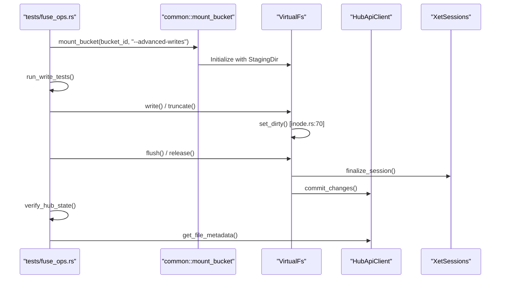
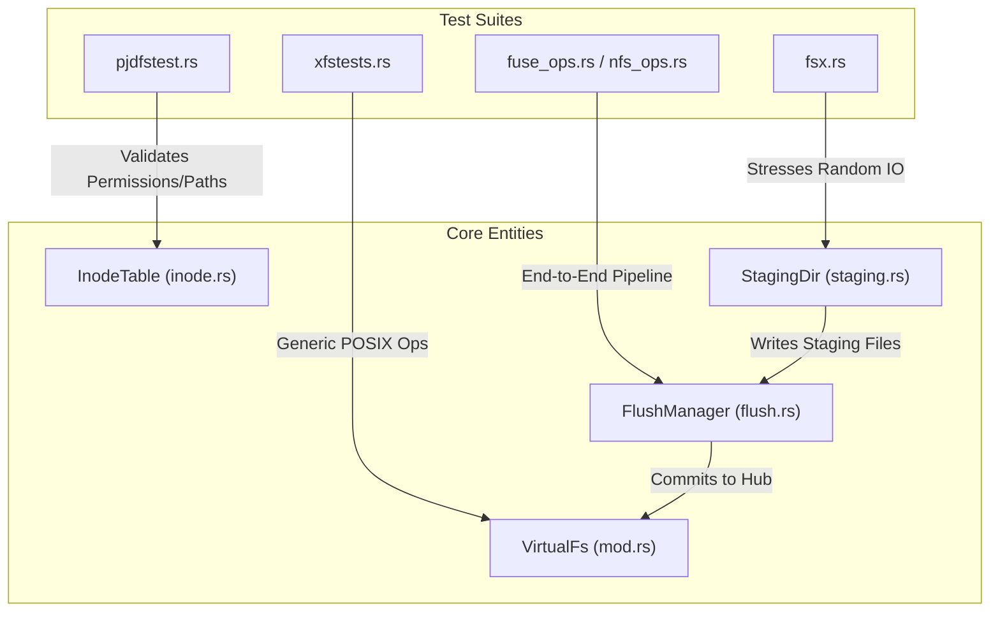

<!-- source: DeepWiki mcp.deepwiki.com · repo huggingface/hf-mount · page 6.2 Functional and POSIX Tests · fetched 2026-10-26 -->

# Functional and POSIX Tests

Relevant source files

The following files were used as context for generating this wiki page:

- [.github/workflows/ci.yml](.github/workflows/ci.yml)
- [src/virtual_fs/inode.rs](src/virtual_fs/inode.rs)
- [tests/common/bench.rs](tests/common/bench.rs)
- [tests/common/fs_tests.rs](tests/common/fs_tests.rs)
- [tests/fsx.rs](tests/fsx.rs)
- [tests/fuse_ops.rs](tests/fuse_ops.rs)
- [tests/nfs_ops.rs](tests/nfs_ops.rs)
- [tests/pjdfstest.rs](tests/pjdfstest.rs)
- [tests/repo_ops.rs](tests/repo_ops.rs)
- [tests/xfstests.rs](tests/xfstests.rs)

The `hf-mount` codebase employs a multi-layered testing strategy to ensure data integrity, protocol correctness, and POSIX compliance. This page covers functional integration tests, the shared test suite used across backends, and the integration of industry-standard POSIX compliance suites.

## Functional Integration Framework

Functional tests are primarily located in the `tests/` directory and leverage a common infrastructure defined in `tests/common/mod.rs`. These tests simulate real-world usage by mounting actual Hugging Face Hub repositories or temporary S3-backed buckets.

### Shared Test Suite (`fs_tests.rs`)

The `tests/common/fs_tests.rs` file contains a portable suite of filesystem operations that can be executed against any mount point, regardless of whether it is backed by FUSE or NFS.

| Function | Scope | Key Operations Verified |
|:---|:---|:---|
| `run_read_tests` | Read-Only | `readdir`, full file reads, range reads (seeking), tail reads, and `stat` metadata accuracy. [tests/common/fs_tests.rs:9-77]() |
| `run_write_tests` | Advanced Writes | File creation, `truncate` (to 0 and non-zero), random writes, `rename` of dirty files, and nested directory operations. [tests/common/fs_tests.rs:82-205]() |
| `run_simple_write_tests` | Streaming Writes | Append-only write patterns and synchronous close-to-upload behavior. [tests/common/fs_tests.rs:209-234]() |
| `run_revalidation_test` | Metadata Consistency | Verification that remote changes are detected via `lookup()` and that kernel caches are invalidated. [tests/common/fs_tests.rs:261-314]() |
| `verify_hub_state` | Remote Integrity | Asynchronous verification that the Hub API reflects the expected file size and existence after a mount flush. [tests/common/fs_tests.rs:244-259]() |

**Sources:** [tests/common/fs_tests.rs:1-314]()

### Protocol-Specific Integration

Individual test files instantiate the `VirtualFs` via specific backends to verify protocol-specific logic:

*   **FUSE Ops (`tests/fuse_ops.rs`):** Tests FUSE-specific features like `--advanced-writes` and metadata TTL revalidation. [tests/fuse_ops.rs:43-78]()
*   **NFS Ops (`tests/nfs_ops.rs`):** Verifies the NFS v3 server implementation, including read-only enforcement and the `HandlePool` bridge. [tests/nfs_ops.rs:4-38]()
*   **Repo Ops (`tests/repo_ops.rs`):** Focuses on mounting real Hugging Face model repositories (e.g., `openai-community/gpt2`) to verify the handling of both plain Git/LFS files and Xet-backed files. [tests/repo_ops.rs:6-28]()

**Sources:** [tests/fuse_ops.rs:1-114](), [tests/nfs_ops.rs:1-77](), [tests/repo_ops.rs:1-90]()

## Data Flow: Test Execution to Backend

The following diagram illustrates how a functional test (e.g., `test_fuse_advanced_writes`) interacts with the system components to verify a write operation.

**Functional Test Data Flow**

**Sources:** [tests/fuse_ops.rs:43-78](), [tests/common/fs_tests.rs:82-205](), [src/virtual_fs/inode.rs:63-98]()

## POSIX Compliance Suites

To ensure `hf-mount` behaves like a standard Unix filesystem, the CI pipeline integrates several external test suites.

### pjdfstest (POSIX Compliance)

The `pjdfstest` suite is used to verify syscall-level correctness for operations like `chmod`, `chown`, `mkdir`, `rename`, and `symlink`.

*   **Implementation:** The test runner (`tests/pjdfstest.rs`) clones and builds `pjdfstest` from source, then runs the `prove` utility against the mount point. [tests/pjdfstest.rs:38-79]()
*   **Exclusions:** Tests involving `mkfifo`, `mknod`, and hard `link` are excluded as they are not supported by the underlying Hub/S3 backends (returning `ENOSYS` or `ENOTSUP`). [tests/pjdfstest.rs:11-30]()
*   **CI Integration:** The `ci.yml` workflow runs this suite and posts a summary table to Pull Requests. [.github/workflows/ci.yml:137-166]()

### fsx (File System Exerciser)

`fsx` performs thousands of random operations (read, write, truncate, fallocate) to stress-test data integrity.

*   **Modes:**
    *   **Normal:** 50,000 random operations. [tests/fsx.rs:91-114]()
    *   **Paranoid:** 100 operations with a close/reopen after every single op (`-c 1`), forcing a full CAS round-trip and Hub commit for every mutation. [tests/fsx.rs:119-144]()
*   **Constraints:** `mmap` operations are disabled (`-R -W`) because FUSE `MAPWRITE` bypasses the FUSE handler via the kernel page cache. [tests/fsx.rs:4-5]()

### xfstests (Filesystem Exerciser)

The Linux kernel `xfstests` suite (generic tests) is run against `hf-mount` with `--advanced-writes` enabled.

*   **FUSE Patching:** Since `xfstests` expects real block devices, `hf-mount` applies runtime patches to `common/rc` within the `xfstests` directory. These patches replace standard `mount`/`unmount` commands with `sync` and `drop_caches` calls to simulate unmounting for a FUSE filesystem. [tests/xfstests.rs:79-125]()
*   **Configuration:** It uses a `local.config` to define `TEST_DEV` and `SCRATCH_DEV` as `hf-mount` instances. [tests/xfstests.rs:159-169]()

**Sources:** [tests/pjdfstest.rs:1-196](), [tests/fsx.rs:1-145](), [tests/xfstests.rs:1-189](), [.github/workflows/ci.yml:115-136]()

## Code Entity Mapping

The following diagram maps the test suites to the specific code entities they exercise within the `hf-mount` architecture.

**Test Suite to Entity Mapping**

**Sources:** [src/virtual_fs/inode.rs:100-110](), [tests/pjdfstest.rs:1-30](), [tests/fsx.rs:119-144](), [tests/fuse_ops.rs:43-51]()

## CI Pipeline Integration

Automated testing is managed via GitHub Actions in `.github/workflows/ci.yml`.

| Job Name | Trigger | Environment Requirements |
|:---|:---|:---|
| `lint-test` | Every Push | Unit tests with `cargo test --lib`. [.github/workflows/ci.yml:21-60]() |
| `smoke-test` | Every Push | Integration tests against `hub-ci.huggingface.co`. [.github/workflows/ci.yml:61-92]() |
| `fsx` | Every Push | Data integrity checks (10-minute timeout). [.github/workflows/ci.yml:93-114]() |
| `xfstests` | Every Push | Full exerciser suite (45-minute timeout). [.github/workflows/ci.yml:115-136]() |
| `pjdfstest` | PR/Push | POSIX compliance verification. [.github/workflows/ci.yml:137-166]() |

**Sources:** [.github/workflows/ci.yml:1-233]()

---

