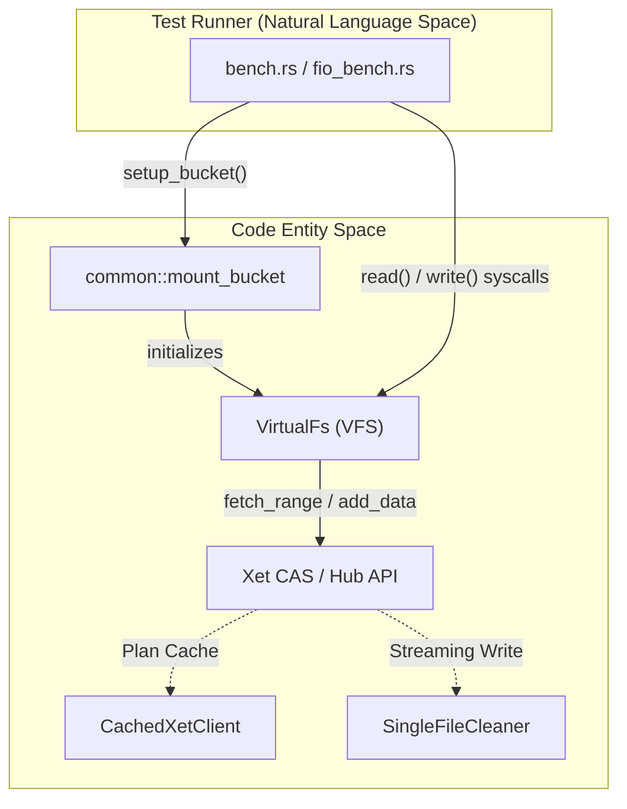

<!-- source: DeepWiki mcp.deepwiki.com · repo huggingface/hf-mount · page 6.3 Benchmarks and Performance Tests · fetched 2026-10-26 -->

# Benchmarks and Performance Tests

Relevant source files

The following files were used as context for generating this wiki page:

- [tests/bench.rs](tests/bench.rs)
- [tests/common/bench.rs](tests/common/bench.rs)
- [tests/common/fs_tests.rs](tests/common/fs_tests.rs)
- [tests/fio_bench.rs](tests/fio_bench.rs)
- [tests/warm_cache_bench.rs](tests/warm_cache_bench.rs)

This page documents the performance testing infrastructure for `hf-mount`. The codebase includes several benchmarking suites designed to measure filesystem throughput, latency, and the effectiveness of caching mechanisms across both FUSE and NFS backends.

## Overview of Benchmark Suites

The benchmarking infrastructure is primarily located in the `tests/` directory and utilizes a combination of custom Rust-based benchmarks and industry-standard tools like `fio`.

| Suite | File | Primary Focus |
|:---|:---|:---|
| **Standard Bench** | [tests/bench.rs]() | Comparison of FUSE vs NFS across multiple file sizes (50MB to 500MB). |
| **Fio Bench** | [tests/fio_bench.rs]() | Detailed IOPS and latency metrics using the `fio` engine. |
| **Warm Cache Bench** | [tests/warm_cache_bench.rs]() | Measuring the impact of the `CachedXetClient` reconstruction plan cache. |
| **Raw Pipeline** | [tests/common/bench.rs]() | Measuring the theoretical throughput of the `SingleFileCleaner` without FUSE/Kernel overhead. |

### Performance Data Flow

The following diagram illustrates how a benchmark request flows through the system components to measure performance.

**Benchmark Execution Flow**

Sources: [tests/bench.rs:12-15](), [tests/common/bench.rs:32-35](), [tests/warm_cache_bench.rs:7-9]()

---

## Standard Benchmark (`bench.rs`)

The `test_bench` function in [tests/bench.rs:10-165]() performs a comprehensive comparison between FUSE and NFS. It uses three standard sizes: 50MB, 200MB, and 500MB [tests/bench.rs:3-7]().

### Measured Metrics
1.  **Sequential Read**: Cold read of a file from the remote bucket [tests/common/bench.rs:37-46]().
2.  **Sequential Re-read**: Reading the same file again to measure local disk cache/kernel buffer impact [tests/common/bench.rs:48-56]().
3.  **Range Read**: Seeking to a specific offset (e.g., 25MB) and reading a 1MB chunk [tests/common/bench.rs:58-70]().
4.  **Random Reads**: Performing 100 independent 4KB reads at random offsets [tests/common/bench.rs:72-97]().
5.  **Write Throughput**: Measuring `write()` syscall speed into the FUSE mount [tests/common/bench.rs:132-146]().
6.  **Close Latency**: The time taken for the `close()` syscall, which includes the Xet CAS finalization and Hub API commit [tests/common/bench.rs:149-151]().
7.  **Deduplication Speedup**: Re-writing identical data to measure the efficiency of the CAS deduplication [tests/common/bench.rs:162-177]().

Sources: [tests/bench.rs:108-156](), [tests/common/bench.rs:9-28]()

---

## FIO Benchmarks (`fio_bench.rs`)

The `fio_bench.rs` suite integrates the industry-standard `fio` tool to provide high-fidelity performance data. It defines several `FioJob` configurations to simulate different workloads [tests/fio_bench.rs:13-57]().

### Job Configurations
*   **seq-read-100M**: 128k block size sequential read [tests/fio_bench.rs:22-28]().
*   **rand-read-4k-100M**: 4k block size random read with IOPS measurement [tests/fio_bench.rs:37-42]().
*   **multi-file**: Concurrent reads across multiple small and medium files [tests/fio_bench.rs:44-56]().

The results are parsed from JSON output and formatted into a comparison table showing FUSE vs NFS bandwidth (MB/s), IOPS, and average latency in microseconds [tests/fio_bench.rs:96-109]().

Sources: [tests/fio_bench.rs:6-11](), [tests/fio_bench.rs:111-160]()

---

## Cache Performance (`warm_cache_bench.rs`)

This benchmark specifically targets the `CachedXetClient` reconstruction plan cache. When a file is opened, the system must fetch a "reconstruction plan" from the CAS to know how to assemble blocks.

*   **Cold Open**: FUSE blocks while the plan is fetched from the remote CAS [tests/warm_cache_bench.rs:7-7]().
*   **Warm Open**: Subsequent opens hit the in-process `CachedXetClient` cache, resulting in near-instant Time-To-First-Byte (TTFB) [tests/warm_cache_bench.rs:8-8]().

The test reports TTFB in milliseconds and end-to-end MB/s for 5 consecutive opens of a 100MB file [tests/warm_cache_bench.rs:17-19]().

Sources: [tests/warm_cache_bench.rs:71-125](), [tests/warm_cache_bench.rs:140-147]()

---

## Raw Pipeline Benchmark

The `run_raw_cleaner_benchmark` function in `tests/common/bench.rs` bypasses the FUSE/NFS layer and the OS kernel entirely. It measures the throughput of the `SingleFileCleaner` and `XetSessions` streaming writer directly [tests/common/bench.rs:193-205]().

This benchmark serves as the "theoretical ceiling" for write performance, identifying if bottlenecks are in the networking/CAS layer or the filesystem protocol implementation.

### Implementation Detail
The benchmark uses `common::generate_pattern` to create deterministic data and pushes it through `writer.add_data()` [tests/common/bench.rs:194-203]().

**Raw Write Pipeline Entity Mapping**

Sources: [tests/common/bench.rs:193-205](), [tests/common/mod.rs:136-145]()

---

## Summary of Key Metrics

| Metric | Code Reference | Description |
|:---|:---|:---|
| `seq_read_mbps` | [tests/common/bench.rs:9]() | Sequential throughput (MB/s). |
| `range_read_ms` | [tests/common/bench.rs:11]() | Latency for 1MB random seek (ms). |
| `close_secs` | [tests/common/bench.rs:20]() | Time to finalize upload on file close (s). |
| `dedup_total_mbps` | [tests/common/bench.rs:25]() | Effective throughput when data is already in CAS. |
| `ttfb_ms` | [tests/warm_cache_bench.rs:111]() | Time to first byte (Plan fetch latency). |

Sources: [tests/common/bench.rs:8-28](), [tests/warm_cache_bench.rs:86-87]()

---

