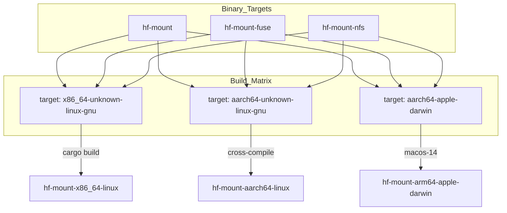
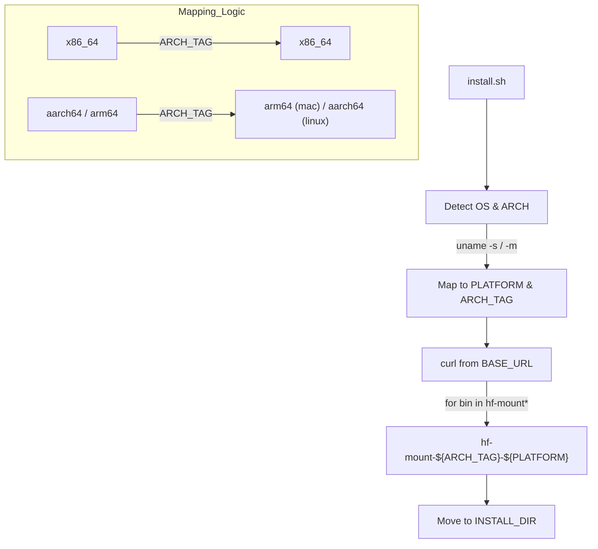

<!-- source: DeepWiki mcp.deepwiki.com · repo huggingface/hf-mount · page 7 CI/CD and Release · fetched 2026-10-26 -->

# CI/CD and Release

Relevant source files

The following files were used as context for generating this wiki page:

- [.github/workflows/ci.yml](.github/workflows/ci.yml)
- [.github/workflows/release.yml](.github/workflows/release.yml)
- [LICENSE](LICENSE)
- [install.sh](install.sh)
- [tests/repo_ops.rs](tests/repo_ops.rs)

This section covers the automated infrastructure used to validate, build, and distribute `hf-mount`. The project leverages GitHub Actions for continuous integration and a specialized release pipeline to produce cross-platform binaries.

## Continuous Integration (CI)

The CI workflow ensures code quality and functional correctness through a multi-stage pipeline. It is triggered on every pull request to `main` and on direct pushes to the `main` branch [.github/workflows/ci.yml:3-7]().

### CI Pipeline Stages

| Stage | Task | Description |
| :--- | :--- | :--- |
| **Lint & Unit Tests** | `lint-test` | Runs `rustfmt` (nightly), `clippy` across various feature flag combinations (none, NFS, FUSE, all), and standard unit tests [.github/workflows/ci.yml:21-59](). |
| **Smoke Tests** | `smoke-test` | Executes integration tests for both FUSE and NFS backends against the Hugging Face Hub CI environment [.github/workflows/ci.yml:61-91](). |
| **Data Integrity** | `fsx` | Runs the `fsx` test suite to verify filesystem consistency under stress [.github/workflows/ci.yml:93-113](). |
| **Compliance** | `pjdfstest` | Validates POSIX compliance. Results are automatically posted as PR comments [.github/workflows/ci.yml:137-202](). |
| **Benchmarks** | `bench` | Measures performance (throughput, latency) and compares results against the base branch for PRs [.github/workflows/ci.yml:203-240](). |

For details on the testing suites executed during CI, see [Integration Test Framework](#6.1) and [Functional and POSIX Tests](#6.2).

**Sources:** [.github/workflows/ci.yml:1-240]()

---

## Release Pipeline

The release pipeline is triggered by version tags (e.g., `v0.1.0`) or manual dispatch [.github/workflows/release.yml:3-6](). It automates the compilation of the three primary binary targets: `hf-mount`, `hf-mount-fuse`, and `hf-mount-nfs`.

### Build Matrix and Artifacts
The pipeline uses a build matrix to support Linux and macOS across different architectures. Binaries are compiled with `vendored-openssl` to ensure portability across environments without requiring system-level OpenSSL dependencies [.github/workflows/release.yml:47-49]().

#### CI to Release Artifact Mapping
The following diagram illustrates how the `release.yml` workflow maps system targets to the final naming convention used in the distribution.

**Release Artifact Generation Flow**

**Sources:** [.github/workflows/release.yml:15-106]()

For details on the build configuration and feature flags, see [Build System and Feature Flags](#7.1).

---

## Installation and Deployment

The project provides a user-facing `install.sh` script to simplify the deployment of the pre-compiled binaries.

### Platform Detection Logic
The installer uses `uname` to detect the operating system and architecture, mapping them to the specific artifact naming convention used in the GitHub Release [.github/workflows/release.yml:55,98]().

**Installation Logic Flow**

**Sources:** [install.sh:9-33]()

### Key Installer Behaviors
- **Binary Retrieval**: It downloads all three components: the main wrapper (`hf-mount`), the FUSE-specific binary (`hf-mount-fuse`), and the NFS-specific binary (`hf-mount-nfs`) [install.sh:28-33]().
- **Permissions**: Automatically applies `chmod +x` to make the binaries executable [install.sh:32]().
- **Environment**: Checks if the `INSTALL_DIR` (defaulting to `$HOME/.local/bin`) is present in the user's `$PATH` and provides a warning if not [install.sh:37-41]().

For details on the installation process and platform-specific requirements, see [Release Pipeline and Installation](#7.2).

**Sources:** [install.sh:1-42]()

---

