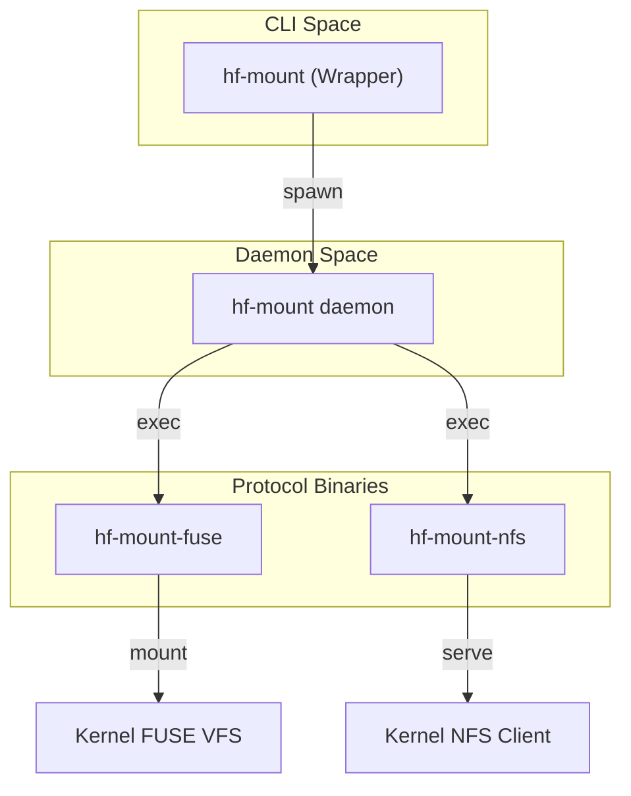
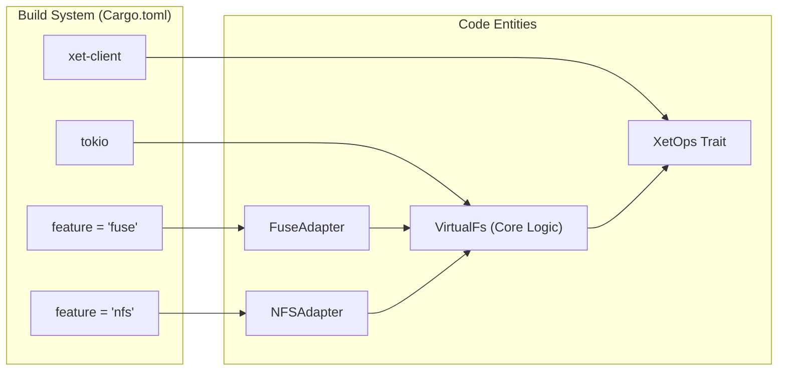

<!-- source: DeepWiki mcp.deepwiki.com · repo huggingface/hf-mount · page 7.1 Build System and Feature Flags · fetched 2026-10-26 -->

# Build System and Feature Flags

Relevant source files

The following files were used as context for generating this wiki page:

- [Cargo.lock](Cargo.lock)
- [Cargo.toml](Cargo.toml)

This page details the configuration of the `hf-mount` build system, including its multi-binary structure, the role of Cargo feature flags in enabling specific filesystem protocols, and the dependency graph that powers the VirtualFs and its backends.

## Binary Targets

The `hf-mount` project is structured to produce three distinct binary targets from a single codebase. This allows users to install only the necessary components for their specific environment (e.g., a system without FUSE support might only use the NFS target).

| Binary | Source Path | Required Features | Description |
|:---|:---|:---|:---|
| `hf-mount` | [src/bin/hf-mount.rs:57-58]() | None | The primary CLI wrapper and daemon manager. It handles process lifecycle and dispatches to the protocol-specific binaries. |
| `hf-mount-fuse` | [src/bin/hf-mount-fuse.rs:47-48]() | `fuse` | The FUSE implementation of the filesystem. Requires `libfuse` (or equivalent) on the host system. |
| `hf-mount-nfs` | [src/bin/hf-mount-nfs.rs:52-53]() | `nfs` | The NFSv3 server implementation. Allows mounting via the OS native NFS client. |

### Binary Relationship Diagram

The following diagram illustrates how the `hf-mount` wrapper interacts with the specialized protocol binaries.

"HF-Mount Binary Relationship"

Sources: [Cargo.toml:46-59]()

## Feature Flags

`hf-mount` uses Cargo features to manage heavy dependencies and platform-specific requirements.

*   **`fuse`**: Enables the `fuser` dependency and builds the `hf-mount-fuse` binary. This is typically used on Linux and macOS (with macFUSE) [Cargo.toml:38]().
*   **`nfs`**: Enables the `nfsserve` dependency and builds the `hf-mount-nfs` binary. This allows the filesystem to be exported via NFSv3, which is useful for environments where FUSE is restricted or unavailable [Cargo.toml:39]().
*   **`vendored-openssl`**: Forces the compilation of a local copy of OpenSSL. This is used in the CI/CD pipeline to ensure binary portability across different Linux distributions [Cargo.toml:40]().

Sources: [Cargo.toml:36-40]()

## Key Dependencies

The project relies on a mix of Hugging Face internal crates (Xet-core) and standard Rust ecosystem libraries.

### Xet-Core Crates
These crates provide the Content Addressable Storage (CAS) and deduplication logic used by the Hub:
*   `xet-client`: Core client for interacting with Xet-based repositories [Cargo.toml:13]().
*   `xet-core-structures`: Common data types for the Xet protocol [Cargo.toml:14]().
*   `xet-data`: Low-level data handling and serialization [Cargo.toml:15]().
*   `xet-runtime`: Execution environment and configuration for Xet operations [Cargo.toml:16]().

### Core Frameworks
*   **`tokio`**: The asynchronous runtime. Used with `rt-multi-thread` and `macros` for the daemon and background polling tasks [Cargo.toml:30]().
*   **`clap`**: Handles CLI argument parsing using the `derive` and `env` features for configuration via environment variables [Cargo.toml:22]().
*   **`tracing` & `tracing-subscriber`**: Provides structured logging and diagnostics throughout the filesystem lifecycle [Cargo.toml:31-32]().

### Protocol Adapters
*   **`fuser`**: A Rust wrapper for the FUSE (Filesystem in Userspace) kernel interface [Cargo.toml:23]().
*   **`nfsserve`**: A userspace NFSv3 server implementation [Cargo.toml:26]().

Sources: [Cargo.toml:11-34]()

## Dependency Graph and Data Flow

The build system facilitates a modular architecture where the `VirtualFs` logic is decoupled from the transport protocol.

"Build Entity to Code Entity Mapping"

Sources: [Cargo.toml:11-40](), [Cargo.lock:1-176]()

## Compilation and Lockfile Management

The `Cargo.lock` file ensures deterministic builds by pinning the entire dependency tree.

1.  **Version 4 Format**: The project uses the latest Cargo lockfile format [Cargo.lock:3]().
2.  **OpenSSL Handling**: The `openssl-sys` dependency is optional [Cargo.toml:42-44](). When `vendored-openssl` is active, it triggers a source-based build of OpenSSL, mitigating "version mismatch" errors when moving binaries between different GLIBC environments.
3.  **Xet-Core Revision**: The Xet-core dependencies are currently pinned to specific Git revisions (e.g., `rev = "0d7808b"`) to ensure compatibility with the Hub's CAS implementation during the development phase [Cargo.toml:13-16]().

Sources: [Cargo.toml:13-16](), [Cargo.lock:1-5]()

---

