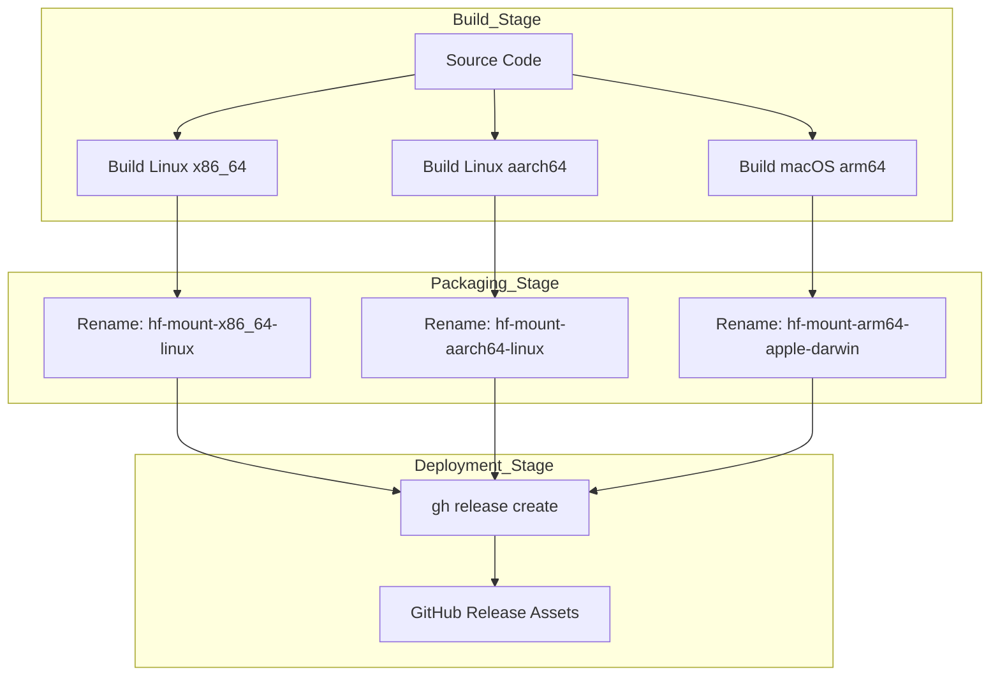
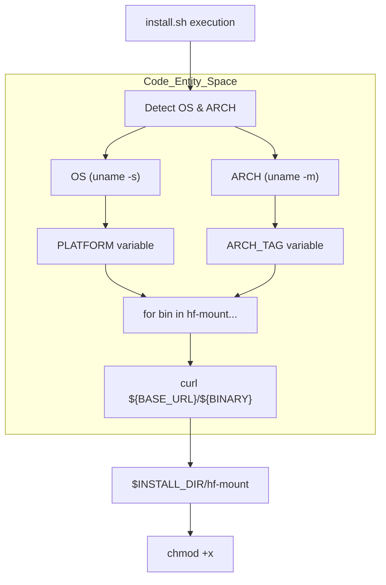

<!-- source: DeepWiki mcp.deepwiki.com · repo huggingface/hf-mount · page 7.2 Release Pipeline and Installation · fetched 2026-10-26 -->

# Release Pipeline and Installation

Relevant source files

The following files were used as context for generating this wiki page:

- [.github/workflows/release.yml](.github/workflows/release.yml)
- [LICENSE](LICENSE)
- [install.sh](install.sh)

This page details the automated release infrastructure and the user-facing installation logic for `hf-mount`. The project utilizes GitHub Actions to manage a cross-platform build matrix, generating specialized binaries for different architectures and operating systems, which are then distributed via a unified shell script.

## Release Workflow (`release.yml`)

The release pipeline is triggered by the creation of a version tag (e.g., `v0.1.0`) or via manual `workflow_dispatch` [ .github/workflows/release.yml:3-6](). It is divided into three primary stages: Linux compilation, macOS compilation, and the final GitHub Release creation.

### Build Matrix and Targets
The pipeline builds three distinct binaries for each supported platform to minimize dependency overhead for users who only require specific backends:
1. `hf-mount`: The main CLI wrapper.
2. `hf-mount-fuse`: The FUSE-enabled daemon.
3. `hf-mount-nfs`: The NFS-enabled daemon.

| Platform | Target Triple | Architecture Tag | Runner |
| :--- | :--- | :--- | :--- |
| Linux x86_64 | `x86_64-unknown-linux-gnu` | `x86_64` | `ubuntu-22.04` |
| Linux aarch64 | `aarch64-unknown-linux-gnu` | `aarch64` | `ubuntu-22.04` |
| macOS arm64 | `aarch64-apple-darwin` | `arm64` | `macos-14` |

Sources: [ .github/workflows/release.yml:15-24](), [ .github/workflows/release.yml:64-72]()

### Cross-Compilation Setup
For Linux `aarch64` builds running on `x86_64` Ubuntu runners, the workflow installs `gcc-aarch64-linux-gnu` and configures Cargo to use it as the linker [ .github/workflows/release.yml:36-42](). macOS builds utilize `macos-14` runners which provide native `arm64` support [ .github/workflows/release.yml:72]().

### Compilation Flags
All binaries are compiled with `--release` and `--no-default-features`. Specific features are enabled per binary to ensure `vendored-openssl` is included for portability:
* **FUSE**: `--features fuse,vendored-openssl` [ .github/workflows/release.yml:47]()
* **NFS**: `--features nfs,vendored-openssl` [ .github/workflows/release.yml:48]()
* **Wrapper**: `--features vendored-openssl` [ .github/workflows/release.yml:49]()

### Artifact Naming Convention
Once built, binaries are renamed to follow a specific pattern: `{binary}-{arch}-{platform}` [ .github/workflows/release.yml:54-56](). 
* Example: `hf-mount-fuse-x86_64-linux`
* Example: `hf-mount-nfs-arm64-apple-darwin`

Sources: [ .github/workflows/release.yml:44-58](), [ .github/workflows/release.yml:94-100]()

## Release Creation and Deployment

The `release` job aggregates artifacts from all build jobs using `actions/download-artifact` [ .github/workflows/release.yml:112-115](). It then uses the GitHub CLI (`gh`) to create a new release associated with the tag, uploading all binaries and automatically generating release notes [ .github/workflows/release.yml:120-127]().

### Release Data Flow
The following diagram illustrates the flow from source code to the final GitHub Release.

**Release Pipeline Data Flow**

Sources: [ .github/workflows/release.yml:14-128]()

## Installation Logic (`install.sh`)

The `install.sh` script provides a "one-liner" installation experience. It performs runtime environment detection to select the correct pre-compiled binaries from the GitHub Release assets.

### Platform Detection
The script uses `uname` to determine the operating system and architecture:
* **OS Detection**: Maps `linux` to `linux` and `darwin` to `apple-darwin` [ install.sh:13-17]().
* **Arch Detection**: Maps `x86_64` to `x86_64`. For ARM-based systems, it normalizes `aarch64` and `arm64` based on the OS (Linux uses `aarch64`, macOS uses `arm64`) [ install.sh:19-23]().

### Deployment Process
1. **Directory Setup**: Ensures the installation directory (defaulting to `$HOME/.local/bin`) exists [ install.sh:7,26]().
2. **Download Loop**: Iterates through the three required binaries (`hf-mount`, `hf-mount-nfs`, `hf-mount-fuse`) [ install.sh:28]().
3. **URL Construction**: Builds the download URL using the detected `ARCH_TAG` and `PLATFORM` [ install.sh:25,29]().
4. **Execution**: Downloads via `curl`, applies executable permissions with `chmod +x`, and verifies if the directory is in the user's `$PATH` [ install.sh:31-41]().

**Installation Logic Mapping**

Sources: [ install.sh:9-33]()

## Summary of Release Artifacts

| Binary Component | Functionality | Release Filename Suffix |
| :--- | :--- | :--- |
| `hf-mount` | CLI entry point and daemon manager | `-{arch}-{platform}` |
| `hf-mount-fuse` | FUSE backend implementation | `-{arch}-{platform}` |
| `hf-mount-nfs` | NFS backend implementation | `-{arch}-{platform}` |

Sources: [ .github/workflows/release.yml:54-56](), [ install.sh:28-29]()

---

