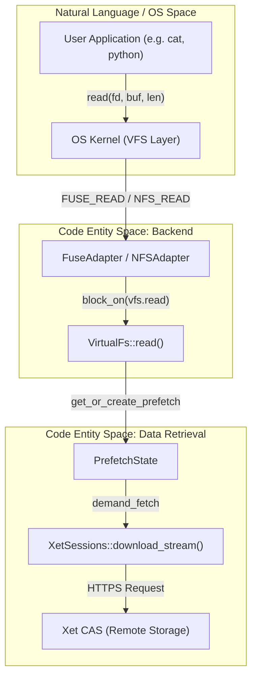
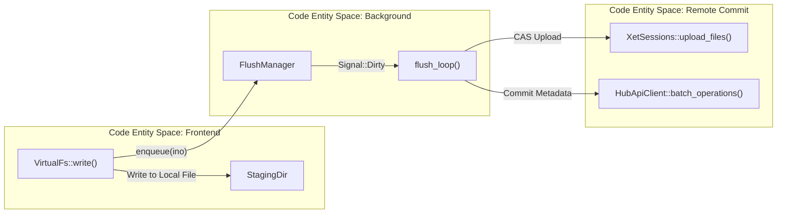

<!-- source: DeepWiki mcp.deepwiki.com · repo huggingface/hf-mount · page 8 Glossary · fetched 2026-10-26 -->

# Glossary

Relevant source files

The following files were used as context for generating this wiki page:

- [README.md](README.md)
- [src/cached_xet_client.rs](src/cached_xet_client.rs)
- [src/daemon.rs](src/daemon.rs)
- [src/fuse.rs](src/fuse.rs)
- [src/hub_api.rs](src/hub_api.rs)
- [src/nfs.rs](src/nfs.rs)
- [src/setup.rs](src/setup.rs)
- [src/virtual_fs/flush.rs](src/virtual_fs/flush.rs)
- [src/virtual_fs/mod.rs](src/virtual_fs/mod.rs)
- [src/xet.rs](src/xet.rs)

This glossary defines the technical terms, abbreviations, and domain-specific concepts used throughout the `hf-mount` codebase. It serves as a reference for onboarding engineers to understand the mapping between high-level filesystem concepts and their specific implementations in Rust.

## Core Domain Concepts

### VirtualFs (Virtual Filesystem)
The central abstraction layer that implements POSIX-like filesystem logic (inodes, directories, file handles) and translates them into Hugging Face Hub API calls and Xet CAS operations. It is protocol-agnostic, serving as the backend for both FUSE and NFS.
*   **Implementation**: `VirtualFs` struct in [src/virtual_fs/mod.rs:75-115]().
*   **Key Responsibilities**: Inode management, metadata caching, path resolution, and coordinating read/write strategies.

### Inode (Index Node)
A unique identifier for every file and directory in the mount. Unlike traditional filesystems where inodes are managed by the kernel/disk, `hf-mount` generates and manages these in-memory.
*   **Types**: Defined by `InodeKind` (File, Directory, Symlink) in [src/virtual_fs/inode.rs:32-37]().
*   **Storage**: Managed by the `InodeTable` in [src/virtual_fs/inode.rs:136-141]().
*   **Persistence**: Inodes are transient and exist only for the duration of the mount process.

### Xet CAS (Content Addressable Storage)
The backend storage system used by Hugging Face for large file versioning and deduplication. `hf-mount` uses the `xet-core` library to interact with this layer.
*   **Trait**: `XetOps` defines the interface for CAS operations in [src/xet.rs:20-33]().
*   **Implementation**: `XetSessions` in [src/xet.rs:54-59]().

### Hub API
The Hugging Face Hub REST API used for metadata operations (listing trees, getting file info, committing changes).
*   **Trait**: `HubOps` abstracts these operations in [src/hub_api.rs:18-26]().
*   **Client**: `HubApiClient` handles authentication and HTTP communication in [src/hub_api.rs:194-214]().

---

## Technical Terms & Abbreviations

| Term | Definition | Code Pointer |
| :--- | :--- | :--- |
| **CAS** | Content Addressable Storage. Data is indexed by its cryptographic hash (Merkle Hash). | [src/xet.rs:20]() |
| **FUSE** | Filesystem in Userspace. A kernel interface for implementing filesystems in non-privileged processes. | [src/fuse.rs:20]() |
| **NFS** | Network File System (v3). Used as an alternative backend to FUSE for better compatibility. | [src/nfs.rs:21]() |
| **O_TRUNC** | A POSIX flag used during `open()` to truncate a file to zero length. | [src/fuse.rs:119-135]() |
| **TTL** | Time-To-Live. Specifically refers to the duration metadata is cached before re-validating with the Hub. | [src/setup.rs:116-127]() |
| **Xet Hash** | A Merkle Hash representing the content of a file in the CAS. | [src/hub_api.rs:133]() |
| **Dirty Inode** | An inode representing a file that has local changes not yet committed to the Hub. | [src/virtual_fs/flush.rs:16]() |

---

## System Data Flow: Read Path

The following diagram illustrates the transition from a POSIX `read()` call to the retrieval of data from the Xet CAS via the `VirtualFs` and `PrefetchState`.

### Read Path Architecture

**Sources**: [src/fuse.rs:198-205](), [src/virtual_fs/mod.rs:118-124](), [src/xet.rs:77-98]()

---

## System Data Flow: Write Path (Advanced Mode)

This diagram shows the "Advanced Write" flow, where files are staged locally before being flushed to the Hub.

### Advanced Write Architecture

**Sources**: [src/virtual_fs/mod.rs:129-141](), [src/virtual_fs/flush.rs:23-30](), [src/virtual_fs/flush.rs:157-190](), [src/xet.rs:127-147]()

---

## Glossary of Key Components

### `StagingDir`
A local directory on disk used to store temporary files during write operations. This allows `hf-mount` to support random-access writes and `seek()` by performing a "read-modify-write" on a local copy before uploading the final version to the CAS.
*   **Implementation**: [src/xet.rs:182-186]()

### `FlushManager`
A background task coordinator that manages the "debounce" logic for writes. It prevents excessive API calls by waiting for a period of inactivity (debounce) or a maximum window before batching multiple file changes into a single Hub commit.
*   **Implementation**: [src/virtual_fs/flush.rs:23-67]()
*   **Key Function**: `flush_loop` in [src/virtual_fs/flush.rs:157-190]().

### `HandlePool`
Specific to the **NFS Backend**. Since NFS v3 is a stateless protocol, the `HandlePool` maintains an LRU (Least Recently Used) cache of open file handles to bridge the gap between stateless NFS requests and the stateful `VirtualFs`.
*   **Implementation**: [src/nfs.rs:23](), [src/nfs.rs:46-81]()

### `NegativeCache`
A cache used to store information about paths that are known *not* to exist on the Hub. This prevents "negative lookup storms" (e.g., when a compiler or shell searches multiple paths for a file) from overwhelming the Hub API.
*   **Implementation**: [src/virtual_fs/mod.rs:89]()
*   **TTL**: Configured by `NEG_CACHE_TTL` in [src/virtual_fs/mod.rs:31]().

### `CachedXetClient`
A wrapper around the Xet CAS client that provides single-flight request coalescing and an in-memory cache for "reconstruction plans" (the map of how a file is composed of CAS chunks).
*   **Implementation**: [src/cached_xet_client.rs:45-55]()
*   **Logic**: `derive_range_response` in [src/cached_xet_client.rs:97-135]() allows the client to calculate sub-range downloads from a cached full-file plan.

### `DaemonGuard`
An RAII (Resource Acquisition Is Initialization) struct used by the daemonized process to signal readiness to the parent process and ensure the PID file is cleaned up upon exit.
*   **Implementation**: [src/daemon.rs:119-123]()

**Sources**: [src/virtual_fs/mod.rs:1-115](), [src/hub_api.rs:1-214](), [src/setup.rs:1-171](), [src/nfs.rs:1-117](), [src/fuse.rs:1-165](), [src/xet.rs:1-190](), [src/cached_xet_client.rs:1-150](), [src/virtual_fs/flush.rs:1-142](), [src/daemon.rs:1-164]().