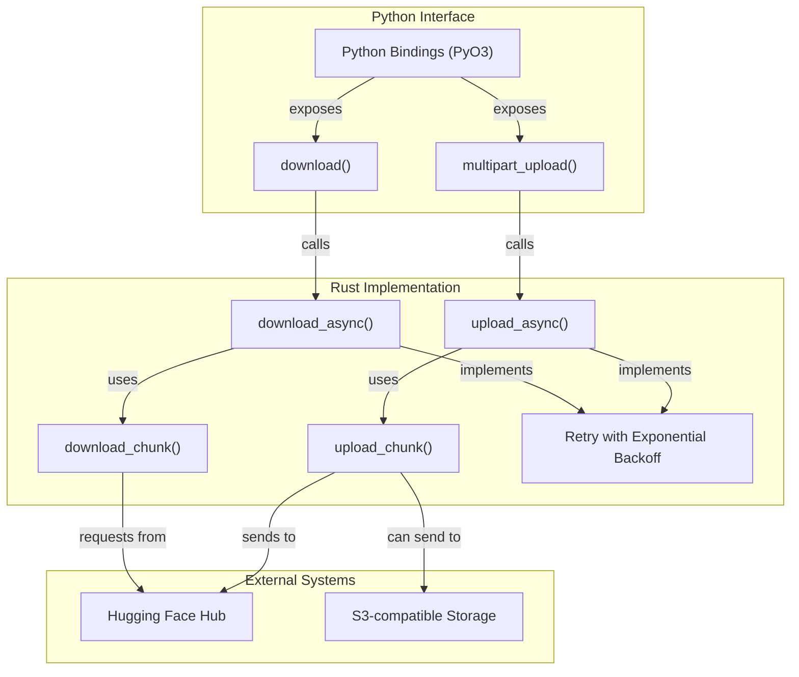
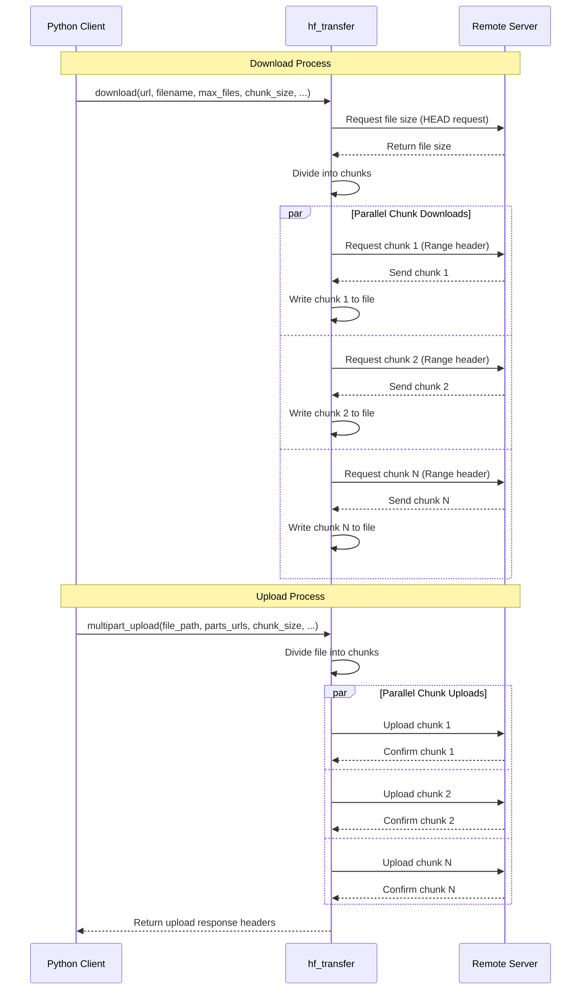
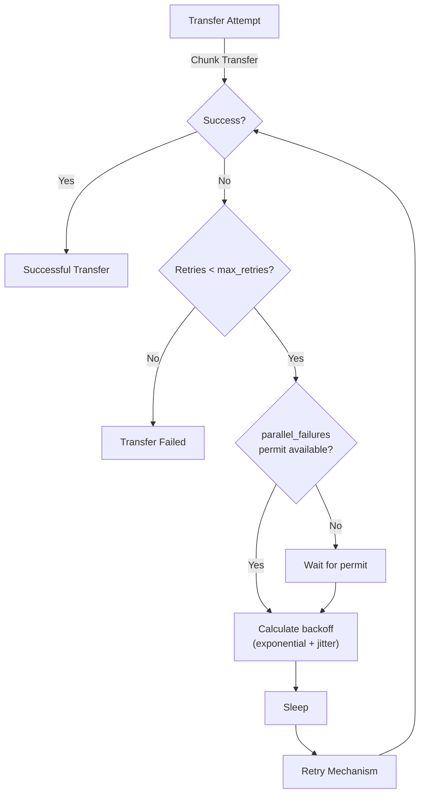

<!-- source: DeepWiki mcp.deepwiki.com · repo huggingface/hf_transfer · page 1 Overview · fetched 2026-10-26 -->

# Overview

<details>
<summary>Relevant source files</summary>

The following files were used as context for generating this wiki page:

- [README.md](README.md)
- [pyproject.toml](pyproject.toml)
- [src/lib.rs](src/lib.rs)

</details>


HF Transfer is a high-performance file transfer library designed to speed up downloads from and uploads to the Hugging Face Hub. It provides a Rust implementation with Python bindings that enables parallel, chunked file transfers capable of reaching transfer speeds beyond 500MB/s on high-bandwidth networks where pure Python implementations cannot fully utilize available bandwidth.

This document provides an introduction to the HF Transfer library, its key capabilities, and intended use cases. For detailed information about the architecture, refer to [Architecture](#2). For API documentation, see [Core API](#3).

## Purpose and Scope

HF Transfer addresses performance bottlenecks in file transfers by:

1. Implementing core transfer functionality in Rust for significantly better performance
2. Using parallel chunked downloading and uploading to maximize throughput
3. Providing robust retry mechanisms with exponential backoff and jitter for reliability
4. Integrating with the huggingface_hub Python library for seamless usage

The library is explicitly designed as a "power user tool" for achieving maximum transfer speeds rather than as a general-purpose utility. It intentionally omits features like progress bars in favor of performance optimization.

Sources: [pyproject.toml:5-10](), [README.md:1-11]()

## Core Components



HF Transfer consists of two primary functions:

1. **download**: Downloads files in parallel chunks with configurable parameters
2. **multipart_upload**: Uploads files using the S3 multipart upload protocol

These Python-facing functions are implemented as wrappers around Rust async functions that handle the actual transfer mechanics.

Sources: [src/lib.rs:33-140](), [src/lib.rs:484-491]()

## Parallel Transfer Process



This diagram illustrates how HF Transfer achieves high performance through parallel processing. Files are divided into chunks that are downloaded or uploaded concurrently, with the maximum concurrency controlled by parameters.

Sources: [src/lib.rs:150-295](), [src/lib.rs:363-450]()

## Key Features

### Parallel Chunked Transfers

HF Transfer breaks down file transfers into chunks and processes them concurrently:

| Parameter | Description |
|-----------|-------------|
| `max_files` | Controls the maximum number of parallel chunk transfers |
| `chunk_size` | Determines the size of each chunk |
| `parallel_failures` | Sets the maximum number of chunks that can be retrying simultaneously |
| `max_retries` | Defines the maximum number of retry attempts per chunk |

Sources: [src/lib.rs:33-47](), [src/lib.rs:90-103]()

### Robust Error Handling

The library implements sophisticated error handling with:

- Exponential backoff retry mechanism with jitter
- Configurable maximum retries per chunk
- Parallel failure limiting to prevent request flooding



Sources: [src/lib.rs:26-28](), [src/lib.rs:142-148](), [src/lib.rs:249-272]()

## Integration with huggingface_hub

HF Transfer is designed to work seamlessly with the huggingface_hub Python library. When enabled through the `HF_HUB_ENABLE_HF_TRANSFER` environment variable, the huggingface_hub library will use HF Transfer for file downloads and uploads, significantly improving performance.

```
# Example activation
export HF_HUB_ENABLE_HF_TRANSFER=1
```

Sources: [README.md:24-49]()

## Performance Considerations

HF Transfer is specifically designed for high-bandwidth scenarios where Python's threading and GIL limitations prevent fully utilizing available network capacity. By implementing the transfer logic in Rust, it can achieve speeds exceeding 500MB/s on suitable networks.

Key performance factors:

- Network bandwidth and latency
- Storage write/read speed
- Optimal chunk size and concurrency settings

Sources: [README.md:5-11]()

## Limitations

As noted in the project documentation, HF Transfer is:

- A power user tool, not a general-purpose utility
- Lacks features like progress bars (though callback functions are supported)
- Primarily focused on performance rather than user experience

Sources: [README.md:5-13]()

---

