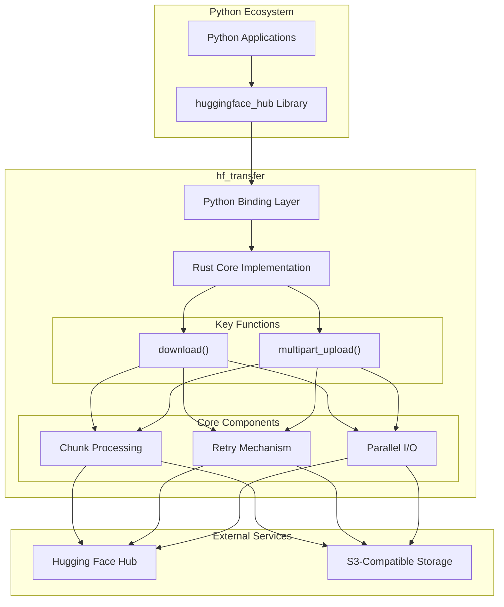
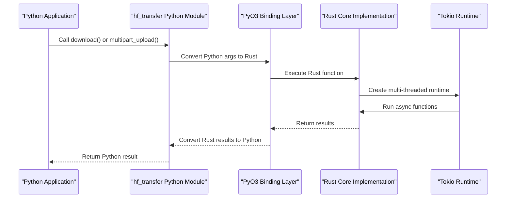
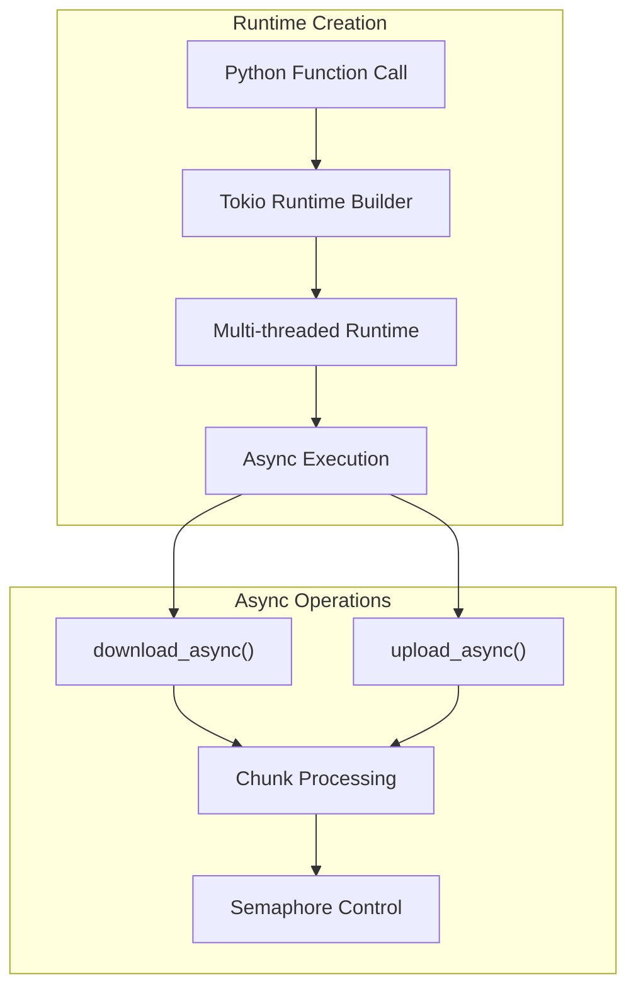
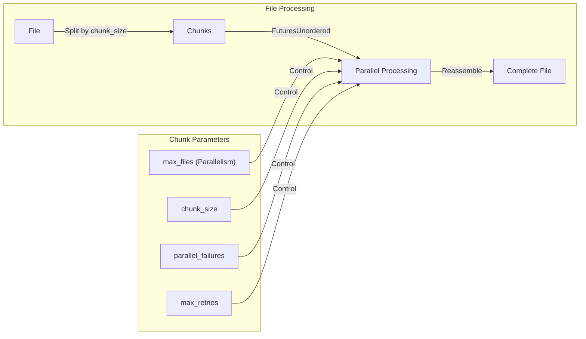
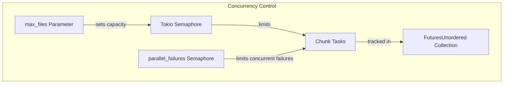
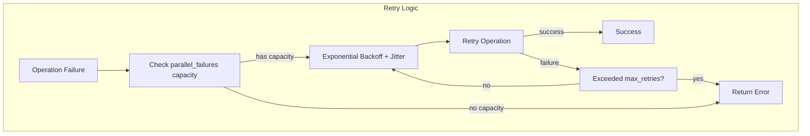
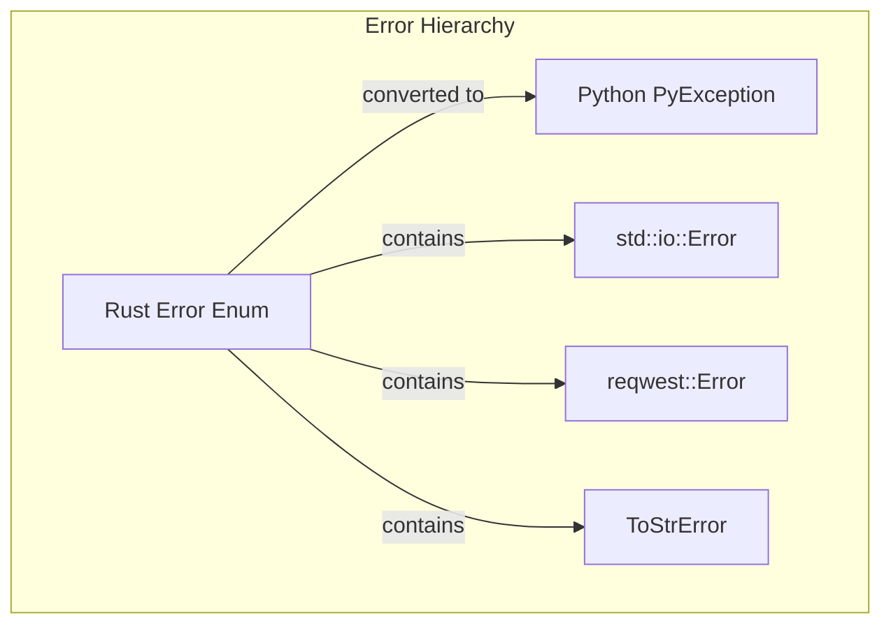
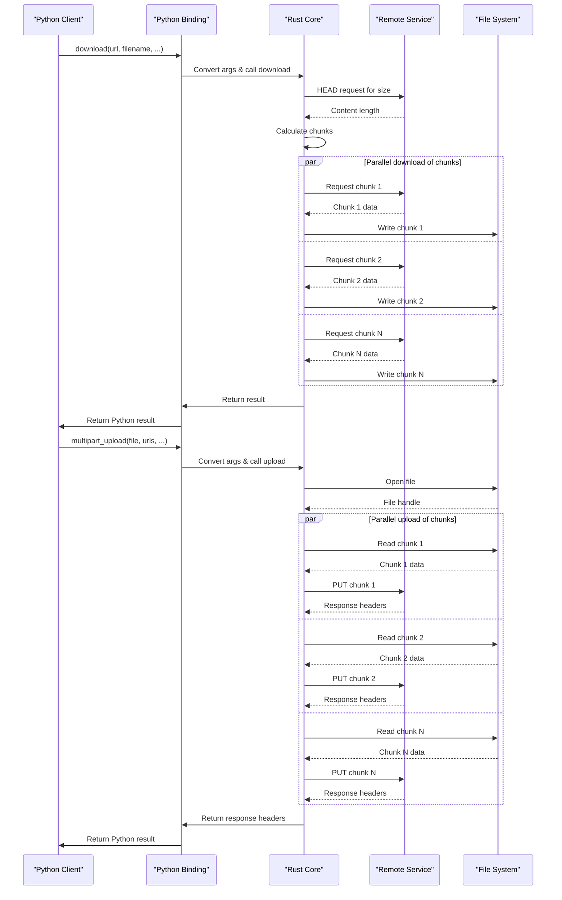

<!-- source: DeepWiki mcp.deepwiki.com · repo huggingface/hf_transfer · page 2 Architecture · fetched 2026-10-26 -->

# Architecture

Relevant source files

The following files were used as context for generating this wiki page:

- [Cargo.toml](Cargo.toml)
- [pyproject.toml](pyproject.toml)
- [src/lib.rs](src/lib.rs)

This document describes the high-level architecture of `hf_transfer`, explaining how the system is designed to enable high-performance file transfers between clients and the Hugging Face Hub or S3-compatible storage. For information about the specific API functions and their usage, see [Core API](#3). For details on integration with the huggingface_hub library, see [Integration with huggingface_hub](#4.1).

## System Overview

`hf_transfer` uses a hybrid language architecture that combines the performance advantages of Rust with the accessibility and ecosystem integration of Python. The system leverages Rust's strong concurrency model and memory safety features to efficiently handle parallelized file transfers, while providing a straightforward Python API for ease of use.

Sources: [src/lib.rs:26-491](). [Cargo.toml:1-19]().

## Rust-Python Integration

The integration between Python and Rust is handled through PyO3, a Rust library that provides bindings to the Python interpreter. This allows `hf_transfer` to expose its high-performance Rust functions directly to Python.

The system exposes two primary functions to Python:

1. `download`: For downloading files from remote sources
2. `multipart_upload`: For uploading files to remote destinations using the S3 multipart upload approach

These functions are defined in the Rust code and exposed through PyO3's `#[pyfunction]` attribute. The Python module initialization happens in the `#[pymodule]` section.

Sources: [src/lib.rs:35-88](). [src/lib.rs:90-140](). [src/lib.rs:484-491]().

## Core Architecture Components

The core architecture consists of several key components that work together to provide high-performance file transfers:

### 1. Tokio Runtime

`hf_transfer` uses Tokio, an asynchronous runtime for Rust, to handle concurrent operations efficiently. The system creates a multi-threaded Tokio runtime to process file chunks in parallel:

The number of worker threads in the Tokio runtime can be configured via the `TOKIO_WORKER_THREADS` environment variable, allowing users to optimize performance for their specific hardware.

Sources: [src/lib.rs:59-62](). [src/lib.rs:125-128](). [Cargo.toml:17-18]().

### 2. Chunking Mechanism

Both download and upload operations split files into chunks that can be processed in parallel:

For downloads:
- The system first determines the file size by making a range request
- It then divides the file into chunks of specified size
- Each chunk is downloaded in parallel, with limits on concurrent operations

For uploads:
- The file is divided into chunks based on the specified chunk size
- Each chunk is uploaded independently in parallel
- The system collects and returns response headers from each upload operation

Sources: [src/lib.rs:230-235](). [src/lib.rs:341-361](). [src/lib.rs:375-382](). [src/lib.rs:452-482]().

### 3. Concurrency Control

The system uses Tokio's `Semaphore` to limit the number of concurrent operations, ensuring that system resources are not overwhelmed:

- The `max_files` parameter determines the maximum number of concurrent operations
- A separate semaphore controls the number of concurrent failures (`parallel_failures`)
- The `FuturesUnordered` collection manages the asynchronous task execution

Sources: [src/lib.rs:230-233](). [src/lib.rs:243-247](). [src/lib.rs:375-377](). [src/lib.rs:388-392]().

### 4. Retry Mechanism

`hf_transfer` implements an exponential backoff retry mechanism with jitter to handle transient failures:

Key components of the retry mechanism:
- Base wait time starts at 300ms
- Maximum wait time is 10,000ms (10 seconds)
- Random jitter (0-500ms) is added to prevent thundering herd problems
- Wait time increases quadratically with retry attempt count

Sources: [src/lib.rs:26-27](). [src/lib.rs:142-148](). [src/lib.rs:249-272](). [src/lib.rs:394-417]().

### 5. Error Handling

The system provides comprehensive error handling through a custom `Error` enum:

- I/O errors from file operations
- Request errors from HTTP operations
- String conversion errors from header processing
- All errors are ultimately converted to Python exceptions

Sources: [src/lib.rs:297-332](). [src/lib.rs:418-424]().

## Key Dependencies

The architecture relies on several critical dependencies:

| Dependency | Version | Purpose |
|------------|---------|---------|
| pyo3 | 0.23 | Python bindings for Rust code |
| reqwest | 0.12 | HTTP client for making web requests |
| tokio | 1.42 | Asynchronous runtime for concurrent operations |
| futures | 0.3 | Abstractions for asynchronous programming |
| tokio-util | 0.7 | Utilities for Tokio runtime |
| openssl | 0.10 | SSL/TLS implementation (with vendored feature) |
| rand | 0.8.5 | Random number generation for jitter |

Sources: [Cargo.toml:11-18](). [pyproject.toml:1-20]().

## Data Flow

The following diagram illustrates the data flow during file transfer operations:

Sources: [src/lib.rs:151-294](). [src/lib.rs:364-450]().

## Summary

The `hf_transfer` architecture combines the performance benefits of Rust with the accessibility of Python to provide an efficient and robust file transfer system. By leveraging parallel processing, chunking, and sophisticated retry mechanisms, it achieves high-performance downloads and uploads while maintaining resilience to transient failures. The system's modular design allows it to be integrated with both the Hugging Face Hub and S3-compatible storage services, making it versatile for various machine learning and data processing workflows.

Sources: [src/lib.rs:1-491](). [Cargo.toml:1-19](). [pyproject.toml:1-20]().

---

