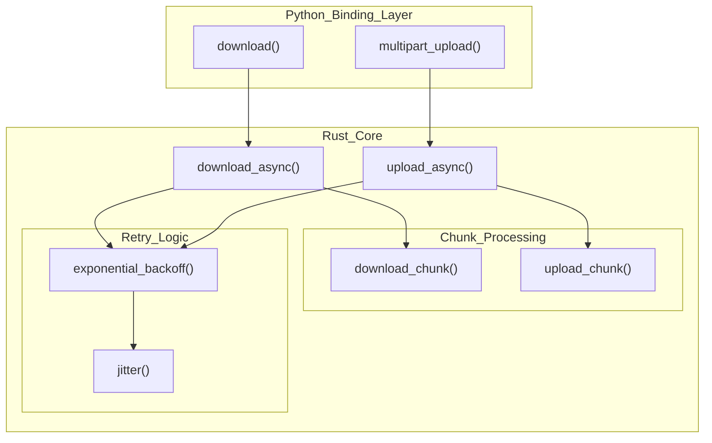
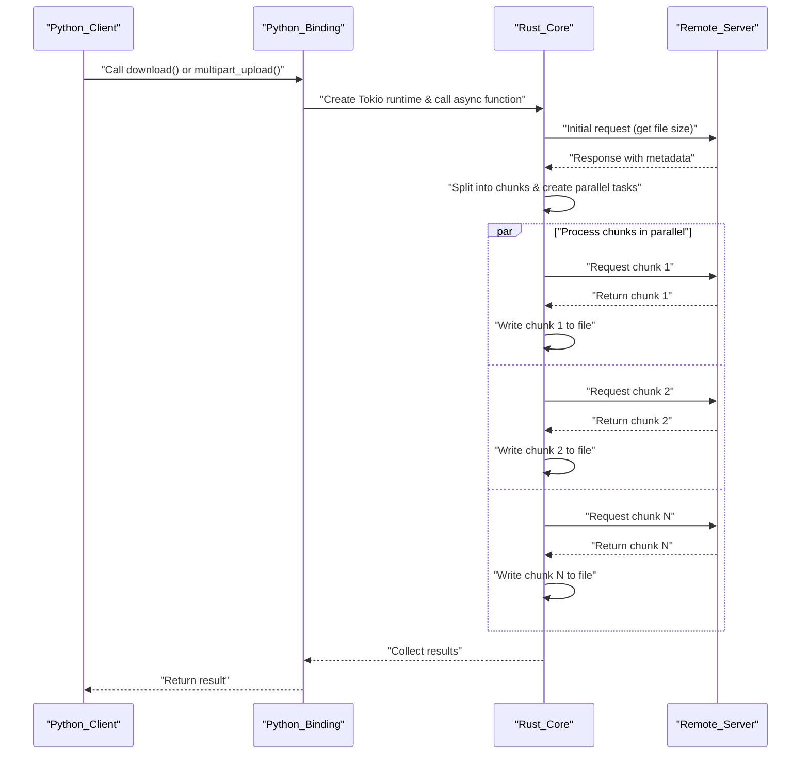
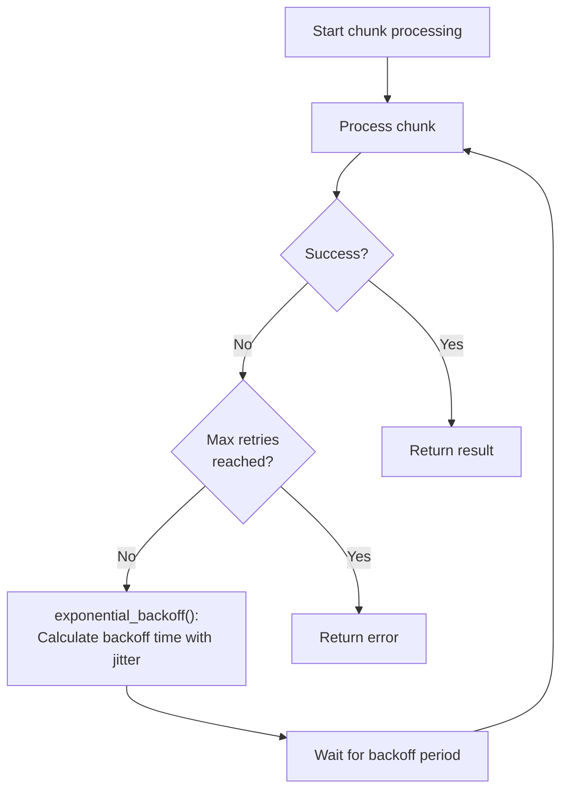
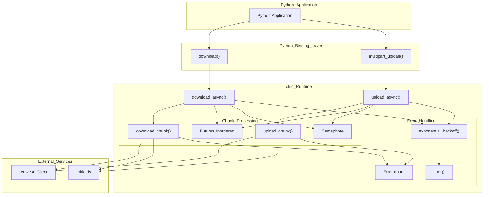

<!-- source: DeepWiki mcp.deepwiki.com · repo huggingface/hf_transfer · page 2.1 Core Components · fetched 2026-10-26 -->

# Core Components

<details>
<summary>Relevant source files</summary>

The following files were used as context for generating this wiki page:

- [Cargo.lock](Cargo.lock)
- [Cargo.toml](Cargo.toml)
- [src/lib.rs](src/lib.rs)

</details>


This document details the main components of the hf_transfer system and how they work together to provide high-performance file transfers. For information about the overall system architecture, see [Architecture](#2). For details about the API functions and their usage, see [Core API](#3).

## Component Overview

hf_transfer consists of several interacting components that enable parallel, efficient, and resilient file transfers. At its core, it uses a Rust implementation with Python bindings provided through PyO3.

### Main Components Diagram



Sources: [src/lib.rs:36-88](), [src/lib.rs:102-140](), [src/lib.rs:151-295](), [src/lib.rs:364-450]()

## Python Binding Layer

The Python binding layer exposes two main functions to Python applications:

1. **`download()`**: Transfers files from a remote URL to a local file system
2. **`multipart_upload()`**: Uploads files in chunks to remote destinations (particularly useful for S3-compatible storage)

These functions are implemented using PyO3's `#[pyfunction]` macro and registered in the Python module through the `#[pymodule]` macro. They serve as entry points that validate parameters and launch the Rust implementation.

```
download(url, filename, max_files, chunk_size, parallel_failures, max_retries, headers, callback)
multipart_upload(file_path, parts_urls, chunk_size, max_files, parallel_failures, max_retries, callback)
```

Sources: [src/lib.rs:36-88](), [src/lib.rs:102-140](), [src/lib.rs:484-491]()

## Rust Core Implementation

The Rust core handles the actual transfer operations and consists of several key components:

### Asynchronous Functions

Two main asynchronous functions drive the transfer operations:

1. **`download_async()`**: Manages the parallel download of file chunks
2. **`upload_async()`**: Handles the parallel upload of file chunks

Both functions create a multi-threaded Tokio runtime for executing asynchronous tasks.

Sources: [src/lib.rs:151-295](), [src/lib.rs:364-450]()

### Chunk Processing

Files are split into chunks for parallel processing:

1. **`download_chunk()`**: Downloads a specific byte range of a file
2. **`upload_chunk()`**: Uploads a specific chunk of a file

This chunking approach is central to hf_transfer's performance, allowing multiple parts of a file to be transferred simultaneously.

Sources: [src/lib.rs:334-361](), [src/lib.rs:452-482]()

### Parallel Execution Flow



Sources: [src/lib.rs:151-295](), [src/lib.rs:364-450]()

### Concurrency Control

hf_transfer uses several mechanisms to control concurrency:

1. **`FuturesUnordered`**: Manages a collection of concurrent tasks
2. **`Semaphore`**: Limits the number of concurrent operations to avoid overwhelming system resources
3. **Parallel failures semaphore**: Separately controls the number of chunks that can be in a failed/retrying state at once

Example from download_async:
```
let semaphore = Arc::new(Semaphore::new(max_files));
let parallel_failures_semaphore = Arc::new(Semaphore::new(parallel_failures));
```

Sources: [src/lib.rs:230-232](), [src/lib.rs:375-377]()

## Error Handling and Retry Mechanism

A robust error handling and retry system improves reliability for spotty network connections.

### Custom Error Types

The library defines a custom `Error` enum with variants:
- `Error::Io`: For file I/O errors
- `Error::Request`: For HTTP request errors 
- `Error::ToStrError`: For header parsing errors

Sources: [src/lib.rs:297-332]()

### Retry Logic



The retry mechanism employs:

1. **`exponential_backoff()`**: Calculates delay time using the formula `(base_wait_time + n^2 + jitter())` with a max cap of 10,000ms
2. **`jitter()`**: Adds random variation (0-500ms) to avoid synchronized retries

Constants:
- `BASE_WAIT_TIME`: 300ms
- `MAX_WAIT_TIME`: 10,000ms

Sources: [src/lib.rs:26-27](), [src/lib.rs:142-148](), [src/lib.rs:248-270](), [src/lib.rs:395-416]()

## Component Interactions

The following diagram illustrates how components interact during file transfers:



Sources: [src/lib.rs:151-295](), [src/lib.rs:364-450]()

## Key Dependencies

The system relies on several critical dependencies to provide its functionality:

| Dependency | Purpose |
|------------|---------|
| `futures` | Provides asynchronous programming primitives including `FuturesUnordered` |
| `openssl` | Enables secure network connections with vendored compilation |
| `pyo3` | Creates Python bindings for the Rust code |
| `rand` | Generates random numbers for jitter in the retry mechanism |
| `reqwest` | HTTP client for making network requests with streaming support |
| `tokio` | Asynchronous runtime with multi-threading, file system access |
| `tokio-util` | Additional utilities for Tokio, specifically the `codec` module |

Sources: [Cargo.toml:11-18]()

## Performance Considerations

Several design choices contribute to hf_transfer's performance:

1. **Parallel transfers**: Multiple chunks are transferred simultaneously, limited by `max_files`
2. **Configurable chunk size**: Optimizes for different network conditions and file sizes
3. **Tokio worker threads**: The number of threads can be configured via the `TOKIO_WORKER_THREADS` environment variable
4. **HTTP/2 keep-alive**: Configured to maintain connections for 15 seconds to improve performance with multiple requests
5. **Minimal copying**: Uses streaming operations where possible to minimize memory usage

Sources: [src/lib.rs:161-164](), [src/lib.rs:33-34]()

---

