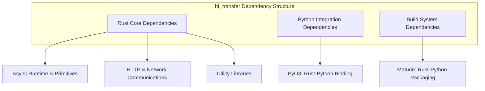
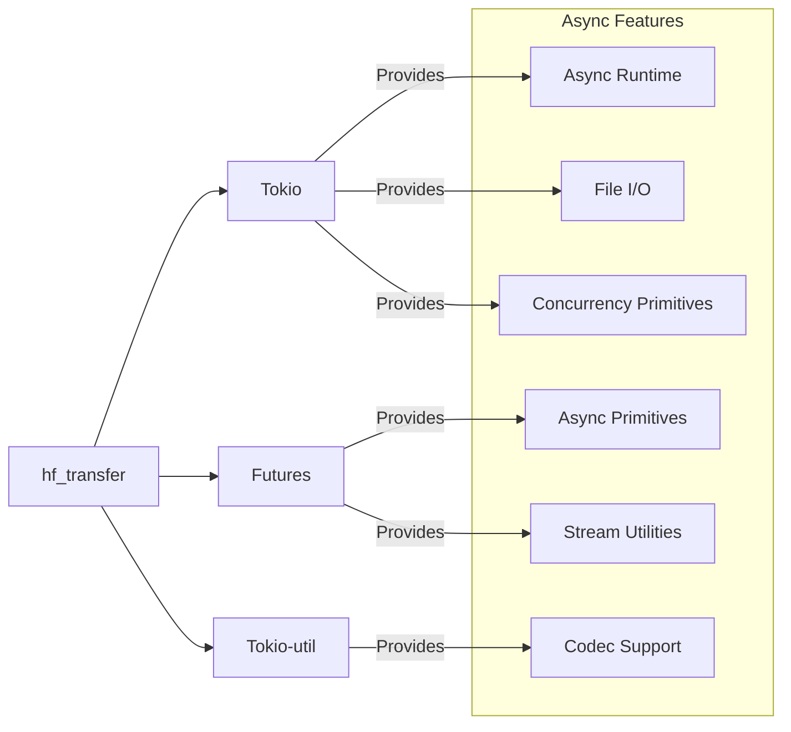
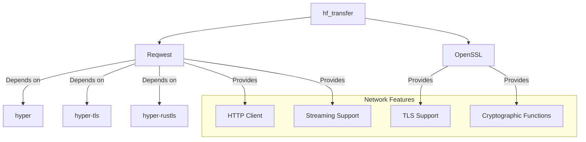
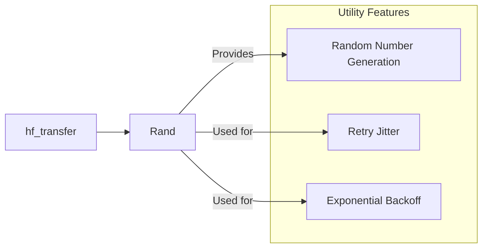
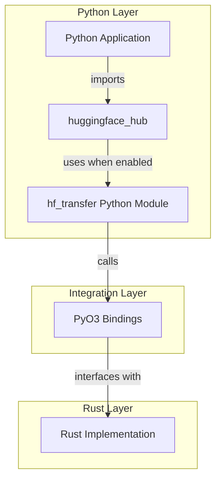
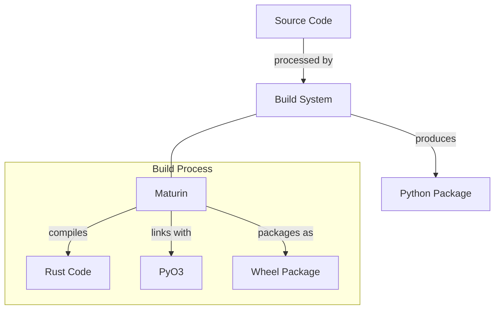
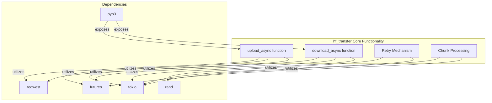

<!-- source: DeepWiki mcp.deepwiki.com · repo huggingface/hf_transfer · page 2.2 Dependency Structure · fetched 2026-10-26 -->

# Dependency Structure

Relevant source files

The following files were used as context for generating this wiki page:

- [Cargo.lock](Cargo.lock)
- [Cargo.toml](Cargo.toml)
- [pyproject.toml](pyproject.toml)

This page documents the key dependencies of the hf_transfer library and how they support the system's core functionality. It explains the relationship between Rust and Python dependencies and their roles in enabling high-performance file transfers.

For information about the high-level architecture of hf_transfer, see [Architecture](#2). For implementation details of specific functions, see [Core API](#3).

## Overview of Dependency Categories

The hf_transfer library relies on a carefully selected set of dependencies to implement its functionality. These dependencies can be categorized into three main groups:

Sources: [Cargo.toml:11-18](), [pyproject.toml:1-4]()

## Rust Core Dependencies

The core functionality of hf_transfer is built with Rust, leveraging several key libraries to achieve high-performance, concurrent file transfers.

### Asynchronous Runtime and Primitives

The asynchronous capabilities of hf_transfer depend on these critical libraries:

| Dependency | Version | Features | Purpose |
|------------|---------|----------|---------|
| **tokio** | 1.42 | rt, rt-multi-thread, fs | Asynchronous runtime enabling concurrent operations and file I/O |
| **futures** | 0.3 | - | Abstractions for writing asynchronous code |
| **tokio-util** | 0.7 | codec | Additional utilities for working with tokio |

Tokio provides the async runtime that powers hf_transfer's concurrent download and upload capabilities. The `rt-multi-thread` feature enables the library to efficiently utilize multiple CPU cores for parallel processing.

Sources: [Cargo.toml:12-13](), [Cargo.toml:17-18]()

### HTTP and Network Communications

Network communication is a core aspect of file transfers, and hf_transfer uses these dependencies:

| Dependency | Version | Features | Purpose |
|------------|---------|----------|---------|
| **reqwest** | 0.12 | stream | High-level HTTP client with support for streaming transfers |
| **openssl** | 0.10 | vendored | TLS/SSL implementation for secure connections |

The `stream` feature of reqwest is particularly important as it enables efficient processing of large file transfers without loading the entire file into memory.

Sources: [Cargo.toml:14-16]()

### Utility Libraries

Additional utility libraries support specific functionality:

| Dependency | Version | Purpose |
|------------|---------|---------|
| **rand** | 0.8.5 | Random number generation for retry logic with jitter |

The rand library is used to implement jitter in the exponential backoff retry mechanism, making concurrent retries less likely to occur simultaneously.

Sources: [Cargo.toml:15]()

## Python Integration

The integration between Python and Rust is a key aspect of hf_transfer's architecture.

Python integration is enabled through PyO3, which facilitates the creation of Python bindings for Rust code:

| Dependency | Version | Features | Purpose |
|------------|---------|----------|---------|
| **pyo3** | 0.23 | extension-module, abi3-py38 | Create Python bindings for Rust code |

The `abi3-py38` feature ensures compatibility with Python 3.8 and later versions through the stable ABI, allowing a single binary to work across multiple Python versions.

Sources: [Cargo.toml:14]()

## Build System Dependencies

The build system is responsible for compiling the Rust code and packaging it as a Python module.

The primary build dependency is Maturin:

| Dependency | Version | Purpose |
|------------|---------|---------|
| **maturin** | ≥1.4, <2 | Build and package Rust code as Python extensions |

Maturin automates the process of compiling Rust code and packaging it in a format that can be installed via pip, making it critical for the distribution of hf_transfer.

Sources: [pyproject.toml:1-3]()

## Dependency Relationships

The following diagram illustrates the relationships between key dependencies and the core functionality they enable in hf_transfer:

Sources: [Cargo.toml:11-18]()

## Transitive Dependencies

The dependencies listed in Cargo.toml pull in numerous transitive dependencies. Key transitive dependencies include:

| Primary Dependency | Notable Transitive Dependencies |
|-------------------|----------------------------------|
| **reqwest** | hyper, h2, http, http-body, url, encoding_rs |
| **tokio** | mio, bytes, socket2, pin-project-lite |
| **pyo3** | pyo3-macros, pyo3-ffi, memoffset |

These transitive dependencies handle lower-level functionality such as HTTP protocol implementation, network I/O, memory management, and Rust-Python interoperability details.

Sources: [Cargo.lock:1-1698]()

## OpenSSL Integration

The OpenSSL dependency is configured with the `vendored` feature, which ensures that OpenSSL is compiled and linked statically with hf_transfer. This approach eliminates runtime dependencies on system-provided OpenSSL libraries, enhancing portability across different operating systems and environments.

Sources: [Cargo.toml:14]()

## Conclusion

The dependency structure of hf_transfer is designed to optimize file transfer performance while ensuring compatibility with the Python ecosystem. The core Rust dependencies provide the foundation for high-performance asynchronous I/O and networking, while PyO3 enables seamless integration with Python. The build system, powered by Maturin, ensures that the resulting package can be easily distributed and installed in Python environments.

This careful selection of dependencies allows hf_transfer to achieve its goal of providing efficient file transfers for the Hugging Face ecosystem, with robust error handling and cross-platform compatibility.

---

