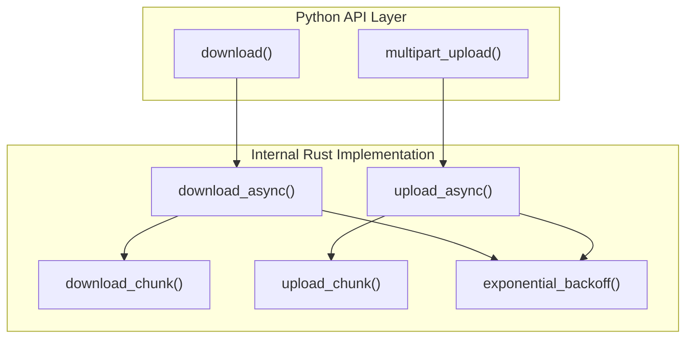
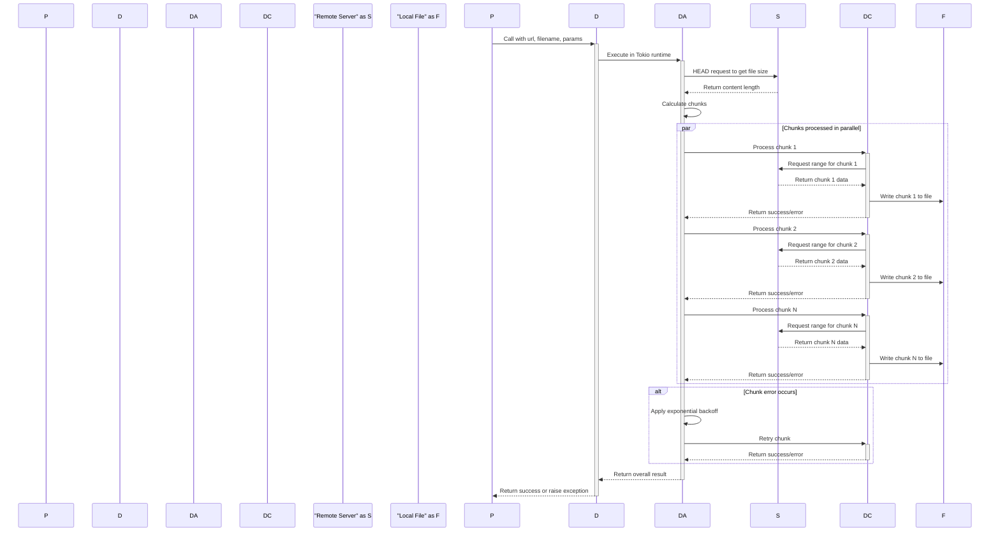
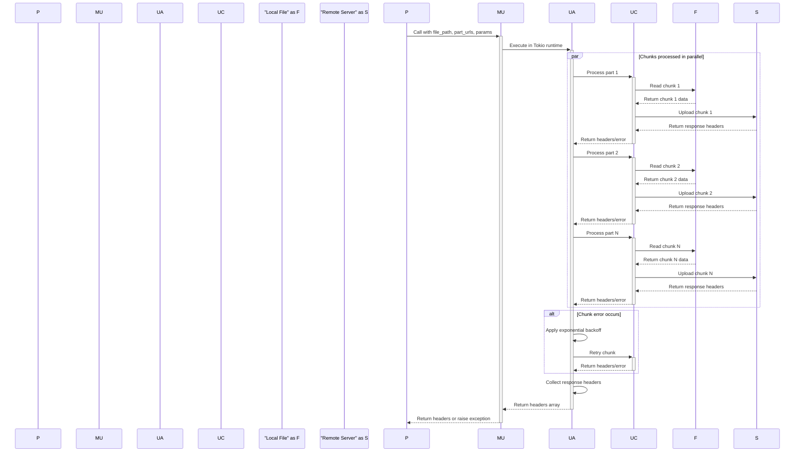
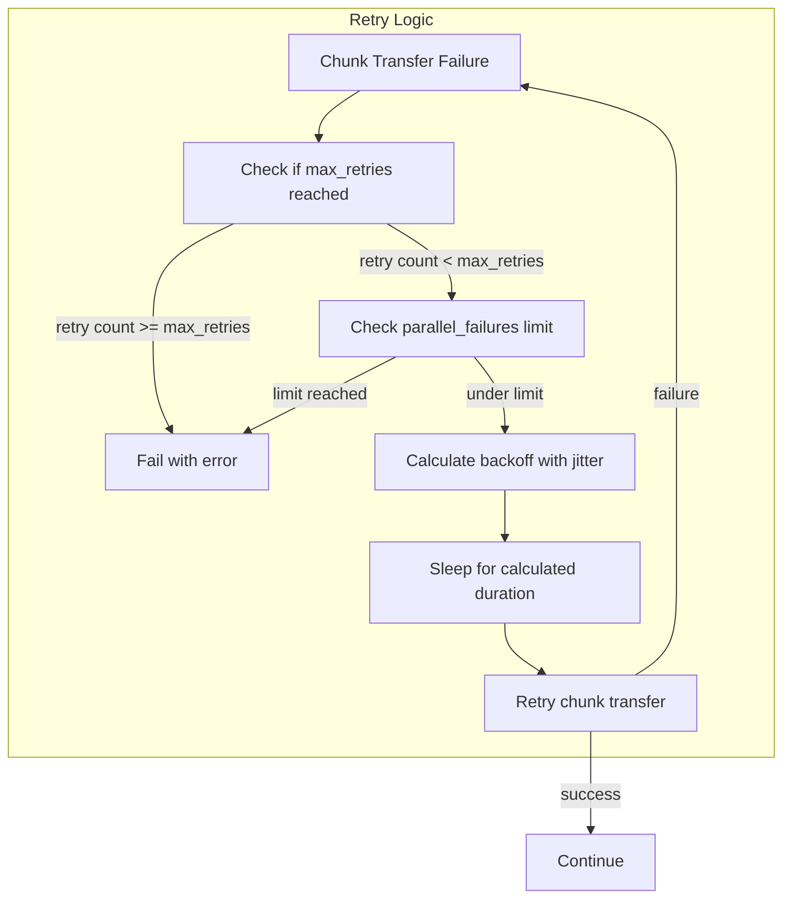

<!-- source: DeepWiki mcp.deepwiki.com · repo huggingface/hf_transfer · page 3 Core API · fetched 2026-10-26 -->

# Core API

<details>
<summary>Relevant source files</summary>

The following files were used as context for generating this wiki page:

- [src/lib.rs](src/lib.rs)

</details>


This page provides a comprehensive overview of the primary functions exposed by the hf_transfer library. The Core API consists of two main functions that enable high-performance file transfers through parallel processing and robust error handling.

For information about the overall architecture of hf_transfer, see [Architecture](#2).

## Overview of Core Functions

The hf_transfer library exposes two primary Python functions for file transfer operations:

1. `download`: High-performance parallel download of files from remote sources
2. `multipart_upload`: Efficient chunked upload to remote storage services

Both functions leverage Rust's performance capabilities and Tokio's asynchronous runtime to significantly improve transfer speeds compared to traditional Python implementations.



Sources: [src/lib.rs:35-140](). [src/lib.rs:363-450]()

## Function: download

The `download` function enables efficient downloading of files by splitting the download into multiple chunks processed in parallel.

### Signature

```python
def download(
    url: str,
    filename: str,
    max_files: int,
    chunk_size: int,
    parallel_failures: int = 0,
    max_retries: int = 0,
    headers: Optional[Dict[str, str]] = None,
    callback: Optional[Callable[[int], None]] = None
) -> None
```

### Parameters

| Parameter | Type | Description |
|-----------|------|-------------|
| `url` | `str` | The URL of the file to download |
| `filename` | `str` | Local path where the file should be saved |
| `max_files` | `int` | Maximum number of open file handles, determining the maximum parallelism |
| `chunk_size` | `int` | Size of each download chunk in bytes |
| `parallel_failures` | `int` | Maximum number of chunk failures allowed in parallel (must be ≤ `max_files`) |
| `max_retries` | `int` | Maximum number of retry attempts per chunk |
| `headers` | `Optional[Dict[str, str]]` | Optional HTTP headers to include in requests |
| `callback` | `Optional[Callable[[int], None]]` | Optional callback function called with bytes transferred |

### Implementation Details

The function operates by:

1. Creating a multi-threaded Tokio runtime
2. Determining the file size via a range request
3. Splitting the download into chunks based on the specified `chunk_size`
4. Creating a semaphore to limit concurrent downloads to `max_files`
5. Spawning tasks for each chunk that download and write to the target file
6. Implementing retry logic with exponential backoff if specified



Sources: [src/lib.rs:36-88](), [src/lib.rs:151-295](), [src/lib.rs:334-361]()

## Function: multipart_upload

The `multipart_upload` function enables efficient uploads by splitting the file into chunks and uploading them in parallel.

### Signature

```python
def multipart_upload(
    file_path: str,
    parts_urls: List[str],
    chunk_size: int,
    max_files: int,
    parallel_failures: int = 0,
    max_retries: int = 0,
    callback: Optional[Callable[[int], None]] = None
) -> List[Dict[str, str]]
```

### Parameters

| Parameter | Type | Description |
|-----------|------|-------------|
| `file_path` | `str` | Path to the local file to upload |
| `parts_urls` | `List[str]` | List of pre-signed URLs for each part of the multipart upload |
| `chunk_size` | `int` | Size of each upload chunk in bytes |
| `max_files` | `int` | Maximum number of open file handles, determining the maximum parallelism |
| `parallel_failures` | `int` | Maximum number of chunk failures allowed in parallel (must be ≤ `max_files`) |
| `max_retries` | `int` | Maximum number of retry attempts per chunk |
| `callback` | `Optional[Callable[[int], None]]` | Optional callback function called with bytes transferred |

### Return Value

List of dictionaries containing the HTTP response headers from each part upload, used for completing multipart uploads.

### Implementation Details

The function operates by:

1. Creating a multi-threaded Tokio runtime
2. Splitting the file into chunks of `chunk_size` bytes
3. Creating a semaphore to limit concurrent uploads to `max_files`
4. Spawning tasks for each chunk that read from the file and upload to the corresponding pre-signed URL
5. Implementing retry logic with exponential backoff if specified
6. Collecting headers from the responses to each part upload



Sources: [src/lib.rs:101-140](), [src/lib.rs:363-450](), [src/lib.rs:452-482]()

## Error Handling and Retry Mechanism

Both `download` and `multipart_upload` implement robust error handling with an exponential backoff retry mechanism. This makes transfers resilient to transient network issues.

### Retry Configuration

To enable the retry mechanism, both `parallel_failures` and `max_retries` must be set:

- `parallel_failures`: Limits how many chunks can be in a failed/retrying state simultaneously
- `max_retries`: Maximum number of retry attempts before failing the entire operation

### Exponential Backoff Implementation

The retry mechanism uses an exponential backoff strategy with jitter to avoid thundering herd problems:



The backoff duration is calculated using this formula:
```
wait_time = (BASE_WAIT_TIME + retry_count² + random_jitter(0-500ms)).min(MAX_WAIT_TIME)
```

Where:
- `BASE_WAIT_TIME` = 300ms
- `MAX_WAIT_TIME` = 10,000ms (10 seconds)

This provides a balance between quick retries for transient failures and avoiding overwhelming the server with retry requests.

Sources: [src/lib.rs:26-28](), [src/lib.rs:142-148](), [src/lib.rs:248-270](), [src/lib.rs:393-416]()

## Thread Control

The number of worker threads used by the Tokio runtime can be tuned by setting the `TOKIO_WORKER_THREADS` environment variable. This allows for fine-grained control over the parallelism model based on the specific environment where hf_transfer is running.

Sources: [src/lib.rs:33-34](), [src/lib.rs:59-62](), [src/lib.rs:125-128]()

## Integration with Python

Both API functions are exposed to Python using PyO3 bindings. They are registered with the Python module in the `pymodule` declaration at [src/lib.rs:484-491]().

For information on how to use these functions with the huggingface_hub library, see [Integration with huggingface_hub](#4.1).

---

