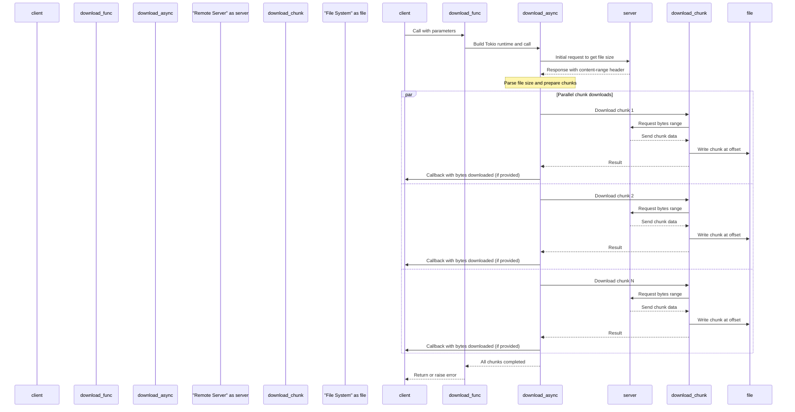
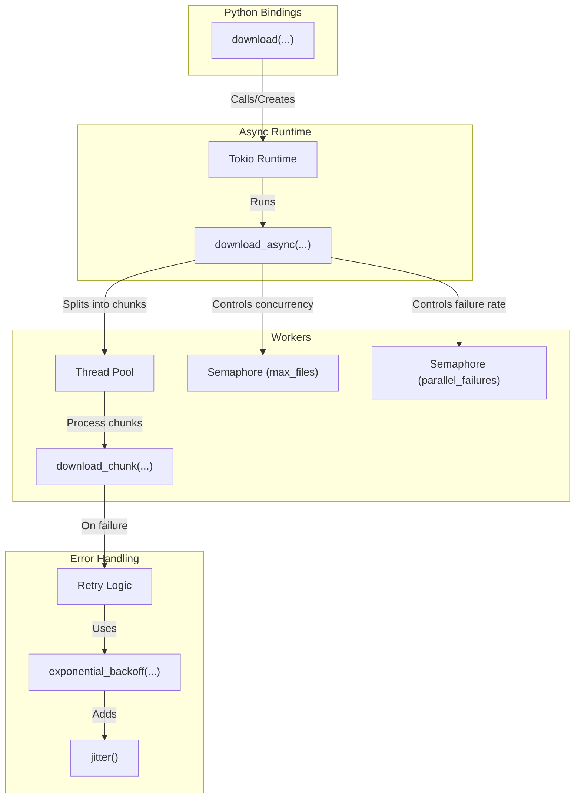

<!-- source: DeepWiki mcp.deepwiki.com · repo huggingface/hf_transfer · page 3.1 Download Function · fetched 2026-10-26 -->

# Download Function

<details>
<summary>Relevant source files</summary>

The following files were used as context for generating this wiki page:

- [src/lib.rs](src/lib.rs)

</details>


The download function is a core API component of hf_transfer, providing high-performance parallel file downloads with resilient error handling. This page documents the function signature, parameters, internal operation, and performance characteristics. For information about uploading files, see [Multipart Upload Function](#3.2).

## Function Signature and Parameters

The download function provides a Python-accessible interface for downloading files using a robust, parallel downloading strategy:

```python
def download(
    url: str,
    filename: str,
    max_files: int,
    chunk_size: int,
    parallel_failures: int = 0,
    max_retries: int = 0,
    headers: Optional[Dict[str, str]] = None,
    callback: Optional[Callable[[int], None]] = None
) -> None
```

### Parameters

| Parameter | Type | Description |
|-----------|------|-------------|
| `url` | `str` | Source URL from which to download the file |
| `filename` | `str` | Destination path where the file will be saved |
| `max_files` | `int` | Maximum number of open file handles, determining the maximum number of parallel download operations |
| `chunk_size` | `int` | Size of each chunk in bytes to be downloaded in parallel |
| `parallel_failures` | `int` | Maximum number of chunk failures allowed in parallel (cannot exceed `max_files`). Must be set along with `max_retries` |
| `max_retries` | `int` | Maximum number of attempts per chunk with exponential backoff. Must be set along with `parallel_failures` |
| `headers` | `Dict[str, str]` | Optional HTTP headers to include in download requests |
| `callback` | `Callable[[int], None]` | Optional callback function that receives the number of bytes downloaded for each chunk |

Sources: [src/lib.rs:36-88]()

## How the Download Function Works

The download function implements a chunked, parallel downloading strategy with sophisticated retry logic to provide efficient and resilient file transfers.

### Download Process Flow



Sources: [src/lib.rs:150-295](), [src/lib.rs:334-361]()

### Key Components



Sources: [src/lib.rs:36-88](), [src/lib.rs:150-295](), [src/lib.rs:334-361](), [src/lib.rs:142-148]()

## Implementation Details

### Initial Setup

1. The `download` function first performs parameter validation:
   - Ensures `parallel_failures` is not greater than `max_files`
   - Verifies that both `parallel_failures` and `max_retries` are either both set or both zero

2. A multi-threaded Tokio runtime is created to execute the asynchronous download process
   - The number of worker threads can be configured via the `TOKIO_WORKER_THREADS` environment variable

3. The function passes control to `download_async` which performs the actual download

Sources: [src/lib.rs:36-88]()

### Size Detection and Chunking

The download process begins by:

1. Building an HTTP client with appropriate settings
2. Processing provided headers, with special handling for authorization tokens
3. Making an initial request using the HTTP Range header to determine file size
4. Following any redirects to avoid overloading the source server
5. Parsing the Content-Range header to determine the total file size
6. Dividing the file into chunks according to the specified `chunk_size`

Sources: [src/lib.rs:150-234]()

### Parallel Download

1. For each chunk, a separate asynchronous task is spawned
2. A semaphore limits concurrent downloads to `max_files`
3. Each chunk is downloaded using the `download_chunk` function
4. The `download_chunk` function:
   - Opens the output file
   - Seeks to the appropriate position based on chunk start
   - Makes an HTTP request with Range header for the chunk
   - Writes received data to the file at the correct offset

Sources: [src/lib.rs:234-294](), [src/lib.rs:334-361]()

## Retry and Error Handling

The download function implements sophisticated error handling:

### Retry Mechanism

When both `parallel_failures` and `max_retries` are set:

1. A semaphore controls how many chunks can be in a retry state simultaneously
2. If a chunk download fails, the system attempts to retry up to `max_retries` times
3. Each retry uses exponential backoff with jitter to determine wait time:
   - Base wait time: 300ms
   - Maximum wait time: 10,000ms
   - Formula: `(base_wait_time + retry_number² + random(0-500))` capped at max wait time

4. If all retries for a chunk fail, the entire download is aborted

### Error Cleanup

If an error occurs during download:
1. The partially downloaded file is removed
2. A Python exception with details is raised

Sources: [src/lib.rs:142-148](), [src/lib.rs:234-294](), [src/lib.rs:36-88]()

## Performance Considerations

The performance of the download function can be tuned through several parameters:

| Parameter | Performance Impact |
|-----------|-------------------|
| `max_files` | Higher values increase parallelism but may cause resource contention. Optimal value depends on available bandwidth, CPU cores, and I/O capabilities |
| `chunk_size` | Smaller chunks allow for finer-grained parallelism and retries, but create more HTTP overhead. Larger chunks reduce overhead but provide less parallelism |
| `TOKIO_WORKER_THREADS` (env var) | Controls the number of threads in the Tokio runtime. Should generally match the number of CPU cores |

For high-bandwidth connections with stable connectivity, consider:
- Larger `chunk_size` (e.g., 8MB to 16MB)
- Higher `max_files` value (e.g., 10-20)

For less reliable connections:
- Smaller `chunk_size` (e.g., 1MB to 4MB)
- Enable retry mechanism with appropriate `parallel_failures` and `max_retries` values

Sources: [src/lib.rs:26-34]()

## Progress Monitoring

The download function supports progress monitoring through an optional callback function:

1. The callback is called after each chunk is successfully downloaded
2. It receives the number of bytes downloaded for that chunk
3. This enables implementing progress bars or other forms of progress reporting

Sources: [src/lib.rs:278-283]()

## Error Types

The download function can raise several types of errors:

1. Parameter validation errors
2. Network errors from the request library
3. I/O errors when writing to the file system
4. Server errors (e.g., 404, 500) from the remote endpoint
5. Retry exhaustion errors when max retries are exceeded

All errors are converted to Python exceptions with descriptive messages.

Sources: [src/lib.rs:297-332]()

---

