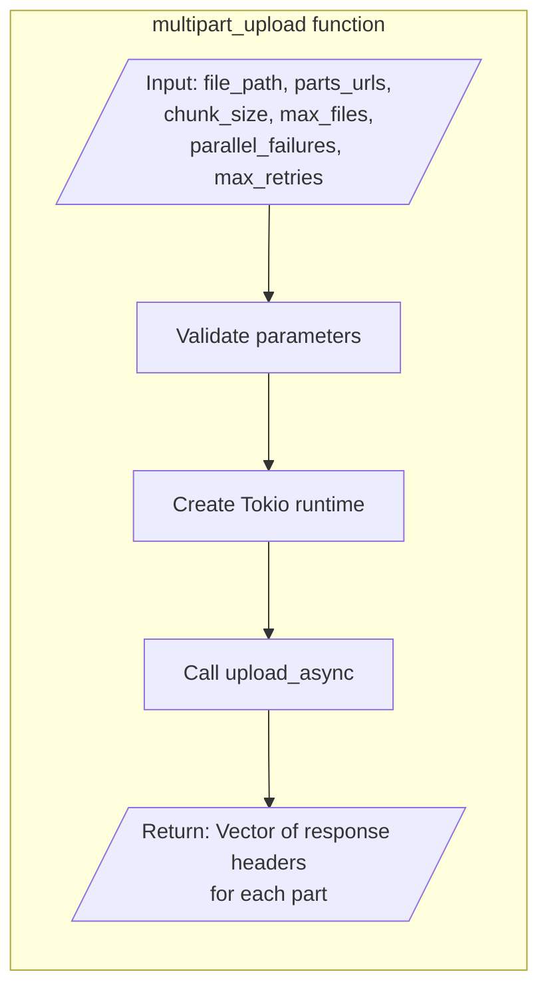
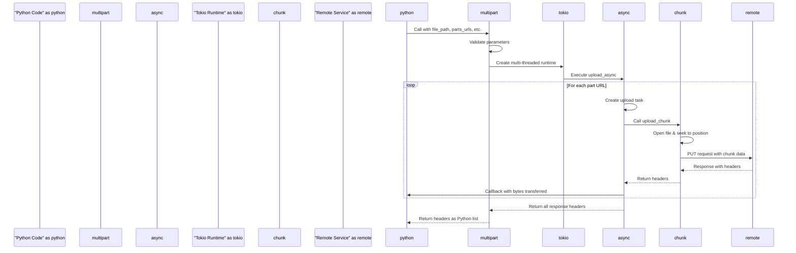
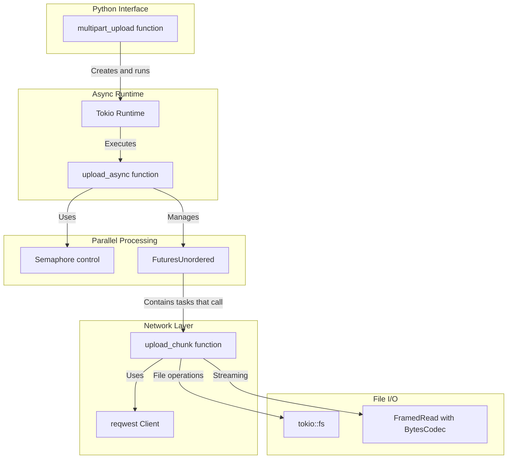

<!-- source: DeepWiki mcp.deepwiki.com · repo huggingface/hf_transfer · page 3.2 Multipart Upload Function · fetched 2026-10-26 -->

# Multipart Upload Function

<details>
<summary>Relevant source files</summary>

The following files were used as context for generating this wiki page:

- [src/lib.rs](src/lib.rs)

</details>


This page provides detailed documentation for the `multipart_upload` function in hf_transfer, which enables high-performance file uploads using parallel processing. This function is particularly useful for transferring large files efficiently to Hugging Face Hub or S3-compatible storage services by breaking them into chunks that are uploaded concurrently. For information about downloading files, see [Download Function](#3.1).

## Function Overview

The `multipart_upload` function implements a high-performance, resilient multipart upload process that:

1. Splits a file into chunks
2. Uploads these chunks in parallel
3. Implements robust retry mechanisms to handle transient network failures
4. Returns response headers for each part for subsequent use in completing the multipart upload



Sources: [src/lib.rs:102-140]()

## Function Signature and Parameters

```rust
multipart_upload(
    file_path: String,
    parts_urls: Vec<String>,
    chunk_size: u64,
    max_files: usize,
    parallel_failures: usize = 0,
    max_retries: usize = 0,
    callback: Optional[Callable] = None
) -> List[Dict[str, str]]
```

| Parameter | Type | Description |
|-----------|------|-------------|
| `file_path` | String | Path to the file to be uploaded |
| `parts_urls` | List[String] | List of pre-signed URLs for each part upload |
| `chunk_size` | Integer | Size of each chunk in bytes |
| `max_files` | Integer | Maximum number of parallel uploads |
| `parallel_failures` | Integer | Maximum number of failures allowed in parallel (default: 0) |
| `max_retries` | Integer | Maximum attempts per chunk with exponential backoff (default: 0) |
| `callback` | Callable | Optional function called after each successful chunk upload with bytes transferred |

**Return Value:** A list of dictionaries containing response headers from each part upload (including ETags needed for completing multipart uploads)

Sources: [src/lib.rs:102-140]()

## Implementation Details

The `multipart_upload` function is implemented as a Python binding to a Rust function using PyO3. Let's examine how it works:



Sources: [src/lib.rs:364-450](), [src/lib.rs:452-482]()

### Parallel Processing

The implementation uses Tokio's asynchronous runtime to handle concurrent uploads efficiently:

1. It creates a semaphore to limit the number of concurrent uploads to `max_files`
2. Each chunk is uploaded in a separate task that acquires a permit from the semaphore
3. The semaphore ensures optimal resource utilization without overwhelming the system

```mermaid
flowchart TD
    subgraph "upload_async function"
        dir TB
        semaphore["Create semaphores:\n- max_files semaphore\n- parallel_failures semaphore"]
        spawn["Spawn tasks for each part"]
        collect["Collect results"]
        return["Return response headers"]
        
        semaphore --> spawn
        spawn --> collect
        collect --> return
    end
    
    subgraph "Per-chunk tasks" 
        dir TB
        acquire["Acquire semaphore permit"]
        upload["Upload chunk"]
        retry{"Failure?"}
        backoff["Calculate backoff time\nwith jitter"]
        wait["Wait & retry"]
        release["Release permit"]
        
        acquire --> upload
        upload --> retry
        retry -->|"Yes (if retries enabled)"| backoff
        retry -->|"No"| release
        backoff --> wait
        wait --> upload
        release --> return
    end
    
    spawn -.-> acquire
```

Sources: [src/lib.rs:364-450](), [src/lib.rs:385-418]()

### Error Handling and Retry Logic

The function implements sophisticated error handling:

1. **Parameter Validation**: 
   - Ensures `parallel_failures` doesn't exceed `max_files`
   - Verifies that if retry is enabled, both `parallel_failures` and `max_retries` are set

2. **Retry Mechanism**:
   - Uses exponential backoff with jitter for failed uploads
   - Base wait time starts at 300ms and increases quadratically
   - Maximum wait time capped at 10,000ms (10 seconds)
   - Adds randomized jitter (0-500ms) to prevent thundering herd problem

3. **Parallel Failures Control**:
   - Uses a dedicated semaphore to limit concurrent retries
   - Prevents cascading failures from consuming all resources

Sources: [src/lib.rs:95-123](), [src/lib.rs:142-148](), [src/lib.rs:395-416]()

### Upload Chunk Process

Each chunk is uploaded using the `upload_chunk` function, which:

1. Opens the source file
2. Seeks to the appropriate position based on chunk number 
3. Takes only the required number of bytes for the chunk
4. Performs a PUT request to the pre-signed URL
5. Returns response headers for each successful upload

Sources: [src/lib.rs:452-482]()

## Usage Example

Here's a basic example of how to use the `multipart_upload` function:

```python
import os
from hf_transfer import multipart_upload

# File to upload
file_path = "large_model.bin"
file_size = os.path.getsize(file_path)

# Calculate optimal chunk size (e.g., 8 MB)
chunk_size = 8 * 1024 * 1024

# Obtain pre-signed URLs for each part (typically from Hugging Face Hub or S3)
# This is a placeholder - you would get these from your storage service
parts_urls = [...] # List of pre-signed URLs

# Upload with parallel processing and retry logic
response_headers = multipart_upload(
    file_path=file_path,
    parts_urls=parts_urls,
    chunk_size=chunk_size,
    max_files=5,            # Upload 5 chunks in parallel
    parallel_failures=2,    # Allow 2 failures in parallel
    max_retries=3,          # Retry each chunk up to 3 times
    callback=lambda bytes_uploaded: print(f"Uploaded {bytes_uploaded} bytes")
)

# response_headers contains the response headers for each part
# These typically include ETags needed for completing the multipart upload
```

## Performance Considerations

To achieve optimal upload performance, consider the following:

1. **Chunk Size**: 
   - Too small: Overhead from many requests
   - Too large: Less parallelism and higher retry cost
   - Recommended: 5-10 MB for most use cases

2. **Parallel Uploads**:
   - Set `max_files` based on available bandwidth and CPU resources
   - Consider network conditions and server limitations
   - Usually 5-10 parallel chunks works well on typical connections

3. **Retry Configuration**:
   - Enable retries for production use by setting both `parallel_failures` and `max_retries`
   - The default exponential backoff provides a good balance between quick retries and avoiding server overload

4. **Worker Threads**:
   - The number of worker threads can be tuned with the `TOKIO_WORKER_THREADS` environment variable
   - Default is the number of CPU cores

Sources: [src/lib.rs:95-101](), [src/lib.rs:364-450]()

## Integration with S3 and Hugging Face Hub

The `multipart_upload` function is designed to work with S3-compatible storage services and the Hugging Face Hub. For detailed information about integration with these services, see [S3 Integration](#4.2).

Both services use a similar multipart upload process:
1. Initiate a multipart upload to get an upload ID
2. Upload each part using pre-signed URLs
3. Complete the multipart upload by providing ETags for all parts

The `multipart_upload` function handles step 2 in this process, uploading all parts and returning the necessary response headers for step 3.

Sources: [src/lib.rs:90-101]()

## Internal Architecture



Sources: [src/lib.rs:102-140](), [src/lib.rs:364-450](), [src/lib.rs:452-482]()

## Related Components

The `multipart_upload` function is part of a broader file transfer system. It works alongside:

1. **Download Function**: For high-performance parallel downloads (see [Download Function](#3.1))
2. **Error Handling and Retry Logic**: Shared components for resilient operations (see [Error Handling and Retry Logic](#3.3))
3. **S3 Integration**: For working with S3-compatible storage (see [S3 Integration](#4.2))

Sources: [src/lib.rs:484-491]()

---

