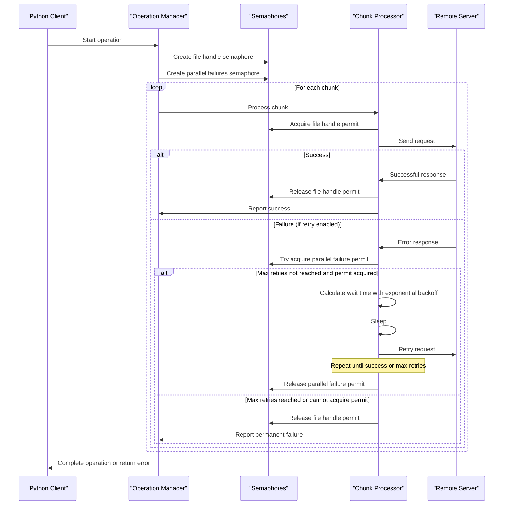
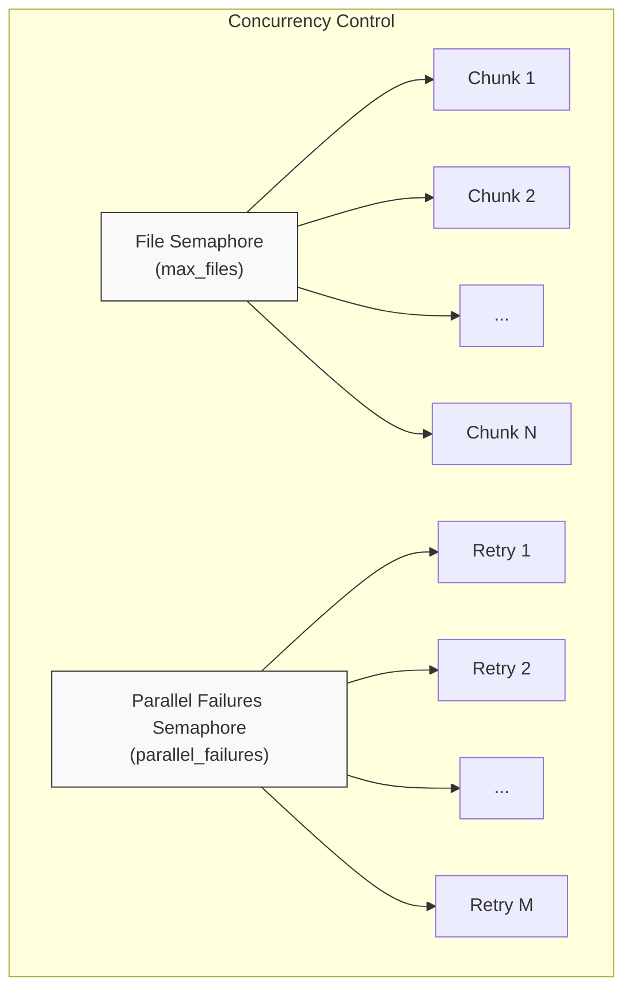

<!-- source: DeepWiki mcp.deepwiki.com · repo huggingface/hf_transfer · page 3.3 Error Handling and Retry Logic · fetched 2026-10-26 -->

# Error Handling and Retry Logic

<details>
<summary>Relevant source files</summary>

The following files were used as context for generating this wiki page:

- [src/lib.rs](src/lib.rs)

</details>


This page describes the error handling and retry mechanisms implemented in hf_transfer to ensure robust and fault-tolerant file transfers, even in the presence of network instability or transient failures. For information about the main download and upload functions, see [Download Function](#3.1) and [Multipart Upload Function](#3.2).

## Overview

File transfers over the internet are susceptible to various failures including network interruptions, timeouts, and server-side issues. The hf_transfer library implements a sophisticated error handling system with configurable retry logic to address these challenges and ensure reliable transfers.

Key features of the error handling system include:

- Custom error types that categorize and propagate different failure modes
- Exponential backoff with jitter for intelligent retry timing
- Parallel failure handling with semaphore-based concurrency control
- Clean state management for failed transfers

Sources: [src/lib.rs:26-27](), [src/lib.rs:142-148](), [src/lib.rs:297-332]()

## Error Types

The library defines a custom `Error` enum that encapsulates the different types of errors that can occur during file transfers:

```mermaid
classDiagram
    class Error {
        <<enum>>
        +Io(std::io::Error)
        +Request(reqwest::Error)
        +ToStrError(ToStrError)
        +Display()
    }
    
    Error --|> std::error::Error : implements
    Error --|> Display : implements
```

These error types are converted to appropriate Python exceptions with descriptive messages when propagating errors back to the Python caller.

Sources: [src/lib.rs:297-332]()

## Retry Configuration

Both download and upload functions accept parameters to configure retry behavior:

| Parameter | Description |
|-----------|-------------|
| `max_files` | Maximum number of open file handles, determining maximum parallel operations |
| `parallel_failures` | Maximum number of failures allowed in parallel (cannot exceed `max_files`) |
| `max_retries` | Maximum number of retry attempts per chunk |

The library enforces validation rules for these parameters:
- `parallel_failures` cannot be greater than `max_files`
- Both `parallel_failures` and `max_retries` must be either both zero (retry disabled) or both non-zero (retry enabled)

Sources: [src/lib.rs:48-58](), [src/lib.rs:113-123]()

## Exponential Backoff with Jitter

To prevent overloading the server and to avoid the "thundering herd" problem during retries, hf_transfer implements exponential backoff with added random jitter:


The wait time calculation uses the formula:
```
wait_time = min(BASE_WAIT_TIME + retry_count² + jitter(), MAX_WAIT_TIME)
```

Where:
- `BASE_WAIT_TIME` is 300ms
- Jitter adds a random value between 0-500ms
- `MAX_WAIT_TIME` is 10,000ms (10 seconds)

Sources: [src/lib.rs:26-27](), [src/lib.rs:142-148](), [src/lib.rs:264](), [src/lib.rs:409]()

## Retry Mechanism Implementation

The retry mechanism is implemented in both download and upload operations following a similar pattern:



### Download Retry Logic

In the download process:
1. Each chunk download is attempted
2. If failure occurs and retry is enabled:
   - Check if max retries reached
   - Try to acquire parallel failure permit
   - Wait using exponential backoff
   - Retry download
   - Release permits after completion

Sources: [src/lib.rs:248-272]()

### Upload Retry Logic

The upload process follows a similar pattern:
1. Each chunk upload is attempted
2. If failure occurs and retry is enabled:
   - Check if max retries reached
   - Try to acquire parallel failure permit
   - Wait using exponential backoff
   - Retry upload
   - Release permits after completion

Sources: [src/lib.rs:393-425]()

## Semaphore-Based Concurrency Control

The library uses two types of semaphores to control concurrency:



1. **File Handle Semaphore**: Controls the maximum number of concurrent chunk operations (both download and upload)
2. **Parallel Failures Semaphore**: Limits how many failed chunks can be in the retry process simultaneously

This approach prevents overloading the system with too many concurrent operations or retries.

Sources: [src/lib.rs:231-232](), [src/lib.rs:376-377]()

## Error Propagation and File Cleanup

When errors occur:

1. For downloads, the library attempts to remove the partially downloaded file to maintain filesystem cleanliness:
   ```
   download → error occurs → attempt to remove partial file → propagate error to Python
   ```

2. For both operations, detailed error messages are created with context about the failure, which helps with debugging.

3. All errors are eventually converted to Python exceptions with descriptive messages.

Sources: [src/lib.rs:75-87](), [src/lib.rs:418-424]()

## Configuring Retry Behavior

To enable retry logic when using hf_transfer functions, you must set both `parallel_failures` and `max_retries` to non-zero values:

```python
# Example with retry enabled
hf_transfer.download(
    url="https://example.com/file.bin",
    filename="local_file.bin",
    max_files=8,
    chunk_size=10_485_760,  # 10MB chunks
    parallel_failures=4,
    max_retries=5
)

# Example with retry disabled (default)
hf_transfer.download(
    url="https://example.com/file.bin",
    filename="local_file.bin",
    max_files=8,
    chunk_size=10_485_760  # 10MB chunks
)
```

Sources: [src/lib.rs:37-38](), [src/lib.rs:102-104]()

---

