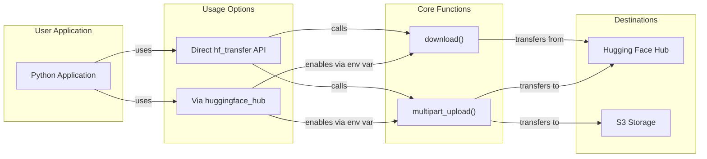
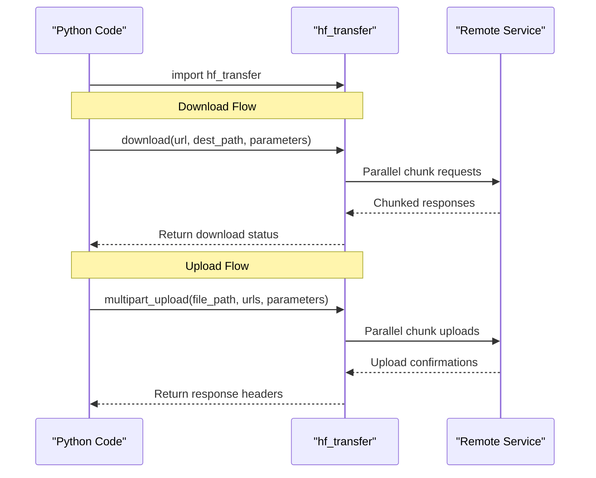
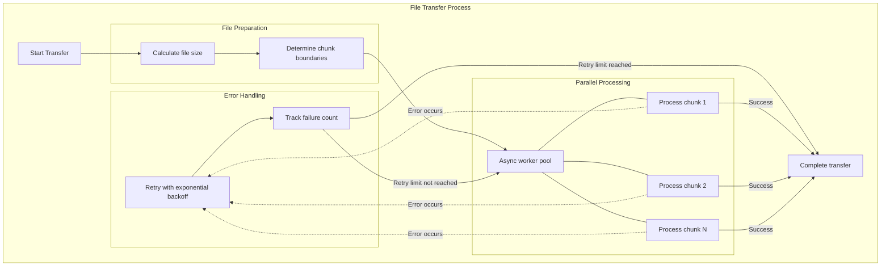
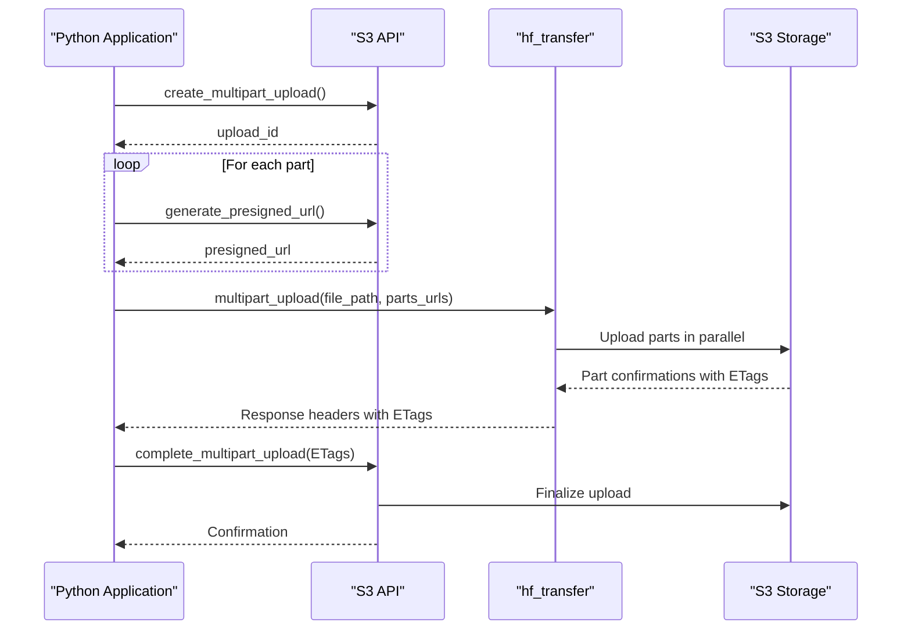

<!-- source: DeepWiki mcp.deepwiki.com · repo huggingface/hf_transfer · page 4 Using hf_transfer · fetched 2026-10-26 -->

# Using hf_transfer

<details>
<summary>Relevant source files</summary>

The following files were used as context for generating this wiki page:

- [README.md](README.md)
- [examples/upload_to_s3.py](examples/upload_to_s3.py)

</details>


This document provides a comprehensive guide on how to use the hf_transfer library, a high-performance file transfer utility developed primarily for large-scale data transfer with the Hugging Face Hub. This page covers general usage patterns, core API functionality, and basic examples. For detailed information about specific integrations, see [Integration with huggingface_hub](#4.1) or [S3 Integration](#4.2).

## Overview

hf_transfer is designed as a power user tool for high-bandwidth networks where Python's native capabilities cannot fully utilize the available bandwidth. It can achieve transfer speeds exceeding 500MB/s through its Rust-based implementation with Python bindings.



Sources: [README.md:1-14]()

## Installation

To install hf_transfer, simply use pip:

```
pip install hf_transfer
```

The package is distributed as a Python wheel with pre-built Rust binaries for various platforms, making installation straightforward without requiring a Rust compiler.

## Basic Usage

### Direct API Usage

hf_transfer exposes two main functions:

1. **`download`**: For downloading files from the Hugging Face Hub
2. **`multipart_upload`**: For uploading files to the Hugging Face Hub or S3-compatible storage

The following diagram illustrates the typical usage flow:



### Integration with huggingface_hub

The simplest way to use hf_transfer is through the huggingface_hub library by enabling it via an environment variable:

```python
import os
os.environ["HF_HUB_ENABLE_HF_TRANSFER"] = "1"

from huggingface_hub import HfApi
# Now all transfers will use hf_transfer automatically
```

Sources: [README.md:36-49]()

## Core API Reference

### Download Function

The `download` function downloads a file from a URL to a specified location:

```python
from hf_transfer import download

download(
    url="https://huggingface.co/path/to/file",
    dest_path="/local/path/to/save.file",
    # Optional parameters:
    chunk_size=10_485_760,  # 10 MiB chunks
    max_files=256,          # Maximum concurrent connections
    parallel_failures=255,  # Maximum failures to handle concurrently
    max_retries=5,          # Maximum retry attempts
)
```

For detailed information about parameters and optimization techniques, see the [Download Function](#3.1) page.

### Multipart Upload Function

The `multipart_upload` function uploads a file in chunks to one or more pre-signed URLs:

```python
from hf_transfer import multipart_upload

responses = multipart_upload(
    file_path="/path/to/local/file",
    parts_urls=["presigned_url_part1", "presigned_url_part2", ...],
    # Optional parameters:
    chunk_size=10_485_760,  # 10 MiB chunks
    max_files=64,           # Maximum concurrent connections
    parallel_failures=63,   # Maximum failures to handle concurrently
    max_retries=5,          # Maximum retry attempts
)
```

The function returns a list of response headers for each part, which typically includes ETag information needed to complete multipart uploads.

For detailed information about parameters and optimization techniques, see the [Multipart Upload Function](#3.2) page.

Sources: [examples/upload_to_s3.py:46-53]()

## File Transfer Process



Sources: [examples/upload_to_s3.py]()

## Performance Considerations

hf_transfer achieves high performance through several techniques:

| Feature | Description | Benefit |
|---------|-------------|---------|
| Rust implementation | Core processing is written in Rust | Faster, memory-efficient execution compared to Python |
| Parallel downloading | Download file chunks concurrently | Maximizes bandwidth utilization |
| Parallel uploading | Upload file chunks concurrently | Maximizes bandwidth utilization |
| Configurable chunk size | Adjust chunk size based on file size | Balance memory usage with parallelism |
| Adaptive retry mechanism | Exponential backoff with jitter | Resilience to network issues |

For optimal performance:

1. Adjust `chunk_size` based on your file size and available memory
2. Tune `max_files` based on your network capabilities and CPU cores
3. Set `parallel_failures` to slightly less than `max_files` (typically `max_files - 1`)
4. Adjust `max_retries` based on your network stability

## Using with S3

hf_transfer can be used to upload files to S3 or compatible storage services. The general process involves:

1. Creating a multipart upload in S3
2. Getting pre-signed URLs for each part
3. Using hf_transfer's `multipart_upload` to upload the parts
4. Completing the multipart upload with the ETags

For a detailed walkthrough with code examples, see the [S3 Integration](#4.2) page.



Sources: [examples/upload_to_s3.py]()

## Limitations and Considerations

1. **No Progress Bars**: As mentioned in the README, hf_transfer purposefully lacks progress bars and other UI elements.

2. **Debug Information**: For debugging purposes, you may want to enable debug logging in the huggingface_hub library:
   ```python
   from huggingface_hub import logging
   logging.set_verbosity_debug()
   ```

3. **Error Handling**: While hf_transfer has built-in retry mechanisms, your application should still handle potential exceptions.

4. **Designed for Large Files**: hf_transfer provides the most benefit when transferring large files (hundreds of MB or GB) over high-bandwidth connections.

Sources: [README.md:5-13]()

## Related Pages

- For integration with the huggingface_hub library, see [Integration with huggingface_hub](#4.1)
- For detailed S3 integration examples, see [S3 Integration](#4.2)
- For understanding the underlying architecture, see [Architecture](#2)
- For detailed API documentation, see [Core API](#3)

---

