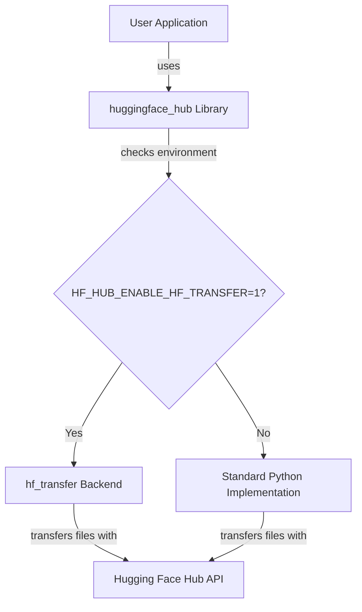
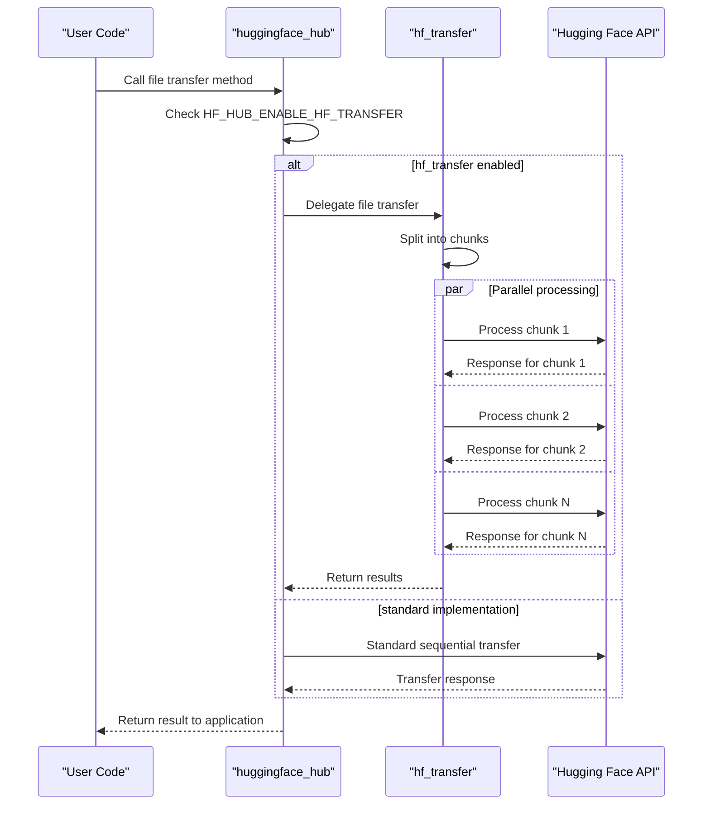
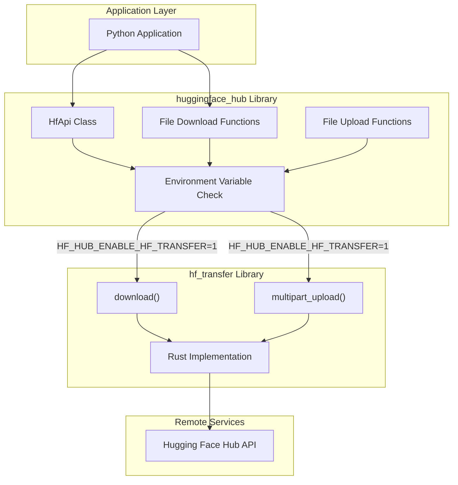

<!-- source: DeepWiki mcp.deepwiki.com · repo huggingface/hf_transfer · page 4.1 Integration with huggingface_hub · fetched 2026-10-26 -->

# Integration with huggingface_hub

<details>
<summary>Relevant source files</summary>

The following files were used as context for generating this wiki page:

- [.github/workflows/test.yml](.github/workflows/test.yml)
- [README.md](README.md)

</details>


## Purpose and Scope

This document explains how to use hf_transfer as an accelerated file transfer backend with the huggingface_hub library. It covers configuration, basic usage patterns, and performance considerations. For information about direct usage of hf_transfer without huggingface_hub, see [Core API](#3).

## Overview of Integration

hf_transfer provides a high-performance Rust-based implementation for file transfers that can be used by the huggingface_hub library. When enabled, huggingface_hub will use hf_transfer instead of its standard Python implementation for file downloads and uploads, resulting in significantly improved performance for large file transfers on high-bandwidth networks.



Sources: [README.md:3-4](), [README.md:42-44]()

## Enabling the Integration

### Prerequisites

To use hf_transfer with huggingface_hub, you need:

1. Both libraries installed in your environment:
   ```bash
   pip install huggingface_hub hf_transfer
   ```

2. The environment variable set to enable hf_transfer:
   ```python
   import os
   os.environ["HF_HUB_ENABLE_HF_TRANSFER"] = "1"
   ```

### Basic Usage

Once the environment variable is set, huggingface_hub will automatically use hf_transfer for file operations. No other code changes are required.

```python
import os

# Enable hf_transfer
os.environ["HF_HUB_ENABLE_HF_TRANSFER"] = "1"

from huggingface_hub import HfApi, logging

# Optional: Enable debug logging
logging.set_verbosity_debug()

# Use huggingface_hub API as normal
hf = HfApi()
hf.upload_file(
    path_or_fileobj="/path/to/my/repo/some_file", 
    path_in_repo="some_file", 
    repo_id="my/repo", 
    repo_type="model"
)
```

Sources: [README.md:42-49]()

## Integration Flow

The following sequence diagram illustrates the execution flow when using huggingface_hub with hf_transfer enabled:



The key advantage of hf_transfer is its ability to perform parallel chunk processing, which can significantly improve transfer speeds on high-bandwidth networks.

Sources: [README.md:6-8]()

## Supported Operations

Based on the test workflow, the integration supports at least the following operations:

1. File downloads via huggingface_hub's download functions
2. Multipart LFS file uploads via the `upload_file` method

This is evidenced by the specific tests run in the CI pipeline:

```
HF_HUB_ENABLE_HF_TRANSFER=1 pytest huggingface_hub/tests/test_file_download.py
HF_HUB_ENABLE_HF_TRANSFER=1 pytest huggingface_hub/tests/test_hf_api.py -k 'test_upload_lfs_file_multipart'
```

Sources: [.github/workflows/test.yml:42-43]()

## Component Integration Diagram

The following diagram illustrates how hf_transfer fits into the ecosystem when used with huggingface_hub:



Sources: [README.md:42-49](), [.github/workflows/test.yml:42-43]()

## Performance Considerations

As stated in the README, hf_transfer is designed specifically for high-performance scenarios:

> This library is a power user tool, to go beyond ~500MB/s on very high bandwidth network, where Python cannot cap out the available bandwidth.

The performance benefits will be most noticeable when:
- Transferring large files (hundreds of MB or more)
- Operating on networks with very high bandwidth
- Handling situations where Python's GIL (Global Interpreter Lock) might limit performance

Note that hf_transfer prioritizes performance over user interface features:

> This is not meant to be a general usability tool. It purposefully lacks progressbars and comes generally as-is.

Sources: [README.md:5-11]()

## Development and Testing

If you're developing with both hf_transfer and huggingface_hub, the README provides guidance on setting up your environment:

```sh
git clone git@github.com:huggingface/huggingface_hub.git
# or: git clone https://github.com/huggingface/huggingface_hub.git

cd huggingface_hub
python3 -m pip install -e ".[quality]"
```

The CI workflow demonstrates how tests are run to verify the integration:

```yaml
- name: Run tests
  run: |
    source .venv/bin/activate
    HF_HUB_ENABLE_HF_TRANSFER=1 pytest huggingface_hub/tests/test_file_download.py
    HF_HUB_ENABLE_HF_TRANSFER=1 pytest huggingface_hub/tests/test_hf_api.py -k 'test_upload_lfs_file_multipart'
```

Sources: [README.md:24-34](), [.github/workflows/test.yml:18-43]()

## Troubleshooting

If you encounter issues with the integration:

1. Verify that both libraries are correctly installed
2. Ensure the environment variable is set before importing huggingface_hub
3. Enable debug logging to see more information:
   ```python
   from huggingface_hub import logging
   logging.set_verbosity_debug()
   ```
4. Make sure you're setting the environment variable early enough in your code, before importing huggingface_hub

Sources: [README.md:46]()

---

