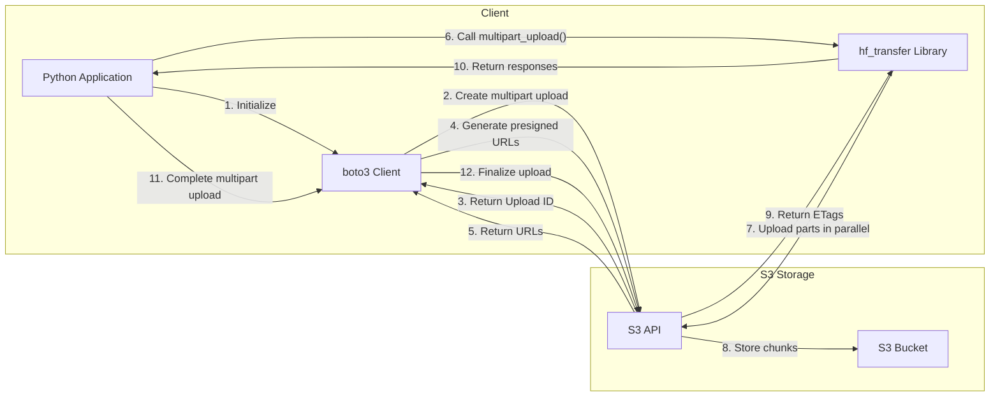
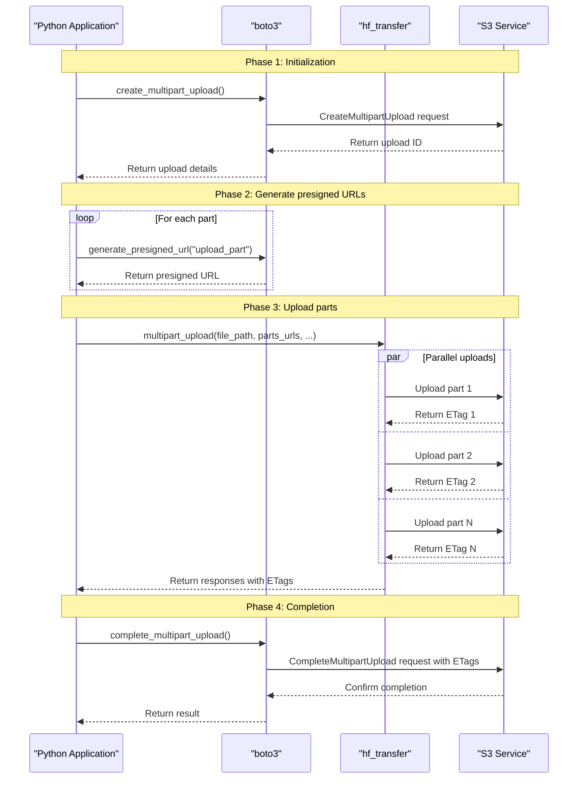
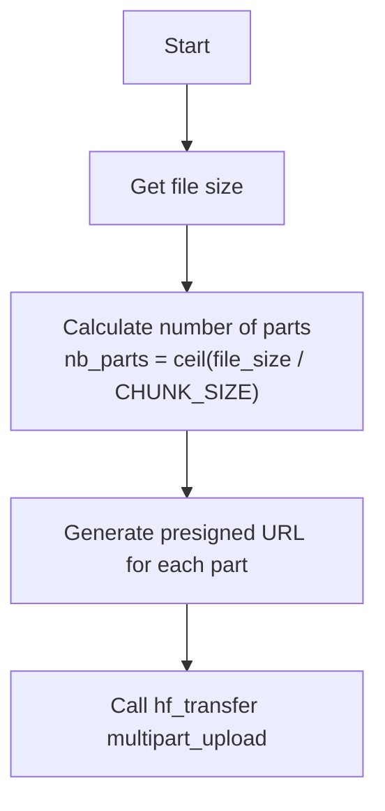
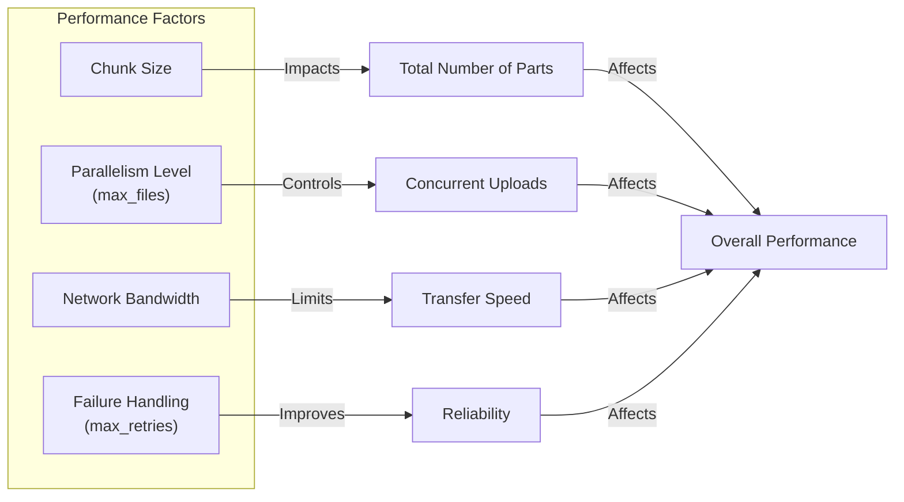

<!-- source: DeepWiki mcp.deepwiki.com · repo huggingface/hf_transfer · page 4.2 S3 Integration · fetched 2026-10-26 -->

# S3 Integration

<details>
<summary>Relevant source files</summary>

The following files were used as context for generating this wiki page:

- [examples/upload_to_s3.py](examples/upload_to_s3.py)

</details>


This page explains how to use hf_transfer with Amazon S3 and S3-compatible storage services. The primary focus is on leveraging the high-performance multipart upload capabilities of hf_transfer to accelerate file transfers to S3 storage. For general information about using hf_transfer with Hugging Face Hub, see [Integration with huggingface_hub](#4.1).

## Overview of S3 Integration

hf_transfer provides integration with S3 through its `multipart_upload` function, which can significantly accelerate file uploads to S3 buckets by processing multiple chunks in parallel. This integration leverages boto3 for S3-specific operations while using hf_transfer's Rust-powered parallel upload capabilities for the actual data transfer.



*Figure: S3 integration workflow with hf_transfer*

Sources: [examples/upload_to_s3.py:1-68]()

## Setup Requirements

To use hf_transfer with S3, you need:

1. **Dependencies**:
   - `hf_transfer`: Core library providing the high-performance upload capabilities
   - `boto3`: AWS SDK for Python, used for S3-specific operations

2. **Authentication**:
   - Valid AWS credentials configured for boto3
   - Appropriate permissions to create and complete multipart uploads in the target bucket

```bash
pip install hf_transfer boto3
```

Sources: [examples/upload_to_s3.py:1-3]()

## Multipart Upload Process

The S3 multipart upload process with hf_transfer consists of three main phases:

1. **Initialization**: Create a multipart upload and obtain an upload ID
2. **Parts Upload**: Use hf_transfer to upload file parts in parallel
3. **Completion**: Finalize the upload by providing ETags of all uploaded parts



*Figure: Detailed sequence for S3 multipart upload with hf_transfer*

Sources: [examples/upload_to_s3.py:17-66]()

## Implementation Walkthrough

### 1. Create Multipart Upload

First, initialize the multipart upload process with boto3 to obtain an upload ID:

```python
s3 = boto3.client("s3")
bucket = "your-bucket-name"
bucket_key = "your-object-key"

upload = s3.create_multipart_upload(
    ACL="bucket-owner-full-control",
    Bucket=bucket,
    Key=bucket_key,
)
upload_id = upload["UploadId"]
```

Sources: [examples/upload_to_s3.py:12-22]()

### 2. Generate Presigned URLs for Each Part

Calculate the number of parts needed based on file size and chunk size, then generate a presigned URL for each part:



*Figure: Part preparation process*

Sources: [examples/upload_to_s3.py:25-42]()

The code to generate presigned URLs:

```python
CHUNK_SIZE = 10_485_760  # 10 MiB

file_name = "your-file-path"
file_size = os.stat(file_name).st_size

urls = []
nb_parts = ceil(file_size / CHUNK_SIZE)
for part_number in range(1, nb_parts + 1):
    params = {
        "Bucket": bucket,
        "Key": bucket_key,
        "PartNumber": part_number,
        "UploadId": upload_id,
    }
    urls.append(
        s3.generate_presigned_url(
            ClientMethod="upload_part", Params=params, ExpiresIn=86400
        )
    )
```

Sources: [examples/upload_to_s3.py:25-41]()

### 3. Upload Parts with hf_transfer

Use hf_transfer's `multipart_upload` function to upload all parts in parallel:

```python
responses = multipart_upload(
    file_path=file_name,
    parts_urls=urls,
    chunk_size=CHUNK_SIZE,
    max_files=64,
    parallel_failures=63,
    max_retries=5,
)
```

Sources: [examples/upload_to_s3.py:46-53]()

Key parameters:
- `file_path`: Path to the file to upload
- `parts_urls`: List of presigned URLs for each part
- `chunk_size`: Size of each part in bytes
- `max_files`: Maximum number of parts to upload in parallel
- `parallel_failures`: Maximum number of part upload failures allowed in parallel
- `max_retries`: Maximum number of retry attempts for failed uploads

### 4. Complete Multipart Upload

Extract ETags from responses and complete the multipart upload:

```python
etag_with_parts = []
for part_number, header in enumerate(responses):
    etag = header.get("etag")
    etag_with_parts.append({"ETag": etag, "PartNumber": part_number + 1})

parts = {"Parts": etag_with_parts}

s3.complete_multipart_upload(
    Bucket=bucket, Key=bucket_key, MultipartUpload=parts, UploadId=upload_id
)
```

Sources: [examples/upload_to_s3.py:56-65]()

## Performance Considerations

The hf_transfer S3 integration offers several parameters that can be tuned for optimal performance:

| Parameter | Description | Default | Recommendation |
|-----------|-------------|---------|---------------|
| `chunk_size` | Size of each part in bytes | - | 10 MiB (minimum for S3) to 100 MiB depending on file size |
| `max_files` | Maximum parallel uploads | - | 16-64 for high bandwidth networks |
| `parallel_failures` | Maximum number of allowed parallel failures | - | Set to `max_files - 1` |
| `max_retries` | Maximum retry attempts for failed uploads | - | 3-5 for most use cases |



*Figure: S3 upload performance factors*

Sources: [examples/upload_to_s3.py:46-53]()

## Best Practices

1. **Chunk Size Selection**:
   - S3 requires a minimum chunk size of 5 MiB (except for the last chunk)
   - Larger chunks reduce the number of individual requests but increase memory usage
   - For large files, consider using 10-100 MiB chunk sizes

2. **Parallelism Settings**:
   - Set `max_files` based on available network bandwidth and system resources
   - Set `parallel_failures` close to but less than `max_files` (typically `max_files - 1`)

3. **Error Handling**:
   - hf_transfer handles individual part failures with retries
   - Implement additional error handling around the complete multipart upload call
   - Consider implementing cleanup for abandoned multipart uploads

4. **Security**:
   - Set appropriate expiration times for presigned URLs
   - Use proper IAM policies limiting access to the required S3 operations

Sources: [examples/upload_to_s3.py:46-53]()

## Complete Example

For a complete working example, refer to the [examples/upload_to_s3.py:1-68]() file in the repository.

## Limitations and Future Enhancements

Currently, hf_transfer S3 integration:
- Supports multipart uploads but not downloads directly from S3
- Requires manual creation and completion of multipart uploads through boto3
- Does not handle S3 bucket creation or management

For additional details on the core functionality of hf_transfer, see [Multipart Upload Function](#3.2).

---

