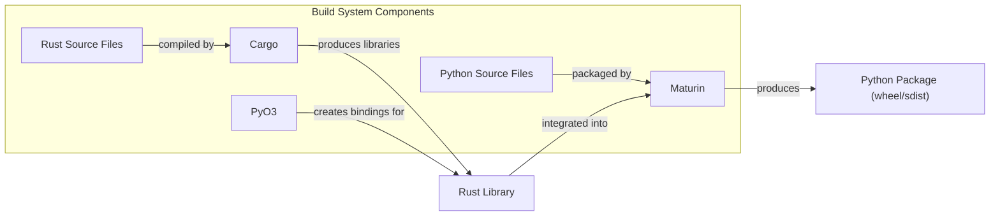
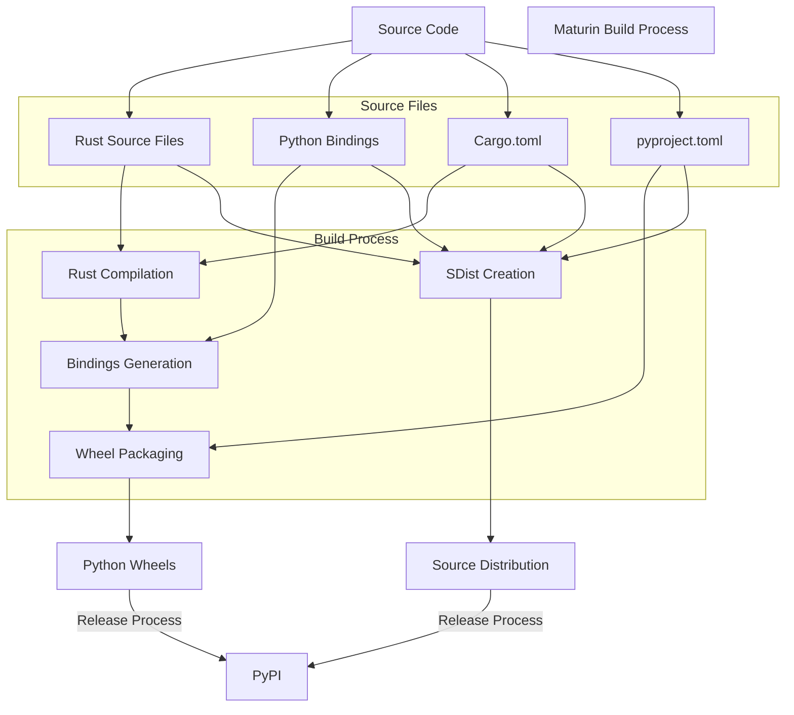
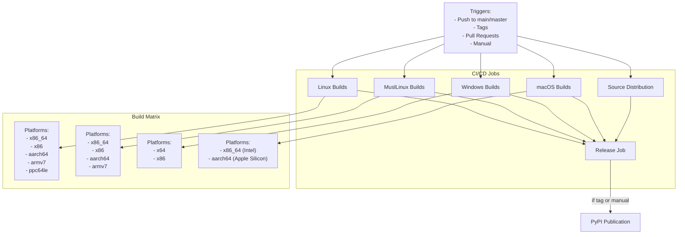
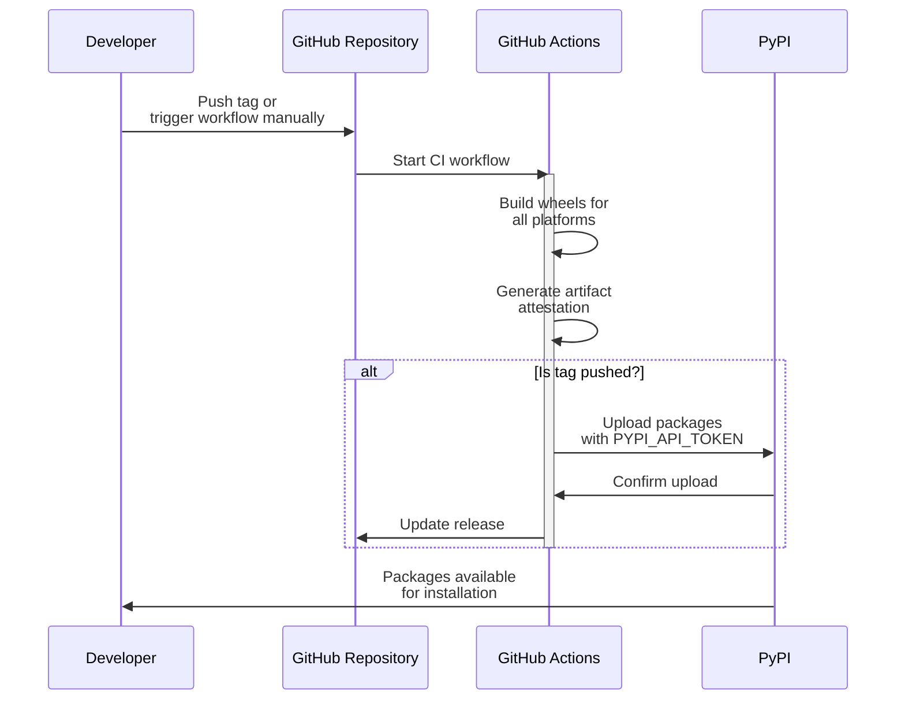

<!-- source: DeepWiki mcp.deepwiki.com · repo huggingface/hf_transfer · page 5 Building and Deployment · fetched 2026-10-26 -->

# Building and Deployment

Relevant source files

The following files were used as context for generating this wiki page:

- [.github/workflows/CI.yml](.github/workflows/CI.yml)
- [pyproject.toml](pyproject.toml)

This page provides a comprehensive overview of the build system and deployment process for hf_transfer. It covers how the Rust-based library is compiled into Python wheels, the continuous integration pipeline, cross-platform support, and the release process. For information about setting up a development environment, see [Development Guide](#6).

## Build System Overview

hf_transfer is primarily written in Rust with Python bindings, using a hybrid approach to provide high-performance file transfers while maintaining seamless Python integration. The build process leverages [Maturin](https://github.com/PyO3/maturin), a tool that simplifies building and publishing Rust-extensions for Python, along with [PyO3](https://github.com/PyO3/pyo3) for creating Rust bindings to Python.

Sources: [pyproject.toml:1-3](), [.github/workflows/CI.yml:1-4]()

## Build Process Flow

The build process for hf_transfer transforms Rust and Python source code into distributable Python packages through a series of steps, as illustrated below:

Sources: [pyproject.toml](), [.github/workflows/CI.yml:185-198]()

## CI/CD Pipeline

hf_transfer uses GitHub Actions for continuous integration and deployment. The workflow automatically builds wheels for multiple platforms and architectures, ensuring compatibility across various environments.

Sources: [.github/workflows/CI.yml:6-17](), [.github/workflows/CI.yml:200-225]()

The CI pipeline uses Maturin Action, a specialized GitHub Action for building Rust Python extensions. The pipeline is configured to build both standard and free-threaded wheels (for Python 3.13+) on supported platforms.

### Job Structure

Each CI job performs the following steps:

1. Checkout the repository
2. Set up Python
3. Build wheels using Maturin Action
4. Upload built wheels as artifacts
5. For releases, collect all artifacts and publish to PyPI

For Linux builds, required dependencies like OpenSSL and libatomic are installed before the build process begins.

Sources: [.github/workflows/CI.yml:39-59](), [.github/workflows/CI.yml:213-225]()

## Cross-Platform Support

hf_transfer supports a wide range of platforms and architectures, making it accessible to almost all Python environments.

| Platform   | Architectures                        | Python Versions    | Build Type        |
|------------|--------------------------------------|--------------------|--------------------|
| Linux      | x86_64, x86, aarch64, armv7, ppc64le | 3.7+               | manylinux          |
| MuslLinux  | x86_64, x86, aarch64, armv7         | 3.7+               | musllinux_1_2      |
| Windows    | x64, x86                            | 3.7+               | Windows wheels     |
| macOS      | x86_64 (Intel), aarch64 (M1/M2)     | 3.7+               | macOS wheels       |
| All        | Source distribution                  | 3.7+ (with Rust)   | SDist              |

Additionally, for Python 3.13+ which introduces a free-threaded runtime, special wheels are built for Linux, MuslLinux, and macOS platforms.

Sources: [.github/workflows/CI.yml:22-183](), [pyproject.toml:10-11]()

## Deployment Process

The deployment process is automated through the GitHub Actions workflow. When a new tag is pushed or the workflow is manually triggered, the following steps occur:

1. All wheel artifacts from different platform builds are collected
2. Build provenance attestation is generated for security
3. Packages are uploaded to PyPI using the PyPI API token stored in GitHub Secrets

This ensures that new releases are consistently and securely published with minimal manual intervention.

Sources: [.github/workflows/CI.yml:200-225]()

## Key Configuration Files

The build and deployment system relies on two primary configuration files:

1. **pyproject.toml**: Defines the Python package metadata and build requirements
   - Specifies maturin as the build backend
   - Defines package details like name, description, and compatibility

2. **CI.yml**: GitHub Actions workflow configuration
   - Defines build matrices for different platforms
   - Configures the maturin build process
   - Handles artifact collection and PyPI deployment

Sources: [pyproject.toml](), [.github/workflows/CI.yml]()

## Conclusion

The hf_transfer build and deployment system leverages modern tools like Maturin and GitHub Actions to create a robust cross-platform distribution process. This ensures that the Rust-based performance optimizations are available to Python users across virtually all platforms and architectures without requiring them to have Rust installed or deal with compilation complexities.

---

