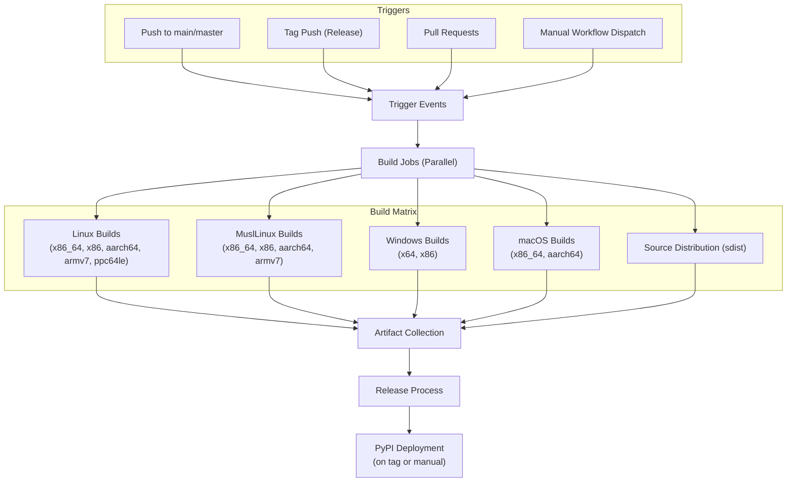
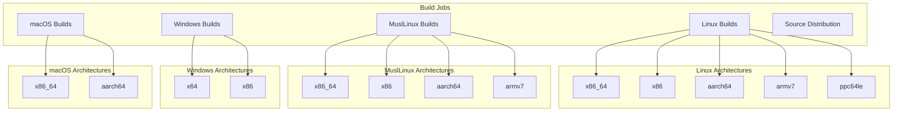
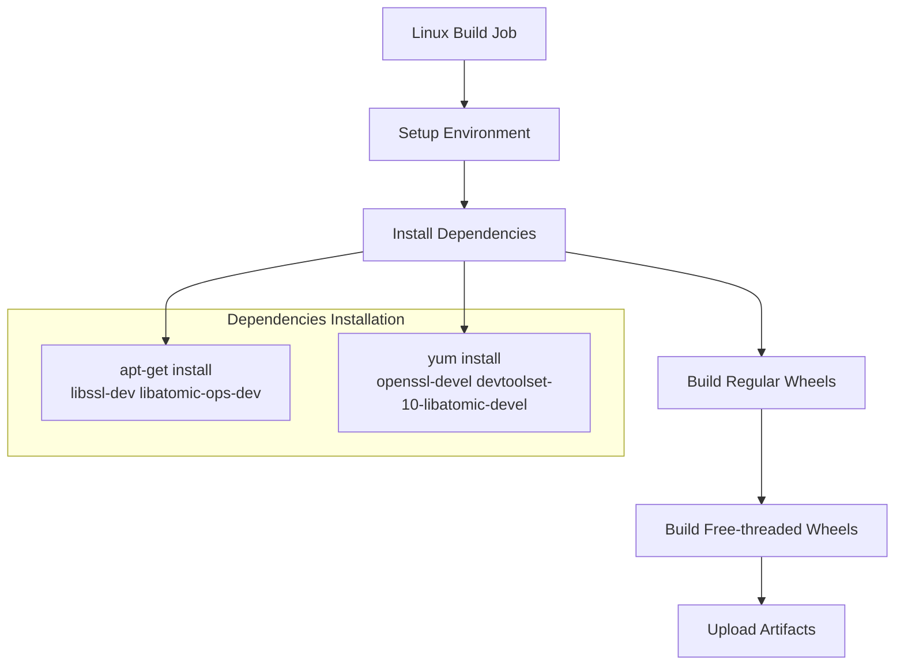
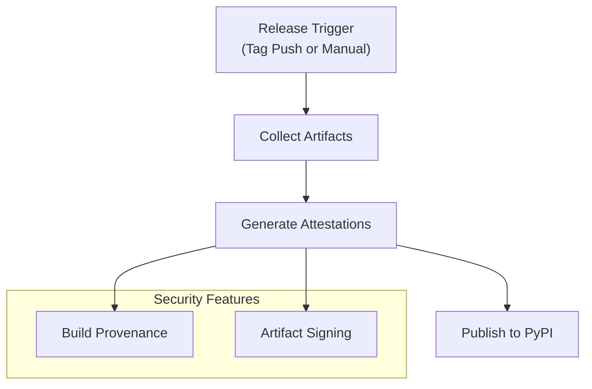
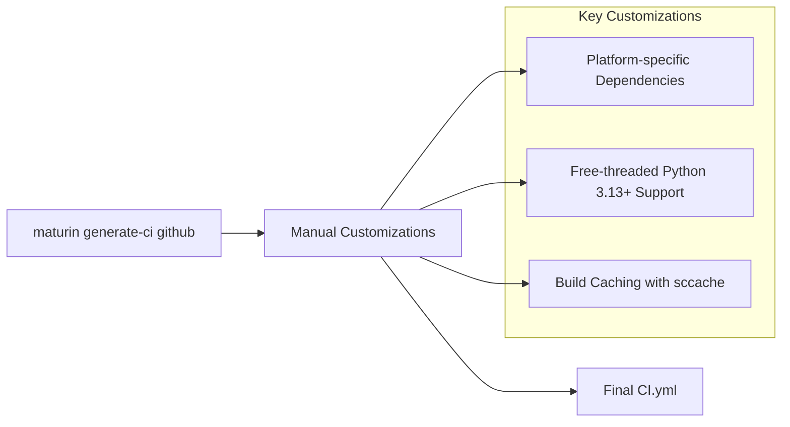

<!-- source: DeepWiki mcp.deepwiki.com · repo huggingface/hf_transfer · page 5.1 CI/CD Pipeline · fetched 2026-10-26 -->

# CI/CD Pipeline

Relevant source files

The following files were used as context for generating this wiki page:

- [.github/workflows/CI.yml](.github/workflows/CI.yml)

## Purpose and Scope

This document details the Continuous Integration and Continuous Deployment (CI/CD) pipeline for `hf_transfer`, which automates the building, testing, and deployment of the library across multiple platforms and architectures. The pipeline ensures that `hf_transfer` can be easily installed on virtually any system that supports Python, by providing pre-built wheels for a comprehensive range of platforms.

For information about specific platform support, see [Cross-Platform Support](#5.2).

## Pipeline Overview

The `hf_transfer` CI/CD pipeline is implemented using GitHub Actions and heavily leverages Maturin for building Python wheels from the Rust code. The pipeline was generated using Maturin's built-in CI generation capabilities and customized for the project's specific needs.

Sources: [.github/workflows/CI.yml:6-22](), [.github/workflows/CI.yml:200-225]()

## Build Process Details

The build process utilizes a matrix strategy to compile the Rust code and generate Python wheels for multiple platforms and architectures. This approach ensures `hf_transfer` can be installed with pip on virtually any system without requiring Rust or a C compiler.

### Build Matrix Structure

Sources: [.github/workflows/CI.yml:22-39](), [.github/workflows/CI.yml:82-94](), [.github/workflows/CI.yml:120-128](), [.github/workflows/CI.yml:153-161]()

### Build Process Workflow

For each platform-architecture combination, the build process follows these steps:

1. **Environment setup**: Prepare the build environment with Python and necessary dependencies
2. **Standard wheel build**: Generate Python wheels for standard Python interpreters
3. **Free-threaded wheel build**: For most platforms, additional wheels are built for Python 3.13+ which uses a free-threaded interpreter
4. **Artifact upload**: All built wheels are uploaded as GitHub artifacts for later stages

| Platform | Dependencies Installation | Free-threaded Support |
|----------|---------------------------|----------------------|
| Linux | libssl-dev, libatomic-ops-dev | Yes (Python 3.13+) |
| MuslLinux | (Uses Alpine base) | Yes (Python 3.13+) |
| Windows | (Using Windows runners) | No |
| macOS | (Using macOS runners) | Yes (Python 3.13+) |

Sources: [.github/workflows/CI.yml:44-75](), [.github/workflows/CI.yml:100-113](), [.github/workflows/CI.yml:135-146](), [.github/workflows/CI.yml:167-178]()

## Platform-Specific Considerations

### Linux Builds

The Linux builds run on Ubuntu 22.04 and generate wheels for various architectures. For architectures that don't match the runner's native architecture (like aarch64 on x86_64), cross-compilation is used. The builds install necessary dependencies like OpenSSL and libatomic.

Sources: [.github/workflows/CI.yml:22-80]()

### MuslLinux Builds

MuslLinux builds are similar to standard Linux builds but target systems using the musl C library instead of glibc (like Alpine Linux). This ensures compatibility with lightweight containers and systems where glibc is not available.

Sources: [.github/workflows/CI.yml:82-118]()

### Windows Builds

Windows builds run on Windows runners and target both 32-bit and 64-bit architectures. Unlike other platforms, Windows builds do not currently include free-threaded wheels for Python 3.13+.

Sources: [.github/workflows/CI.yml:120-151]()

### macOS Builds

macOS builds run on macOS runners (macOS 13 for Intel and macOS 14 for Apple Silicon) and build wheels for both x86_64 and aarch64 architectures, ensuring support for both Intel Macs and Apple Silicon Macs.

Sources: [.github/workflows/CI.yml:153-183]()

## Release Process

The release process is triggered automatically when a tag is pushed or manually via workflow dispatch. It collects all the built wheels from the various jobs, generates attestations for security, and publishes them to PyPI.

Sources: [.github/workflows/CI.yml:200-225]()

### Release Workflow

1. **Triggers**: The release job runs only when a tag is pushed (for automatic releases) or when manually triggered
2. **Dependencies**: The release job depends on the successful completion of all build jobs
3. **Permissions**: Special permissions are granted for signing artifacts and generating attestations
4. **Artifact Collection**: All wheel artifacts from previous jobs are downloaded
5. **Attestation**: Build provenance is generated to verify the origin of the artifacts
6. **PyPI Publishing**: For tag pushes, the wheels are published to PyPI using the Maturin upload command

Sources: [.github/workflows/CI.yml:202-225]()

## CI Configuration and Customization

The CI pipeline is configured through the `.github/workflows/CI.yml` file, which was initially generated by Maturin and then customized for the project's needs. This file defines the triggers, jobs, and steps of the pipeline.

Sources: [.github/workflows/CI.yml:1-5]()

### Key Configuration Elements

| Element | Description | File Reference |
|---------|-------------|----------------|
| Trigger Events | When the workflow runs | [.github/workflows/CI.yml:8-16]() |
| Job Matrix | Platform/architecture combinations | [.github/workflows/CI.yml:25-38](), [.github/workflows/CI.yml:85-94](), etc. |
| Build Steps | How wheels are built for each platform | [.github/workflows/CI.yml:44-75](), etc. |
| Release Criteria | When artifacts are published | [.github/workflows/CI.yml:203]() |
| PyPI Token | Secret for PyPI publishing | [.github/workflows/CI.yml:221-222]() |

## Integration with Development Workflow

The CI/CD pipeline integrates with the development workflow by:

1. Running on all pull requests to validate changes
2. Building wheels for the main branch to provide development versions
3. Automatically releasing new versions when tags are pushed
4. Supporting manual triggering for testing or special releases

This ensures that the library remains stable and available across all supported platforms throughout the development process.

---

