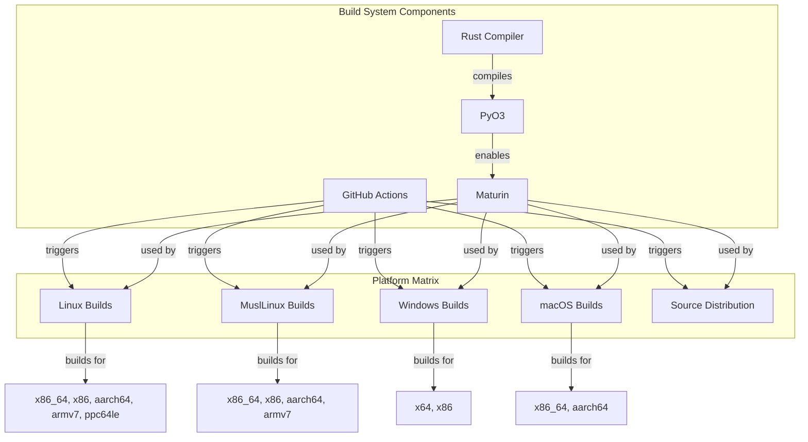
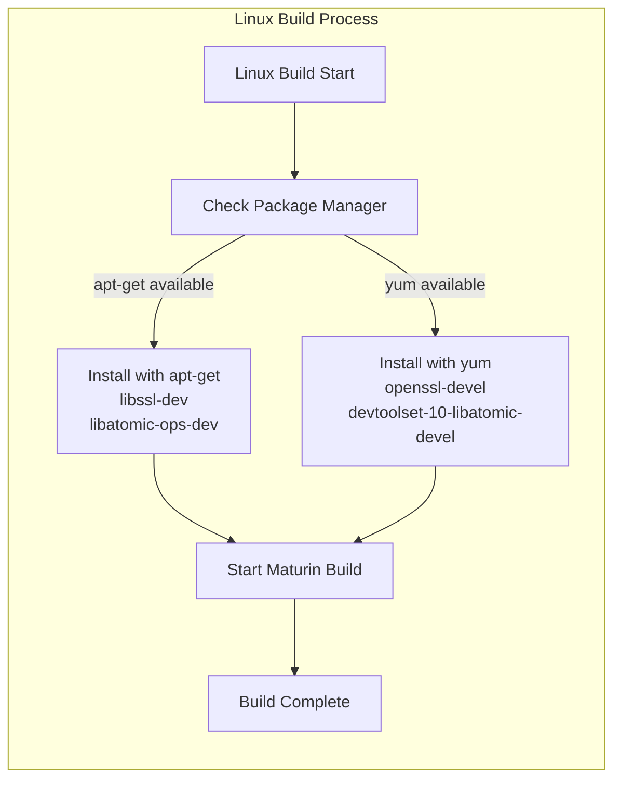
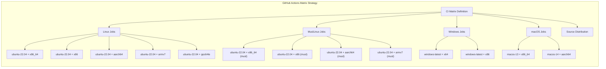
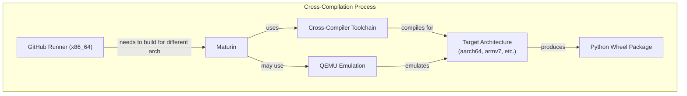

<!-- source: DeepWiki mcp.deepwiki.com · repo huggingface/hf_transfer · page 5.2 Cross-Platform Support · fetched 2026-10-26 -->

# Cross-Platform Support

<details>
<summary>Relevant source files</summary>

The following files were used as context for generating this wiki page:

- [.github/workflows/CI.yml](.github/workflows/CI.yml)
- [Cargo.lock](Cargo.lock)

</details>


This document provides detailed information about the platforms, architectures, and build configurations supported by hf_transfer. The page covers how the project ensures wide compatibility across different operating systems and hardware architectures through its build system. For information about the CI/CD pipeline implementation, see [CI/CD Pipeline](#5.1).

## Supported Platforms and Architectures

hf_transfer is designed to work across multiple operating systems and CPU architectures, making it accessible to a wide range of users with different hardware and software setups.

### Operating Systems

| Operating System | Description |
|------------------|-------------|
| Linux | Standard distributions with glibc |
| MuslLinux | Alpine Linux and other musl-based distributions |
| Windows | Windows 10, 11 and Server editions |
| macOS | Both Intel and Apple Silicon |

### CPU Architectures

| Architecture | Description | Supported OS |
|--------------|-------------|-------------|
| x86_64 (64-bit) | Modern Intel/AMD 64-bit CPUs | Linux, MuslLinux, Windows, macOS |
| x86 (32-bit) | Legacy Intel/AMD 32-bit CPUs | Linux, MuslLinux, Windows |
| aarch64 (ARM 64-bit) | Modern ARM 64-bit CPUs | Linux, MuslLinux, macOS |
| armv7 (ARM 32-bit) | ARM 32-bit CPUs | Linux, MuslLinux |
| ppc64le | PowerPC 64-bit Little Endian | Linux |

Sources: [.github/workflows/CI.yml:22-38](), [.github/workflows/CI.yml:82-94](), [.github/workflows/CI.yml:120-128](), [.github/workflows/CI.yml:153-161]()

## Build System Architecture

hf_transfer uses a sophisticated build system that leverages GitHub Actions and Maturin to create Python wheels for multiple platforms and architectures automatically.



The diagram shows how GitHub Actions orchestrates the build process for different platforms, using Maturin to generate Python wheels for each supported architecture.

Sources: [.github/workflows/CI.yml:22-196]()

## Platform-Specific Requirements

Each platform has specific requirements and dependencies that need to be satisfied for successful builds.

### Linux-specific Requirements

Linux builds require additional system libraries:

- OpenSSL development libraries (`libssl-dev`)
- Atomic operations library (`libatomic-ops-dev`)

These dependencies are installed during the CI process before the build begins. The CI process detects the package manager (apt or yum) and installs the appropriate packages.



Sources: [.github/workflows/CI.yml:51-59](), [.github/workflows/CI.yml:67-75]()

### Build Configurations

hf_transfer builds include special configurations for different Python versions:

1. **Standard Builds**: Regular Python wheels compatible with most Python versions
2. **Free-Threaded Builds**: Special wheels built for Python 3.13t, which has a different threading model

The CI pipeline generates both types of wheels for Linux, MuslLinux, and macOS platforms.

Sources: [.github/workflows/CI.yml:60-75](), [.github/workflows/CI.yml:107-113](), [.github/workflows/CI.yml:173-178]()

## Build Matrix Implementation

The GitHub Actions workflow uses a matrix strategy to define the platforms and architectures to build for. This allows for efficient parallel building across different configurations.



The matrix allows for a flexible build strategy, where specific platform/architecture combinations can be enabled or disabled as needed.

Sources: [.github/workflows/CI.yml:22-39](), [.github/workflows/CI.yml:82-94](), [.github/workflows/CI.yml:120-128](), [.github/workflows/CI.yml:153-161]()

## Cross-Compilation and Emulation

For architectures that aren't natively supported by the GitHub Actions runners (such as ARM on x86 machines), the build process uses cross-compilation or emulation. Maturin provides this capability through integration with tools like QEMU.



The cross-compilation process allows building wheels for architectures like ARM on x86 machines, ensuring that users on those platforms can use hf_transfer without compilation issues.

Sources: [.github/workflows/CI.yml:22-39](), [.github/workflows/CI.yml:82-94]()

## Installation on Different Platforms

Users can install hf_transfer on supported platforms using pip. The PyPI package system automatically selects the appropriate wheel for the user's platform and architecture.

```
pip install hf_transfer
```

For exotic platforms or architectures that don't have pre-built wheels, the source distribution (sdist) can be used. When installing from the source distribution, the user's system needs to have Rust and the necessary dependencies installed.

## Technical Implementation Details

hf_transfer achieves its cross-platform compatibility through careful design choices:

1. **Rust Core**: Using Rust ensures memory safety and consistent behavior across platforms
2. **PyO3 Bindings**: The PyO3 library provides Python bindings that work across platforms
3. **Platform-Agnostic Code**: Core functionality is implemented in a platform-agnostic way
4. **Platform-Specific Adaptations**: Where necessary, conditional compilation is used to handle platform differences

This combination of technologies allows for a codebase that can be efficiently built and run on multiple platforms while maintaining consistent behavior.

## Testing Across Platforms

To ensure consistent behavior across all supported platforms, the project employs:

1. **Automated Testing**: CI runs tests on multiple platforms to catch platform-specific issues
2. **Cross-Platform Test Cases**: Tests that verify platform-specific behavior works correctly
3. **Manual Testing**: Periodic manual testing on key platforms to catch subtle issues

This multi-layered testing approach helps maintain compatibility as the codebase evolves.

## Conclusion

hf_transfer provides robust cross-platform support through a well-designed build system that creates optimized binaries for multiple operating systems and CPU architectures. This ensures that users can benefit from high-performance file transfers regardless of their platform.

By leveraging Rust's cross-platform capabilities and a comprehensive CI/CD pipeline, the project maintains compatibility with a wide range of systems, from standard desktop platforms to specialized server hardware.

---

