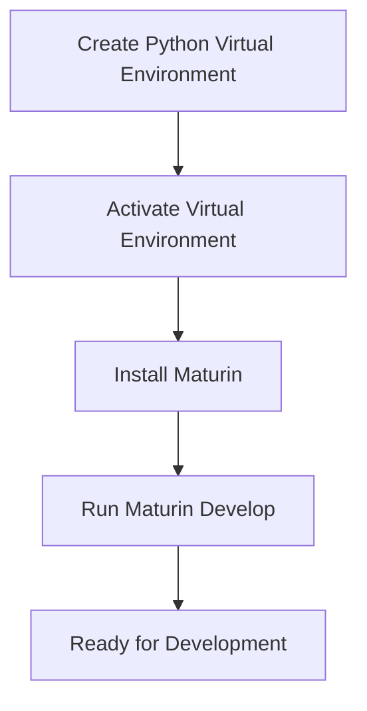
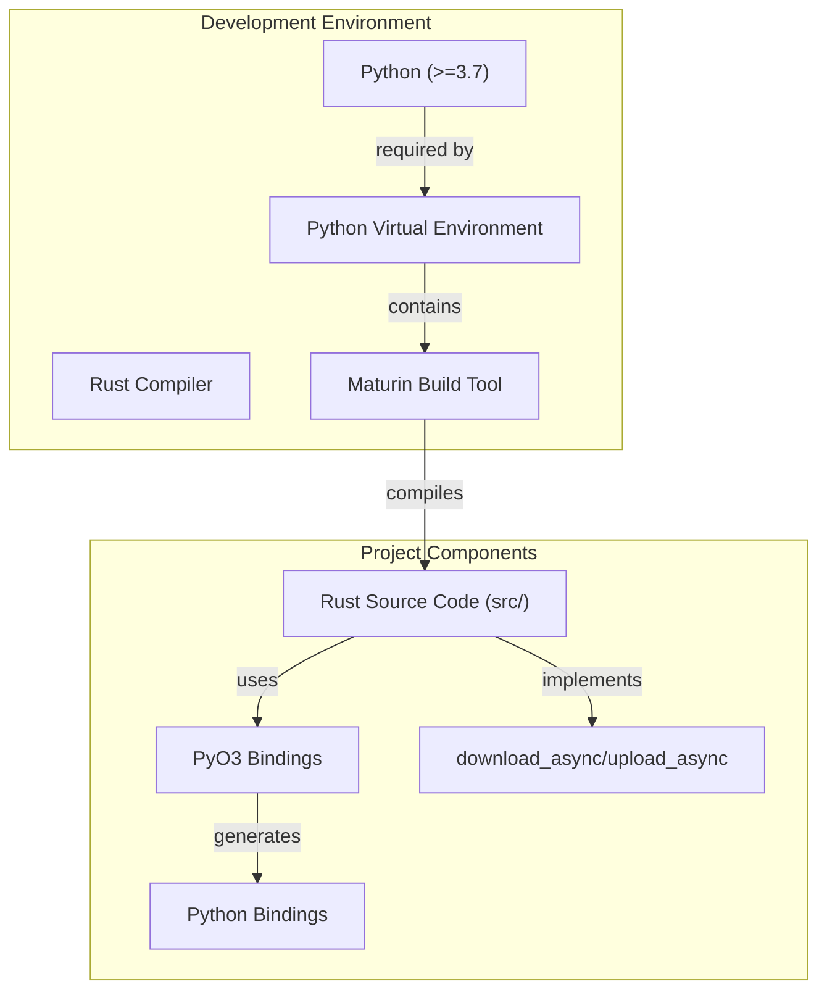
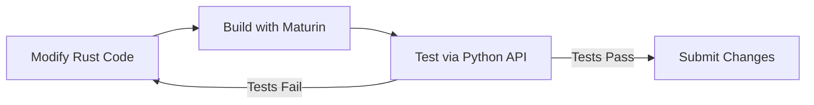
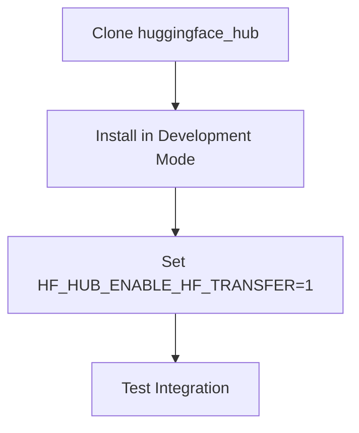
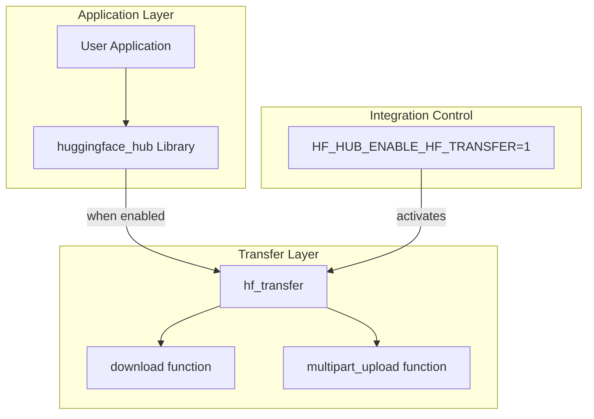

<!-- source: DeepWiki mcp.deepwiki.com · repo huggingface/hf_transfer · page 6 Development Guide · fetched 2026-10-26 -->

# Development Guide

<details>
<summary>Relevant source files</summary>

The following files were used as context for generating this wiki page:

- [README.md](README.md)
- [pyproject.toml](pyproject.toml)

</details>


This guide provides comprehensive information for developers who want to work on or with the hf_transfer codebase. It covers setting up a development environment, workflow processes, testing procedures, and contribution guidelines. This guide is targeted at technical developers who want to understand how to build, extend, or modify hf_transfer.

For information about using hf_transfer in applications, see [Using hf_transfer](#4). For details on building and deploying hf_transfer, see [Building and Deployment](#5).

## Setting Up Development Environment

hf_transfer is a hybrid Rust-Python project that uses Maturin as its build backend to bridge the two languages. This section walks you through the process of creating a proper development environment.



### Basic Setup

Follow these steps to set up your development environment:

1. Create and activate a Python virtual environment:
```sh
python3 -m venv ~/.venv/hf_transfer
source ~/.venv/hf_transfer/bin/activate
```

2. Install Maturin, the build backend for Rust-Python integration:
```sh
pip install maturin
```

3. Build and install the development version of hf_transfer:
```sh
maturin develop
```

This command compiles the Rust code and makes the Python bindings available in your virtual environment for testing and development.

Sources: [README.md:17-22](), [pyproject.toml:2-3]()

### Development Environment Components



The development environment consists of:
- Python (version 3.7 or higher) as specified in pyproject.toml
- Rust compiler and toolchain for core implementation
- Maturin build tool for Rust-Python integration
- PyO3 for creating Python bindings from Rust code

Sources: [pyproject.toml:10-16]()

## Development Workflow

This section describes the typical workflow for developing and contributing to hf_transfer.



### Rust-Python Development Cycle

hf_transfer uses Rust for performance-critical code with Python bindings for ease of integration. The development cycle typically involves:

1. Modifying Rust code in the `src` directory
2. Running `maturin develop` to compile changes and update the Python package
3. Testing the changes through the Python interface
4. Iterating as needed

## Working with huggingface_hub

Since hf_transfer is designed to work with the huggingface_hub library, you may need to test this integration during development.



### Setting Up huggingface_hub

To work on changes that involve integration with huggingface_hub:

1. Clone the huggingface_hub repository:
```sh
git clone git@github.com:huggingface/huggingface_hub.git
# or
git clone https://github.com/huggingface/huggingface_hub.git
```

2. Install in development mode:
```sh
cd huggingface_hub
python3 -m pip install -e ".[quality]"
```

Sources: [README.md:24-34]()

### Testing the Integration

Use this test script to verify that hf_transfer works correctly with huggingface_hub:

```python
import os

# Enable hf_transfer integration
os.environ["HF_HUB_ENABLE_HF_TRANSFER"] = "1"

# For local testing, uncomment the following line
# os.environ["HF_ENDPOINT"] = "http://localhost:5564"

from huggingface_hub import HfApi, logging

# Enable debug logs
logging.set_verbosity_debug()

# Initialize the API
hf = HfApi()

# Test file upload
hf.upload_file(
    path_or_fileobj="/path/to/my/repo/some_file", 
    path_in_repo="some_file", 
    repo_id="my/repo", 
    repo_type="model"
)
```

This script enables the hf_transfer integration through an environment variable, sets up debug logging, and performs a file upload operation.

Sources: [README.md:36-49]()

### Integration Architecture



The integration between huggingface_hub and hf_transfer is controlled by the `HF_HUB_ENABLE_HF_TRANSFER` environment variable. When set to "1", huggingface_hub routes file operations through hf_transfer for improved performance.

Sources: [README.md:42]()

## Testing

Comprehensive testing ensures that hf_transfer works correctly across different environments and use cases.

### Testing Approach

The testing strategy for hf_transfer includes:

1. **Unit Tests**: Testing individual components in isolation
2. **Integration Tests**: Testing the interaction between components
3. **Cross-Platform Tests**: Ensuring compatibility across different operating systems and architectures

### Manual Testing

For manual testing during development:

1. Make changes to the codebase
2. Build the project with `maturin develop`
3. Write a simple Python script that uses your changes
4. Run the script and verify the expected behavior

### Cross-Platform Considerations

hf_transfer is designed to work across multiple platforms:

| Platform | Architectures |
|----------|---------------|
| Linux    | x86_64, x86, aarch64, armv7, ppc64le |
| MuslLinux| x86_64, x86, aarch64, armv7 |
| Windows  | x64, x86 |
| macOS    | x86_64, aarch64 |

When making changes, consider how they might affect different platforms and architectures.

## Security and Auditing

Security is a critical aspect of file transfer libraries. When developing for hf_transfer, consider these security aspects:

1. **Input Validation**: Validate all inputs, especially those from external sources
2. **Error Handling**: Implement proper error handling to prevent information leakage
3. **Dependencies**: Keep dependencies up-to-date and regularly audit them for vulnerabilities
4. **Authentication**: Properly handle authentication credentials and tokens
5. **Network Security**: Implement proper TLS validation for network communications

## Issue Reporting


When reporting issues:

1. Check if the issue has already been reported
2. Only file issues if there's a problem with the underlying downloaded file
3. Provide detailed information about your environment and the problem
4. Include steps to reproduce the issue

Issues can be reported at the official GitHub repository: https://github.com/huggingface/hf_transfer/issues

Sources: [README.md:13-14](), [pyproject.toml:19]()

## Contributing Code

To contribute code to hf_transfer:

1. Set up your development environment as described above
2. Make your changes on a new branch
3. Ensure tests pass
4. Submit a pull request to the repository

### Code Style and Standards

Contributors should adhere to:

1. Rust coding standards for Rust code
2. Python PEP 8 for Python code
3. Comprehensive documentation for public APIs
4. Test coverage for new functionality

## Important Considerations

hf_transfer is designed as a specialized tool for high-bandwidth networks. As noted in the README:

> This library is a power user tool, to go beyond ~500MB/s on very high bandwidth network, where Python cannot cap out the available bandwidth.
> 
> This is *not* meant to be a general usability tool. It purposefully lacks progressbars and comes generally as-is.

When contributing to hf_transfer, maintain this focus on high performance rather than adding features that might impact this core objective.

Sources: [README.md:5-11]()

---

