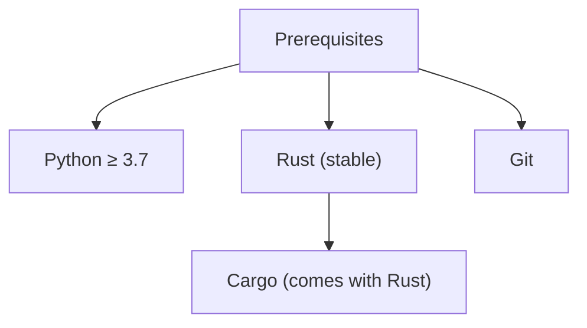
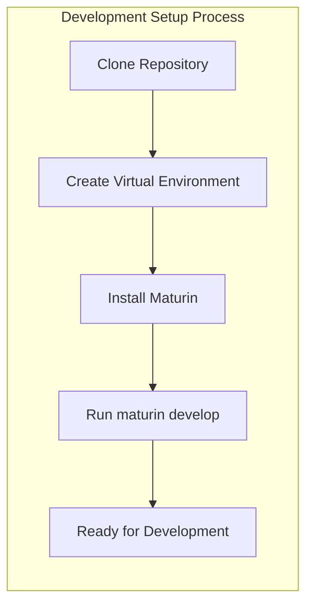
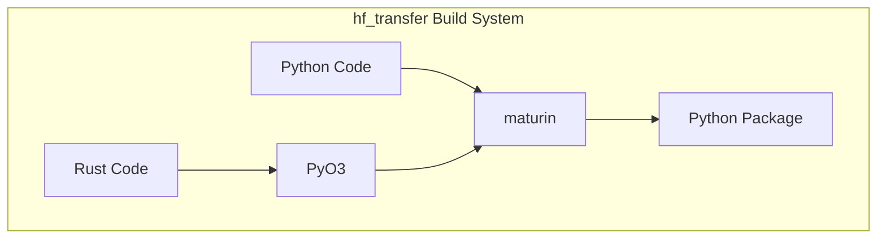
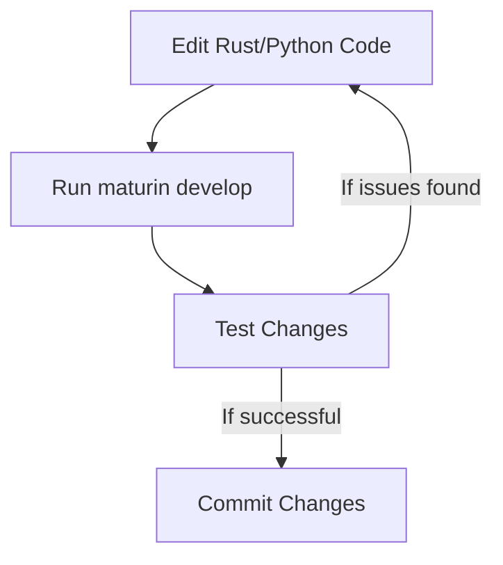
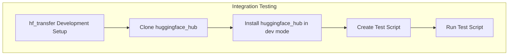
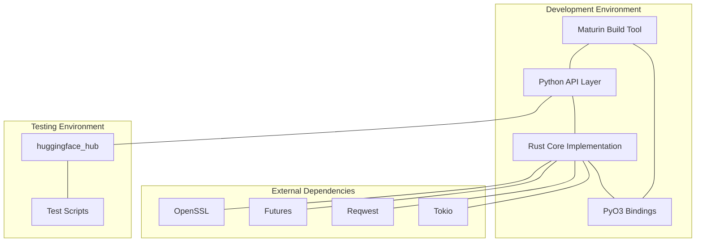

<!-- source: DeepWiki mcp.deepwiki.com · repo huggingface/hf_transfer · page 6.1 Setting Up Development Environment · fetched 2026-10-26 -->

# Setting Up Development Environment

<details>
<summary>Relevant source files</summary>

The following files were used as context for generating this wiki page:

- [README.md](README.md)
- [pyproject.toml](pyproject.toml)

</details>


This guide explains how to set up a development environment for working with the hf_transfer library. It covers the essential steps to get started with developing, building, and testing the library on your local machine. For information about the CI/CD pipeline or cross-platform build configurations, see [Building and Deployment](#5) and [Cross-Platform Support](#5.2).

## Prerequisites

Before setting up the development environment, ensure you have the following prerequisites installed:

- **Python**: Version 3.7 or later
- **Rust**: Latest stable version
- **Git**: For cloning the repository



Sources: [pyproject.toml:10-15]()

## Setting Up Basic Development Environment

Follow these steps to set up a basic development environment for hf_transfer:

1. **Clone the repository**:
   ```bash
   git clone https://github.com/huggingface/hf_transfer.git
   cd hf_transfer
   ```

2. **Create and activate a virtual environment**:
   ```bash
   python3 -m venv ~/.venv/hf_transfer
   source ~/.venv/hf_transfer/bin/activate  # On Windows: .\.venv\hf_transfer\Scripts\activate
   ```

3. **Install maturin**:
   ```bash
   pip install maturin>=1.4
   ```

4. **Develop the package**:
   ```bash
   maturin develop
   ```



Sources: [README.md:17-22](), [pyproject.toml:2-3]()

## Project Build System

hf_transfer uses Maturin as its build system, which bridges Rust and Python, allowing Rust code to be compiled into Python extensions.



The build system specified in the project configuration requires Maturin version 1.4 or higher (but less than 2). Maturin compiles the Rust code and packages it with the Python code to create a distributable package.

Sources: [pyproject.toml:1-4]()

## Development Workflow

After setting up your environment, the typical development workflow includes:

1. **Making changes** to Rust or Python code
2. **Rebuilding the package** with `maturin develop`
3. **Testing your changes**



When you run `maturin develop`, it:
1. Compiles the Rust code
2. Creates Python bindings using PyO3
3. Installs the package in development mode in your virtual environment

This allows you to immediately test any changes without having to reinstall the package.

Sources: [README.md:17-22]()

## Integration with huggingface_hub

For testing integration with the huggingface_hub library, follow these additional steps:

1. **Clone the huggingface_hub repository**:
   ```bash
   git clone https://github.com/huggingface/huggingface_hub.git
   cd huggingface_hub
   ```

2. **Install huggingface_hub in development mode**:
   ```bash
   python -m pip install -e ".[quality]"
   ```

3. **Create a test script** to verify the integration:
   ```python
   import os
   
   # Enable hf_transfer
   os.environ["HF_HUB_ENABLE_HF_TRANSFER"] = "1"
   
   from huggingface_hub import HfApi, logging
   
   logging.set_verbosity_debug()
   hf = HfApi()
   hf.upload_file(path_or_fileobj="/path/to/my/repo/some_file", 
                 path_in_repo="some_file", 
                 repo_id="my/repo", 
                 repo_type="model")
   ```



Sources: [README.md:24-49]()

## Project Architecture in Development Context

This diagram illustrates how the components relate during development:



During development, you'll primarily work with:

1. The **Rust Core Implementation** - Contains the high-performance file transfer logic
2. The **Python API Layer** - Provides Python bindings for the Rust implementation
3. **Maturin** - Builds and packages these components together

Sources: [pyproject.toml:1-15](), [README.md:17-49]()

## Development Tips

1. **Iterative Development**: After making changes to Rust code, always run `maturin develop` to rebuild and reinstall the package.

2. **Environment Variable Control**: When testing, you can enable hf_transfer in huggingface_hub by setting:
   ```bash
   export HF_HUB_ENABLE_HF_TRANSFER=1
   ```

3. **Debug Logging**: Enable debug logging to see detailed information about the transfer operations:
   ```python
   from huggingface_hub import logging
   logging.set_verbosity_debug()
   ```

4. **Virtual Environment Management**: Always ensure you're working in the correct virtual environment when switching between hf_transfer and huggingface_hub development.

Sources: [README.md:38-47]()

## Troubleshooting Common Setup Issues

| Issue | Possible Solution |
|-------|------------------|
| Rust compiler errors | Ensure you have the latest stable Rust version with `rustup update stable` |
| Missing Python headers | Install Python development packages (e.g., `python3-dev` on Ubuntu) |
| Maturin build failures | Check Maturin version is ≥1.4 and <2.0 |
| Import errors after installation | Verify the virtual environment is activated |
| OpenSSL-related errors | Install OpenSSL development packages |

Sources: [pyproject.toml:2-3]()

---

