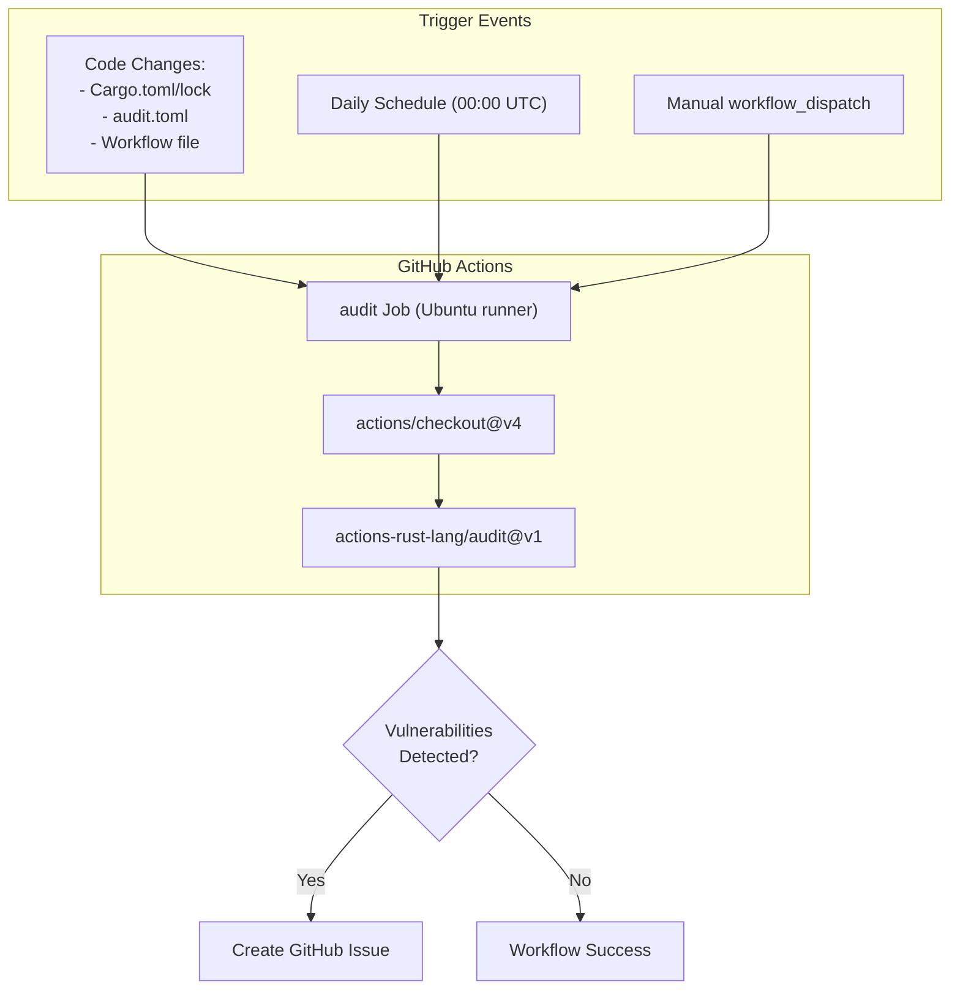
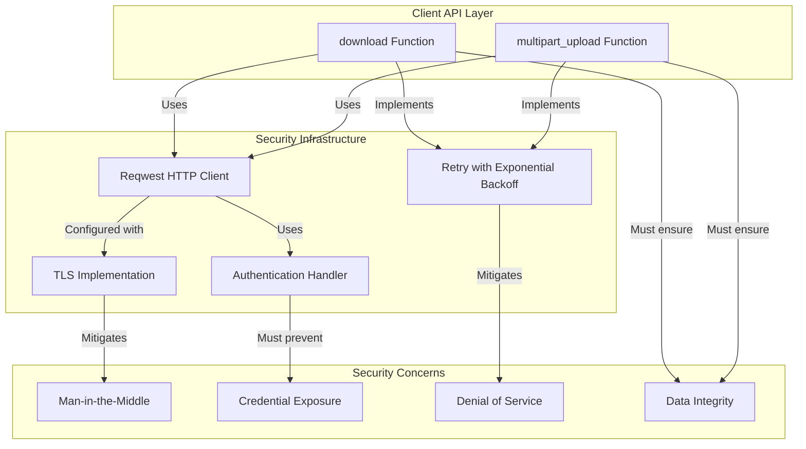
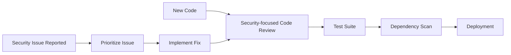

<!-- source: DeepWiki mcp.deepwiki.com · repo huggingface/hf_transfer · page 6.2 Security and Auditing · fetched 2026-10-26 -->

# Security and Auditing

Relevant source files

The following files were used as context for generating this wiki page:

- [.github/workflows/audit.yml](.github/workflows/audit.yml)

This document outlines the security auditing mechanisms and security practices implemented in the hf_transfer library. It covers automated dependency scanning, security considerations for developers, and guidelines for maintaining secure code. For information about testing methodology, see [Testing](#6.3).

## Automated Dependency Vulnerability Scanning

The hf_transfer project employs automated tools to continuously scan dependencies for known security vulnerabilities, helping to identify and address potential security issues promptly.

### Dependency Audit Workflow

The dependency audit is implemented as a GitHub Actions workflow in [.github/workflows/audit.yml:1-28](). This workflow automatically runs when:

- Changes are pushed to dependency files (`Cargo.toml`, `Cargo.lock`)
- The audit configuration (`audit.toml`) is updated
- The workflow file itself is modified
- The daily schedule runs at midnight UTC
- The workflow is manually triggered

The workflow uses the `actions-rust-lang/audit@v1` action to check Rust dependencies against the RustSec Advisory Database for known vulnerabilities.

Sources: [.github/workflows/audit.yml:1-28]()

### Audit Configuration

The audit process is customizable through an `audit.toml` configuration file, which allows:

- Ignoring specific advisories that are not applicable
- Setting severity thresholds
- Configuring audit tool behavior

## Security-Critical Components

As a file transfer library that interfaces with remote services, hf_transfer includes several security-critical components.

Sources: Based on system architecture overview

### Key Security Aspects

| Component | Security Considerations |
|-----------|-------------------------|
| **HTTP Client (Reqwest)** | Certificate validation, secure redirects, proper header handling |
| **Authentication** | Token management, secure transmission of credentials |
| **TLS Implementation** | Up-to-date TLS libraries, secure cipher preferences |
| **Error Handling** | Preventing sensitive information disclosure |
| **Retry Logic** | Implementing exponential backoff with jitter |

## Security Best Practices for Developers

When contributing to hf_transfer, developers should follow these security best practices:

### Code Development Practices

1. **Input Validation**: Validate all external inputs (URLs, file paths, etc.)
2. **Error Handling**: Handle errors without exposing sensitive information
3. **Dependency Management**: Evaluate new dependencies for security implications
4. **Code Reviews**: Address security considerations during code review

### Dependency Management

The following practices help maintain secure dependencies:

1. **Minimize Dependencies**: Keep the dependency tree as small as possible
2. **Regular Updates**: Keep dependencies updated to incorporate security fixes
3. **Audit Configuration**: Maintain `audit.toml` to document known issues and mitigations

## Reporting Security Vulnerabilities

If you discover a security vulnerability in hf_transfer:

1. **Do not disclose publicly** until the issue has been addressed
2. Report directly to the maintainers through appropriate channels
3. Provide detailed information to reproduce the issue
4. If possible, suggest mitigation strategies

## Security Considerations for Users

When using hf_transfer in your applications, consider these security practices:

| Practice | Description |
|----------|-------------|
| **Keep Updated** | Regularly update to incorporate security fixes |
| **Verify Downloads** | Implement integrity verification for critical downloads |
| **Secure Token Storage** | Store authentication tokens securely |
| **Secure Logging** | Ensure logs don't expose sensitive information |
| **Least Privilege** | Use tokens with minimal required permissions |

By following these practices, you can help ensure the security of systems using hf_transfer.

---

