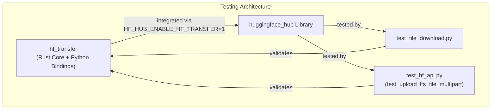
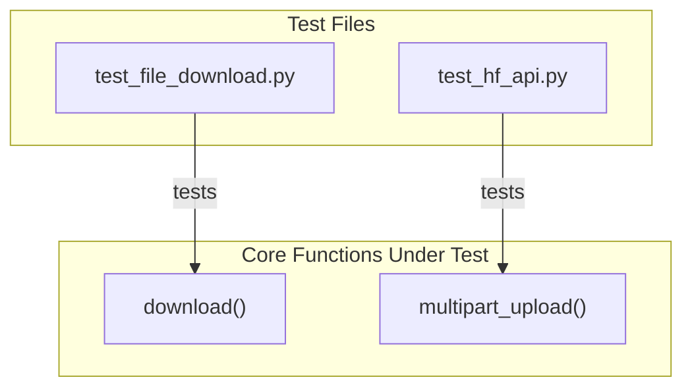
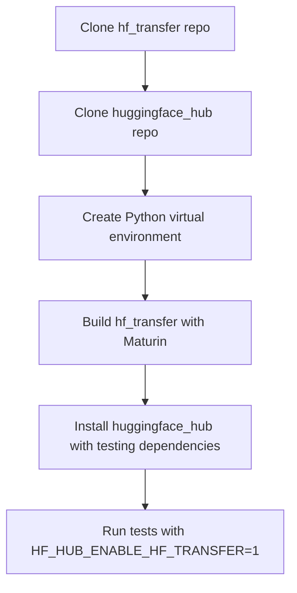
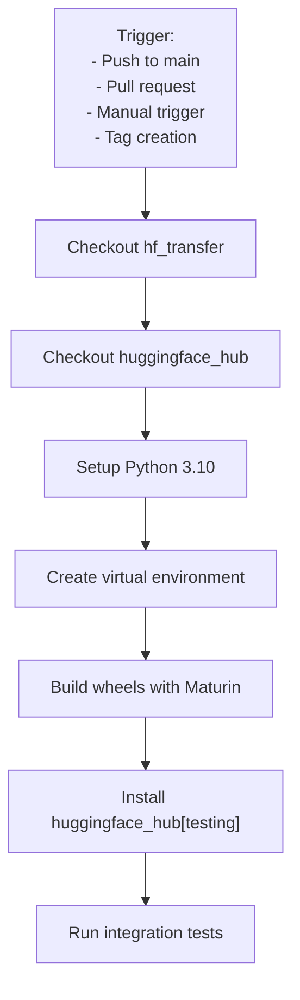

<!-- source: DeepWiki mcp.deepwiki.com · repo huggingface/hf_transfer · page 6.3 Testing · fetched 2026-10-26 -->

# Testing

<details>
<summary>Relevant source files</summary>

The following files were used as context for generating this wiki page:

- [.github/workflows/test.yml](.github/workflows/test.yml)

</details>


This document describes the testing methodology and procedures for hf_transfer. It outlines how the library is tested, primarily through integration with the huggingface_hub library. For information about setting up a development environment, see [Setting Up Development Environment](#6.1).

## Testing Approach

hf_transfer uses an integration-focused testing strategy. Rather than maintaining extensive unit tests within its own repository, it ensures functionality by testing the integration with the huggingface_hub library, which is its primary consumer.

### Testing Integration Architecture



This approach verifies that hf_transfer works correctly in its primary use case - as an accelerated file transfer backend for huggingface_hub operations.

Sources: [.github/workflows/test.yml:41-43]()

## Test Coverage

The integration tests focus on two main functionality areas:

1. **Download Functionality**: Tested via `test_file_download.py` in the huggingface_hub repository
2. **Multipart Upload Functionality**: Tested via the `test_upload_lfs_file_multipart` test in `test_hf_api.py`

| Test File | Test Name | Function Tested | Description |
|-----------|-----------|----------------|-------------|
| test_file_download.py | All tests | download() | Tests file downloads from Hugging Face Hub |
| test_hf_api.py | test_upload_lfs_file_multipart | multipart_upload() | Tests multipart upload for LFS files |

### Core Functions and Test Files Relationship



Sources: [.github/workflows/test.yml:41-43]()

## Testing Environment Setup

To run the tests, you need both the hf_transfer and huggingface_hub repositories with their dependencies.

### Environment Requirements

- Python 3.10 or later
- Rust toolchain (for building hf_transfer)
- Maturin (for building the Python extension)
- pytest (for running the tests)

### Local Testing Setup Process



Sources: [.github/workflows/test.yml:18-39]()

## Running Tests Locally

To run the tests locally, follow these steps:

1. **Clone both repositories**:
   ```bash
   git clone https://github.com/huggingface/hf_transfer
   git clone https://github.com/huggingface/huggingface_hub
   ```

2. **Set up a virtual environment**:
   ```bash
   cd hf_transfer
   python -m venv .venv
   source .venv/bin/activate  # On Windows: .venv\Scripts\activate
   ```

3. **Build hf_transfer**:
   ```bash
   maturin develop
   ```

4. **Install huggingface_hub with testing dependencies**:
   ```bash
   pip install -e '../huggingface_hub[testing]'
   ```

5. **Run the tests**:
   ```bash
   HF_HUB_ENABLE_HF_TRANSFER=1 pytest ../huggingface_hub/tests/test_file_download.py
   HF_HUB_ENABLE_HF_TRANSFER=1 pytest ../huggingface_hub/tests/test_hf_api.py -k 'test_upload_lfs_file_multipart'
   ```

Sources: [.github/workflows/test.yml:18-43]()

## Continuous Integration

hf_transfer uses GitHub Actions for continuous integration testing. The test workflow is defined in `.github/workflows/test.yml`.

### CI Workflow Process



The CI system runs the same tests as the local development process but in an automated environment to ensure consistency and detect regressions early. It uses sccache to speed up the build process.

### Test Triggers

Tests automatically run on:
- Push to the main branch
- Pull requests
- Manual workflow dispatch
- Tag creation (for releases)

This ensures that code changes are tested before merging and that releases are properly validated.

Sources: [.github/workflows/test.yml:1-44]()

---

