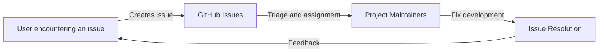
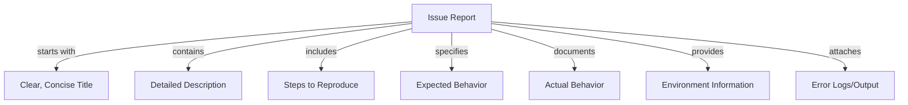
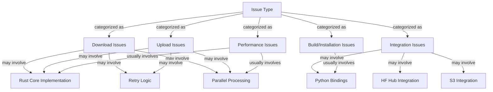
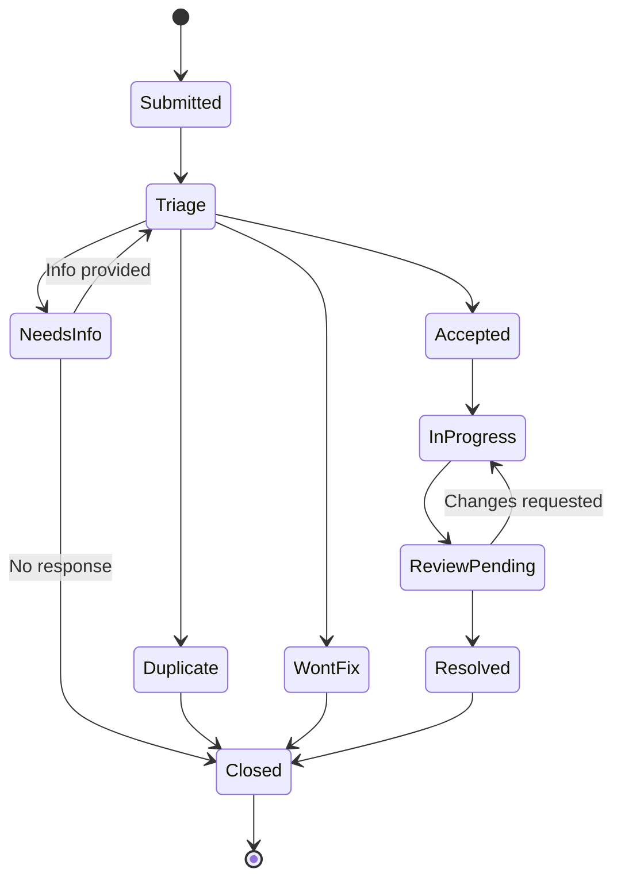

<!-- source: DeepWiki mcp.deepwiki.com · repo huggingface/hf_transfer · page 6.4 Issue Reporting · fetched 2026-10-26 -->

# Issue Reporting

Relevant source files

The following files were used as context for generating this wiki page:

- [.github/ISSUE_TEMPLATE/config.yml](.github/ISSUE_TEMPLATE/config.yml)

This document provides comprehensive guidelines for reporting issues encountered with hf_transfer. Proper issue reporting is crucial for the continuous improvement and stability of the library. For information about testing procedures, see [Testing](#6.3), and for development environment setup, see [Setting Up Development Environment](#6.1).

## Issue Reporting Channels

The primary channel for reporting issues with hf_transfer is through GitHub Issues. This centralized approach ensures that all issues are tracked, prioritized, and addressed systematically.

Sources: `.github/ISSUE_TEMPLATE/config.yml`

## Issue Reporting Guidelines

When reporting an issue with hf_transfer, please follow these guidelines to ensure your report is clear, actionable, and can be addressed efficiently.

### Issue Structure

A well-structured issue contains the following components:

Sources: `.github/ISSUE_TEMPLATE/config.yml`

### Essential Information to Include

| Component | Description | Why It's Important |
|-----------|-------------|-------------------|
| Version | The version of hf_transfer you're using | Issues may be version-specific or already fixed in newer releases |
| Operating System | Your OS and version | Some issues are platform-specific |
| Python Version | Your Python version | Compatibility issues may be Python version-dependent |
| Rust Environment | If relevant, your Rust environment details | For build-related issues |
| Reproduction Steps | Clear step-by-step instructions to reproduce the issue | Allows maintainers to verify and diagnose the problem |
| Error Messages | Complete error output, traceback, or logs | Provides crucial diagnostic information |
| Expected vs. Actual Behavior | What you expected to happen and what actually happened | Clarifies the nature of the issue |

## Specific Guidelines for hf_transfer Issues

Due to the specialized nature of hf_transfer as a high-performance file transfer library, different types of issues require different information.

### Reporting Download Issues

For issues related to the download functionality:

1. Specify the URL you were trying to download from
2. Include the download parameters used
3. Note any retry behavior observed
4. Include network environment details (bandwidth, firewall settings, proxy configuration)
5. Specify if the issue occurs with all files or only specific ones
6. Include any error messages or tracebacks

### Reporting Upload Issues

For issues related to the multipart upload functionality:

1. Specify the upload target (Hugging Face Hub, S3, etc.)
2. Include the upload parameters used
3. File details (size, format, etc.)
4. Note whether the issue occurs consistently or intermittently
5. Include any authentication errors if applicable
6. Specify chunk-related issues if relevant

### System Component Relationship

When reporting issues, it's helpful to understand which component of the system might be affected:

## Issue Lifecycle

Understanding the lifecycle of an issue can help set expectations for the resolution process:

1. **Submitted**: Issue is initially created
2. **Triage**: Maintainers evaluate the issue
3. **Needs Info**: Additional information is required from the reporter
4. **Duplicate**: Issue is a duplicate of an existing one
5. **Won't Fix**: Issue is acknowledged but won't be addressed (with explanation)
6. **Accepted**: Issue is valid and will be worked on
7. **In Progress**: Development is actively working on a fix
8. **Review Pending**: A fix is proposed and awaiting review
9. **Resolved**: Issue is fixed in the codebase
10. **Closed**: Issue is formally closed

## Contributing Beyond Issues

If you're interested in contributing to hf_transfer beyond reporting issues, consider:

1. **Pull Requests**: Implementing fixes or features yourself
2. **Documentation Improvements**: Enhancing the project documentation
3. **Testing**: Adding test cases, especially for edge cases
4. **Examples**: Creating example code that showcases the library's capabilities

For more detailed information on contributing, please refer to the project's contribution guidelines on GitHub.

## Best Practices for Effective Issue Resolution

| Practice | Description |
|----------|-------------|
| One Issue Per Report | Keep each issue report focused on a single problem |
| Search Before Submitting | Check if the issue has already been reported |
| Be Responsive | Respond to requests for additional information |
| Tags and Labels | Use appropriate tags/labels if available |
| Code Examples | Provide minimal, complete, and verifiable examples |
| Screenshots/Videos | Include visual evidence for UI or behavior issues when relevant |
| Patience | Complex issues may take time to diagnose and resolve |

Following these guidelines will help the maintainers address issues efficiently and improve the overall quality of hf_transfer for all users.

---

