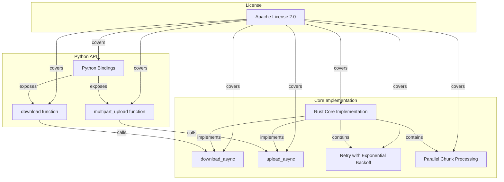
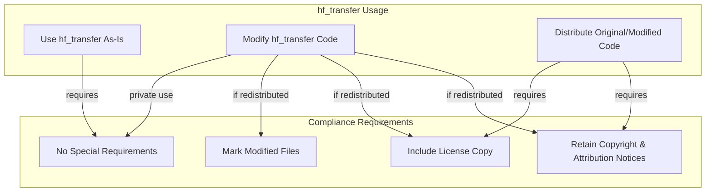
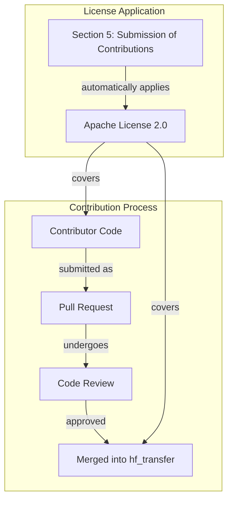
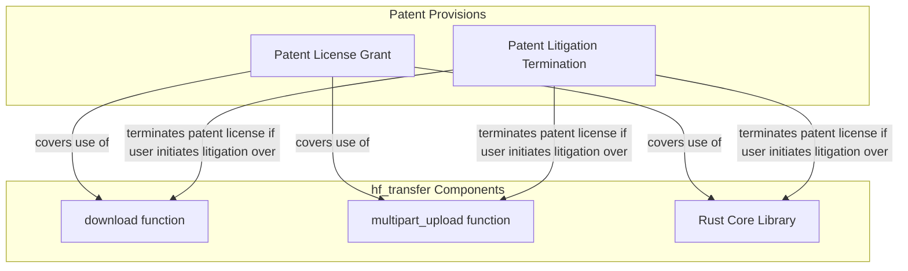

<!-- source: DeepWiki mcp.deepwiki.com · repo huggingface/hf_transfer · page 7 License · fetched 2026-10-26 -->

# License

Relevant source files

The following files were used as context for generating this wiki page:

- [LICENSE](LICENSE)

This document outlines the licensing terms for the hf_transfer library, detailing how the software can be legally used, modified, and distributed.

## License Overview

The hf_transfer project is licensed under the Apache License, Version 2.0 (Apache-2.0), a permissive open-source license that balances freedom of use with appropriate protections for contributors.

Sources: [LICENSE:1-5]()

## License Details

The Apache License 2.0 was implemented with copyright notice assigned to HuggingFace Inc. from 2023. The complete license text is available in the LICENSE file at the repository root.

### Key License Provisions

| Provision | Description |
|-----------|-------------|
| Copyright License | Grants permission to use, reproduce, modify, distribute the code |
| Patent License | Provides express patent grant for patents covering the contributed code |
| Redistribution Requirements | Mandates inclusion of license copy, retention of notices, and marking of changes |
| Warranty Disclaimers | Software provided "AS IS" without warranties |
| Liability Limitations | Contributors not liable for damages arising from software use |

Sources: [LICENSE:66-71](), [LICENSE:73-87](), [LICENSE:89-128](), [LICENSE:143-163]()

## License Application to Code Components

The following diagram illustrates how the Apache License 2.0 applies to the various components of the hf_transfer library:

Sources: [LICENSE:1-201]()

## License Compliance Requirements

The following diagram illustrates the compliance requirements when using, modifying, or distributing hf_transfer:

Sources: [LICENSE:89-128]()

## Integration with External Projects

The Apache License 2.0 is compatible with many other open-source licenses, facilitating integration of hf_transfer with other projects:

| Integration Type | Compatibility |
|------------------|---------------|
| Use in Commercial Products | Fully compatible |
| Use in Open-Source Projects | Compatible with many open-source licenses |
| Use in Proprietary Software | Allowed with proper attribution |
| Sublicensing | Allowed, original license must be included |
| Modifications | Allowed, must be marked if distributed |

Sources: [LICENSE:66-71](), [LICENSE:89-128]()

## Contribution License Terms

All contributions to hf_transfer are automatically covered by the same Apache License 2.0 terms, ensuring license consistency throughout the codebase.

Sources: [LICENSE:130-136]()

## Patent Protection Mechanism

The Apache License 2.0 includes specific patent provisions that both grant patent rights and protect contributors through a litigation termination clause:

Sources: [LICENSE:73-87]()

## Warranty and Liability Disclaimers

The hf_transfer library is provided "AS IS" without warranties. This standard disclaimer protects contributors from liability while encouraging open-source contribution.

| Aspect | Disclaimer |
|--------|------------|
| Warranties | None provided; software offered "AS IS" |
| Fitness for Purpose | No guarantee of suitability for any particular use |
| Liability | Contributors not liable for damages arising from software use |
| Support | No obligation to provide support or maintenance |

Sources: [LICENSE:143-163]()

## Trademark Usage Limitations

The Apache License 2.0 does not grant permission to use contributors' trademarks except for describing the origin of the work and reproducing NOTICE file contents.

Sources: [LICENSE:138-141]()

## Additional License Information

The Apache License 2.0 was selected for hf_transfer to provide maximum flexibility for users while maintaining appropriate protections for contributors. This license facilitates broad adoption in both commercial and open-source ecosystems.

Sources: [LICENSE:1-201]()