# Page: Overview

# Overview

<details>
<summary>Relevant source files</summary>

The following files were used as context for generating this wiki page:

- [README.md](README.md)
- [pyproject.toml](pyproject.toml)
- [src/lib.rs](src/lib.rs)

</details>


HF Transfer is a high-performance file transfer library designed to speed up downloads from and uploads to the Hugging Face Hub. It provides a Rust implementation with Python bindings that enables parallel, chunked file transfers capable of reaching transfer speeds beyond 500MB/s on high-bandwidth networks where pure Python implementations cannot fully utilize available bandwidth.

This document provides an introduction to the HF Transfer library, its key capabilities, and intended use cases. For detailed information about the architecture, refer to [Architecture](#2). For API documentation, see [Core API](#3).

## Purpose and Scope

HF Transfer addresses performance bottlenecks in file transfers by:

1. Implementing core transfer functionality in Rust for significantly better performance
2. Using parallel chunked downloading and uploading to maximize throughput
3. Providing robust retry mechanisms with exponential backoff and jitter for reliability
4. Integrating with the huggingface_hub Python library for seamless usage

The library is explicitly designed as a "power user tool" for achieving maximum transfer speeds rather than as a general-purpose utility. It intentionally omits features like progress bars in favor of performance optimization.

Sources: [pyproject.toml:5-10](), [README.md:1-11]()

## Core Components

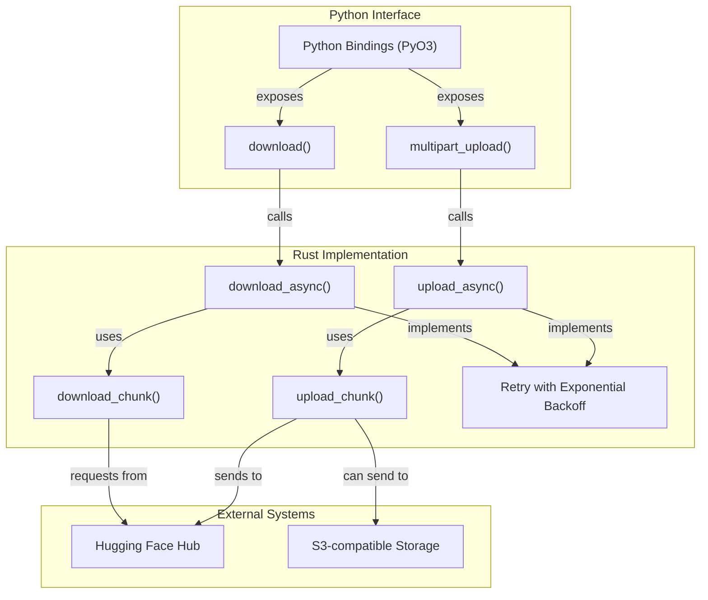

HF Transfer consists of two primary functions:

1. **download**: Downloads files in parallel chunks with configurable parameters
2. **multipart_upload**: Uploads files using the S3 multipart upload protocol

These Python-facing functions are implemented as wrappers around Rust async functions that handle the actual transfer mechanics.

Sources: [src/lib.rs:33-140](), [src/lib.rs:484-491]()

## Parallel Transfer Process

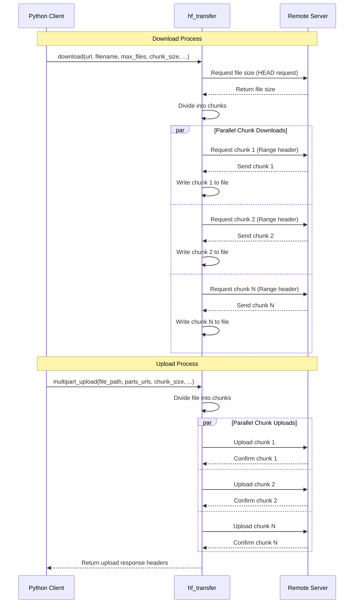

This diagram illustrates how HF Transfer achieves high performance through parallel processing. Files are divided into chunks that are downloaded or uploaded concurrently, with the maximum concurrency controlled by parameters.

Sources: [src/lib.rs:150-295](), [src/lib.rs:363-450]()

## Key Features

### Parallel Chunked Transfers

HF Transfer breaks down file transfers into chunks and processes them concurrently:

| Parameter | Description |
|-----------|-------------|
| `max_files` | Controls the maximum number of parallel chunk transfers |
| `chunk_size` | Determines the size of each chunk |
| `parallel_failures` | Sets the maximum number of chunks that can be retrying simultaneously |
| `max_retries` | Defines the maximum number of retry attempts per chunk |

Sources: [src/lib.rs:33-47](), [src/lib.rs:90-103]()

### Robust Error Handling

The library implements sophisticated error handling with:

- Exponential backoff retry mechanism with jitter
- Configurable maximum retries per chunk
- Parallel failure limiting to prevent request flooding

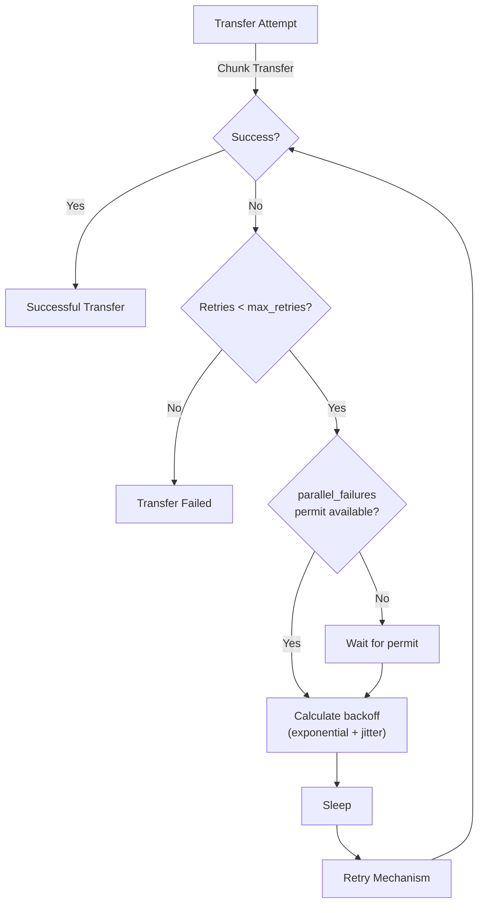

Sources: [src/lib.rs:26-28](), [src/lib.rs:142-148](), [src/lib.rs:249-272]()

## Integration with huggingface_hub

HF Transfer is designed to work seamlessly with the huggingface_hub Python library. When enabled through the `HF_HUB_ENABLE_HF_TRANSFER` environment variable, the huggingface_hub library will use HF Transfer for file downloads and uploads, significantly improving performance.

```
# Example activation
export HF_HUB_ENABLE_HF_TRANSFER=1
```

Sources: [README.md:24-49]()

## Performance Considerations

HF Transfer is specifically designed for high-bandwidth scenarios where Python's threading and GIL limitations prevent fully utilizing available network capacity. By implementing the transfer logic in Rust, it can achieve speeds exceeding 500MB/s on suitable networks.

Key performance factors:

- Network bandwidth and latency
- Storage write/read speed
- Optimal chunk size and concurrency settings

Sources: [README.md:5-11]()

## Limitations

As noted in the project documentation, HF Transfer is:

- A power user tool, not a general-purpose utility
- Lacks features like progress bars (though callback functions are supported)
- Primarily focused on performance rather than user experience

Sources: [README.md:5-13]()

---

# Page: Architecture

# Architecture

<details>
<summary>Relevant source files</summary>

The following files were used as context for generating this wiki page:

- [Cargo.toml](Cargo.toml)
- [pyproject.toml](pyproject.toml)
- [src/lib.rs](src/lib.rs)

</details>


This document describes the high-level architecture of `hf_transfer`, explaining how the system is designed to enable high-performance file transfers between clients and the Hugging Face Hub or S3-compatible storage. For information about the specific API functions and their usage, see [Core API](#3). For details on integration with the huggingface_hub library, see [Integration with huggingface_hub](#4.1).

## System Overview

`hf_transfer` uses a hybrid language architecture that combines the performance advantages of Rust with the accessibility and ecosystem integration of Python. The system leverages Rust's strong concurrency model and memory safety features to efficiently handle parallelized file transfers, while providing a straightforward Python API for ease of use.

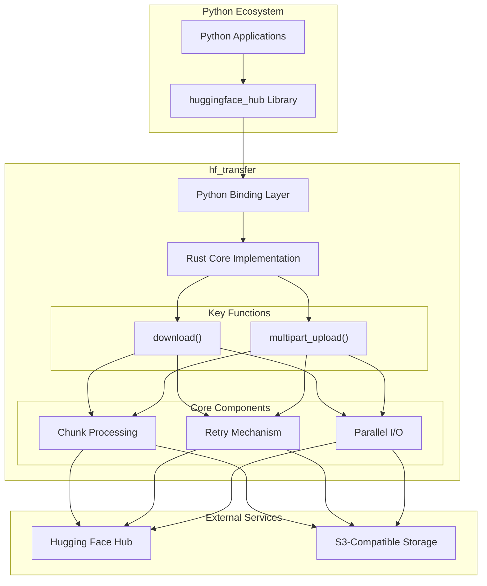

Sources: [src/lib.rs:26-491](). [Cargo.toml:1-19]().

## Rust-Python Integration

The integration between Python and Rust is handled through PyO3, a Rust library that provides bindings to the Python interpreter. This allows `hf_transfer` to expose its high-performance Rust functions directly to Python.

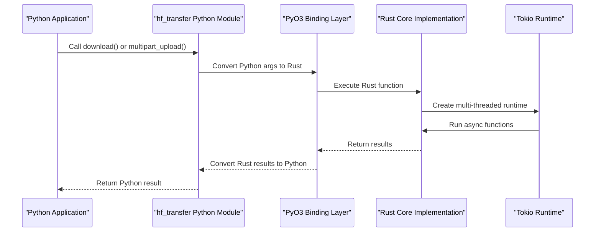

The system exposes two primary functions to Python:

1. `download`: For downloading files from remote sources
2. `multipart_upload`: For uploading files to remote destinations using the S3 multipart upload approach

These functions are defined in the Rust code and exposed through PyO3's `#[pyfunction]` attribute. The Python module initialization happens in the `#[pymodule]` section.

Sources: [src/lib.rs:35-88](). [src/lib.rs:90-140](). [src/lib.rs:484-491]().

## Core Architecture Components

The core architecture consists of several key components that work together to provide high-performance file transfers:

### 1. Tokio Runtime

`hf_transfer` uses Tokio, an asynchronous runtime for Rust, to handle concurrent operations efficiently. The system creates a multi-threaded Tokio runtime to process file chunks in parallel:

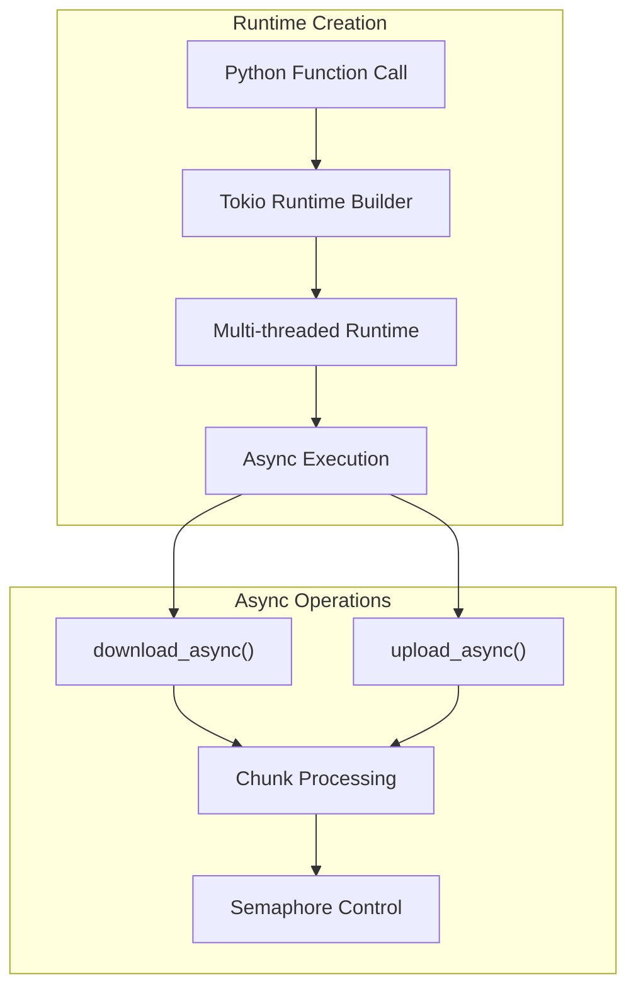

The number of worker threads in the Tokio runtime can be configured via the `TOKIO_WORKER_THREADS` environment variable, allowing users to optimize performance for their specific hardware.

Sources: [src/lib.rs:59-62](). [src/lib.rs:125-128](). [Cargo.toml:17-18]().

### 2. Chunking Mechanism

Both download and upload operations split files into chunks that can be processed in parallel:

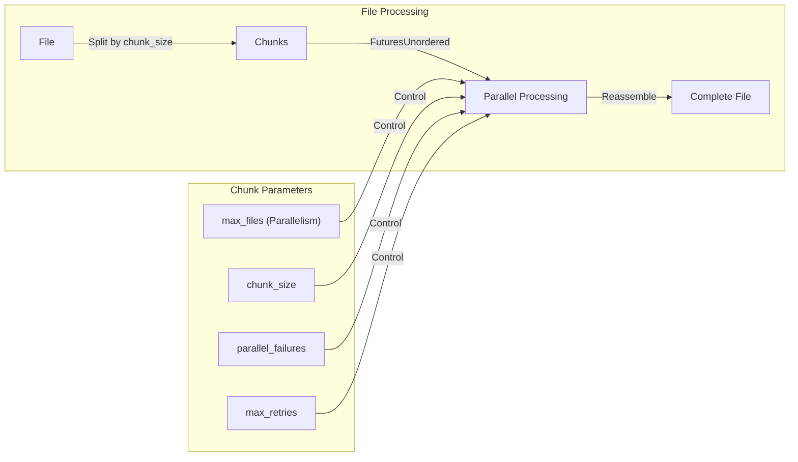

For downloads:
- The system first determines the file size by making a range request
- It then divides the file into chunks of specified size
- Each chunk is downloaded in parallel, with limits on concurrent operations

For uploads:
- The file is divided into chunks based on the specified chunk size
- Each chunk is uploaded independently in parallel
- The system collects and returns response headers from each upload operation

Sources: [src/lib.rs:230-235](). [src/lib.rs:341-361](). [src/lib.rs:375-382](). [src/lib.rs:452-482]().

### 3. Concurrency Control

The system uses Tokio's `Semaphore` to limit the number of concurrent operations, ensuring that system resources are not overwhelmed:


- The `max_files` parameter determines the maximum number of concurrent operations
- A separate semaphore controls the number of concurrent failures (`parallel_failures`)
- The `FuturesUnordered` collection manages the asynchronous task execution

Sources: [src/lib.rs:230-233](). [src/lib.rs:243-247](). [src/lib.rs:375-377](). [src/lib.rs:388-392]().

### 4. Retry Mechanism

`hf_transfer` implements an exponential backoff retry mechanism with jitter to handle transient failures:

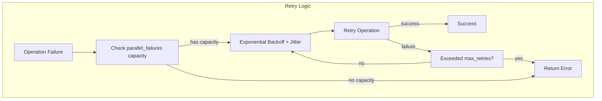

Key components of the retry mechanism:
- Base wait time starts at 300ms
- Maximum wait time is 10,000ms (10 seconds)
- Random jitter (0-500ms) is added to prevent thundering herd problems
- Wait time increases quadratically with retry attempt count

Sources: [src/lib.rs:26-27](). [src/lib.rs:142-148](). [src/lib.rs:249-272](). [src/lib.rs:394-417]().

### 5. Error Handling

The system provides comprehensive error handling through a custom `Error` enum:

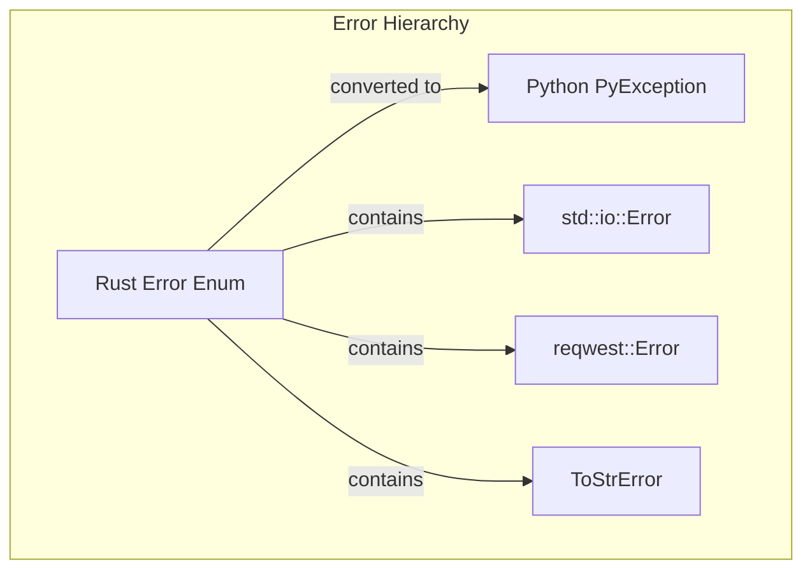

- I/O errors from file operations
- Request errors from HTTP operations
- String conversion errors from header processing
- All errors are ultimately converted to Python exceptions

Sources: [src/lib.rs:297-332](). [src/lib.rs:418-424]().

## Key Dependencies

The architecture relies on several critical dependencies:

| Dependency | Version | Purpose |
|------------|---------|---------|
| pyo3 | 0.23 | Python bindings for Rust code |
| reqwest | 0.12 | HTTP client for making web requests |
| tokio | 1.42 | Asynchronous runtime for concurrent operations |
| futures | 0.3 | Abstractions for asynchronous programming |
| tokio-util | 0.7 | Utilities for Tokio runtime |
| openssl | 0.10 | SSL/TLS implementation (with vendored feature) |
| rand | 0.8.5 | Random number generation for jitter |

Sources: [Cargo.toml:11-18](). [pyproject.toml:1-20]().

## Data Flow

The following diagram illustrates the data flow during file transfer operations:

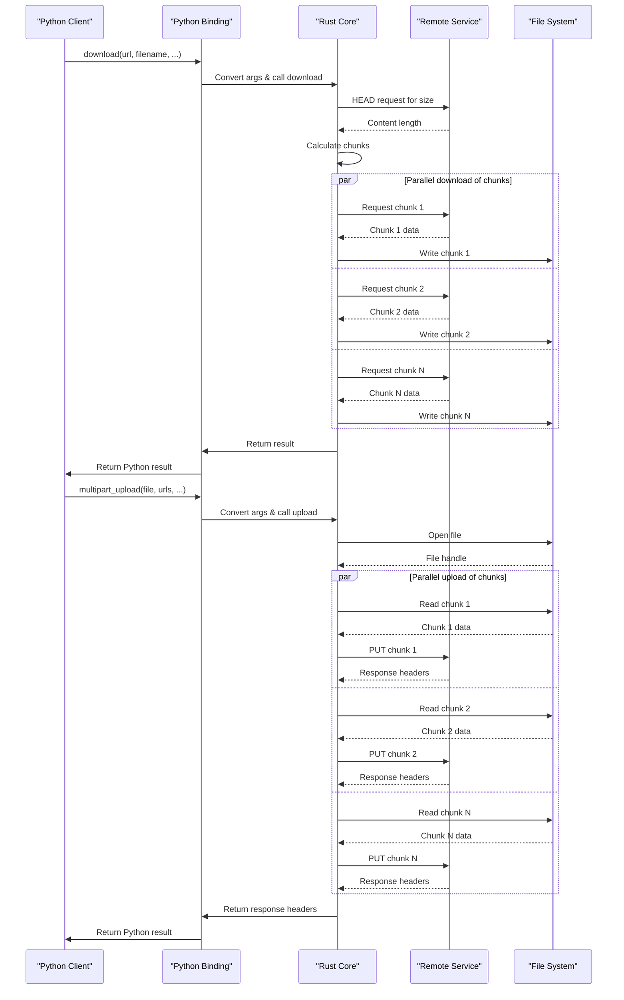

Sources: [src/lib.rs:151-294](). [src/lib.rs:364-450]().

## Summary

The `hf_transfer` architecture combines the performance benefits of Rust with the accessibility of Python to provide an efficient and robust file transfer system. By leveraging parallel processing, chunking, and sophisticated retry mechanisms, it achieves high-performance downloads and uploads while maintaining resilience to transient failures. The system's modular design allows it to be integrated with both the Hugging Face Hub and S3-compatible storage services, making it versatile for various machine learning and data processing workflows.

Sources: [src/lib.rs:1-491](). [Cargo.toml:1-19](). [pyproject.toml:1-20]().

---

# Page: Core Components

# Core Components

<details>
<summary>Relevant source files</summary>

The following files were used as context for generating this wiki page:

- [Cargo.lock](Cargo.lock)
- [Cargo.toml](Cargo.toml)
- [src/lib.rs](src/lib.rs)

</details>


This document details the main components of the hf_transfer system and how they work together to provide high-performance file transfers. For information about the overall system architecture, see [Architecture](#2). For details about the API functions and their usage, see [Core API](#3).

## Component Overview

hf_transfer consists of several interacting components that enable parallel, efficient, and resilient file transfers. At its core, it uses a Rust implementation with Python bindings provided through PyO3.

### Main Components Diagram

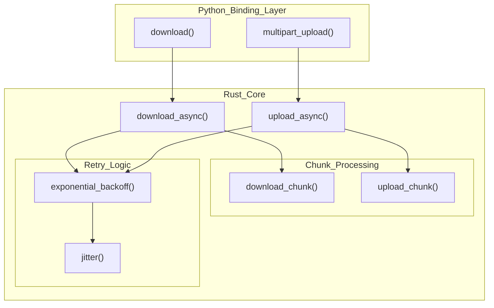

Sources: [src/lib.rs:36-88](), [src/lib.rs:102-140](), [src/lib.rs:151-295](), [src/lib.rs:364-450]()

## Python Binding Layer

The Python binding layer exposes two main functions to Python applications:

1. **`download()`**: Transfers files from a remote URL to a local file system
2. **`multipart_upload()`**: Uploads files in chunks to remote destinations (particularly useful for S3-compatible storage)

These functions are implemented using PyO3's `#[pyfunction]` macro and registered in the Python module through the `#[pymodule]` macro. They serve as entry points that validate parameters and launch the Rust implementation.

```
download(url, filename, max_files, chunk_size, parallel_failures, max_retries, headers, callback)
multipart_upload(file_path, parts_urls, chunk_size, max_files, parallel_failures, max_retries, callback)
```

Sources: [src/lib.rs:36-88](), [src/lib.rs:102-140](), [src/lib.rs:484-491]()

## Rust Core Implementation

The Rust core handles the actual transfer operations and consists of several key components:

### Asynchronous Functions

Two main asynchronous functions drive the transfer operations:

1. **`download_async()`**: Manages the parallel download of file chunks
2. **`upload_async()`**: Handles the parallel upload of file chunks

Both functions create a multi-threaded Tokio runtime for executing asynchronous tasks.

Sources: [src/lib.rs:151-295](), [src/lib.rs:364-450]()

### Chunk Processing

Files are split into chunks for parallel processing:

1. **`download_chunk()`**: Downloads a specific byte range of a file
2. **`upload_chunk()`**: Uploads a specific chunk of a file

This chunking approach is central to hf_transfer's performance, allowing multiple parts of a file to be transferred simultaneously.

Sources: [src/lib.rs:334-361](), [src/lib.rs:452-482]()

### Parallel Execution Flow

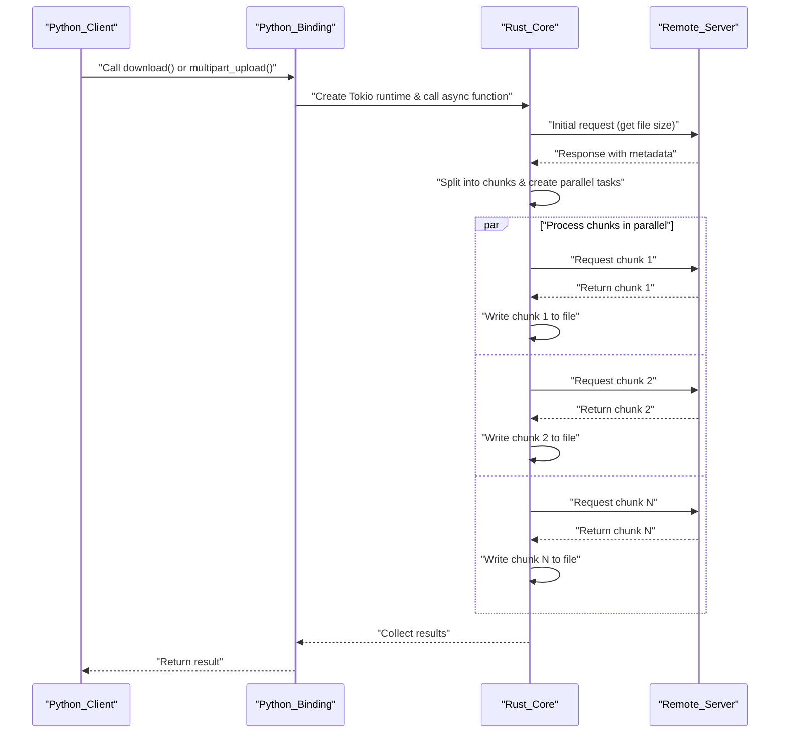

Sources: [src/lib.rs:151-295](), [src/lib.rs:364-450]()

### Concurrency Control

hf_transfer uses several mechanisms to control concurrency:

1. **`FuturesUnordered`**: Manages a collection of concurrent tasks
2. **`Semaphore`**: Limits the number of concurrent operations to avoid overwhelming system resources
3. **Parallel failures semaphore**: Separately controls the number of chunks that can be in a failed/retrying state at once

Example from download_async:
```
let semaphore = Arc::new(Semaphore::new(max_files));
let parallel_failures_semaphore = Arc::new(Semaphore::new(parallel_failures));
```

Sources: [src/lib.rs:230-232](), [src/lib.rs:375-377]()

## Error Handling and Retry Mechanism

A robust error handling and retry system improves reliability for spotty network connections.

### Custom Error Types

The library defines a custom `Error` enum with variants:
- `Error::Io`: For file I/O errors
- `Error::Request`: For HTTP request errors 
- `Error::ToStrError`: For header parsing errors

Sources: [src/lib.rs:297-332]()

### Retry Logic

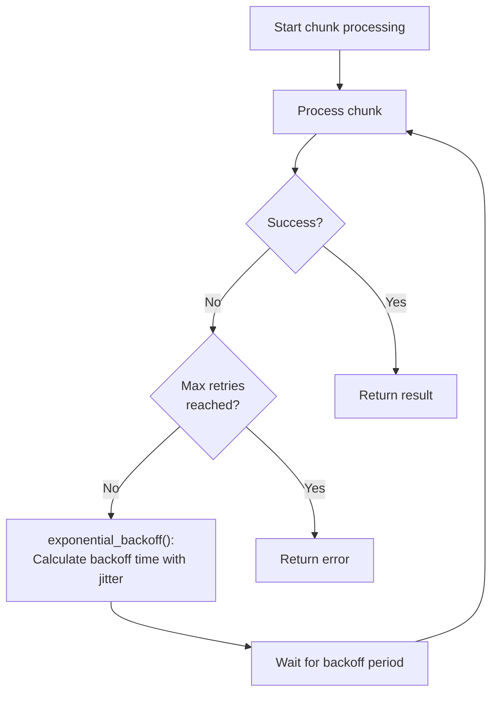

The retry mechanism employs:

1. **`exponential_backoff()`**: Calculates delay time using the formula `(base_wait_time + n^2 + jitter())` with a max cap of 10,000ms
2. **`jitter()`**: Adds random variation (0-500ms) to avoid synchronized retries

Constants:
- `BASE_WAIT_TIME`: 300ms
- `MAX_WAIT_TIME`: 10,000ms

Sources: [src/lib.rs:26-27](), [src/lib.rs:142-148](), [src/lib.rs:248-270](), [src/lib.rs:395-416]()

## Component Interactions

The following diagram illustrates how components interact during file transfers:

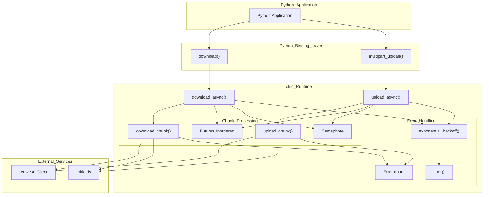

Sources: [src/lib.rs:151-295](), [src/lib.rs:364-450]()

## Key Dependencies

The system relies on several critical dependencies to provide its functionality:

| Dependency | Purpose |
|------------|---------|
| `futures` | Provides asynchronous programming primitives including `FuturesUnordered` |
| `openssl` | Enables secure network connections with vendored compilation |
| `pyo3` | Creates Python bindings for the Rust code |
| `rand` | Generates random numbers for jitter in the retry mechanism |
| `reqwest` | HTTP client for making network requests with streaming support |
| `tokio` | Asynchronous runtime with multi-threading, file system access |
| `tokio-util` | Additional utilities for Tokio, specifically the `codec` module |

Sources: [Cargo.toml:11-18]()

## Performance Considerations

Several design choices contribute to hf_transfer's performance:

1. **Parallel transfers**: Multiple chunks are transferred simultaneously, limited by `max_files`
2. **Configurable chunk size**: Optimizes for different network conditions and file sizes
3. **Tokio worker threads**: The number of threads can be configured via the `TOKIO_WORKER_THREADS` environment variable
4. **HTTP/2 keep-alive**: Configured to maintain connections for 15 seconds to improve performance with multiple requests
5. **Minimal copying**: Uses streaming operations where possible to minimize memory usage

Sources: [src/lib.rs:161-164](), [src/lib.rs:33-34]()

---

# Page: Dependency Structure

# Dependency Structure

<details>
<summary>Relevant source files</summary>

The following files were used as context for generating this wiki page:

- [Cargo.lock](Cargo.lock)
- [Cargo.toml](Cargo.toml)
- [pyproject.toml](pyproject.toml)

</details>


This page documents the key dependencies of the hf_transfer library and how they support the system's core functionality. It explains the relationship between Rust and Python dependencies and their roles in enabling high-performance file transfers.

For information about the high-level architecture of hf_transfer, see [Architecture](#2). For implementation details of specific functions, see [Core API](#3).

## Overview of Dependency Categories

The hf_transfer library relies on a carefully selected set of dependencies to implement its functionality. These dependencies can be categorized into three main groups:

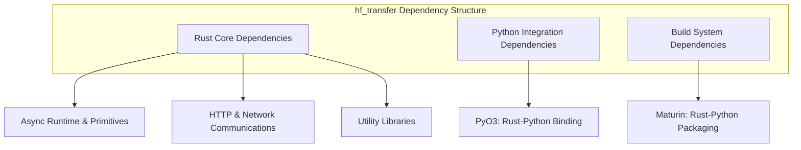

Sources: [Cargo.toml:11-18](), [pyproject.toml:1-4]()

## Rust Core Dependencies

The core functionality of hf_transfer is built with Rust, leveraging several key libraries to achieve high-performance, concurrent file transfers.

### Asynchronous Runtime and Primitives

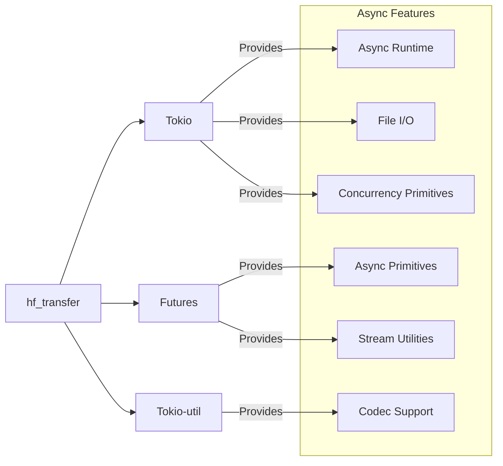

The asynchronous capabilities of hf_transfer depend on these critical libraries:

| Dependency | Version | Features | Purpose |
|------------|---------|----------|---------|
| **tokio** | 1.42 | rt, rt-multi-thread, fs | Asynchronous runtime enabling concurrent operations and file I/O |
| **futures** | 0.3 | - | Abstractions for writing asynchronous code |
| **tokio-util** | 0.7 | codec | Additional utilities for working with tokio |

Tokio provides the async runtime that powers hf_transfer's concurrent download and upload capabilities. The `rt-multi-thread` feature enables the library to efficiently utilize multiple CPU cores for parallel processing.

Sources: [Cargo.toml:12-13](), [Cargo.toml:17-18]()

### HTTP and Network Communications

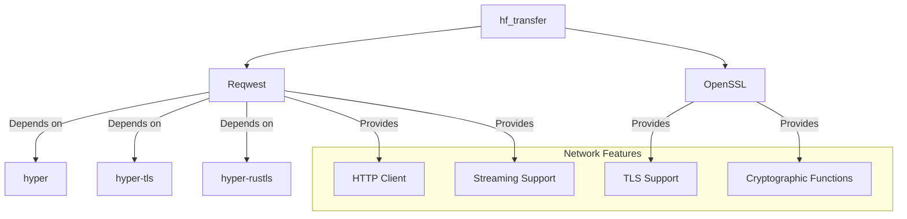

Network communication is a core aspect of file transfers, and hf_transfer uses these dependencies:

| Dependency | Version | Features | Purpose |
|------------|---------|----------|---------|
| **reqwest** | 0.12 | stream | High-level HTTP client with support for streaming transfers |
| **openssl** | 0.10 | vendored | TLS/SSL implementation for secure connections |

The `stream` feature of reqwest is particularly important as it enables efficient processing of large file transfers without loading the entire file into memory.

Sources: [Cargo.toml:14-16]()

### Utility Libraries

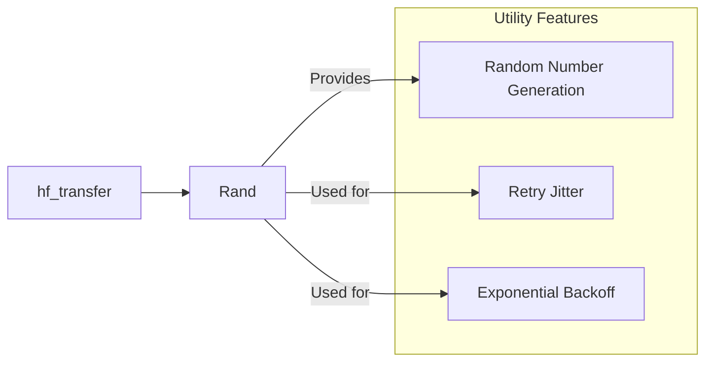

Additional utility libraries support specific functionality:

| Dependency | Version | Purpose |
|------------|---------|---------|
| **rand** | 0.8.5 | Random number generation for retry logic with jitter |

The rand library is used to implement jitter in the exponential backoff retry mechanism, making concurrent retries less likely to occur simultaneously.

Sources: [Cargo.toml:15]()

## Python Integration

The integration between Python and Rust is a key aspect of hf_transfer's architecture.

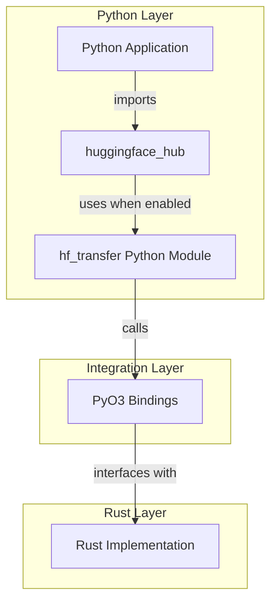

Python integration is enabled through PyO3, which facilitates the creation of Python bindings for Rust code:

| Dependency | Version | Features | Purpose |
|------------|---------|----------|---------|
| **pyo3** | 0.23 | extension-module, abi3-py38 | Create Python bindings for Rust code |

The `abi3-py38` feature ensures compatibility with Python 3.8 and later versions through the stable ABI, allowing a single binary to work across multiple Python versions.

Sources: [Cargo.toml:14]()

## Build System Dependencies

The build system is responsible for compiling the Rust code and packaging it as a Python module.

```mermaid
flowchart TD
    SourceCode["Source Code"] -->|"processed by"| BuildSystem["Build System"]
    BuildSystem -->|"produces"| PythonPackage["Python Package"]
    
    subgraph "Build Process"
        Maturin -->|"compiles"| RustCode["Rust Code"]
        Maturin -->|"links with"| PyO3["PyO3"]
        Maturin -->|"packages as"| WheelPackage["Wheel Package"]
    end
    
    BuildSystem --- Maturin
```

The primary build dependency is Maturin:

| Dependency | Version | Purpose |
|------------|---------|---------|
| **maturin** | ≥1.4, <2 | Build and package Rust code as Python extensions |

Maturin automates the process of compiling Rust code and packaging it in a format that can be installed via pip, making it critical for the distribution of hf_transfer.

Sources: [pyproject.toml:1-3]()

## Dependency Relationships

The following diagram illustrates the relationships between key dependencies and the core functionality they enable in hf_transfer:

```mermaid
graph TD
    subgraph "hf_transfer Core Functionality"
        Download["download_async function"]
        Upload["upload_async function"]
        RetryMechanism["Retry Mechanism"]
        ChunkProcessing["Chunk Processing"]
    end
    
    subgraph "Dependencies"
        Tokio["tokio"]
        Futures["futures"]
        Reqwest["reqwest"]
        Rand["rand"]
        PyO3["pyo3"]
    end
    
    Download -->|"utilizes"| Tokio
    Download -->|"utilizes"| Futures
    Download -->|"utilizes"| Reqwest
    
    Upload -->|"utilizes"| Tokio
    Upload -->|"utilizes"| Futures
    Upload -->|"utilizes"| Reqwest
    
    RetryMechanism -->|"utilizes"| Tokio
    RetryMechanism -->|"utilizes"| Rand
    
    ChunkProcessing -->|"utilizes"| Futures
    ChunkProcessing -->|"utilizes"| Tokio
    
    PyO3 -->|"exposes"| Download
    PyO3 -->|"exposes"| Upload
```

Sources: [Cargo.toml:11-18]()

## Transitive Dependencies

The dependencies listed in Cargo.toml pull in numerous transitive dependencies. Key transitive dependencies include:

| Primary Dependency | Notable Transitive Dependencies |
|-------------------|----------------------------------|
| **reqwest** | hyper, h2, http, http-body, url, encoding_rs |
| **tokio** | mio, bytes, socket2, pin-project-lite |
| **pyo3** | pyo3-macros, pyo3-ffi, memoffset |

These transitive dependencies handle lower-level functionality such as HTTP protocol implementation, network I/O, memory management, and Rust-Python interoperability details.

Sources: [Cargo.lock:1-1698]()

## OpenSSL Integration

```mermaid
flowchart LR
    hf_transfer -->|"depends on"| OpenSSL["openssl"]
    OpenSSL -->|"feature"| Vendored["vendored"]
    
    Vendored -->|"enables"| SelfContained["Self-contained SSL"]
    SelfContained -->|"provides"| CrossPlatform["Cross-platform compatibility"]
    CrossPlatform -->|"supports"| MultiOS["Multiple operating systems"]
```

The OpenSSL dependency is configured with the `vendored` feature, which ensures that OpenSSL is compiled and linked statically with hf_transfer. This approach eliminates runtime dependencies on system-provided OpenSSL libraries, enhancing portability across different operating systems and environments.

Sources: [Cargo.toml:14]()

## Conclusion

The dependency structure of hf_transfer is designed to optimize file transfer performance while ensuring compatibility with the Python ecosystem. The core Rust dependencies provide the foundation for high-performance asynchronous I/O and networking, while PyO3 enables seamless integration with Python. The build system, powered by Maturin, ensures that the resulting package can be easily distributed and installed in Python environments.

This careful selection of dependencies allows hf_transfer to achieve its goal of providing efficient file transfers for the Hugging Face ecosystem, with robust error handling and cross-platform compatibility.

---

# Page: Core API

# Core API

<details>
<summary>Relevant source files</summary>

The following files were used as context for generating this wiki page:

- [src/lib.rs](src/lib.rs)

</details>


This page provides a comprehensive overview of the primary functions exposed by the hf_transfer library. The Core API consists of two main functions that enable high-performance file transfers through parallel processing and robust error handling.

For information about the overall architecture of hf_transfer, see [Architecture](#2).

## Overview of Core Functions

The hf_transfer library exposes two primary Python functions for file transfer operations:

1. `download`: High-performance parallel download of files from remote sources
2. `multipart_upload`: Efficient chunked upload to remote storage services

Both functions leverage Rust's performance capabilities and Tokio's asynchronous runtime to significantly improve transfer speeds compared to traditional Python implementations.

```mermaid
graph TD
    subgraph "Python API Layer"
        download["download()"]
        multipart_upload["multipart_upload()"]
    end
    
    subgraph "Internal Rust Implementation"
        download_async["download_async()"]
        upload_async["upload_async()"]
        download_chunk["download_chunk()"]
        upload_chunk["upload_chunk()"]
        exponential_backoff["exponential_backoff()"]
    end
    
    download --> download_async
    multipart_upload --> upload_async
    
    download_async --> download_chunk
    download_async --> exponential_backoff
    upload_async --> upload_chunk
    upload_async --> exponential_backoff
```

Sources: [src/lib.rs:35-140](). [src/lib.rs:363-450]()

## Function: download

The `download` function enables efficient downloading of files by splitting the download into multiple chunks processed in parallel.

### Signature

```python
def download(
    url: str,
    filename: str,
    max_files: int,
    chunk_size: int,
    parallel_failures: int = 0,
    max_retries: int = 0,
    headers: Optional[Dict[str, str]] = None,
    callback: Optional[Callable[[int], None]] = None
) -> None
```

### Parameters

| Parameter | Type | Description |
|-----------|------|-------------|
| `url` | `str` | The URL of the file to download |
| `filename` | `str` | Local path where the file should be saved |
| `max_files` | `int` | Maximum number of open file handles, determining the maximum parallelism |
| `chunk_size` | `int` | Size of each download chunk in bytes |
| `parallel_failures` | `int` | Maximum number of chunk failures allowed in parallel (must be ≤ `max_files`) |
| `max_retries` | `int` | Maximum number of retry attempts per chunk |
| `headers` | `Optional[Dict[str, str]]` | Optional HTTP headers to include in requests |
| `callback` | `Optional[Callable[[int], None]]` | Optional callback function called with bytes transferred |

### Implementation Details

The function operates by:

1. Creating a multi-threaded Tokio runtime
2. Determining the file size via a range request
3. Splitting the download into chunks based on the specified `chunk_size`
4. Creating a semaphore to limit concurrent downloads to `max_files`
5. Spawning tasks for each chunk that download and write to the target file
6. Implementing retry logic with exponential backoff if specified

```mermaid
sequenceDiagram
    participant "Python" as P
    participant "download()" as D
    participant "download_async()" as DA
    participant "download_chunk()" as DC
    participant "Remote Server" as S
    participant "Local File" as F
    
    P->>+D: Call with url, filename, params
    D->>+DA: Execute in Tokio runtime
    DA->>S: HEAD request to get file size
    S-->>DA: Return content length
    
    DA->>DA: Calculate chunks
    
    par Chunks processed in parallel
        DA->>+DC: Process chunk 1
        DC->>S: Request range for chunk 1
        S-->>DC: Return chunk 1 data
        DC->>F: Write chunk 1 to file
        DC-->>-DA: Return success/error
        
        DA->>+DC: Process chunk 2
        DC->>S: Request range for chunk 2
        S-->>DC: Return chunk 2 data
        DC->>F: Write chunk 2 to file
        DC-->>-DA: Return success/error
        
        DA->>+DC: Process chunk N
        DC->>S: Request range for chunk N
        S-->>DC: Return chunk N data
        DC->>F: Write chunk N to file
        DC-->>-DA: Return success/error
    end
    
    alt Chunk error occurs
        DA->>DA: Apply exponential backoff
        DA->>+DC: Retry chunk
        DC-->>-DA: Return success/error
    end
    
    DA-->>-D: Return overall result
    D-->>-P: Return success or raise exception
```

Sources: [src/lib.rs:36-88](), [src/lib.rs:151-295](), [src/lib.rs:334-361]()

## Function: multipart_upload

The `multipart_upload` function enables efficient uploads by splitting the file into chunks and uploading them in parallel.

### Signature

```python
def multipart_upload(
    file_path: str,
    parts_urls: List[str],
    chunk_size: int,
    max_files: int,
    parallel_failures: int = 0,
    max_retries: int = 0,
    callback: Optional[Callable[[int], None]] = None
) -> List[Dict[str, str]]
```

### Parameters

| Parameter | Type | Description |
|-----------|------|-------------|
| `file_path` | `str` | Path to the local file to upload |
| `parts_urls` | `List[str]` | List of pre-signed URLs for each part of the multipart upload |
| `chunk_size` | `int` | Size of each upload chunk in bytes |
| `max_files` | `int` | Maximum number of open file handles, determining the maximum parallelism |
| `parallel_failures` | `int` | Maximum number of chunk failures allowed in parallel (must be ≤ `max_files`) |
| `max_retries` | `int` | Maximum number of retry attempts per chunk |
| `callback` | `Optional[Callable[[int], None]]` | Optional callback function called with bytes transferred |

### Return Value

List of dictionaries containing the HTTP response headers from each part upload, used for completing multipart uploads.

### Implementation Details

The function operates by:

1. Creating a multi-threaded Tokio runtime
2. Splitting the file into chunks of `chunk_size` bytes
3. Creating a semaphore to limit concurrent uploads to `max_files`
4. Spawning tasks for each chunk that read from the file and upload to the corresponding pre-signed URL
5. Implementing retry logic with exponential backoff if specified
6. Collecting headers from the responses to each part upload

```mermaid
sequenceDiagram
    participant "Python" as P
    participant "multipart_upload()" as MU
    participant "upload_async()" as UA
    participant "upload_chunk()" as UC
    participant "Local File" as F
    participant "Remote Server" as S
    
    P->>+MU: Call with file_path, part_urls, params
    MU->>+UA: Execute in Tokio runtime
    
    par Chunks processed in parallel
        UA->>+UC: Process part 1
        UC->>F: Read chunk 1
        F-->>UC: Return chunk 1 data
        UC->>S: Upload chunk 1
        S-->>UC: Return response headers
        UC-->>-UA: Return headers/error
        
        UA->>+UC: Process part 2
        UC->>F: Read chunk 2
        F-->>UC: Return chunk 2 data
        UC->>S: Upload chunk 2
        S-->>UC: Return response headers
        UC-->>-UA: Return headers/error
        
        UA->>+UC: Process part N
        UC->>F: Read chunk N
        F-->>UC: Return chunk N data
        UC->>S: Upload chunk N
        S-->>UC: Return response headers
        UC-->>-UA: Return headers/error
    end
    
    alt Chunk error occurs
        UA->>UA: Apply exponential backoff
        UA->>+UC: Retry chunk
        UC-->>-UA: Return headers/error
    end
    
    UA->>UA: Collect response headers
    UA-->>-MU: Return headers array
    MU-->>-P: Return headers or raise exception
```

Sources: [src/lib.rs:101-140](), [src/lib.rs:363-450](), [src/lib.rs:452-482]()

## Error Handling and Retry Mechanism

Both `download` and `multipart_upload` implement robust error handling with an exponential backoff retry mechanism. This makes transfers resilient to transient network issues.

### Retry Configuration

To enable the retry mechanism, both `parallel_failures` and `max_retries` must be set:

- `parallel_failures`: Limits how many chunks can be in a failed/retrying state simultaneously
- `max_retries`: Maximum number of retry attempts before failing the entire operation

### Exponential Backoff Implementation

The retry mechanism uses an exponential backoff strategy with jitter to avoid thundering herd problems:

```mermaid
graph TD
    subgraph "Retry Logic"
        failure["Chunk Transfer Failure"]
        check_max_retries["Check if max_retries reached"]
        check_parallel["Check parallel_failures limit"]
        backoff["Calculate backoff with jitter"]
        wait["Sleep for calculated duration"]
        retry["Retry chunk transfer"]
        fail["Fail with error"]
    end
    
    failure --> check_max_retries
    check_max_retries -->|"retry count >= max_retries"| fail
    check_max_retries -->|"retry count < max_retries"| check_parallel
    
    check_parallel -->|"limit reached"| fail
    check_parallel -->|"under limit"| backoff
    
    backoff --> wait
    wait --> retry
    retry -->|"success"| success["Continue"]
    retry -->|"failure"| failure
```

The backoff duration is calculated using this formula:
```
wait_time = (BASE_WAIT_TIME + retry_count² + random_jitter(0-500ms)).min(MAX_WAIT_TIME)
```

Where:
- `BASE_WAIT_TIME` = 300ms
- `MAX_WAIT_TIME` = 10,000ms (10 seconds)

This provides a balance between quick retries for transient failures and avoiding overwhelming the server with retry requests.

Sources: [src/lib.rs:26-28](), [src/lib.rs:142-148](), [src/lib.rs:248-270](), [src/lib.rs:393-416]()

## Thread Control

The number of worker threads used by the Tokio runtime can be tuned by setting the `TOKIO_WORKER_THREADS` environment variable. This allows for fine-grained control over the parallelism model based on the specific environment where hf_transfer is running.

Sources: [src/lib.rs:33-34](), [src/lib.rs:59-62](), [src/lib.rs:125-128]()

## Integration with Python

Both API functions are exposed to Python using PyO3 bindings. They are registered with the Python module in the `pymodule` declaration at [src/lib.rs:484-491]().

For information on how to use these functions with the huggingface_hub library, see [Integration with huggingface_hub](#4.1).

---

# Page: Download Function

# Download Function

<details>
<summary>Relevant source files</summary>

The following files were used as context for generating this wiki page:

- [src/lib.rs](src/lib.rs)

</details>


The download function is a core API component of hf_transfer, providing high-performance parallel file downloads with resilient error handling. This page documents the function signature, parameters, internal operation, and performance characteristics. For information about uploading files, see [Multipart Upload Function](#3.2).

## Function Signature and Parameters

The download function provides a Python-accessible interface for downloading files using a robust, parallel downloading strategy:

```python
def download(
    url: str,
    filename: str,
    max_files: int,
    chunk_size: int,
    parallel_failures: int = 0,
    max_retries: int = 0,
    headers: Optional[Dict[str, str]] = None,
    callback: Optional[Callable[[int], None]] = None
) -> None
```

### Parameters

| Parameter | Type | Description |
|-----------|------|-------------|
| `url` | `str` | Source URL from which to download the file |
| `filename` | `str` | Destination path where the file will be saved |
| `max_files` | `int` | Maximum number of open file handles, determining the maximum number of parallel download operations |
| `chunk_size` | `int` | Size of each chunk in bytes to be downloaded in parallel |
| `parallel_failures` | `int` | Maximum number of chunk failures allowed in parallel (cannot exceed `max_files`). Must be set along with `max_retries` |
| `max_retries` | `int` | Maximum number of attempts per chunk with exponential backoff. Must be set along with `parallel_failures` |
| `headers` | `Dict[str, str]` | Optional HTTP headers to include in download requests |
| `callback` | `Callable[[int], None]` | Optional callback function that receives the number of bytes downloaded for each chunk |

Sources: [src/lib.rs:36-88]()

## How the Download Function Works

The download function implements a chunked, parallel downloading strategy with sophisticated retry logic to provide efficient and resilient file transfers.

### Download Process Flow

```mermaid
sequenceDiagram
    participant "Python" as client
    participant "download()" as download_func
    participant "download_async()" as download_async
    participant "Remote Server" as server
    participant "download_chunk()" as download_chunk
    participant "File System" as file

    client->>download_func: Call with parameters
    download_func->>download_async: Build Tokio runtime and call

    download_async->>server: Initial request to get file size
    server-->>download_async: Response with content-range header
    
    Note over download_async: Parse file size and prepare chunks

    par Parallel chunk downloads
        download_async->>download_chunk: Download chunk 1
        download_chunk->>server: Request bytes range
        server-->>download_chunk: Send chunk data
        download_chunk->>file: Write chunk at offset
        download_chunk-->>download_async: Result
        download_async->>client: Callback with bytes downloaded (if provided)
    and
        download_async->>download_chunk: Download chunk 2
        download_chunk->>server: Request bytes range
        server-->>download_chunk: Send chunk data
        download_chunk->>file: Write chunk at offset
        download_chunk-->>download_async: Result
        download_async->>client: Callback with bytes downloaded (if provided)
    and
        download_async->>download_chunk: Download chunk N
        download_chunk->>server: Request bytes range
        server-->>download_chunk: Send chunk data
        download_chunk->>file: Write chunk at offset
        download_chunk-->>download_async: Result
        download_async->>client: Callback with bytes downloaded (if provided)
    end

    download_async-->>download_func: All chunks completed
    download_func-->>client: Return or raise error
```

Sources: [src/lib.rs:150-295](), [src/lib.rs:334-361]()

### Key Components

```mermaid
graph TD
    subgraph "Python Bindings"
        download["download(...)"]
    end

    subgraph "Async Runtime"
        tokio_runtime["Tokio Runtime"]
        download_async["download_async(...)"]
    end

    subgraph "Workers"
        download_chunk["download_chunk(...)"]
        chunk_threads["Thread Pool"]
        semaphore["Semaphore (max_files)"]
        failure_semaphore["Semaphore (parallel_failures)"]
    end

    subgraph "Error Handling"
        retry_logic["Retry Logic"]
        exponential_backoff["exponential_backoff(...)"]
        jitter["jitter()"]
    end

    download -->|"Calls/Creates"| tokio_runtime
    tokio_runtime -->|"Runs"| download_async
    download_async -->|"Splits into chunks"| chunk_threads
    chunk_threads -->|"Process chunks"| download_chunk
    download_chunk -->|"On failure"| retry_logic
    retry_logic -->|"Uses"| exponential_backoff
    exponential_backoff -->|"Adds"| jitter
    download_async -->|"Controls concurrency"| semaphore
    download_async -->|"Controls failure rate"| failure_semaphore
```

Sources: [src/lib.rs:36-88](), [src/lib.rs:150-295](), [src/lib.rs:334-361](), [src/lib.rs:142-148]()

## Implementation Details

### Initial Setup

1. The `download` function first performs parameter validation:
   - Ensures `parallel_failures` is not greater than `max_files`
   - Verifies that both `parallel_failures` and `max_retries` are either both set or both zero

2. A multi-threaded Tokio runtime is created to execute the asynchronous download process
   - The number of worker threads can be configured via the `TOKIO_WORKER_THREADS` environment variable

3. The function passes control to `download_async` which performs the actual download

Sources: [src/lib.rs:36-88]()

### Size Detection and Chunking

The download process begins by:

1. Building an HTTP client with appropriate settings
2. Processing provided headers, with special handling for authorization tokens
3. Making an initial request using the HTTP Range header to determine file size
4. Following any redirects to avoid overloading the source server
5. Parsing the Content-Range header to determine the total file size
6. Dividing the file into chunks according to the specified `chunk_size`

Sources: [src/lib.rs:150-234]()

### Parallel Download

1. For each chunk, a separate asynchronous task is spawned
2. A semaphore limits concurrent downloads to `max_files`
3. Each chunk is downloaded using the `download_chunk` function
4. The `download_chunk` function:
   - Opens the output file
   - Seeks to the appropriate position based on chunk start
   - Makes an HTTP request with Range header for the chunk
   - Writes received data to the file at the correct offset

Sources: [src/lib.rs:234-294](), [src/lib.rs:334-361]()

## Retry and Error Handling

The download function implements sophisticated error handling:

### Retry Mechanism

When both `parallel_failures` and `max_retries` are set:

1. A semaphore controls how many chunks can be in a retry state simultaneously
2. If a chunk download fails, the system attempts to retry up to `max_retries` times
3. Each retry uses exponential backoff with jitter to determine wait time:
   - Base wait time: 300ms
   - Maximum wait time: 10,000ms
   - Formula: `(base_wait_time + retry_number² + random(0-500))` capped at max wait time

4. If all retries for a chunk fail, the entire download is aborted

### Error Cleanup

If an error occurs during download:
1. The partially downloaded file is removed
2. A Python exception with details is raised

Sources: [src/lib.rs:142-148](), [src/lib.rs:234-294](), [src/lib.rs:36-88]()

## Performance Considerations

The performance of the download function can be tuned through several parameters:

| Parameter | Performance Impact |
|-----------|-------------------|
| `max_files` | Higher values increase parallelism but may cause resource contention. Optimal value depends on available bandwidth, CPU cores, and I/O capabilities |
| `chunk_size` | Smaller chunks allow for finer-grained parallelism and retries, but create more HTTP overhead. Larger chunks reduce overhead but provide less parallelism |
| `TOKIO_WORKER_THREADS` (env var) | Controls the number of threads in the Tokio runtime. Should generally match the number of CPU cores |

For high-bandwidth connections with stable connectivity, consider:
- Larger `chunk_size` (e.g., 8MB to 16MB)
- Higher `max_files` value (e.g., 10-20)

For less reliable connections:
- Smaller `chunk_size` (e.g., 1MB to 4MB)
- Enable retry mechanism with appropriate `parallel_failures` and `max_retries` values

Sources: [src/lib.rs:26-34]()

## Progress Monitoring

The download function supports progress monitoring through an optional callback function:

1. The callback is called after each chunk is successfully downloaded
2. It receives the number of bytes downloaded for that chunk
3. This enables implementing progress bars or other forms of progress reporting

Sources: [src/lib.rs:278-283]()

## Error Types

The download function can raise several types of errors:

1. Parameter validation errors
2. Network errors from the request library
3. I/O errors when writing to the file system
4. Server errors (e.g., 404, 500) from the remote endpoint
5. Retry exhaustion errors when max retries are exceeded

All errors are converted to Python exceptions with descriptive messages.

Sources: [src/lib.rs:297-332]()

---

# Page: Multipart Upload Function

# Multipart Upload Function

<details>
<summary>Relevant source files</summary>

The following files were used as context for generating this wiki page:

- [src/lib.rs](src/lib.rs)

</details>


This page provides detailed documentation for the `multipart_upload` function in hf_transfer, which enables high-performance file uploads using parallel processing. This function is particularly useful for transferring large files efficiently to Hugging Face Hub or S3-compatible storage services by breaking them into chunks that are uploaded concurrently. For information about downloading files, see [Download Function](#3.1).

## Function Overview

The `multipart_upload` function implements a high-performance, resilient multipart upload process that:

1. Splits a file into chunks
2. Uploads these chunks in parallel
3. Implements robust retry mechanisms to handle transient network failures
4. Returns response headers for each part for subsequent use in completing the multipart upload

```mermaid
flowchart TD
    subgraph "multipart_upload function"
        direction TB
        start[/"Input: file_path, parts_urls,\nchunk_size, max_files,\nparallel_failures, max_retries"/]
        validate["Validate parameters"]
        runtime["Create Tokio runtime"]
        upload["Call upload_async"]
        finish[/"Return: Vector of response headers\nfor each part"/]
        
        start --> validate
        validate --> runtime
        runtime --> upload
        upload --> finish
    end
```

Sources: [src/lib.rs:102-140]()

## Function Signature and Parameters

```rust
multipart_upload(
    file_path: String,
    parts_urls: Vec<String>,
    chunk_size: u64,
    max_files: usize,
    parallel_failures: usize = 0,
    max_retries: usize = 0,
    callback: Optional[Callable] = None
) -> List[Dict[str, str]]
```

| Parameter | Type | Description |
|-----------|------|-------------|
| `file_path` | String | Path to the file to be uploaded |
| `parts_urls` | List[String] | List of pre-signed URLs for each part upload |
| `chunk_size` | Integer | Size of each chunk in bytes |
| `max_files` | Integer | Maximum number of parallel uploads |
| `parallel_failures` | Integer | Maximum number of failures allowed in parallel (default: 0) |
| `max_retries` | Integer | Maximum attempts per chunk with exponential backoff (default: 0) |
| `callback` | Callable | Optional function called after each successful chunk upload with bytes transferred |

**Return Value:** A list of dictionaries containing response headers from each part upload (including ETags needed for completing multipart uploads)

Sources: [src/lib.rs:102-140]()

## Implementation Details

The `multipart_upload` function is implemented as a Python binding to a Rust function using PyO3. Let's examine how it works:

```mermaid
sequenceDiagram
    participant "Python Code" as python
    participant "multipart_upload" as multipart
    participant "upload_async" as async
    participant "Tokio Runtime" as tokio
    participant "upload_chunk" as chunk
    participant "Remote Service" as remote

    python->>multipart: Call with file_path, parts_urls, etc.
    multipart->>multipart: Validate parameters
    multipart->>tokio: Create multi-threaded runtime
    tokio->>async: Execute upload_async
    
    loop For each part URL
        async->>async: Create upload task
        async->>chunk: Call upload_chunk
        chunk->>chunk: Open file & seek to position
        chunk->>remote: PUT request with chunk data
        remote-->>chunk: Response with headers
        chunk-->>async: Return headers
        async->>python: Callback with bytes transferred
    end
    
    async-->>multipart: Return all response headers
    multipart-->>python: Return headers as Python list
```

Sources: [src/lib.rs:364-450](), [src/lib.rs:452-482]()

### Parallel Processing

The implementation uses Tokio's asynchronous runtime to handle concurrent uploads efficiently:

1. It creates a semaphore to limit the number of concurrent uploads to `max_files`
2. Each chunk is uploaded in a separate task that acquires a permit from the semaphore
3. The semaphore ensures optimal resource utilization without overwhelming the system

```mermaid
flowchart TD
    subgraph "upload_async function"
        dir TB
        semaphore["Create semaphores:\n- max_files semaphore\n- parallel_failures semaphore"]
        spawn["Spawn tasks for each part"]
        collect["Collect results"]
        return["Return response headers"]
        
        semaphore --> spawn
        spawn --> collect
        collect --> return
    end
    
    subgraph "Per-chunk tasks" 
        dir TB
        acquire["Acquire semaphore permit"]
        upload["Upload chunk"]
        retry{"Failure?"}
        backoff["Calculate backoff time\nwith jitter"]
        wait["Wait & retry"]
        release["Release permit"]
        
        acquire --> upload
        upload --> retry
        retry -->|"Yes (if retries enabled)"| backoff
        retry -->|"No"| release
        backoff --> wait
        wait --> upload
        release --> return
    end
    
    spawn -.-> acquire
```

Sources: [src/lib.rs:364-450](), [src/lib.rs:385-418]()

### Error Handling and Retry Logic

The function implements sophisticated error handling:

1. **Parameter Validation**: 
   - Ensures `parallel_failures` doesn't exceed `max_files`
   - Verifies that if retry is enabled, both `parallel_failures` and `max_retries` are set

2. **Retry Mechanism**:
   - Uses exponential backoff with jitter for failed uploads
   - Base wait time starts at 300ms and increases quadratically
   - Maximum wait time capped at 10,000ms (10 seconds)
   - Adds randomized jitter (0-500ms) to prevent thundering herd problem

3. **Parallel Failures Control**:
   - Uses a dedicated semaphore to limit concurrent retries
   - Prevents cascading failures from consuming all resources

Sources: [src/lib.rs:95-123](), [src/lib.rs:142-148](), [src/lib.rs:395-416]()

### Upload Chunk Process

Each chunk is uploaded using the `upload_chunk` function, which:

1. Opens the source file
2. Seeks to the appropriate position based on chunk number 
3. Takes only the required number of bytes for the chunk
4. Performs a PUT request to the pre-signed URL
5. Returns response headers for each successful upload

Sources: [src/lib.rs:452-482]()

## Usage Example

Here's a basic example of how to use the `multipart_upload` function:

```python
import os
from hf_transfer import multipart_upload

# File to upload
file_path = "large_model.bin"
file_size = os.path.getsize(file_path)

# Calculate optimal chunk size (e.g., 8 MB)
chunk_size = 8 * 1024 * 1024

# Obtain pre-signed URLs for each part (typically from Hugging Face Hub or S3)
# This is a placeholder - you would get these from your storage service
parts_urls = [...] # List of pre-signed URLs

# Upload with parallel processing and retry logic
response_headers = multipart_upload(
    file_path=file_path,
    parts_urls=parts_urls,
    chunk_size=chunk_size,
    max_files=5,            # Upload 5 chunks in parallel
    parallel_failures=2,    # Allow 2 failures in parallel
    max_retries=3,          # Retry each chunk up to 3 times
    callback=lambda bytes_uploaded: print(f"Uploaded {bytes_uploaded} bytes")
)

# response_headers contains the response headers for each part
# These typically include ETags needed for completing the multipart upload
```

## Performance Considerations

To achieve optimal upload performance, consider the following:

1. **Chunk Size**: 
   - Too small: Overhead from many requests
   - Too large: Less parallelism and higher retry cost
   - Recommended: 5-10 MB for most use cases

2. **Parallel Uploads**:
   - Set `max_files` based on available bandwidth and CPU resources
   - Consider network conditions and server limitations
   - Usually 5-10 parallel chunks works well on typical connections

3. **Retry Configuration**:
   - Enable retries for production use by setting both `parallel_failures` and `max_retries`
   - The default exponential backoff provides a good balance between quick retries and avoiding server overload

4. **Worker Threads**:
   - The number of worker threads can be tuned with the `TOKIO_WORKER_THREADS` environment variable
   - Default is the number of CPU cores

Sources: [src/lib.rs:95-101](), [src/lib.rs:364-450]()

## Integration with S3 and Hugging Face Hub

The `multipart_upload` function is designed to work with S3-compatible storage services and the Hugging Face Hub. For detailed information about integration with these services, see [S3 Integration](#4.2).

Both services use a similar multipart upload process:
1. Initiate a multipart upload to get an upload ID
2. Upload each part using pre-signed URLs
3. Complete the multipart upload by providing ETags for all parts

The `multipart_upload` function handles step 2 in this process, uploading all parts and returning the necessary response headers for step 3.

Sources: [src/lib.rs:90-101]()

## Internal Architecture

```mermaid
graph TD
    subgraph "Python Interface"
        multipart_upload["multipart_upload function"]
    end
    
    subgraph "Async Runtime"
        tokio["Tokio Runtime"]
        upload_async["upload_async function"]
    end
    
    subgraph "Parallel Processing"
        semaphore["Semaphore control"]
        futures["FuturesUnordered"]
    end
    
    subgraph "Network Layer"
        reqwest["reqwest Client"]
        upload_chunk["upload_chunk function"]
    end
    
    subgraph "File I/O"
        tokio_fs["tokio::fs"]
        framed_read["FramedRead with BytesCodec"]
    end
    
    multipart_upload -->|"Creates and runs"| tokio
    tokio -->|"Executes"| upload_async
    upload_async -->|"Uses"| semaphore
    upload_async -->|"Manages"| futures
    futures -->|"Contains tasks that call"| upload_chunk
    upload_chunk -->|"Uses"| reqwest
    upload_chunk -->|"File operations"| tokio_fs
    upload_chunk -->|"Streaming"| framed_read
```

Sources: [src/lib.rs:102-140](), [src/lib.rs:364-450](), [src/lib.rs:452-482]()

## Related Components

The `multipart_upload` function is part of a broader file transfer system. It works alongside:

1. **Download Function**: For high-performance parallel downloads (see [Download Function](#3.1))
2. **Error Handling and Retry Logic**: Shared components for resilient operations (see [Error Handling and Retry Logic](#3.3))
3. **S3 Integration**: For working with S3-compatible storage (see [S3 Integration](#4.2))

Sources: [src/lib.rs:484-491]()

---

# Page: Error Handling and Retry Logic

# Error Handling and Retry Logic

<details>
<summary>Relevant source files</summary>

The following files were used as context for generating this wiki page:

- [src/lib.rs](src/lib.rs)

</details>


This page describes the error handling and retry mechanisms implemented in hf_transfer to ensure robust and fault-tolerant file transfers, even in the presence of network instability or transient failures. For information about the main download and upload functions, see [Download Function](#3.1) and [Multipart Upload Function](#3.2).

## Overview

File transfers over the internet are susceptible to various failures including network interruptions, timeouts, and server-side issues. The hf_transfer library implements a sophisticated error handling system with configurable retry logic to address these challenges and ensure reliable transfers.

Key features of the error handling system include:

- Custom error types that categorize and propagate different failure modes
- Exponential backoff with jitter for intelligent retry timing
- Parallel failure handling with semaphore-based concurrency control
- Clean state management for failed transfers

Sources: [src/lib.rs:26-27](), [src/lib.rs:142-148](), [src/lib.rs:297-332]()

## Error Types

The library defines a custom `Error` enum that encapsulates the different types of errors that can occur during file transfers:

```mermaid
classDiagram
    class Error {
        <<enum>>
        +Io(std::io::Error)
        +Request(reqwest::Error)
        +ToStrError(ToStrError)
        +Display()
    }
    
    Error --|> std::error::Error : implements
    Error --|> Display : implements
```

These error types are converted to appropriate Python exceptions with descriptive messages when propagating errors back to the Python caller.

Sources: [src/lib.rs:297-332]()

## Retry Configuration

Both download and upload functions accept parameters to configure retry behavior:

| Parameter | Description |
|-----------|-------------|
| `max_files` | Maximum number of open file handles, determining maximum parallel operations |
| `parallel_failures` | Maximum number of failures allowed in parallel (cannot exceed `max_files`) |
| `max_retries` | Maximum number of retry attempts per chunk |

The library enforces validation rules for these parameters:
- `parallel_failures` cannot be greater than `max_files`
- Both `parallel_failures` and `max_retries` must be either both zero (retry disabled) or both non-zero (retry enabled)

Sources: [src/lib.rs:48-58](), [src/lib.rs:113-123]()

## Exponential Backoff with Jitter

To prevent overloading the server and to avoid the "thundering herd" problem during retries, hf_transfer implements exponential backoff with added random jitter:

```mermaid
flowchart LR
    A["Retry Needed"] --> B["Calculate Wait Time"]
    B --> C["Apply Exponential Backoff"]
    C --> D["Add Random Jitter"]
    D --> E["Enforce Maximum Wait Time"]
    E --> F["Sleep for Wait Time"]
    F --> G["Retry Operation"]
```

The wait time calculation uses the formula:
```
wait_time = min(BASE_WAIT_TIME + retry_count² + jitter(), MAX_WAIT_TIME)
```

Where:
- `BASE_WAIT_TIME` is 300ms
- Jitter adds a random value between 0-500ms
- `MAX_WAIT_TIME` is 10,000ms (10 seconds)

Sources: [src/lib.rs:26-27](), [src/lib.rs:142-148](), [src/lib.rs:264](), [src/lib.rs:409]()

## Retry Mechanism Implementation

The retry mechanism is implemented in both download and upload operations following a similar pattern:

```mermaid
sequenceDiagram
    participant Client as "Python Client"
    participant Manager as "Operation Manager"
    participant Semaphore as "Semaphores"
    participant Chunk as "Chunk Processor"
    participant Remote as "Remote Server"
    
    Client->>Manager: Start operation
    Manager->>Semaphore: Create file handle semaphore
    Manager->>Semaphore: Create parallel failures semaphore
    
    loop For each chunk
        Manager->>Chunk: Process chunk
        Chunk->>Semaphore: Acquire file handle permit
        Chunk->>Remote: Send request
        
        alt Success
            Remote->>Chunk: Successful response
            Chunk->>Semaphore: Release file handle permit
            Chunk->>Manager: Report success
        else Failure (if retry enabled)
            Remote->>Chunk: Error response
            Chunk->>Semaphore: Try acquire parallel failure permit
            
            alt Max retries not reached and permit acquired
                Chunk->>Chunk: Calculate wait time with exponential backoff
                Chunk->>Chunk: Sleep
                Chunk->>Remote: Retry request
                note over Chunk: Repeat until success or max retries
                Chunk->>Semaphore: Release parallel failure permit
            else Max retries reached or cannot acquire permit
                Chunk->>Semaphore: Release file handle permit
                Chunk->>Manager: Report permanent failure
            end
        end
    end
    
    Manager->>Client: Complete operation or return error
```

### Download Retry Logic

In the download process:
1. Each chunk download is attempted
2. If failure occurs and retry is enabled:
   - Check if max retries reached
   - Try to acquire parallel failure permit
   - Wait using exponential backoff
   - Retry download
   - Release permits after completion

Sources: [src/lib.rs:248-272]()

### Upload Retry Logic

The upload process follows a similar pattern:
1. Each chunk upload is attempted
2. If failure occurs and retry is enabled:
   - Check if max retries reached
   - Try to acquire parallel failure permit
   - Wait using exponential backoff
   - Retry upload
   - Release permits after completion

Sources: [src/lib.rs:393-425]()

## Semaphore-Based Concurrency Control

The library uses two types of semaphores to control concurrency:

```mermaid
graph TD
    subgraph "Concurrency Control"
        FS["File Semaphore<br>(max_files)"] --> C1["Chunk 1"]
        FS --> C2["Chunk 2"]
        FS --> C3["..."]
        FS --> CN["Chunk N"]
        
        PFS["Parallel Failures Semaphore<br>(parallel_failures)"] --> R1["Retry 1"]
        PFS --> R2["Retry 2"]
        PFS --> R3["..."]
        PFS --> RM["Retry M"]
    end

    style FS fill:#f9f9f9,stroke:#333,stroke-width:1px
    style PFS fill:#f9f9f9,stroke:#333,stroke-width:1px
```

1. **File Handle Semaphore**: Controls the maximum number of concurrent chunk operations (both download and upload)
2. **Parallel Failures Semaphore**: Limits how many failed chunks can be in the retry process simultaneously

This approach prevents overloading the system with too many concurrent operations or retries.

Sources: [src/lib.rs:231-232](), [src/lib.rs:376-377]()

## Error Propagation and File Cleanup

When errors occur:

1. For downloads, the library attempts to remove the partially downloaded file to maintain filesystem cleanliness:
   ```
   download → error occurs → attempt to remove partial file → propagate error to Python
   ```

2. For both operations, detailed error messages are created with context about the failure, which helps with debugging.

3. All errors are eventually converted to Python exceptions with descriptive messages.

Sources: [src/lib.rs:75-87](), [src/lib.rs:418-424]()

## Configuring Retry Behavior

To enable retry logic when using hf_transfer functions, you must set both `parallel_failures` and `max_retries` to non-zero values:

```python
# Example with retry enabled
hf_transfer.download(
    url="https://example.com/file.bin",
    filename="local_file.bin",
    max_files=8,
    chunk_size=10_485_760,  # 10MB chunks
    parallel_failures=4,
    max_retries=5
)

# Example with retry disabled (default)
hf_transfer.download(
    url="https://example.com/file.bin",
    filename="local_file.bin",
    max_files=8,
    chunk_size=10_485_760  # 10MB chunks
)
```

Sources: [src/lib.rs:37-38](), [src/lib.rs:102-104]()

---

# Page: Using hf_transfer

# Using hf_transfer

<details>
<summary>Relevant source files</summary>

The following files were used as context for generating this wiki page:

- [README.md](README.md)
- [examples/upload_to_s3.py](examples/upload_to_s3.py)

</details>


This document provides a comprehensive guide on how to use the hf_transfer library, a high-performance file transfer utility developed primarily for large-scale data transfer with the Hugging Face Hub. This page covers general usage patterns, core API functionality, and basic examples. For detailed information about specific integrations, see [Integration with huggingface_hub](#4.1) or [S3 Integration](#4.2).

## Overview

hf_transfer is designed as a power user tool for high-bandwidth networks where Python's native capabilities cannot fully utilize the available bandwidth. It can achieve transfer speeds exceeding 500MB/s through its Rust-based implementation with Python bindings.

```mermaid
flowchart LR
    subgraph "User Application"
        App["Python Application"]
    end
    
    subgraph "Usage Options"
        Direct["Direct hf_transfer API"]
        HFHub["Via huggingface_hub"]
    end
    
    subgraph "Core Functions"
        Download["download()"]
        Upload["multipart_upload()"]
    end
    
    subgraph "Destinations"
        HF["Hugging Face Hub"]
        S3["S3 Storage"]
    end
    
    App -->|"uses"| Direct
    App -->|"uses"| HFHub
    Direct -->|"calls"| Download
    Direct -->|"calls"| Upload
    HFHub -->|"enables via env var"| Download
    HFHub -->|"enables via env var"| Upload
    Download -->|"transfers from"| HF
    Upload -->|"transfers to"| HF
    Upload -->|"transfers to"| S3
```

Sources: [README.md:1-14]()

## Installation

To install hf_transfer, simply use pip:

```
pip install hf_transfer
```

The package is distributed as a Python wheel with pre-built Rust binaries for various platforms, making installation straightforward without requiring a Rust compiler.

## Basic Usage

### Direct API Usage

hf_transfer exposes two main functions:

1. **`download`**: For downloading files from the Hugging Face Hub
2. **`multipart_upload`**: For uploading files to the Hugging Face Hub or S3-compatible storage

The following diagram illustrates the typical usage flow:

```mermaid
sequenceDiagram
    participant User as "Python Code"
    participant HFT as "hf_transfer"
    participant Remote as "Remote Service"
    
    User->>HFT: import hf_transfer
    
    Note over User,HFT: Download Flow
    User->>HFT: download(url, dest_path, parameters)
    HFT->>Remote: Parallel chunk requests
    Remote-->>HFT: Chunked responses
    HFT-->>User: Return download status
    
    Note over User,HFT: Upload Flow
    User->>HFT: multipart_upload(file_path, urls, parameters)
    HFT->>Remote: Parallel chunk uploads
    Remote-->>HFT: Upload confirmations
    HFT-->>User: Return response headers
```

### Integration with huggingface_hub

The simplest way to use hf_transfer is through the huggingface_hub library by enabling it via an environment variable:

```python
import os
os.environ["HF_HUB_ENABLE_HF_TRANSFER"] = "1"

from huggingface_hub import HfApi
# Now all transfers will use hf_transfer automatically
```

Sources: [README.md:36-49]()

## Core API Reference

### Download Function

The `download` function downloads a file from a URL to a specified location:

```python
from hf_transfer import download

download(
    url="https://huggingface.co/path/to/file",
    dest_path="/local/path/to/save.file",
    # Optional parameters:
    chunk_size=10_485_760,  # 10 MiB chunks
    max_files=256,          # Maximum concurrent connections
    parallel_failures=255,  # Maximum failures to handle concurrently
    max_retries=5,          # Maximum retry attempts
)
```

For detailed information about parameters and optimization techniques, see the [Download Function](#3.1) page.

### Multipart Upload Function

The `multipart_upload` function uploads a file in chunks to one or more pre-signed URLs:

```python
from hf_transfer import multipart_upload

responses = multipart_upload(
    file_path="/path/to/local/file",
    parts_urls=["presigned_url_part1", "presigned_url_part2", ...],
    # Optional parameters:
    chunk_size=10_485_760,  # 10 MiB chunks
    max_files=64,           # Maximum concurrent connections
    parallel_failures=63,   # Maximum failures to handle concurrently
    max_retries=5,          # Maximum retry attempts
)
```

The function returns a list of response headers for each part, which typically includes ETag information needed to complete multipart uploads.

For detailed information about parameters and optimization techniques, see the [Multipart Upload Function](#3.2) page.

Sources: [examples/upload_to_s3.py:46-53]()

## File Transfer Process

```mermaid
flowchart TD
    subgraph "File Transfer Process"
        Start["Start Transfer"]
        
        subgraph "File Preparation"
            CalcSize["Calculate file size"]
            DetermineChunks["Determine chunk boundaries"]
        end
        
        subgraph "Parallel Processing"
            direction LR
            AsyncPool["Async worker pool"]
            Chunk1["Process chunk 1"]
            Chunk2["Process chunk 2"]
            ChunkN["Process chunk N"]
            AsyncPool --- Chunk1
            AsyncPool --- Chunk2
            AsyncPool --- ChunkN
        end
        
        subgraph "Error Handling"
            RetryLogic["Retry with exponential backoff"]
            FailureTracking["Track failure count"]
        end
        
        Complete["Complete transfer"]
    end
    
    Start --> CalcSize
    CalcSize --> DetermineChunks
    DetermineChunks --> AsyncPool
    Chunk1 & Chunk2 & ChunkN -.->|"Error occurs"| RetryLogic
    RetryLogic --> FailureTracking
    FailureTracking -->|"Retry limit not reached"| AsyncPool
    FailureTracking -->|"Retry limit reached"| Complete
    Chunk1 & Chunk2 & ChunkN -->|"Success"| Complete
```

Sources: [examples/upload_to_s3.py]()

## Performance Considerations

hf_transfer achieves high performance through several techniques:

| Feature | Description | Benefit |
|---------|-------------|---------|
| Rust implementation | Core processing is written in Rust | Faster, memory-efficient execution compared to Python |
| Parallel downloading | Download file chunks concurrently | Maximizes bandwidth utilization |
| Parallel uploading | Upload file chunks concurrently | Maximizes bandwidth utilization |
| Configurable chunk size | Adjust chunk size based on file size | Balance memory usage with parallelism |
| Adaptive retry mechanism | Exponential backoff with jitter | Resilience to network issues |

For optimal performance:

1. Adjust `chunk_size` based on your file size and available memory
2. Tune `max_files` based on your network capabilities and CPU cores
3. Set `parallel_failures` to slightly less than `max_files` (typically `max_files - 1`)
4. Adjust `max_retries` based on your network stability

## Using with S3

hf_transfer can be used to upload files to S3 or compatible storage services. The general process involves:

1. Creating a multipart upload in S3
2. Getting pre-signed URLs for each part
3. Using hf_transfer's `multipart_upload` to upload the parts
4. Completing the multipart upload with the ETags

For a detailed walkthrough with code examples, see the [S3 Integration](#4.2) page.

```mermaid
sequenceDiagram
    participant App as "Python Application"
    participant S3API as "S3 API"
    participant HFT as "hf_transfer"
    participant S3 as "S3 Storage"
    
    App->>S3API: create_multipart_upload()
    S3API-->>App: upload_id
    
    loop For each part
        App->>S3API: generate_presigned_url()
        S3API-->>App: presigned_url
    end
    
    App->>HFT: multipart_upload(file_path, parts_urls)
    HFT->>S3: Upload parts in parallel
    S3-->>HFT: Part confirmations with ETags
    HFT-->>App: Response headers with ETags
    
    App->>S3API: complete_multipart_upload(ETags)
    S3API->>S3: Finalize upload
    S3API-->>App: Confirmation
```

Sources: [examples/upload_to_s3.py]()

## Limitations and Considerations

1. **No Progress Bars**: As mentioned in the README, hf_transfer purposefully lacks progress bars and other UI elements.

2. **Debug Information**: For debugging purposes, you may want to enable debug logging in the huggingface_hub library:
   ```python
   from huggingface_hub import logging
   logging.set_verbosity_debug()
   ```

3. **Error Handling**: While hf_transfer has built-in retry mechanisms, your application should still handle potential exceptions.

4. **Designed for Large Files**: hf_transfer provides the most benefit when transferring large files (hundreds of MB or GB) over high-bandwidth connections.

Sources: [README.md:5-13]()

## Related Pages

- For integration with the huggingface_hub library, see [Integration with huggingface_hub](#4.1)
- For detailed S3 integration examples, see [S3 Integration](#4.2)
- For understanding the underlying architecture, see [Architecture](#2)
- For detailed API documentation, see [Core API](#3)

---

# Page: Integration with huggingface_hub

# Integration with huggingface_hub

<details>
<summary>Relevant source files</summary>

The following files were used as context for generating this wiki page:

- [.github/workflows/test.yml](.github/workflows/test.yml)
- [README.md](README.md)

</details>


## Purpose and Scope

This document explains how to use hf_transfer as an accelerated file transfer backend with the huggingface_hub library. It covers configuration, basic usage patterns, and performance considerations. For information about direct usage of hf_transfer without huggingface_hub, see [Core API](#3).

## Overview of Integration

hf_transfer provides a high-performance Rust-based implementation for file transfers that can be used by the huggingface_hub library. When enabled, huggingface_hub will use hf_transfer instead of its standard Python implementation for file downloads and uploads, resulting in significantly improved performance for large file transfers on high-bandwidth networks.

```mermaid
graph TD
    A["User Application"] -->|"uses"| B["huggingface_hub Library"]
    B -->|"checks environment"| C{"HF_HUB_ENABLE_HF_TRANSFER=1?"}
    C -->|"Yes"| D["hf_transfer Backend"]
    C -->|"No"| E["Standard Python Implementation"]
    D -->|"transfers files with"| F["Hugging Face Hub API"]
    E -->|"transfers files with"| F
```

Sources: [README.md:3-4](), [README.md:42-44]()

## Enabling the Integration

### Prerequisites

To use hf_transfer with huggingface_hub, you need:

1. Both libraries installed in your environment:
   ```bash
   pip install huggingface_hub hf_transfer
   ```

2. The environment variable set to enable hf_transfer:
   ```python
   import os
   os.environ["HF_HUB_ENABLE_HF_TRANSFER"] = "1"
   ```

### Basic Usage

Once the environment variable is set, huggingface_hub will automatically use hf_transfer for file operations. No other code changes are required.

```python
import os

# Enable hf_transfer
os.environ["HF_HUB_ENABLE_HF_TRANSFER"] = "1"

from huggingface_hub import HfApi, logging

# Optional: Enable debug logging
logging.set_verbosity_debug()

# Use huggingface_hub API as normal
hf = HfApi()
hf.upload_file(
    path_or_fileobj="/path/to/my/repo/some_file", 
    path_in_repo="some_file", 
    repo_id="my/repo", 
    repo_type="model"
)
```

Sources: [README.md:42-49]()

## Integration Flow

The following sequence diagram illustrates the execution flow when using huggingface_hub with hf_transfer enabled:

```mermaid
sequenceDiagram
    participant App as "User Code"
    participant HFHub as "huggingface_hub"
    participant HFT as "hf_transfer"
    participant API as "Hugging Face API"

    App->>HFHub: Call file transfer method
    HFHub->>HFHub: Check HF_HUB_ENABLE_HF_TRANSFER
    
    alt hf_transfer enabled
        HFHub->>HFT: Delegate file transfer
        HFT->>HFT: Split into chunks
        
        par Parallel processing
            HFT->>API: Process chunk 1
            API-->>HFT: Response for chunk 1
        and
            HFT->>API: Process chunk 2
            API-->>HFT: Response for chunk 2
        and
            HFT->>API: Process chunk N
            API-->>HFT: Response for chunk N
        end
        
        HFT-->>HFHub: Return results
    else standard implementation
        HFHub->>API: Standard sequential transfer
        API-->>HFHub: Transfer response
    end
    
    HFHub-->>App: Return result to application
```

The key advantage of hf_transfer is its ability to perform parallel chunk processing, which can significantly improve transfer speeds on high-bandwidth networks.

Sources: [README.md:6-8]()

## Supported Operations

Based on the test workflow, the integration supports at least the following operations:

1. File downloads via huggingface_hub's download functions
2. Multipart LFS file uploads via the `upload_file` method

This is evidenced by the specific tests run in the CI pipeline:

```
HF_HUB_ENABLE_HF_TRANSFER=1 pytest huggingface_hub/tests/test_file_download.py
HF_HUB_ENABLE_HF_TRANSFER=1 pytest huggingface_hub/tests/test_hf_api.py -k 'test_upload_lfs_file_multipart'
```

Sources: [.github/workflows/test.yml:42-43]()

## Component Integration Diagram

The following diagram illustrates how hf_transfer fits into the ecosystem when used with huggingface_hub:

```mermaid
graph TD
    subgraph "Application Layer"
        App["Python Application"]
    end
    
    subgraph "huggingface_hub Library"
        HFApi["HfApi Class"]
        FileDownload["File Download Functions"]
        FileUpload["File Upload Functions"]
        EnvCheck["Environment Variable Check"]
    end
    
    subgraph "hf_transfer Library"
        Download["download()"]
        MultipartUpload["multipart_upload()"]
        RustCore["Rust Implementation"]
    end
    
    subgraph "Remote Services"
        HFHubAPI["Hugging Face Hub API"]
    end
    
    App-->HFApi
    App-->FileDownload
    
    HFApi-->EnvCheck
    FileDownload-->EnvCheck
    FileUpload-->EnvCheck
    
    EnvCheck-->|"HF_HUB_ENABLE_HF_TRANSFER=1"|Download
    EnvCheck-->|"HF_HUB_ENABLE_HF_TRANSFER=1"|MultipartUpload
    
    Download-->RustCore
    MultipartUpload-->RustCore
    
    RustCore-->HFHubAPI
```

Sources: [README.md:42-49](), [.github/workflows/test.yml:42-43]()

## Performance Considerations

As stated in the README, hf_transfer is designed specifically for high-performance scenarios:

> This library is a power user tool, to go beyond ~500MB/s on very high bandwidth network, where Python cannot cap out the available bandwidth.

The performance benefits will be most noticeable when:
- Transferring large files (hundreds of MB or more)
- Operating on networks with very high bandwidth
- Handling situations where Python's GIL (Global Interpreter Lock) might limit performance

Note that hf_transfer prioritizes performance over user interface features:

> This is not meant to be a general usability tool. It purposefully lacks progressbars and comes generally as-is.

Sources: [README.md:5-11]()

## Development and Testing

If you're developing with both hf_transfer and huggingface_hub, the README provides guidance on setting up your environment:

```sh
git clone git@github.com:huggingface/huggingface_hub.git
# or: git clone https://github.com/huggingface/huggingface_hub.git

cd huggingface_hub
python3 -m pip install -e ".[quality]"
```

The CI workflow demonstrates how tests are run to verify the integration:

```yaml
- name: Run tests
  run: |
    source .venv/bin/activate
    HF_HUB_ENABLE_HF_TRANSFER=1 pytest huggingface_hub/tests/test_file_download.py
    HF_HUB_ENABLE_HF_TRANSFER=1 pytest huggingface_hub/tests/test_hf_api.py -k 'test_upload_lfs_file_multipart'
```

Sources: [README.md:24-34](), [.github/workflows/test.yml:18-43]()

## Troubleshooting

If you encounter issues with the integration:

1. Verify that both libraries are correctly installed
2. Ensure the environment variable is set before importing huggingface_hub
3. Enable debug logging to see more information:
   ```python
   from huggingface_hub import logging
   logging.set_verbosity_debug()
   ```
4. Make sure you're setting the environment variable early enough in your code, before importing huggingface_hub

Sources: [README.md:46]()

---

# Page: S3 Integration

# S3 Integration

<details>
<summary>Relevant source files</summary>

The following files were used as context for generating this wiki page:

- [examples/upload_to_s3.py](examples/upload_to_s3.py)

</details>


This page explains how to use hf_transfer with Amazon S3 and S3-compatible storage services. The primary focus is on leveraging the high-performance multipart upload capabilities of hf_transfer to accelerate file transfers to S3 storage. For general information about using hf_transfer with Hugging Face Hub, see [Integration with huggingface_hub](#4.1).

## Overview of S3 Integration

hf_transfer provides integration with S3 through its `multipart_upload` function, which can significantly accelerate file uploads to S3 buckets by processing multiple chunks in parallel. This integration leverages boto3 for S3-specific operations while using hf_transfer's Rust-powered parallel upload capabilities for the actual data transfer.

```mermaid
flowchart LR
    subgraph "Client"
        Python["Python Application"]
        boto3["boto3 Client"]
        hf_transfer["hf_transfer Library"]
    end
    
    subgraph "S3 Storage"
        S3API["S3 API"]
        Bucket["S3 Bucket"]
    end
    
    Python -->|"1. Initialize"| boto3
    boto3 -->|"2. Create multipart upload"| S3API
    S3API -->|"3. Return Upload ID"| boto3
    boto3 -->|"4. Generate presigned URLs"| S3API
    S3API -->|"5. Return URLs"| boto3
    Python -->|"6. Call multipart_upload()"| hf_transfer
    hf_transfer -->|"7. Upload parts in parallel"| S3API
    S3API -->|"8. Store chunks"| Bucket
    S3API -->|"9. Return ETags"| hf_transfer
    hf_transfer -->|"10. Return responses"| Python
    Python -->|"11. Complete multipart upload"| boto3
    boto3 -->|"12. Finalize upload"| S3API
```

*Figure: S3 integration workflow with hf_transfer*

Sources: [examples/upload_to_s3.py:1-68]()

## Setup Requirements

To use hf_transfer with S3, you need:

1. **Dependencies**:
   - `hf_transfer`: Core library providing the high-performance upload capabilities
   - `boto3`: AWS SDK for Python, used for S3-specific operations

2. **Authentication**:
   - Valid AWS credentials configured for boto3
   - Appropriate permissions to create and complete multipart uploads in the target bucket

```bash
pip install hf_transfer boto3
```

Sources: [examples/upload_to_s3.py:1-3]()

## Multipart Upload Process

The S3 multipart upload process with hf_transfer consists of three main phases:

1. **Initialization**: Create a multipart upload and obtain an upload ID
2. **Parts Upload**: Use hf_transfer to upload file parts in parallel
3. **Completion**: Finalize the upload by providing ETags of all uploaded parts

```mermaid
sequenceDiagram
    participant App as "Python Application"
    participant Boto as "boto3"
    participant HFT as "hf_transfer"
    participant S3 as "S3 Service"
    
    Note over App,S3: Phase 1: Initialization
    App->>Boto: create_multipart_upload()
    Boto->>S3: CreateMultipartUpload request
    S3-->>Boto: Return upload ID
    Boto-->>App: Return upload details
    
    Note over App,S3: Phase 2: Generate presigned URLs
    loop For each part
        App->>Boto: generate_presigned_url("upload_part")
        Boto-->>App: Return presigned URL
    end
    
    Note over App,S3: Phase 3: Upload parts
    App->>HFT: multipart_upload(file_path, parts_urls, ...)
    
    par Parallel uploads
        HFT->>S3: Upload part 1
        S3-->>HFT: Return ETag 1
    and
        HFT->>S3: Upload part 2  
        S3-->>HFT: Return ETag 2
    and
        HFT->>S3: Upload part N
        S3-->>HFT: Return ETag N
    end
    
    HFT-->>App: Return responses with ETags
    
    Note over App,S3: Phase 4: Completion
    App->>Boto: complete_multipart_upload()
    Boto->>S3: CompleteMultipartUpload request with ETags
    S3-->>Boto: Confirm completion
    Boto-->>App: Return result
```

*Figure: Detailed sequence for S3 multipart upload with hf_transfer*

Sources: [examples/upload_to_s3.py:17-66]()

## Implementation Walkthrough

### 1. Create Multipart Upload

First, initialize the multipart upload process with boto3 to obtain an upload ID:

```python
s3 = boto3.client("s3")
bucket = "your-bucket-name"
bucket_key = "your-object-key"

upload = s3.create_multipart_upload(
    ACL="bucket-owner-full-control",
    Bucket=bucket,
    Key=bucket_key,
)
upload_id = upload["UploadId"]
```

Sources: [examples/upload_to_s3.py:12-22]()

### 2. Generate Presigned URLs for Each Part

Calculate the number of parts needed based on file size and chunk size, then generate a presigned URL for each part:

```mermaid
graph TD
    Start["Start"] --> FileSize["Get file size"]
    FileSize --> CalculateParts["Calculate number of parts\nnb_parts = ceil(file_size / CHUNK_SIZE)"]
    CalculateParts --> GenerateURLs["Generate presigned URL for each part"]
    GenerateURLs --> CallHFTransfer["Call hf_transfer multipart_upload"]
```

*Figure: Part preparation process*

Sources: [examples/upload_to_s3.py:25-42]()

The code to generate presigned URLs:

```python
CHUNK_SIZE = 10_485_760  # 10 MiB

file_name = "your-file-path"
file_size = os.stat(file_name).st_size

urls = []
nb_parts = ceil(file_size / CHUNK_SIZE)
for part_number in range(1, nb_parts + 1):
    params = {
        "Bucket": bucket,
        "Key": bucket_key,
        "PartNumber": part_number,
        "UploadId": upload_id,
    }
    urls.append(
        s3.generate_presigned_url(
            ClientMethod="upload_part", Params=params, ExpiresIn=86400
        )
    )
```

Sources: [examples/upload_to_s3.py:25-41]()

### 3. Upload Parts with hf_transfer

Use hf_transfer's `multipart_upload` function to upload all parts in parallel:

```python
responses = multipart_upload(
    file_path=file_name,
    parts_urls=urls,
    chunk_size=CHUNK_SIZE,
    max_files=64,
    parallel_failures=63,
    max_retries=5,
)
```

Sources: [examples/upload_to_s3.py:46-53]()

Key parameters:
- `file_path`: Path to the file to upload
- `parts_urls`: List of presigned URLs for each part
- `chunk_size`: Size of each part in bytes
- `max_files`: Maximum number of parts to upload in parallel
- `parallel_failures`: Maximum number of part upload failures allowed in parallel
- `max_retries`: Maximum number of retry attempts for failed uploads

### 4. Complete Multipart Upload

Extract ETags from responses and complete the multipart upload:

```python
etag_with_parts = []
for part_number, header in enumerate(responses):
    etag = header.get("etag")
    etag_with_parts.append({"ETag": etag, "PartNumber": part_number + 1})

parts = {"Parts": etag_with_parts}

s3.complete_multipart_upload(
    Bucket=bucket, Key=bucket_key, MultipartUpload=parts, UploadId=upload_id
)
```

Sources: [examples/upload_to_s3.py:56-65]()

## Performance Considerations

The hf_transfer S3 integration offers several parameters that can be tuned for optimal performance:

| Parameter | Description | Default | Recommendation |
|-----------|-------------|---------|---------------|
| `chunk_size` | Size of each part in bytes | - | 10 MiB (minimum for S3) to 100 MiB depending on file size |
| `max_files` | Maximum parallel uploads | - | 16-64 for high bandwidth networks |
| `parallel_failures` | Maximum number of allowed parallel failures | - | Set to `max_files - 1` |
| `max_retries` | Maximum retry attempts for failed uploads | - | 3-5 for most use cases |

```mermaid
graph LR
    subgraph "Performance Factors"
        ChunkSize["Chunk Size"]
        Parallelism["Parallelism Level\n(max_files)"]
        Network["Network Bandwidth"]
        FailureHandling["Failure Handling\n(max_retries)"]
    end
    
    ChunkSize -->|"Impacts"| TotalParts["Total Number of Parts"]
    Parallelism -->|"Controls"| ConcurrentUploads["Concurrent Uploads"]
    Network -->|"Limits"| TransferSpeed["Transfer Speed"]
    FailureHandling -->|"Improves"| Reliability["Reliability"]
    
    TotalParts -->|"Affects"| OverallPerformance["Overall Performance"]
    ConcurrentUploads -->|"Affects"| OverallPerformance
    TransferSpeed -->|"Affects"| OverallPerformance
    Reliability -->|"Affects"| OverallPerformance
```

*Figure: S3 upload performance factors*

Sources: [examples/upload_to_s3.py:46-53]()

## Best Practices

1. **Chunk Size Selection**:
   - S3 requires a minimum chunk size of 5 MiB (except for the last chunk)
   - Larger chunks reduce the number of individual requests but increase memory usage
   - For large files, consider using 10-100 MiB chunk sizes

2. **Parallelism Settings**:
   - Set `max_files` based on available network bandwidth and system resources
   - Set `parallel_failures` close to but less than `max_files` (typically `max_files - 1`)

3. **Error Handling**:
   - hf_transfer handles individual part failures with retries
   - Implement additional error handling around the complete multipart upload call
   - Consider implementing cleanup for abandoned multipart uploads

4. **Security**:
   - Set appropriate expiration times for presigned URLs
   - Use proper IAM policies limiting access to the required S3 operations

Sources: [examples/upload_to_s3.py:46-53]()

## Complete Example

For a complete working example, refer to the [examples/upload_to_s3.py:1-68]() file in the repository.

## Limitations and Future Enhancements

Currently, hf_transfer S3 integration:
- Supports multipart uploads but not downloads directly from S3
- Requires manual creation and completion of multipart uploads through boto3
- Does not handle S3 bucket creation or management

For additional details on the core functionality of hf_transfer, see [Multipart Upload Function](#3.2).

---

# Page: Building and Deployment

# Building and Deployment

<details>
<summary>Relevant source files</summary>

The following files were used as context for generating this wiki page:

- [.github/workflows/CI.yml](.github/workflows/CI.yml)
- [pyproject.toml](pyproject.toml)

</details>


This page provides a comprehensive overview of the build system and deployment process for hf_transfer. It covers how the Rust-based library is compiled into Python wheels, the continuous integration pipeline, cross-platform support, and the release process. For information about setting up a development environment, see [Development Guide](#6).

## Build System Overview

hf_transfer is primarily written in Rust with Python bindings, using a hybrid approach to provide high-performance file transfers while maintaining seamless Python integration. The build process leverages [Maturin](https://github.com/PyO3/maturin), a tool that simplifies building and publishing Rust-extensions for Python, along with [PyO3](https://github.com/PyO3/pyo3) for creating Rust bindings to Python.

```mermaid
flowchart LR
    subgraph "Build System Components"
        rustSrc["Rust Source Files"]
        pythonSrc["Python Source Files"]
        maturin["Maturin"]
        pyO3["PyO3"]
        cargo["Cargo"]
    end

    rustSrc -->|compiled by| cargo
    pythonSrc -->|packaged by| maturin
    cargo -->|produces libraries| rustLib["Rust Library"]
    pyO3 -->|creates bindings for| rustLib
    rustLib -->|integrated into| maturin
    maturin -->|produces| package["Python Package (wheel/sdist)"]
```

Sources: [pyproject.toml:1-3](), [.github/workflows/CI.yml:1-4]()

## Build Process Flow

The build process for hf_transfer transforms Rust and Python source code into distributable Python packages through a series of steps, as illustrated below:

```mermaid
flowchart TD
    source["Source Code"]
    maturinBuild["Maturin Build Process"]
    wheels["Python Wheels"]
    sdist["Source Distribution"]
    pypi["PyPI"]

    subgraph "Source Files"
        rustSrc["Rust Source Files"]
        pythonBindings["Python Bindings"]
        cargoToml["Cargo.toml"]
        pyprojectToml["pyproject.toml"]
    end

    subgraph "Build Process"
        rustCompile["Rust Compilation"]
        bindingsGen["Bindings Generation"]
        wheelPackaging["Wheel Packaging"]
        sdistCreation["SDist Creation"]
    end

    source --> rustSrc
    source --> pythonBindings
    source --> cargoToml
    source --> pyprojectToml

    rustSrc --> rustCompile
    cargoToml --> rustCompile
    rustCompile --> bindingsGen
    pythonBindings --> bindingsGen
    pyprojectToml --> wheelPackaging

    bindingsGen --> wheelPackaging
    wheelPackaging --> wheels
    pyprojectToml --> sdistCreation
    rustSrc --> sdistCreation
    pythonBindings --> sdistCreation
    cargoToml --> sdistCreation
    sdistCreation --> sdist

    wheels -->|"Release Process"| pypi
    sdist -->|"Release Process"| pypi
```

Sources: [pyproject.toml](), [.github/workflows/CI.yml:185-198]()

## CI/CD Pipeline

hf_transfer uses GitHub Actions for continuous integration and deployment. The workflow automatically builds wheels for multiple platforms and architectures, ensuring compatibility across various environments.

```mermaid
flowchart TD
    trigger["Triggers:\n- Push to main/master\n- Tags\n- Pull Requests\n- Manual"]
    
    subgraph "CI/CD Jobs"
        linux["Linux Builds"]
        musllinux["MuslLinux Builds"]
        windows["Windows Builds"]
        macos["macOS Builds"]
        sdist["Source Distribution"]
        release["Release Job"]
    end

    subgraph "Build Matrix"
        linuxPlatforms["Platforms:\n- x86_64\n- x86\n- aarch64\n- armv7\n- ppc64le"]
        muslPlatforms["Platforms:\n- x86_64\n- x86\n- aarch64\n- armv7"]
        winPlatforms["Platforms:\n- x64\n- x86"]
        macPlatforms["Platforms:\n- x86_64 (Intel)\n- aarch64 (Apple Silicon)"]
    end

    trigger --> linux
    trigger --> musllinux
    trigger --> windows
    trigger --> macos
    trigger --> sdist

    linux --> linuxPlatforms
    musllinux --> muslPlatforms
    windows --> winPlatforms
    macos --> macPlatforms

    linux --> release
    musllinux --> release
    windows --> release
    macos --> release
    sdist --> release

    release -->|"if tag or manual"| pypi["PyPI Publication"]
```

Sources: [.github/workflows/CI.yml:6-17](), [.github/workflows/CI.yml:200-225]()

The CI pipeline uses Maturin Action, a specialized GitHub Action for building Rust Python extensions. The pipeline is configured to build both standard and free-threaded wheels (for Python 3.13+) on supported platforms.

### Job Structure

Each CI job performs the following steps:

1. Checkout the repository
2. Set up Python
3. Build wheels using Maturin Action
4. Upload built wheels as artifacts
5. For releases, collect all artifacts and publish to PyPI

For Linux builds, required dependencies like OpenSSL and libatomic are installed before the build process begins.

Sources: [.github/workflows/CI.yml:39-59](), [.github/workflows/CI.yml:213-225]()

## Cross-Platform Support

hf_transfer supports a wide range of platforms and architectures, making it accessible to almost all Python environments.

| Platform   | Architectures                        | Python Versions    | Build Type        |
|------------|--------------------------------------|--------------------|--------------------|
| Linux      | x86_64, x86, aarch64, armv7, ppc64le | 3.7+               | manylinux          |
| MuslLinux  | x86_64, x86, aarch64, armv7         | 3.7+               | musllinux_1_2      |
| Windows    | x64, x86                            | 3.7+               | Windows wheels     |
| macOS      | x86_64 (Intel), aarch64 (M1/M2)     | 3.7+               | macOS wheels       |
| All        | Source distribution                  | 3.7+ (with Rust)   | SDist              |

Additionally, for Python 3.13+ which introduces a free-threaded runtime, special wheels are built for Linux, MuslLinux, and macOS platforms.

Sources: [.github/workflows/CI.yml:22-183](), [pyproject.toml:10-11]()

## Deployment Process

The deployment process is automated through the GitHub Actions workflow. When a new tag is pushed or the workflow is manually triggered, the following steps occur:

1. All wheel artifacts from different platform builds are collected
2. Build provenance attestation is generated for security
3. Packages are uploaded to PyPI using the PyPI API token stored in GitHub Secrets

This ensures that new releases are consistently and securely published with minimal manual intervention.

```mermaid
sequenceDiagram
    participant Developer
    participant GitHub as GitHub Repository
    participant Actions as GitHub Actions
    participant PyPI

    Developer->>GitHub: Push tag or<br>trigger workflow manually
    GitHub->>Actions: Start CI workflow
    
    activate Actions
    Actions->>Actions: Build wheels for<br>all platforms
    Actions->>Actions: Generate artifact<br>attestation
    
    alt Is tag pushed?
        Actions->>PyPI: Upload packages<br>with PYPI_API_TOKEN
        PyPI->>Actions: Confirm upload
        Actions->>GitHub: Update release
    end
    deactivate Actions

    PyPI->>Developer: Packages available<br>for installation
```

Sources: [.github/workflows/CI.yml:200-225]()

## Key Configuration Files

The build and deployment system relies on two primary configuration files:

1. **pyproject.toml**: Defines the Python package metadata and build requirements
   - Specifies maturin as the build backend
   - Defines package details like name, description, and compatibility

2. **CI.yml**: GitHub Actions workflow configuration
   - Defines build matrices for different platforms
   - Configures the maturin build process
   - Handles artifact collection and PyPI deployment

Sources: [pyproject.toml](), [.github/workflows/CI.yml]()

## Conclusion

The hf_transfer build and deployment system leverages modern tools like Maturin and GitHub Actions to create a robust cross-platform distribution process. This ensures that the Rust-based performance optimizations are available to Python users across virtually all platforms and architectures without requiring them to have Rust installed or deal with compilation complexities.

---

# Page: CI/CD Pipeline

# CI/CD Pipeline

<details>
<summary>Relevant source files</summary>

The following files were used as context for generating this wiki page:

- [.github/workflows/CI.yml](.github/workflows/CI.yml)

</details>


## Purpose and Scope

This document details the Continuous Integration and Continuous Deployment (CI/CD) pipeline for `hf_transfer`, which automates the building, testing, and deployment of the library across multiple platforms and architectures. The pipeline ensures that `hf_transfer` can be easily installed on virtually any system that supports Python, by providing pre-built wheels for a comprehensive range of platforms.

For information about specific platform support, see [Cross-Platform Support](#5.2).

## Pipeline Overview

The `hf_transfer` CI/CD pipeline is implemented using GitHub Actions and heavily leverages Maturin for building Python wheels from the Rust code. The pipeline was generated using Maturin's built-in CI generation capabilities and customized for the project's specific needs.

```mermaid
flowchart TD
    trigger["Trigger Events"]
    build["Build Jobs (Parallel)"]
    artifacts["Artifact Collection"]
    release["Release Process"]
    
    subgraph "Triggers"
        push["Push to main/master"]
        tags["Tag Push (Release)"]
        pr["Pull Requests"]
        manual["Manual Workflow Dispatch"]
    end

    subgraph "Build Matrix"
        linux["Linux Builds\n(x86_64, x86, aarch64, armv7, ppc64le)"]
        musl["MuslLinux Builds\n(x86_64, x86, aarch64, armv7)"]
        windows["Windows Builds\n(x64, x86)"]
        macos["macOS Builds\n(x86_64, aarch64)"]
        sdist["Source Distribution (sdist)"]
    end

    push --> trigger
    tags --> trigger
    pr --> trigger
    manual --> trigger
    
    trigger --> build
    
    build --> linux
    build --> musl
    build --> windows
    build --> macos
    build --> sdist
    
    linux --> artifacts
    musl --> artifacts
    windows --> artifacts
    macos --> artifacts
    sdist --> artifacts
    
    artifacts --> release
    
    release --> deploy["PyPI Deployment\n(on tag or manual)"]
```

Sources: [.github/workflows/CI.yml:6-22](), [.github/workflows/CI.yml:200-225]()

## Build Process Details

The build process utilizes a matrix strategy to compile the Rust code and generate Python wheels for multiple platforms and architectures. This approach ensures `hf_transfer` can be installed with pip on virtually any system without requiring Rust or a C compiler.

### Build Matrix Structure

```mermaid
flowchart TD
    subgraph "Build Jobs"
        linux["Linux Builds"]
        musl["MuslLinux Builds"]
        windows["Windows Builds"]
        macos["macOS Builds"]
        sdist["Source Distribution"]
    end

    subgraph "Linux Architectures"
        linux_x86_64["x86_64"]
        linux_x86["x86"]
        linux_aarch64["aarch64"]
        linux_armv7["armv7"]
        linux_ppc64le["ppc64le"]
    end

    subgraph "MuslLinux Architectures"
        musl_x86_64["x86_64"]
        musl_x86["x86"]
        musl_aarch64["aarch64"]
        musl_armv7["armv7"]
    end

    subgraph "Windows Architectures"
        win_x64["x64"]
        win_x86["x86"]
    end

    subgraph "macOS Architectures"
        mac_x86_64["x86_64"]
        mac_aarch64["aarch64"]
    end

    linux --> linux_x86_64
    linux --> linux_x86
    linux --> linux_aarch64
    linux --> linux_armv7
    linux --> linux_ppc64le

    musl --> musl_x86_64
    musl --> musl_x86
    musl --> musl_aarch64
    musl --> musl_armv7

    windows --> win_x64
    windows --> win_x86

    macos --> mac_x86_64
    macos --> mac_aarch64
```

Sources: [.github/workflows/CI.yml:22-39](), [.github/workflows/CI.yml:82-94](), [.github/workflows/CI.yml:120-128](), [.github/workflows/CI.yml:153-161]()

### Build Process Workflow

For each platform-architecture combination, the build process follows these steps:

1. **Environment setup**: Prepare the build environment with Python and necessary dependencies
2. **Standard wheel build**: Generate Python wheels for standard Python interpreters
3. **Free-threaded wheel build**: For most platforms, additional wheels are built for Python 3.13+ which uses a free-threaded interpreter
4. **Artifact upload**: All built wheels are uploaded as GitHub artifacts for later stages

| Platform | Dependencies Installation | Free-threaded Support |
|----------|---------------------------|----------------------|
| Linux | libssl-dev, libatomic-ops-dev | Yes (Python 3.13+) |
| MuslLinux | (Uses Alpine base) | Yes (Python 3.13+) |
| Windows | (Using Windows runners) | No |
| macOS | (Using macOS runners) | Yes (Python 3.13+) |

Sources: [.github/workflows/CI.yml:44-75](), [.github/workflows/CI.yml:100-113](), [.github/workflows/CI.yml:135-146](), [.github/workflows/CI.yml:167-178]()

## Platform-Specific Considerations

### Linux Builds

The Linux builds run on Ubuntu 22.04 and generate wheels for various architectures. For architectures that don't match the runner's native architecture (like aarch64 on x86_64), cross-compilation is used. The builds install necessary dependencies like OpenSSL and libatomic.

```mermaid
flowchart TD
    linux_build["Linux Build Job"]
    setup["Setup Environment"]
    install_deps["Install Dependencies"]
    build_wheel["Build Regular Wheels"]
    build_ft["Build Free-threaded Wheels"]
    upload["Upload Artifacts"]

    linux_build --> setup
    setup --> install_deps
    install_deps --> build_wheel
    build_wheel --> build_ft
    build_ft --> upload

    subgraph "Dependencies Installation"
        apt["apt-get install\nlibssl-dev libatomic-ops-dev"]
        yum["yum install\nopenssl-devel devtoolset-10-libatomic-devel"]
    end

    install_deps --> apt
    install_deps --> yum
```

Sources: [.github/workflows/CI.yml:22-80]()

### MuslLinux Builds

MuslLinux builds are similar to standard Linux builds but target systems using the musl C library instead of glibc (like Alpine Linux). This ensures compatibility with lightweight containers and systems where glibc is not available.

Sources: [.github/workflows/CI.yml:82-118]()

### Windows Builds

Windows builds run on Windows runners and target both 32-bit and 64-bit architectures. Unlike other platforms, Windows builds do not currently include free-threaded wheels for Python 3.13+.

Sources: [.github/workflows/CI.yml:120-151]()

### macOS Builds

macOS builds run on macOS runners (macOS 13 for Intel and macOS 14 for Apple Silicon) and build wheels for both x86_64 and aarch64 architectures, ensuring support for both Intel Macs and Apple Silicon Macs.

Sources: [.github/workflows/CI.yml:153-183]()

## Release Process

The release process is triggered automatically when a tag is pushed or manually via workflow dispatch. It collects all the built wheels from the various jobs, generates attestations for security, and publishes them to PyPI.

```mermaid
flowchart TD
    trigger["Release Trigger\n(Tag Push or Manual)"]
    collect["Collect Artifacts"]
    attest["Generate Attestations"]
    publish["Publish to PyPI"]

    trigger --> collect
    collect --> attest
    attest --> publish

    subgraph "Security Features"
        prov["Build Provenance"]
        sign["Artifact Signing"]
    end

    attest --> prov
    attest --> sign
```

Sources: [.github/workflows/CI.yml:200-225]()

### Release Workflow

1. **Triggers**: The release job runs only when a tag is pushed (for automatic releases) or when manually triggered
2. **Dependencies**: The release job depends on the successful completion of all build jobs
3. **Permissions**: Special permissions are granted for signing artifacts and generating attestations
4. **Artifact Collection**: All wheel artifacts from previous jobs are downloaded
5. **Attestation**: Build provenance is generated to verify the origin of the artifacts
6. **PyPI Publishing**: For tag pushes, the wheels are published to PyPI using the Maturin upload command

Sources: [.github/workflows/CI.yml:202-225]()

## CI Configuration and Customization

The CI pipeline is configured through the `.github/workflows/CI.yml` file, which was initially generated by Maturin and then customized for the project's needs. This file defines the triggers, jobs, and steps of the pipeline.

```mermaid
flowchart LR
    maturin["maturin generate-ci github"]
    custom["Manual Customizations"]
    final["Final CI.yml"]
    
    maturin --> custom
    custom --> final
    
    subgraph "Key Customizations"
        deps["Platform-specific Dependencies"]
        freethreaded["Free-threaded Python 3.13+ Support"]
        caching["Build Caching with sccache"]
    end
    
    custom --> deps
    custom --> freethreaded
    custom --> caching
```

Sources: [.github/workflows/CI.yml:1-5]()

### Key Configuration Elements

| Element | Description | File Reference |
|---------|-------------|----------------|
| Trigger Events | When the workflow runs | [.github/workflows/CI.yml:8-16]() |
| Job Matrix | Platform/architecture combinations | [.github/workflows/CI.yml:25-38](), [.github/workflows/CI.yml:85-94](), etc. |
| Build Steps | How wheels are built for each platform | [.github/workflows/CI.yml:44-75](), etc. |
| Release Criteria | When artifacts are published | [.github/workflows/CI.yml:203]() |
| PyPI Token | Secret for PyPI publishing | [.github/workflows/CI.yml:221-222]() |

## Integration with Development Workflow

The CI/CD pipeline integrates with the development workflow by:

1. Running on all pull requests to validate changes
2. Building wheels for the main branch to provide development versions
3. Automatically releasing new versions when tags are pushed
4. Supporting manual triggering for testing or special releases

This ensures that the library remains stable and available across all supported platforms throughout the development process.

---

# Page: Cross-Platform Support

# Cross-Platform Support

<details>
<summary>Relevant source files</summary>

The following files were used as context for generating this wiki page:

- [.github/workflows/CI.yml](.github/workflows/CI.yml)
- [Cargo.lock](Cargo.lock)

</details>


This document provides detailed information about the platforms, architectures, and build configurations supported by hf_transfer. The page covers how the project ensures wide compatibility across different operating systems and hardware architectures through its build system. For information about the CI/CD pipeline implementation, see [CI/CD Pipeline](#5.1).

## Supported Platforms and Architectures

hf_transfer is designed to work across multiple operating systems and CPU architectures, making it accessible to a wide range of users with different hardware and software setups.

### Operating Systems

| Operating System | Description |
|------------------|-------------|
| Linux | Standard distributions with glibc |
| MuslLinux | Alpine Linux and other musl-based distributions |
| Windows | Windows 10, 11 and Server editions |
| macOS | Both Intel and Apple Silicon |

### CPU Architectures

| Architecture | Description | Supported OS |
|--------------|-------------|-------------|
| x86_64 (64-bit) | Modern Intel/AMD 64-bit CPUs | Linux, MuslLinux, Windows, macOS |
| x86 (32-bit) | Legacy Intel/AMD 32-bit CPUs | Linux, MuslLinux, Windows |
| aarch64 (ARM 64-bit) | Modern ARM 64-bit CPUs | Linux, MuslLinux, macOS |
| armv7 (ARM 32-bit) | ARM 32-bit CPUs | Linux, MuslLinux |
| ppc64le | PowerPC 64-bit Little Endian | Linux |

Sources: [.github/workflows/CI.yml:22-38](), [.github/workflows/CI.yml:82-94](), [.github/workflows/CI.yml:120-128](), [.github/workflows/CI.yml:153-161]()

## Build System Architecture

hf_transfer uses a sophisticated build system that leverages GitHub Actions and Maturin to create Python wheels for multiple platforms and architectures automatically.

```mermaid
flowchart TD
    subgraph "Build System Components"
        Maturin["Maturin"]
        PyO3["PyO3"]
        Rust["Rust Compiler"]
        GHActions["GitHub Actions"]
    end

    subgraph "Platform Matrix"
        Linux["Linux Builds"]
        MuslLinux["MuslLinux Builds"]
        Windows["Windows Builds"]
        MacOS["macOS Builds"]
        SDist["Source Distribution"]
    end

    GHActions -->|"triggers"| Linux
    GHActions -->|"triggers"| MuslLinux
    GHActions -->|"triggers"| Windows
    GHActions -->|"triggers"| MacOS
    GHActions -->|"triggers"| SDist

    Linux -->|"builds for"| LinuxArch["x86_64, x86, aarch64, armv7, ppc64le"]
    MuslLinux -->|"builds for"| MuslArch["x86_64, x86, aarch64, armv7"]
    Windows -->|"builds for"| WinArch["x64, x86"]
    MacOS -->|"builds for"| MacArch["x86_64, aarch64"]

    Maturin -->|"used by"| Linux
    Maturin -->|"used by"| MuslLinux
    Maturin -->|"used by"| Windows
    Maturin -->|"used by"| MacOS
    Maturin -->|"used by"| SDist

    PyO3 -->|"enables"| Maturin
    Rust -->|"compiles"| PyO3
```

The diagram shows how GitHub Actions orchestrates the build process for different platforms, using Maturin to generate Python wheels for each supported architecture.

Sources: [.github/workflows/CI.yml:22-196]()

## Platform-Specific Requirements

Each platform has specific requirements and dependencies that need to be satisfied for successful builds.

### Linux-specific Requirements

Linux builds require additional system libraries:

- OpenSSL development libraries (`libssl-dev`)
- Atomic operations library (`libatomic-ops-dev`)

These dependencies are installed during the CI process before the build begins. The CI process detects the package manager (apt or yum) and installs the appropriate packages.

```mermaid
flowchart LR
    subgraph "Linux Build Process"
        direction TB
        Start["Linux Build Start"] --> CheckPM["Check Package Manager"]
        CheckPM -->|"apt-get available"| AptInst["Install with apt-get\nlibssl-dev\nlibatomic-ops-dev"]
        CheckPM -->|"yum available"| YumInst["Install with yum\nopenssl-devel\ndevtoolset-10-libatomic-devel"]
        AptInst --> BuildStart["Start Maturin Build"]
        YumInst --> BuildStart
        BuildStart --> BuildComplete["Build Complete"]
    end
```

Sources: [.github/workflows/CI.yml:51-59](), [.github/workflows/CI.yml:67-75]()

### Build Configurations

hf_transfer builds include special configurations for different Python versions:

1. **Standard Builds**: Regular Python wheels compatible with most Python versions
2. **Free-Threaded Builds**: Special wheels built for Python 3.13t, which has a different threading model

The CI pipeline generates both types of wheels for Linux, MuslLinux, and macOS platforms.

Sources: [.github/workflows/CI.yml:60-75](), [.github/workflows/CI.yml:107-113](), [.github/workflows/CI.yml:173-178]()

## Build Matrix Implementation

The GitHub Actions workflow uses a matrix strategy to define the platforms and architectures to build for. This allows for efficient parallel building across different configurations.

```mermaid
flowchart LR
    subgraph "GitHub Actions Matrix Strategy"
        direction TB
        Matrix["CI Matrix Definition"] --> Linux["Linux Jobs"]
        Matrix --> MuslLinux["MuslLinux Jobs"]
        Matrix --> Windows["Windows Jobs"]
        Matrix --> MacOS["macOS Jobs"]
        Matrix --> SDist["Source Distribution"]
        
        Linux --> Linux1["ubuntu-22.04 + x86_64"]
        Linux --> Linux2["ubuntu-22.04 + x86"]
        Linux --> Linux3["ubuntu-22.04 + aarch64"]
        Linux --> Linux4["ubuntu-22.04 + armv7"]
        Linux --> Linux5["ubuntu-22.04 + ppc64le"]
        
        MuslLinux --> Musl1["ubuntu-22.04 + x86_64 (musl)"]
        MuslLinux --> Musl2["ubuntu-22.04 + x86 (musl)"]
        MuslLinux --> Musl3["ubuntu-22.04 + aarch64 (musl)"]
        MuslLinux --> Musl4["ubuntu-22.04 + armv7 (musl)"]
        
        Windows --> Win1["windows-latest + x64"]
        Windows --> Win2["windows-latest + x86"]
        
        MacOS --> Mac1["macos-13 + x86_64"]
        MacOS --> Mac2["macos-14 + aarch64"]
    end
```

The matrix allows for a flexible build strategy, where specific platform/architecture combinations can be enabled or disabled as needed.

Sources: [.github/workflows/CI.yml:22-39](), [.github/workflows/CI.yml:82-94](), [.github/workflows/CI.yml:120-128](), [.github/workflows/CI.yml:153-161]()

## Cross-Compilation and Emulation

For architectures that aren't natively supported by the GitHub Actions runners (such as ARM on x86 machines), the build process uses cross-compilation or emulation. Maturin provides this capability through integration with tools like QEMU.

```mermaid
flowchart TD
    subgraph "Cross-Compilation Process"
        Runner["GitHub Runner (x86_64)"] -->|"needs to build for different arch"| Maturin
        Maturin -->|"uses"| CrossCompiler["Cross-Compiler Toolchain"]
        Maturin -->|"may use"| QEMU["QEMU Emulation"]
        CrossCompiler -->|"compiles for"| TargetArch["Target Architecture\n(aarch64, armv7, etc.)"]
        QEMU -->|"emulates"| TargetArch
        TargetArch -->|"produces"| Wheel["Python Wheel Package"]
    end
```

The cross-compilation process allows building wheels for architectures like ARM on x86 machines, ensuring that users on those platforms can use hf_transfer without compilation issues.

Sources: [.github/workflows/CI.yml:22-39](), [.github/workflows/CI.yml:82-94]()

## Installation on Different Platforms

Users can install hf_transfer on supported platforms using pip. The PyPI package system automatically selects the appropriate wheel for the user's platform and architecture.

```
pip install hf_transfer
```

For exotic platforms or architectures that don't have pre-built wheels, the source distribution (sdist) can be used. When installing from the source distribution, the user's system needs to have Rust and the necessary dependencies installed.

## Technical Implementation Details

hf_transfer achieves its cross-platform compatibility through careful design choices:

1. **Rust Core**: Using Rust ensures memory safety and consistent behavior across platforms
2. **PyO3 Bindings**: The PyO3 library provides Python bindings that work across platforms
3. **Platform-Agnostic Code**: Core functionality is implemented in a platform-agnostic way
4. **Platform-Specific Adaptations**: Where necessary, conditional compilation is used to handle platform differences

This combination of technologies allows for a codebase that can be efficiently built and run on multiple platforms while maintaining consistent behavior.

## Testing Across Platforms

To ensure consistent behavior across all supported platforms, the project employs:

1. **Automated Testing**: CI runs tests on multiple platforms to catch platform-specific issues
2. **Cross-Platform Test Cases**: Tests that verify platform-specific behavior works correctly
3. **Manual Testing**: Periodic manual testing on key platforms to catch subtle issues

This multi-layered testing approach helps maintain compatibility as the codebase evolves.

## Conclusion

hf_transfer provides robust cross-platform support through a well-designed build system that creates optimized binaries for multiple operating systems and CPU architectures. This ensures that users can benefit from high-performance file transfers regardless of their platform.

By leveraging Rust's cross-platform capabilities and a comprehensive CI/CD pipeline, the project maintains compatibility with a wide range of systems, from standard desktop platforms to specialized server hardware.

---

# Page: Development Guide

# Development Guide

<details>
<summary>Relevant source files</summary>

The following files were used as context for generating this wiki page:

- [README.md](README.md)
- [pyproject.toml](pyproject.toml)

</details>


This guide provides comprehensive information for developers who want to work on or with the hf_transfer codebase. It covers setting up a development environment, workflow processes, testing procedures, and contribution guidelines. This guide is targeted at technical developers who want to understand how to build, extend, or modify hf_transfer.

For information about using hf_transfer in applications, see [Using hf_transfer](#4). For details on building and deploying hf_transfer, see [Building and Deployment](#5).

## Setting Up Development Environment

hf_transfer is a hybrid Rust-Python project that uses Maturin as its build backend to bridge the two languages. This section walks you through the process of creating a proper development environment.

```mermaid
flowchart TD
    A["Create Python Virtual Environment"] --> B["Activate Virtual Environment"]
    B --> C["Install Maturin"]
    C --> D["Run Maturin Develop"]
    D --> E["Ready for Development"]
```

### Basic Setup

Follow these steps to set up your development environment:

1. Create and activate a Python virtual environment:
```sh
python3 -m venv ~/.venv/hf_transfer
source ~/.venv/hf_transfer/bin/activate
```

2. Install Maturin, the build backend for Rust-Python integration:
```sh
pip install maturin
```

3. Build and install the development version of hf_transfer:
```sh
maturin develop
```

This command compiles the Rust code and makes the Python bindings available in your virtual environment for testing and development.

Sources: [README.md:17-22](), [pyproject.toml:2-3]()

### Development Environment Components

```mermaid
graph TD
    subgraph "Development Environment"
        Python["Python (>=3.7)"]
        Rust["Rust Compiler"]
        Maturin["Maturin Build Tool"]
        VEnv["Python Virtual Environment"]
    end
    
    subgraph "Project Components"
        RustCode["Rust Source Code (src/)"]
        PyO3["PyO3 Bindings"]
        Bindings["Python Bindings"]
        CoreFunctions["download_async/upload_async"]
    end
    
    Python -->|"required by"| VEnv
    VEnv -->|"contains"| Maturin
    Maturin -->|"compiles"| RustCode
    RustCode -->|"uses"| PyO3
    PyO3 -->|"generates"| Bindings
    RustCode -->|"implements"| CoreFunctions
```

The development environment consists of:
- Python (version 3.7 or higher) as specified in pyproject.toml
- Rust compiler and toolchain for core implementation
- Maturin build tool for Rust-Python integration
- PyO3 for creating Python bindings from Rust code

Sources: [pyproject.toml:10-16]()

## Development Workflow

This section describes the typical workflow for developing and contributing to hf_transfer.

```mermaid
flowchart LR
    A["Modify Rust Code"] --> B["Build with Maturin"]
    B --> C["Test via Python API"]
    C -->|"Tests Pass"| D["Submit Changes"]
    C -->|"Tests Fail"| A
```

### Rust-Python Development Cycle

hf_transfer uses Rust for performance-critical code with Python bindings for ease of integration. The development cycle typically involves:

1. Modifying Rust code in the `src` directory
2. Running `maturin develop` to compile changes and update the Python package
3. Testing the changes through the Python interface
4. Iterating as needed

## Working with huggingface_hub

Since hf_transfer is designed to work with the huggingface_hub library, you may need to test this integration during development.

```mermaid
flowchart TD
    A["Clone huggingface_hub"] --> B["Install in Development Mode"]
    B --> C["Set HF_HUB_ENABLE_HF_TRANSFER=1"]
    C --> D["Test Integration"]
```

### Setting Up huggingface_hub

To work on changes that involve integration with huggingface_hub:

1. Clone the huggingface_hub repository:
```sh
git clone git@github.com:huggingface/huggingface_hub.git
# or
git clone https://github.com/huggingface/huggingface_hub.git
```

2. Install in development mode:
```sh
cd huggingface_hub
python3 -m pip install -e ".[quality]"
```

Sources: [README.md:24-34]()

### Testing the Integration

Use this test script to verify that hf_transfer works correctly with huggingface_hub:

```python
import os

# Enable hf_transfer integration
os.environ["HF_HUB_ENABLE_HF_TRANSFER"] = "1"

# For local testing, uncomment the following line
# os.environ["HF_ENDPOINT"] = "http://localhost:5564"

from huggingface_hub import HfApi, logging

# Enable debug logs
logging.set_verbosity_debug()

# Initialize the API
hf = HfApi()

# Test file upload
hf.upload_file(
    path_or_fileobj="/path/to/my/repo/some_file", 
    path_in_repo="some_file", 
    repo_id="my/repo", 
    repo_type="model"
)
```

This script enables the hf_transfer integration through an environment variable, sets up debug logging, and performs a file upload operation.

Sources: [README.md:36-49]()

### Integration Architecture

```mermaid
graph TD
    subgraph "Application Layer"
        App["User Application"]
        HFHub["huggingface_hub Library"]
    end
    
    subgraph "Transfer Layer"
        HFT["hf_transfer"]
        download["download function"]
        multipart_upload["multipart_upload function"]
    end
    
    subgraph "Integration Control"
        EnvVar["HF_HUB_ENABLE_HF_TRANSFER=1"]
    end
    
    App --> HFHub
    HFHub -->|"when enabled"| HFT
    HFT --> download
    HFT --> multipart_upload
    EnvVar -->|"activates"| HFT
```

The integration between huggingface_hub and hf_transfer is controlled by the `HF_HUB_ENABLE_HF_TRANSFER` environment variable. When set to "1", huggingface_hub routes file operations through hf_transfer for improved performance.

Sources: [README.md:42]()

## Testing

Comprehensive testing ensures that hf_transfer works correctly across different environments and use cases.

### Testing Approach

The testing strategy for hf_transfer includes:

1. **Unit Tests**: Testing individual components in isolation
2. **Integration Tests**: Testing the interaction between components
3. **Cross-Platform Tests**: Ensuring compatibility across different operating systems and architectures

### Manual Testing

For manual testing during development:

1. Make changes to the codebase
2. Build the project with `maturin develop`
3. Write a simple Python script that uses your changes
4. Run the script and verify the expected behavior

### Cross-Platform Considerations

hf_transfer is designed to work across multiple platforms:

| Platform | Architectures |
|----------|---------------|
| Linux    | x86_64, x86, aarch64, armv7, ppc64le |
| MuslLinux| x86_64, x86, aarch64, armv7 |
| Windows  | x64, x86 |
| macOS    | x86_64, aarch64 |

When making changes, consider how they might affect different platforms and architectures.

## Security and Auditing

Security is a critical aspect of file transfer libraries. When developing for hf_transfer, consider these security aspects:

1. **Input Validation**: Validate all inputs, especially those from external sources
2. **Error Handling**: Implement proper error handling to prevent information leakage
3. **Dependencies**: Keep dependencies up-to-date and regularly audit them for vulnerabilities
4. **Authentication**: Properly handle authentication credentials and tokens
5. **Network Security**: Implement proper TLS validation for network communications

## Issue Reporting

```mermaid
flowchart LR
    A["Identify Issue"] --> B["Check Existing Issues"]
    B --> C["Create Issue on GitHub"]
    C --> D["Provide Reproduction Steps"]
    D --> E["Add Environment Details"]
```

When reporting issues:

1. Check if the issue has already been reported
2. Only file issues if there's a problem with the underlying downloaded file
3. Provide detailed information about your environment and the problem
4. Include steps to reproduce the issue

Issues can be reported at the official GitHub repository: https://github.com/huggingface/hf_transfer/issues

Sources: [README.md:13-14](), [pyproject.toml:19]()

## Contributing Code

To contribute code to hf_transfer:

1. Set up your development environment as described above
2. Make your changes on a new branch
3. Ensure tests pass
4. Submit a pull request to the repository

### Code Style and Standards

Contributors should adhere to:

1. Rust coding standards for Rust code
2. Python PEP 8 for Python code
3. Comprehensive documentation for public APIs
4. Test coverage for new functionality

## Important Considerations

hf_transfer is designed as a specialized tool for high-bandwidth networks. As noted in the README:

> This library is a power user tool, to go beyond ~500MB/s on very high bandwidth network, where Python cannot cap out the available bandwidth.
> 
> This is *not* meant to be a general usability tool. It purposefully lacks progressbars and comes generally as-is.

When contributing to hf_transfer, maintain this focus on high performance rather than adding features that might impact this core objective.

Sources: [README.md:5-11]()

---

# Page: Setting Up Development Environment

# Setting Up Development Environment

<details>
<summary>Relevant source files</summary>

The following files were used as context for generating this wiki page:

- [README.md](README.md)
- [pyproject.toml](pyproject.toml)

</details>


This guide explains how to set up a development environment for working with the hf_transfer library. It covers the essential steps to get started with developing, building, and testing the library on your local machine. For information about the CI/CD pipeline or cross-platform build configurations, see [Building and Deployment](#5) and [Cross-Platform Support](#5.2).

## Prerequisites

Before setting up the development environment, ensure you have the following prerequisites installed:

- **Python**: Version 3.7 or later
- **Rust**: Latest stable version
- **Git**: For cloning the repository

```mermaid
flowchart TD
    A["Prerequisites"] --> B["Python ≥ 3.7"]
    A --> C["Rust (stable)"]
    A --> D["Git"]
    C --> E["Cargo (comes with Rust)"]
```

Sources: [pyproject.toml:10-15]()

## Setting Up Basic Development Environment

Follow these steps to set up a basic development environment for hf_transfer:

1. **Clone the repository**:
   ```bash
   git clone https://github.com/huggingface/hf_transfer.git
   cd hf_transfer
   ```

2. **Create and activate a virtual environment**:
   ```bash
   python3 -m venv ~/.venv/hf_transfer
   source ~/.venv/hf_transfer/bin/activate  # On Windows: .\.venv\hf_transfer\Scripts\activate
   ```

3. **Install maturin**:
   ```bash
   pip install maturin>=1.4
   ```

4. **Develop the package**:
   ```bash
   maturin develop
   ```

```mermaid
flowchart LR
    subgraph "Development Setup Process"
        A["Clone Repository"] --> B["Create Virtual Environment"]
        B --> C["Install Maturin"]
        C --> D["Run maturin develop"]
        D --> E["Ready for Development"]
    end
```

Sources: [README.md:17-22](), [pyproject.toml:2-3]()

## Project Build System

hf_transfer uses Maturin as its build system, which bridges Rust and Python, allowing Rust code to be compiled into Python extensions.

```mermaid
graph TD
    subgraph "hf_transfer Build System"
        A["Python Code"]
        B["Rust Code"]
        C["maturin"]
        D["PyO3"]
        E["Python Package"]
        
        A --> C
        B --> D --> C
        C --> E
    end
```

The build system specified in the project configuration requires Maturin version 1.4 or higher (but less than 2). Maturin compiles the Rust code and packages it with the Python code to create a distributable package.

Sources: [pyproject.toml:1-4]()

## Development Workflow

After setting up your environment, the typical development workflow includes:

1. **Making changes** to Rust or Python code
2. **Rebuilding the package** with `maturin develop`
3. **Testing your changes**

```mermaid
flowchart TD
    A["Edit Rust/Python Code"] --> B["Run maturin develop"]
    B --> C["Test Changes"]
    C -->|"If issues found"| A
    C -->|"If successful"| D["Commit Changes"]
```

When you run `maturin develop`, it:
1. Compiles the Rust code
2. Creates Python bindings using PyO3
3. Installs the package in development mode in your virtual environment

This allows you to immediately test any changes without having to reinstall the package.

Sources: [README.md:17-22]()

## Integration with huggingface_hub

For testing integration with the huggingface_hub library, follow these additional steps:

1. **Clone the huggingface_hub repository**:
   ```bash
   git clone https://github.com/huggingface/huggingface_hub.git
   cd huggingface_hub
   ```

2. **Install huggingface_hub in development mode**:
   ```bash
   python -m pip install -e ".[quality]"
   ```

3. **Create a test script** to verify the integration:
   ```python
   import os
   
   # Enable hf_transfer
   os.environ["HF_HUB_ENABLE_HF_TRANSFER"] = "1"
   
   from huggingface_hub import HfApi, logging
   
   logging.set_verbosity_debug()
   hf = HfApi()
   hf.upload_file(path_or_fileobj="/path/to/my/repo/some_file", 
                 path_in_repo="some_file", 
                 repo_id="my/repo", 
                 repo_type="model")
   ```

```mermaid
flowchart TD
    subgraph "Integration Testing"
        A["hf_transfer Development Setup"]
        B["Clone huggingface_hub"]
        C["Install huggingface_hub in dev mode"]
        D["Create Test Script"]
        E["Run Test Script"]
        
        A --> B
        B --> C
        C --> D
        D --> E
    end
```

Sources: [README.md:24-49]()

## Project Architecture in Development Context

This diagram illustrates how the components relate during development:

```mermaid
graph TD
    subgraph "Development Environment"
        PyAPI["Python API Layer"]
        RustCore["Rust Core Implementation"]
        Maturin["Maturin Build Tool"]
        PyO3["PyO3 Bindings"]
        
        PyAPI --- RustCore
        RustCore --- PyO3
        Maturin --- PyO3
        Maturin --- PyAPI
    end
    
    subgraph "External Dependencies"
        Tokio["Tokio"]
        Reqwest["Reqwest"]
        Futures["Futures"]
        OpenSSL["OpenSSL"]
        
        RustCore --- Tokio
        RustCore --- Reqwest
        RustCore --- Futures
        RustCore --- OpenSSL
    end
    
    subgraph "Testing Environment"
        HFHub["huggingface_hub"]
        TestScripts["Test Scripts"]
        
        PyAPI --- HFHub
        HFHub --- TestScripts
    end
```

During development, you'll primarily work with:

1. The **Rust Core Implementation** - Contains the high-performance file transfer logic
2. The **Python API Layer** - Provides Python bindings for the Rust implementation
3. **Maturin** - Builds and packages these components together

Sources: [pyproject.toml:1-15](), [README.md:17-49]()

## Development Tips

1. **Iterative Development**: After making changes to Rust code, always run `maturin develop` to rebuild and reinstall the package.

2. **Environment Variable Control**: When testing, you can enable hf_transfer in huggingface_hub by setting:
   ```bash
   export HF_HUB_ENABLE_HF_TRANSFER=1
   ```

3. **Debug Logging**: Enable debug logging to see detailed information about the transfer operations:
   ```python
   from huggingface_hub import logging
   logging.set_verbosity_debug()
   ```

4. **Virtual Environment Management**: Always ensure you're working in the correct virtual environment when switching between hf_transfer and huggingface_hub development.

Sources: [README.md:38-47]()

## Troubleshooting Common Setup Issues

| Issue | Possible Solution |
|-------|------------------|
| Rust compiler errors | Ensure you have the latest stable Rust version with `rustup update stable` |
| Missing Python headers | Install Python development packages (e.g., `python3-dev` on Ubuntu) |
| Maturin build failures | Check Maturin version is ≥1.4 and <2.0 |
| Import errors after installation | Verify the virtual environment is activated |
| OpenSSL-related errors | Install OpenSSL development packages |

Sources: [pyproject.toml:2-3]()

---

# Page: Security and Auditing

# Security and Auditing

<details>
<summary>Relevant source files</summary>

The following files were used as context for generating this wiki page:

- [.github/workflows/audit.yml](.github/workflows/audit.yml)

</details>


This document outlines the security auditing mechanisms and security practices implemented in the hf_transfer library. It covers automated dependency scanning, security considerations for developers, and guidelines for maintaining secure code. For information about testing methodology, see [Testing](#6.3).

## Automated Dependency Vulnerability Scanning

The hf_transfer project employs automated tools to continuously scan dependencies for known security vulnerabilities, helping to identify and address potential security issues promptly.

### Dependency Audit Workflow

```mermaid
flowchart TD
    subgraph "Trigger Events"
        Changes["Code Changes:\n- Cargo.toml/lock\n- audit.toml\n- Workflow file"]
        Schedule["Daily Schedule (00:00 UTC)"]
        Manual["Manual workflow_dispatch"]
    end
    
    subgraph "GitHub Actions"
        AuditJob["audit Job (Ubuntu runner)"]
        Checkout["actions/checkout@v4"]
        AuditAction["actions-rust-lang/audit@v1"]
    end
    
    Changes --> AuditJob
    Schedule --> AuditJob
    Manual --> AuditJob
    
    AuditJob --> Checkout
    Checkout --> AuditAction
    AuditAction --> Result{"Vulnerabilities\nDetected?"}
    Result -->|"Yes"| IssueCreation["Create GitHub Issue"]
    Result -->|"No"| Success["Workflow Success"]
```

The dependency audit is implemented as a GitHub Actions workflow in [.github/workflows/audit.yml:1-28](). This workflow automatically runs when:

- Changes are pushed to dependency files (`Cargo.toml`, `Cargo.lock`)
- The audit configuration (`audit.toml`) is updated
- The workflow file itself is modified
- The daily schedule runs at midnight UTC
- The workflow is manually triggered

The workflow uses the `actions-rust-lang/audit@v1` action to check Rust dependencies against the RustSec Advisory Database for known vulnerabilities.

Sources: [.github/workflows/audit.yml:1-28]()

### Audit Configuration

The audit process is customizable through an `audit.toml` configuration file, which allows:

- Ignoring specific advisories that are not applicable
- Setting severity thresholds
- Configuring audit tool behavior

## Security-Critical Components

As a file transfer library that interfaces with remote services, hf_transfer includes several security-critical components.

```mermaid
graph TD
    subgraph "Client API Layer"
        download["download Function"]
        multipart_upload["multipart_upload Function"]
    end
    
    subgraph "Security Infrastructure"
        reqwest["Reqwest HTTP Client"]
        tls["TLS Implementation"]
        auth["Authentication Handler"]
        retry["Retry with Exponential Backoff"]
    end
    
    download -->|"Uses"| reqwest
    multipart_upload -->|"Uses"| reqwest
    reqwest -->|"Configured with"| tls
    reqwest -->|"Uses"| auth
    download -->|"Implements"| retry
    multipart_upload -->|"Implements"| retry
    
    subgraph "Security Concerns"
        mitm["Man-in-the-Middle"]
        creds["Credential Exposure"]
        dos["Denial of Service"]
        integrity["Data Integrity"]
    end
    
    tls -->|"Mitigates"| mitm
    auth -->|"Must prevent"| creds
    retry -->|"Mitigates"| dos
    download -->|"Must ensure"| integrity
    multipart_upload -->|"Must ensure"| integrity
```

Sources: Based on system architecture overview

### Key Security Aspects

| Component | Security Considerations |
|-----------|-------------------------|
| **HTTP Client (Reqwest)** | Certificate validation, secure redirects, proper header handling |
| **Authentication** | Token management, secure transmission of credentials |
| **TLS Implementation** | Up-to-date TLS libraries, secure cipher preferences |
| **Error Handling** | Preventing sensitive information disclosure |
| **Retry Logic** | Implementing exponential backoff with jitter |

## Security Best Practices for Developers

When contributing to hf_transfer, developers should follow these security best practices:

### Code Development Practices

```mermaid
flowchart LR
    NewCode["New Code"] --> CodeReview["Security-focused Code Review"]
    CodeReview --> TestSuite["Test Suite"]
    TestSuite --> DependencyScan["Dependency Scan"]
    DependencyScan --> Deployment["Deployment"]
    
    SecurityIssue["Security Issue Reported"] --> Prioritization["Prioritize Issue"]
    Prioritization --> FixImplementation["Implement Fix"]
    FixImplementation --> CodeReview
```

1. **Input Validation**: Validate all external inputs (URLs, file paths, etc.)
2. **Error Handling**: Handle errors without exposing sensitive information
3. **Dependency Management**: Evaluate new dependencies for security implications
4. **Code Reviews**: Address security considerations during code review

### Dependency Management

The following practices help maintain secure dependencies:

1. **Minimize Dependencies**: Keep the dependency tree as small as possible
2. **Regular Updates**: Keep dependencies updated to incorporate security fixes
3. **Audit Configuration**: Maintain `audit.toml` to document known issues and mitigations

## Reporting Security Vulnerabilities

If you discover a security vulnerability in hf_transfer:

1. **Do not disclose publicly** until the issue has been addressed
2. Report directly to the maintainers through appropriate channels
3. Provide detailed information to reproduce the issue
4. If possible, suggest mitigation strategies

## Security Considerations for Users

When using hf_transfer in your applications, consider these security practices:

| Practice | Description |
|----------|-------------|
| **Keep Updated** | Regularly update to incorporate security fixes |
| **Verify Downloads** | Implement integrity verification for critical downloads |
| **Secure Token Storage** | Store authentication tokens securely |
| **Secure Logging** | Ensure logs don't expose sensitive information |
| **Least Privilege** | Use tokens with minimal required permissions |

By following these practices, you can help ensure the security of systems using hf_transfer.

---

# Page: Testing

# Testing

<details>
<summary>Relevant source files</summary>

The following files were used as context for generating this wiki page:

- [.github/workflows/test.yml](.github/workflows/test.yml)

</details>


This document describes the testing methodology and procedures for hf_transfer. It outlines how the library is tested, primarily through integration with the huggingface_hub library. For information about setting up a development environment, see [Setting Up Development Environment](#6.1).

## Testing Approach

hf_transfer uses an integration-focused testing strategy. Rather than maintaining extensive unit tests within its own repository, it ensures functionality by testing the integration with the huggingface_hub library, which is its primary consumer.

### Testing Integration Architecture

```mermaid
graph TD
    subgraph "Testing Architecture"
        HFT["hf_transfer\n(Rust Core + Python Bindings)"]
        HFHUB["huggingface_hub Library"]
        FileDownloadTests["test_file_download.py"]
        HfApiTests["test_hf_api.py\n(test_upload_lfs_file_multipart)"]
    end
    
    HFT -->|"integrated via\nHF_HUB_ENABLE_HF_TRANSFER=1"| HFHUB
    HFHUB -->|"tested by"| FileDownloadTests
    HFHUB -->|"tested by"| HfApiTests
    FileDownloadTests -->|"validates"| HFT
    HfApiTests -->|"validates"| HFT
```

This approach verifies that hf_transfer works correctly in its primary use case - as an accelerated file transfer backend for huggingface_hub operations.

Sources: [.github/workflows/test.yml:41-43]()

## Test Coverage

The integration tests focus on two main functionality areas:

1. **Download Functionality**: Tested via `test_file_download.py` in the huggingface_hub repository
2. **Multipart Upload Functionality**: Tested via the `test_upload_lfs_file_multipart` test in `test_hf_api.py`

| Test File | Test Name | Function Tested | Description |
|-----------|-----------|----------------|-------------|
| test_file_download.py | All tests | download() | Tests file downloads from Hugging Face Hub |
| test_hf_api.py | test_upload_lfs_file_multipart | multipart_upload() | Tests multipart upload for LFS files |

### Core Functions and Test Files Relationship

```mermaid
flowchart TD
    subgraph "Core Functions Under Test"
        download["download()"]
        multipart_upload["multipart_upload()"]
    end
    
    subgraph "Test Files"
        file_download["test_file_download.py"]
        hf_api["test_hf_api.py"]
    end
    
    file_download -->|"tests"| download
    hf_api -->|"tests"| multipart_upload
```

Sources: [.github/workflows/test.yml:41-43]()

## Testing Environment Setup

To run the tests, you need both the hf_transfer and huggingface_hub repositories with their dependencies.

### Environment Requirements

- Python 3.10 or later
- Rust toolchain (for building hf_transfer)
- Maturin (for building the Python extension)
- pytest (for running the tests)

### Local Testing Setup Process

```mermaid
flowchart TD
    clone_hft["Clone hf_transfer repo"]
    clone_hfhub["Clone huggingface_hub repo"]
    venv["Create Python virtual environment"]
    build["Build hf_transfer with Maturin"]
    install_hfhub["Install huggingface_hub with testing dependencies"]
    run_tests["Run tests with HF_HUB_ENABLE_HF_TRANSFER=1"]
    
    clone_hft --> clone_hfhub --> venv --> build --> install_hfhub --> run_tests
```

Sources: [.github/workflows/test.yml:18-39]()

## Running Tests Locally

To run the tests locally, follow these steps:

1. **Clone both repositories**:
   ```bash
   git clone https://github.com/huggingface/hf_transfer
   git clone https://github.com/huggingface/huggingface_hub
   ```

2. **Set up a virtual environment**:
   ```bash
   cd hf_transfer
   python -m venv .venv
   source .venv/bin/activate  # On Windows: .venv\Scripts\activate
   ```

3. **Build hf_transfer**:
   ```bash
   maturin develop
   ```

4. **Install huggingface_hub with testing dependencies**:
   ```bash
   pip install -e '../huggingface_hub[testing]'
   ```

5. **Run the tests**:
   ```bash
   HF_HUB_ENABLE_HF_TRANSFER=1 pytest ../huggingface_hub/tests/test_file_download.py
   HF_HUB_ENABLE_HF_TRANSFER=1 pytest ../huggingface_hub/tests/test_hf_api.py -k 'test_upload_lfs_file_multipart'
   ```

Sources: [.github/workflows/test.yml:18-43]()

## Continuous Integration

hf_transfer uses GitHub Actions for continuous integration testing. The test workflow is defined in `.github/workflows/test.yml`.

### CI Workflow Process

```mermaid
flowchart TD
    trigger["Trigger:\n- Push to main\n- Pull request\n- Manual trigger\n- Tag creation"]
    checkout_hft["Checkout hf_transfer"]
    checkout_hfhub["Checkout huggingface_hub"]
    setup_python["Setup Python 3.10"]
    create_venv["Create virtual environment"]
    build_wheels["Build wheels with Maturin"]
    install_deps["Install huggingface_hub[testing]"]
    run_tests["Run integration tests"]
    
    trigger --> checkout_hft --> checkout_hfhub --> setup_python --> create_venv --> build_wheels --> install_deps --> run_tests
```

The CI system runs the same tests as the local development process but in an automated environment to ensure consistency and detect regressions early. It uses sccache to speed up the build process.

### Test Triggers

Tests automatically run on:
- Push to the main branch
- Pull requests
- Manual workflow dispatch
- Tag creation (for releases)

This ensures that code changes are tested before merging and that releases are properly validated.

Sources: [.github/workflows/test.yml:1-44]()

---

# Page: Issue Reporting

# Issue Reporting

<details>
<summary>Relevant source files</summary>

The following files were used as context for generating this wiki page:

- [.github/ISSUE_TEMPLATE/config.yml](.github/ISSUE_TEMPLATE/config.yml)

</details>


This document provides comprehensive guidelines for reporting issues encountered with hf_transfer. Proper issue reporting is crucial for the continuous improvement and stability of the library. For information about testing procedures, see [Testing](#6.3), and for development environment setup, see [Setting Up Development Environment](#6.1).

## Issue Reporting Channels

The primary channel for reporting issues with hf_transfer is through GitHub Issues. This centralized approach ensures that all issues are tracked, prioritized, and addressed systematically.

```mermaid
flowchart LR
    User["User encountering an issue"]
    GitHub["GitHub Issues"]
    Maintainers["Project Maintainers"]
    Resolution["Issue Resolution"]
    
    User -->|"Creates issue"| GitHub
    GitHub -->|"Triage and assignment"| Maintainers
    Maintainers -->|"Fix development"| Resolution
    Resolution -->|"Feedback"| User
```

Sources: `.github/ISSUE_TEMPLATE/config.yml`

## Issue Reporting Guidelines

When reporting an issue with hf_transfer, please follow these guidelines to ensure your report is clear, actionable, and can be addressed efficiently.

### Issue Structure

A well-structured issue contains the following components:

```mermaid
graph TD
    Issue["Issue Report"]
    Title["Clear, Concise Title"]
    Description["Detailed Description"]
    Reproduction["Steps to Reproduce"]
    Expected["Expected Behavior"]
    Actual["Actual Behavior"]
    Environment["Environment Information"]
    Logs["Error Logs/Output"]
    
    Issue -->|"starts with"| Title
    Issue -->|"contains"| Description
    Issue -->|"includes"| Reproduction
    Issue -->|"specifies"| Expected
    Issue -->|"documents"| Actual
    Issue -->|"provides"| Environment
    Issue -->|"attaches"| Logs
```

Sources: `.github/ISSUE_TEMPLATE/config.yml`

### Essential Information to Include

| Component | Description | Why It's Important |
|-----------|-------------|-------------------|
| Version | The version of hf_transfer you're using | Issues may be version-specific or already fixed in newer releases |
| Operating System | Your OS and version | Some issues are platform-specific |
| Python Version | Your Python version | Compatibility issues may be Python version-dependent |
| Rust Environment | If relevant, your Rust environment details | For build-related issues |
| Reproduction Steps | Clear step-by-step instructions to reproduce the issue | Allows maintainers to verify and diagnose the problem |
| Error Messages | Complete error output, traceback, or logs | Provides crucial diagnostic information |
| Expected vs. Actual Behavior | What you expected to happen and what actually happened | Clarifies the nature of the issue |

## Specific Guidelines for hf_transfer Issues

Due to the specialized nature of hf_transfer as a high-performance file transfer library, different types of issues require different information.

### Reporting Download Issues

For issues related to the download functionality:

1. Specify the URL you were trying to download from
2. Include the download parameters used
3. Note any retry behavior observed
4. Include network environment details (bandwidth, firewall settings, proxy configuration)
5. Specify if the issue occurs with all files or only specific ones
6. Include any error messages or tracebacks

### Reporting Upload Issues

For issues related to the multipart upload functionality:

1. Specify the upload target (Hugging Face Hub, S3, etc.)
2. Include the upload parameters used
3. File details (size, format, etc.)
4. Note whether the issue occurs consistently or intermittently
5. Include any authentication errors if applicable
6. Specify chunk-related issues if relevant

### System Component Relationship

When reporting issues, it's helpful to understand which component of the system might be affected:

```mermaid
graph TD
    Issue["Issue Type"]
    
    Download["Download Issues"]
    Upload["Upload Issues"]
    Performance["Performance Issues"]
    Integration["Integration Issues"]
    Build["Build/Installation Issues"]
    
    RustCore["Rust Core Implementation"]
    PythonBindings["Python Bindings"]
    RetryLogic["Retry Logic"]
    ParallelProcessing["Parallel Processing"]
    HFHubIntegration["HF Hub Integration"]
    S3Integration["S3 Integration"]
    
    Issue -->|"categorized as"| Download
    Issue -->|"categorized as"| Upload
    Issue -->|"categorized as"| Performance
    Issue -->|"categorized as"| Integration
    Issue -->|"categorized as"| Build
    
    Download -->|"may involve"| RustCore
    Download -->|"may involve"| RetryLogic
    Download -->|"may involve"| ParallelProcessing
    
    Upload -->|"may involve"| RustCore
    Upload -->|"may involve"| RetryLogic
    Upload -->|"may involve"| ParallelProcessing
    
    Performance -->|"usually involves"| RustCore
    Performance -->|"usually involves"| ParallelProcessing
    
    Integration -->|"may involve"| PythonBindings
    Integration -->|"may involve"| HFHubIntegration
    Integration -->|"may involve"| S3Integration
    
    Build -->|"usually involves"| PythonBindings
```

## Issue Lifecycle

Understanding the lifecycle of an issue can help set expectations for the resolution process:

```mermaid
stateDiagram-v2
    [*] --> Submitted
    Submitted --> Triage
    Triage --> NeedsInfo
    Triage --> Duplicate
    Triage --> WontFix
    Triage --> Accepted
    
    NeedsInfo --> Closed: No response
    NeedsInfo --> Triage: Info provided
    
    Duplicate --> Closed
    WontFix --> Closed
    
    Accepted --> InProgress
    InProgress --> ReviewPending
    ReviewPending --> InProgress: Changes requested
    ReviewPending --> Resolved
    Resolved --> Closed
    
    Closed --> [*]
```

1. **Submitted**: Issue is initially created
2. **Triage**: Maintainers evaluate the issue
3. **Needs Info**: Additional information is required from the reporter
4. **Duplicate**: Issue is a duplicate of an existing one
5. **Won't Fix**: Issue is acknowledged but won't be addressed (with explanation)
6. **Accepted**: Issue is valid and will be worked on
7. **In Progress**: Development is actively working on a fix
8. **Review Pending**: A fix is proposed and awaiting review
9. **Resolved**: Issue is fixed in the codebase
10. **Closed**: Issue is formally closed

## Contributing Beyond Issues

If you're interested in contributing to hf_transfer beyond reporting issues, consider:

1. **Pull Requests**: Implementing fixes or features yourself
2. **Documentation Improvements**: Enhancing the project documentation
3. **Testing**: Adding test cases, especially for edge cases
4. **Examples**: Creating example code that showcases the library's capabilities

For more detailed information on contributing, please refer to the project's contribution guidelines on GitHub.

## Best Practices for Effective Issue Resolution

| Practice | Description |
|----------|-------------|
| One Issue Per Report | Keep each issue report focused on a single problem |
| Search Before Submitting | Check if the issue has already been reported |
| Be Responsive | Respond to requests for additional information |
| Tags and Labels | Use appropriate tags/labels if available |
| Code Examples | Provide minimal, complete, and verifiable examples |
| Screenshots/Videos | Include visual evidence for UI or behavior issues when relevant |
| Patience | Complex issues may take time to diagnose and resolve |

Following these guidelines will help the maintainers address issues efficiently and improve the overall quality of hf_transfer for all users.

---

# Page: License

# License

<details>
<summary>Relevant source files</summary>

The following files were used as context for generating this wiki page:

- [LICENSE](LICENSE)

</details>


This document outlines the licensing terms for the hf_transfer library, detailing how the software can be legally used, modified, and distributed.

## License Overview

The hf_transfer project is licensed under the Apache License, Version 2.0 (Apache-2.0), a permissive open-source license that balances freedom of use with appropriate protections for contributors.

Sources: [LICENSE:1-5]()

## License Details

The Apache License 2.0 was implemented with copyright notice assigned to HuggingFace Inc. from 2023. The complete license text is available in the LICENSE file at the repository root.

### Key License Provisions

| Provision | Description |
|-----------|-------------|
| Copyright License | Grants permission to use, reproduce, modify, distribute the code |
| Patent License | Provides express patent grant for patents covering the contributed code |
| Redistribution Requirements | Mandates inclusion of license copy, retention of notices, and marking of changes |
| Warranty Disclaimers | Software provided "AS IS" without warranties |
| Liability Limitations | Contributors not liable for damages arising from software use |

Sources: [LICENSE:66-71](), [LICENSE:73-87](), [LICENSE:89-128](), [LICENSE:143-163]()

## License Application to Code Components

The following diagram illustrates how the Apache License 2.0 applies to the various components of the hf_transfer library:

```mermaid
graph TD
    subgraph "License"
        ApacheLicense["Apache License 2.0"]
    end
    
    subgraph "Core Implementation"
        RustCore["Rust Core Implementation"]
        download_async["download_async"]
        upload_async["upload_async"]
        RetryMechanism["Retry with Exponential Backoff"]
        ParallelChunks["Parallel Chunk Processing"]
    end
    
    subgraph "Python API"
        PyBindings["Python Bindings"]
        download["download function"]
        multipart_upload["multipart_upload function"]
    end
    
    ApacheLicense -->|covers| RustCore
    ApacheLicense -->|covers| PyBindings
    ApacheLicense -->|covers| download
    ApacheLicense -->|covers| multipart_upload
    ApacheLicense -->|covers| download_async
    ApacheLicense -->|covers| upload_async
    ApacheLicense -->|covers| RetryMechanism
    ApacheLicense -->|covers| ParallelChunks
    
    RustCore -->|implements| download_async
    RustCore -->|implements| upload_async
    RustCore -->|contains| RetryMechanism
    RustCore -->|contains| ParallelChunks
    PyBindings -->|exposes| download
    PyBindings -->|exposes| multipart_upload
    download -->|calls| download_async
    multipart_upload -->|calls| upload_async
```

Sources: [LICENSE:1-201]()

## License Compliance Requirements

The following diagram illustrates the compliance requirements when using, modifying, or distributing hf_transfer:

```mermaid
flowchart TD
    subgraph "hf_transfer Usage"
        UseAsIs["Use hf_transfer As-Is"]
        ModifyCode["Modify hf_transfer Code"]
        Distribute["Distribute Original/Modified Code"]
    end
    
    subgraph "Compliance Requirements"
        NoRequirements["No Special Requirements"]
        MarkChanges["Mark Modified Files"]
        IncludeLicense["Include License Copy"]
        RetainNotices["Retain Copyright & Attribution Notices"]
    end
    
    UseAsIs -->|requires| NoRequirements
    ModifyCode -->|private use| NoRequirements
    ModifyCode -->|if redistributed| MarkChanges
    Distribute -->|requires| IncludeLicense
    Distribute -->|requires| RetainNotices
    ModifyCode -->|if redistributed| IncludeLicense
    ModifyCode -->|if redistributed| RetainNotices
```

Sources: [LICENSE:89-128]()

## Integration with External Projects

The Apache License 2.0 is compatible with many other open-source licenses, facilitating integration of hf_transfer with other projects:

| Integration Type | Compatibility |
|------------------|---------------|
| Use in Commercial Products | Fully compatible |
| Use in Open-Source Projects | Compatible with many open-source licenses |
| Use in Proprietary Software | Allowed with proper attribution |
| Sublicensing | Allowed, original license must be included |
| Modifications | Allowed, must be marked if distributed |

Sources: [LICENSE:66-71](), [LICENSE:89-128]()

## Contribution License Terms

All contributions to hf_transfer are automatically covered by the same Apache License 2.0 terms, ensuring license consistency throughout the codebase.

```mermaid
graph TD
    subgraph "Contribution Process"
        UserCode["Contributor Code"]
        PR["Pull Request"]
        Review["Code Review"]
        MergedCode["Merged into hf_transfer"]
    end
    
    subgraph "License Application"
        ApacheLicense["Apache License 2.0"]
        Section5["Section 5: Submission of Contributions"]
    end
    
    UserCode -->|submitted as| PR
    PR -->|undergoes| Review
    Review -->|approved| MergedCode
    
    Section5 -->|automatically applies| ApacheLicense
    ApacheLicense -->|covers| UserCode
    ApacheLicense -->|covers| MergedCode
```

Sources: [LICENSE:130-136]()

## Patent Protection Mechanism

The Apache License 2.0 includes specific patent provisions that both grant patent rights and protect contributors through a litigation termination clause:

```mermaid
graph TD
    subgraph "Patent Provisions"
        PatentGrant["Patent License Grant"]
        LitigationClause["Patent Litigation Termination"]
    end
    
    subgraph "hf_transfer Components"
        download["download function"]
        multipart_upload["multipart_upload function"]
        CoreLib["Rust Core Library"]
    end
    
    PatentGrant -->|covers use of| download
    PatentGrant -->|covers use of| multipart_upload
    PatentGrant -->|covers use of| CoreLib
    
    LitigationClause -->|terminates patent license if user initiates litigation over| download
    LitigationClause -->|terminates patent license if user initiates litigation over| multipart_upload
    LitigationClause -->|terminates patent license if user initiates litigation over| CoreLib
```

Sources: [LICENSE:73-87]()

## Warranty and Liability Disclaimers

The hf_transfer library is provided "AS IS" without warranties. This standard disclaimer protects contributors from liability while encouraging open-source contribution.

| Aspect | Disclaimer |
|--------|------------|
| Warranties | None provided; software offered "AS IS" |
| Fitness for Purpose | No guarantee of suitability for any particular use |
| Liability | Contributors not liable for damages arising from software use |
| Support | No obligation to provide support or maintenance |

Sources: [LICENSE:143-163]()

## Trademark Usage Limitations

The Apache License 2.0 does not grant permission to use contributors' trademarks except for describing the origin of the work and reproducing NOTICE file contents.

Sources: [LICENSE:138-141]()

## Additional License Information

The Apache License 2.0 was selected for hf_transfer to provide maximum flexibility for users while maintaining appropriate protections for contributors. This license facilitates broad adoption in both commercial and open-source ecosystems.

Sources: [LICENSE:1-201]()